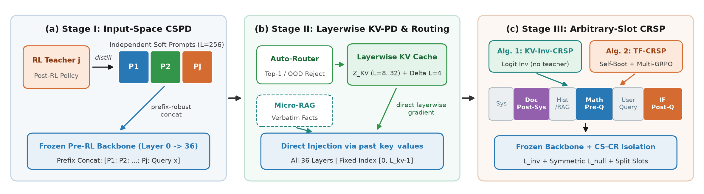
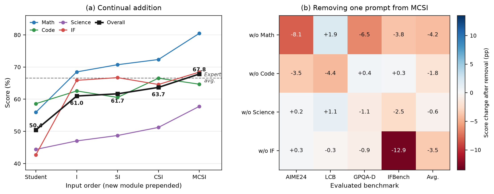
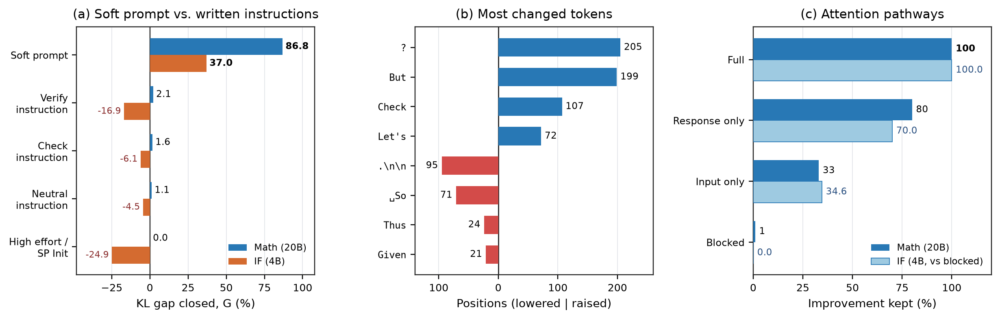
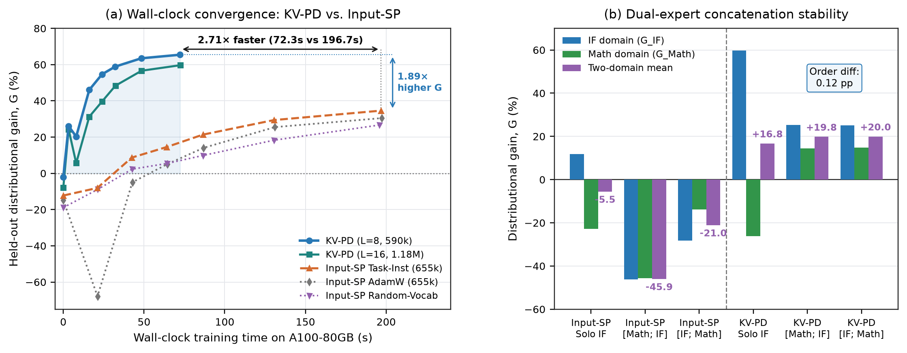
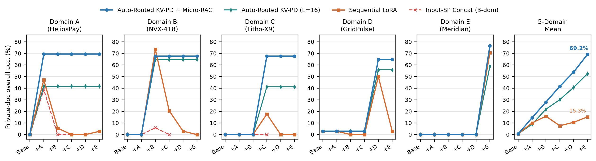
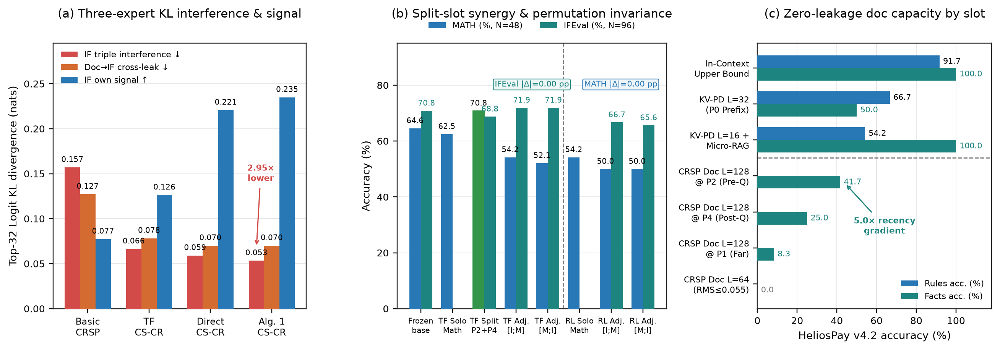
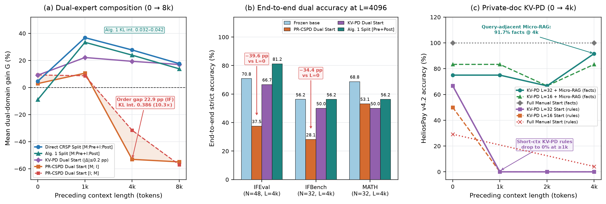

# 面向冻结大语言模型的模块化软提示蒸馏：输入空间、键值缓存与任意槽位组合

## 摘要

在不修改大语言模型主干参数的前提下，如何将多个独立训练的领域能力与私有知识模块化地保存在外部连续表示中，并同时满足自由增删、低干扰组合与长上下文稳定生效，是持续后训练面临的核心问题。本文通过跨模型、跨语境与跨长度的系统实验，考察了输入嵌入空间、逐层键值缓存空间与任意槽位输入空间三类外部参数化方案。实验结果表明，不存在适用于全部场景的单一软提示形态：外部模块应置于第 0 层输入嵌入还是逐层键值缓存、固定在序列起点还是随查询动态挂载、组合时直接拼接还是路由隔离，取决于任务类型（程序性推理策略与模型未在预训练中见过的私有文档知识）以及上下文长度。

针对上述问题，本文建立了一套递进式的三阶段模块化蒸馏框架。第一阶段评估输入空间可组合软提示蒸馏（`CSPD`）。该方法仅在冻结主干前端拼接少量输入软提示，即可在 7B–35B 模型上恢复大部分强化学习专家能力，并在域外通用能力保持与高并发吞吐上优于权重合并与 LoRA。但实验也暴露出三项局限：跨全网反向传播耗时较高、难以承载模型未在预训练中见过的私有文档规则，以及离开序列起点后（例如移至用户查询之后，或置于数千词元长上下文前端）因浅层注意力流失而出现性能下降甚至双专家失效。

机理分析表明，输入软提示主要通过回复生成阶段的响应侧注意力发挥作用。由此，第二阶段将可训练参数前移至全部层的键值缓存（`KV-PD`），并采用真实文本前向缓存初始化、完整轨迹过滤、轻量自动路由、短片段检索（`Micro-RAG`）与增量补丁。这一设计在同等步数下明显加快了蒸馏速度，并在五类合成私有文档上实现了无遗忘持续学习与版本更新；同时，程序性 `KV-PD` 在 8192 词元长上下文与全排列拼接下保持正向增益和顺序不变性。不过，`KV-PD` 的键张量受旋转位置编码约束而绑定于序列起点，无法插入长上下文中段，且短上下文训练的私有文档 `KV-PD` 在经过上千词元无关对话历史后，规则推理会失效。

为突破固定起点限制，第三阶段回归位置无关的输入空间，提出任意槽位软提示（`CRSP`），使其在不同上下文与挂载位置下保持稳定。该方法引入多槽语境随机化、一致性损失 $`\mathcal{L}_{\text{inv}}`$ 与非目标保持损失 $`\mathcal{L}_{\text{null}}`$，并提供两条构造路径：从已有 `KV-PD` 经输出分布逆向蒸馏（算法 1），以及无强化学习教师的两阶段构造（算法 2）。推理时，模块可随当前查询动态挂载于查询前或查询后，从而保持模块与生成起点的相对距离恒定。

结合 36 层因果通路消融、多专家注入顺序及服务化实验，本文得出四条主要结论。第一，**表示空间分工**：程序性策略适合由低幅值的输入空间 `CRSP` 分槽挂载（推理置于查询前，格式约束置于查询后）；信息密度高的私有文档则应由自动路由 `KV-PD` 处理多条件规则，并由紧邻查询的 `Micro-RAG` 补充精确常量。第二，**长上下文保持路径**：维持长程有效性的两条可行路径，分别是逐层 `KV-PD` 在深层保持较高注意力占比，以及滑动 `CRSP` 与 `Micro-RAG` 紧邻当前查询以避免距离退化。第三，**组合兼容性与注入顺序**：低幅值模块配合双向非目标保持与分槽布局可降低跨专家干扰并消除顺序敏感，而高幅值模块既不适合不经路由直接拼接，也不应放在长对话历史之前（序列起点或系统提示之后）。第四，**输出分布对齐与思维链校准**：仅对齐最终输出分布优于中间层几何或隐状态拟合，且完整轨迹过滤与两级压缩有助于提高有限预算内的完成率与准确率。结合仅在回复位置计算词表投影、虚拟词元导出以及解码阶段的虚拟词元输出屏蔽，本文最终给出了一套面向冻结主干的分层部署方案。全部实现、评测脚本与论文图表索引见仓库说明文档（[`README.md`](../README.md)）。

---

## 1. 引言

大语言模型的强化学习后训练与企业私有规范适配通常按单一领域独立进行。数学推理、代码生成、智能体交互与复杂指令遵循各自依赖不同的数据分布与验证器 [[1]](#ref-1)[[2]](#ref-2)，企业业务规章也需要随合规要求持续更新。理想的能力整合系统应当同时满足四项需求：（1）充分保留各领域专家的能力增量；（2）不损害已有领域性能与基座的通用域外能力；（3）新增或移除任一模块时，无需重新训练其他模块；（4）能够在包含系统人设、多轮对话与检索文档的长上下文中按需挂载，并支持低干扰的多专家组合。

现有的能力整合路线主要分为两类。权重空间方法（如任务算术 [[3]](#ref-3)、TIES 权重合并 [[4]](#ref-4) 与多教师同策略蒸馏 MOPD [[1]](#ref-1)）将多个专家写入同一套模型参数，每次新增能力都需重新整合，且修改主干权重容易引起遗忘和域外能力退化 [[5]](#ref-5)。低秩适配器（LoRA [[6]](#ref-6)）虽然保持各专家参数独立，但在多租户并发请求挂载不同适配器时，每层、每解码步都需执行额外的矩阵运算，从而降低吞吐并增加首词元延迟。

本文研究在**严格冻结主干参数**的条件下，将专精能力封装于外部连续表示的递进方案。围绕表示深度、参数幅值约束与挂载槽位三个设计维度，本文构建了三阶段统一框架（图 1）：

1. **阶段一（输入空间 `CSPD`）**：将强化学习专家独立蒸馏为前置输入词嵌入软提示，通过前缀鲁棒训练实现无需联合微调的直接拼接。实验在验证其跨模型泛化、域外保持与并发吞吐优势的同时，也定位了三项明确局限：跨全网反向传播耗时较高、未见私有文档直接拼接失效，以及离开序列起点后的槽位退化。
2. **阶段二（逐层键值空间 `KV-PD`）**：基于输入软提示主要经由各层响应侧注意力生效的发现，将可训练参数直接放到全部 Transformer 层的分组查询注意力键值缓存中，利用真实文本前向缓存初始化来省去跨层反向传播。面向未见私有文档持续学习，本文在 `KV-PD` 上引入了自动路由、`Micro-RAG` 常量检索与增量补丁。但受旋转位置编码（RoPE [[7]](#ref-7)）约束，`KV-PD` 的键张量绑定于序列起点索引，无法动态插入复杂长上下文中间。
3. **阶段三（任意槽位软提示 `CRSP`）**：重新回到位置无关的输入嵌入空间，针对六类常见部署位置引入多槽语境随机化、一致性损失与非目标保持损失。针对已有 `KV-PD` 但无原教师（算法 1），以及无教师、仅有验证器（算法 2）两类场景，分别设计了对应的构造算法，并与前两阶段一同在长上下文、多专家注入顺序和服务化部署下开展对比评测。



**图 1：三阶段模块化软提示蒸馏框架总览。** **(a)** 阶段一（`CSPD`）将强化学习专家蒸馏为输入嵌入向量并直接拼接；**(b)** 阶段二（`KV-PD`）以真实文本前向缓存初始化逐层键值参数，结合自动路由、`Micro-RAG` 与增量补丁支持私有文档持续学习；**(c)** 阶段三（`CRSP`）通过输出分布逆向蒸馏（算法 1）或无教师两阶段构造（算法 2），配合一致性与非目标保持约束，支持在系统提示后、查询前与查询后等任意位置组合。

本文的主要贡献如下：
- **统一的三阶段模块化方法**：在冻结主干上系统建立了从输入空间 `CSPD`、逐层键值空间 `KV-PD` 到任意槽位 `CRSP` 的方法体系，并给出了完整轨迹过滤、仅在回复位置计算词表投影、键值输出分布逆向蒸馏（算法 1）、无教师两阶段构造（算法 2）及任意槽位虚拟词元导出方案。
- **程序性策略与私有文档记忆的分工边界**：通过受控消融、五域合成私有文档持续学习与跨槽容量测试，定量分析了参数均方根幅值、数据规模和任务性质对直接拼接兼容性的影响，明确了低幅值 `CRSP` 与自动路由 `KV-PD + Micro-RAG` 的适用范围。
- **长上下文衰减机理与注入顺序规律**：在非重复真实长上下文中，结合同权重对照、逐层注意力统计、全部 36 层因果遮蔽消融及多专家全排列互换，分离了位置距离退化、注意力稀释与高幅值前置干扰三类原因，归纳了不同架构与槽位的顺序敏感规律。
- **训练与部署工程验证**：验证了回复位置输出投影的显存节省效果、虚拟词元导出的数值等价性、共享词嵌入模型上屏蔽虚拟词元采样的必要性，以及滑动槽位在多租户前缀缓存共享上的优势，总结出面向实际部署的选型矩阵。

---

## 2. 问题定义与方法

### 2.1 问题定义与三类外部参数化

设 $`f_{\theta_0}`$ 为包含 $`N_{\text{layer}}`$ 层、隐藏维度为 $`d`$、分组查询注意力（GQA）键值头数为 $`H_{\text{kv}}`$、单头维度为 $`d_h`$ 的自回归 Transformer 模型，其主干参数 $`\theta_0`$ 在全部训练与推理阶段保持冻结。给定用户查询 $`x = (x_1, \dots, x_m)`$、外部部署语境 $`\mathcal{C}`$（如系统提示、多轮对话历史或检索文本）与回复序列 $`y = (y_1, \dots, y_T)`$，冻结基座的条件生成分布记为 $`p_{\theta_0}(y_t \mid \mathcal{C}, x, y_{\lt t})`$。

针对由强化学习教师 $`f_{\theta_j}`$、私有规范文档或程序化验证器 $`R(x, y)`$ 定义的目标能力，本文考察三类外部连续参数 $`\psi`$ 及其注入方式 $`\mathcal{I}(\cdot; \psi)`$：
1. **起始位输入软提示（`CSPD`）**：$`\psi = \mathbf{P} \in \mathbb{R}^{L \times d}`$，固定拼接在序列起点：$`\mathbf{E}_{\text{in}} = [\mathbf{P};\, \text{Emb}(x)]`$。
2. **逐层键值缓存软提示（`KV-PD`）**：$`\psi = \mathbf{Z}_{\text{KV}} = \lbrace (\mathbf{K}^{(\ell)}, \mathbf{V}^{(\ell)})\rbrace_{\ell=1}^{N_{\text{layer}}}`$，其中 $`\mathbf{K}^{(\ell)}, \mathbf{V}^{(\ell)} \in \mathbb{R}^{L_{\text{kv}} \times H_{\text{kv}} \times d_h}`$，通过 `past_key_values` 注入全部注意力层前端。
3. **任意槽位输入软提示（`CRSP`）**：$`\psi = \mathbf{P} \in \mathbb{R}^{L \times d}`$ 仍位于第 0 层词嵌入空间，但按语境切分 $`\mathcal{C} = (\mathcal{C}_{\text{pre}}, \mathcal{C}_{\text{post}})`$ 动态插入指定槽位 $`s \in \mathcal{S}`$：

```math
\mathcal{I}_s(\mathcal{C}, x; \mathbf{P}) = \text{Concat}\big(\text{Emb}(\mathcal{C}_{\text{pre}}(s)),\, \mathbf{P},\, \text{Emb}(\mathcal{C}_{\text{post}}(s))\big) \qquad \text{(1)}
```

### 2.2 阶段一：输入空间可组合软提示蒸馏（CSPD）

核心蒸馏目标、完整轨迹过滤、确定性前缀切分与回复位置输出投影实现见 [`src/cspd_core.py`](../src/cspd_core.py)。

#### 蒸馏目标与完整轨迹过滤

给定领域 $`j`$ 的强化学习教师 $`p_{\theta_j}`$ 与轨迹数据集 $`\mathcal{D}_j`$，单专家软提示 $`\mathbf{P}_j`$ 根据教师监督形式采用两类训练目标。在大规模离线训练中，仅在教师生成的验证通过回复上最小化长度归一化负对数似然 [[8]](#ref-8)：

```math
\mathbf{P}_j^\star = \arg\min_{\mathbf{P}_j} \mathbb{E}_{(x,y) \sim \mathcal{D}_j} \left[ -\frac{1}{\lvert y \rvert} \sum_{t=1}^{\lvert y \rvert} \log p_{\theta_0}\big(y_t \mid \mathcal{I}(\mathbf{P}_j, x), y_{\lt t}\big) \right] \qquad \text{(2)}
```

当教师逐词元概率可离线缓存时，为了保留推理分叉点上的次优候选概率并控制存储开销，每步保留教师概率最高的 Top-$`K`$ 词元集合 $`\mathcal{V}_K(t)`$ 与剩余尾概率 $`r_j(t) = 1 - \sum_{v \in \mathcal{V}_K(t)} p_{\theta_j}(v \mid x, y_{\lt t})`$，构造 Rao-Blackwellized Top-$`K`$ 前向交叉熵损失：

```math
\mathcal{L}_{\text{RB-CE}}(\mathbf{P}_j) = \mathbb{E}_{(x,y) \sim \mathcal{D}_j} \left[ \frac{1}{\lvert y \rvert} \sum_{t=1}^{\lvert y \rvert} \left( -\sum_{v \in \mathcal{V}_K(t)} p_{\theta_j}(v \mid x, y_{\lt t}) \log p_{\theta_0,\mathbf{P}_j}(v \mid x, y_{\lt t}) - r_j(t) \log \Big(1 - \sum_{v \in \mathcal{V}_K(t)} p_{\theta_0,\mathbf{P}_j}(v \mid x, y_{\lt t})\Big) \right) \right] \qquad \text{(3)}
```

在固定轨迹分布下，式 (3) 与合并尾类空间上的精确前向 KL 散度等价。对于包含显式思考过程 `<think>...</think>` 的推理模型，本文引入**完整轨迹过滤**：仅保留包含单对完整思考标签、最终回答非空且以终止符（EOS，`<|im_end|>`）结束的轨迹，避免定长截断丢失思考结束与停止生成信号。

#### 前缀鲁棒训练、矩阵正交化更新与回复位置输出投影

在推理阶段组合 $`k`$ 个独立训练的专家时，直接沿序列长度维无分隔符拼接各嵌入矩阵 $`\mathbf{P}_{1:k} = [\mathbf{P}_1^\star; \dots; \mathbf{P}_k^\star]`$：

```math
p(y \mid x) = p_{\theta_0}\big(y \mid \mathcal{I}(\mathbf{P}_{1:k}, x)\big) \qquad \text{(4)}
```

为缓解拼接后其他专家带来的前置偏移，训练时以概率 $`p_{\text{pr}}`$ 在 $`\mathbf{P}_j`$ 前随机插入冻结文本前缀 $`\mathbf{F}`$（不计入损失，可按样本 SHA-256 哈希确定性切分以保证可重复性）：

```math
\tilde{\mathbf{E}}_{\text{in}} = \begin{cases} [\mathbf{F};\, \mathbf{P}_j;\, \text{Emb}(x)], & \text{以概率 } p_{\text{pr}} \\ [\mathbf{P}_j;\, \text{Emb}(x)], & \text{以概率 } 1 - p_{\text{pr}} \end{cases} \qquad \text{(5)}
```

优化器除 AdamW 外，本文还对比了矩阵正交化优化器 Muon [[9]](#ref-9)。该方法对动量矩阵 $`\mathbf{M}_t`$ 执行迭代 Newton-Schulz 近似极分解 $`\text{Orth}(\mathbf{M}_t) = \mathbf{U}\mathbf{V}^\top`$，更新规则如下：

```math
\mathbf{P}_{t+1} = \mathbf{P}_t - \eta \sqrt{\max\left(1, \frac{L}{d}\right)}\, \text{Orth}(\mathbf{M}_t) \qquad \text{(6)}
```

训练过程中同步监测参数偏移的有效秩（$`\exp(-\sum_i \tilde{\sigma}_i \log \tilde{\sigma}_i)`$）与单向量均方根范数（RMS）。在显存优化方面，处理长轨迹或长上下文时，先通过主干提取末层隐状态，再**仅在有监督的回复位置计算词表输出头（`lm_head`）投影**。该做法与全序列投影在数值上完全一致，但避免了为前置上下文实例化 $`[B, T_{\text{ctx}}, V]`$ 词表 logits，从而明显降低训练显存。

### 2.3 阶段二：逐层键值空间软提示蒸馏（KV-PD）

逐层键值缓存参数化、前缀缓存注入封装与增量补丁实现见 [`src/kv_prefix_core.py`](../src/kv_prefix_core.py)。

输入软提示虽然影响全部网络层的注意力计算，但反向传播必须经激活重计算串联回传至第 0 层，导致训练开销偏高。为此，`KV-PD` 直接将全部 $`N_{\text{layer}}`$ 层的 GQA 键值张量作为可训练参数：

```math
\mathbf{Z}_{\text{KV}} = \left\lbrace \big(\mathbf{K}^{(\ell)},\, \mathbf{V}^{(\ell)}\big) \right\rbrace_{\ell=1}^{N_{\text{layer}}}, \qquad \mathbf{K}^{(\ell)}, \mathbf{V}^{(\ell)} \in \mathbb{R}^{L_{\text{kv}} \times H_{\text{kv}} \times d_h} \qquad \text{(7)}
```

为了使初始参数符合冻结主干各层固有的键值分布尺度，采用**真实文本键值初始化**：选取长度为 $`L_{\text{kv}}`$ 的真实任务指令或规范文本 $`u`$，通过冻结主干前向推理一次，直接截取各层键值缓存作为初值：

```math
\mathbf{Z}_{\text{KV}}^{(0)} = \text{KV-Cache}\big(f_{\theta_0}(u)\big) \qquad \text{(8)}
```

训练与推理时，将 $`\mathbf{Z}_{\text{KV}}`$ 拼接于每层注意力键值序列前端：

```math
\text{Attn}^{(\ell)}(\mathbf{Q}_x^{(\ell)}) = \text{Softmax}\left(\frac{\mathbf{Q}_x^{(\ell)} \big[\mathbf{K}^{(\ell)};\, \mathbf{K}_x^{(\ell)}\big]^\top}{\sqrt{d_h}}\right) \big[\mathbf{V}^{(\ell)};\, \mathbf{V}_x^{(\ell)}\big] \qquad \text{(9)}
```

每层参数可直接接收本层注意力输出的一阶梯度，无需跨层反传至输入端；对于程序性推理专家，推理期可直接沿长度维拼接 $`[\mathbf{Z}_{\text{KV}}^{(1)}; \mathbf{Z}_{\text{KV}}^{(2)}]`$。

针对未在预训练中出现过的私有规范文档（同时包含多条件逻辑规则与精确常量事实），本文在 `KV-PD` 之上配套三项模块化机制（路由与版本更新实现见 [`src/exp5_doc_cl_stress_tests.py`](../src/exp5_doc_cl_stress_tests.py)，常量卡片定义见 [`src/domain_docs_extended.py`](../src/domain_docs_extended.py)）：
1. **自动路由与单域隔离**：直接复用冻结主干提取查询与各领域描述文本的末层均值语义向量，将语义余弦相似度与领域实体词元重合度加权求和，仅加载得分最高的单一目标领域缓存；当最高分低于域外拒答阈值时，判定为域外查询并回退至空缓存。新增领域仅需保存独立缓存与领域描述，删除对应文件即可移除该领域知识。
2. **`KV-PD` 与短片段检索（`Micro-RAG`）分工**：少量连续键值向量擅长编码多分支条件判断规则，但难以逐字记忆人名、版本号、精确数值阈值和错误码等任意字面常量。与传统检索增强生成（RAG）向提示中拼入数百至上千词元完整文档段落不同，**`Micro-RAG` 是一种仅面向常量事实的轻量短片段检索机制**：对每份私有文档预先抽取出不包含规则正文、仅记录核心常量键值对的极短事实卡片（长度仅为完整手册的约十分之一），或在长对话中按关键词仅匹配一至两条相关常量条目，并在推理时紧邻当前用户查询按需注入上下文。由此，`KV-PD` 专责执行多条件规则逻辑，`Micro-RAG` 负责精确常量查询，二者以极低上下文开销形成互补。
3. **增量补丁更新**：当旧版规则发生不兼容修订时，冻结旧版缓存 $`\mathbf{Z}_{\text{KV}}^{(v_{\text{old}})}`$（下式中 $`\text{sg}(\cdot)`$ 表示停止梯度操作），仅在末尾追加极短的增量键值 $`\Delta\mathbf{Z}_{\text{KV}}`$：

```math
\mathbf{Z}_{\text{KV}}^{(v_{\text{new}})} = \big[\text{sg}\big(\mathbf{Z}_{\text{KV}}^{(v_{\text{old}})}\big);\, \Delta\mathbf{Z}_{\text{KV}}\big] \qquad \text{(10)}
```

移除增量切片即可直接回滚至旧版本。但从结构上看，`KV-PD` 的键张量已应用绝对索引 $`[0, L_{\text{kv}}-1]`$ 的旋转位置编码，无法在不破坏相对位置关系或重算前置缓存的前提下动态插入长上下文中段。

### 2.4 阶段三：任意槽位软提示（CRSP）与部署导出

六类语义槽位的统一定义见 [`src/slot_positions.py`](../src/slot_positions.py)，多槽训练、算法 1、算法 2 与虚拟词元导出分别实现于 [`src/exp7_context_robust_sp.py`](../src/exp7_context_robust_sp.py)、[`src/exp8_kv_inversion_and_tf_cr_sp.py`](../src/exp8_kv_inversion_and_tf_cr_sp.py)、[`src/exp9_multiseed_cr_grpo_and_composition.py`](../src/exp9_multiseed_cr_grpo_and_composition.py) 与 [`src/virtual_tokens_export.py`](../src/virtual_tokens_export.py)。

#### 六类挂载槽位与训练目标

为了兼具输入嵌入的位置灵活性与复杂语境下的稳定性，本文将实际推理中的挂载位置划分为六类语义槽位 $`\mathcal{S}`$：
- **序列起点**（`start`）：无前置上下文，位于最前端 $`[\mathbf{P}; x]`$；
- **系统提示后**（`post_system`）：置于系统人设之后、对话历史之前 $`[\mathcal{C}_{\text{sys}}; \mathbf{P}; x]`$；
- **查询前**（`pre_query`）：置于多轮对话历史之后、当前查询之前 $`[\mathcal{C}_{\text{sys}}; \mathcal{C}_{\text{hist}}; \mathbf{P}; x]`$；
- **检索后**（`post_rag`）：置于检索文档片段之后、当前查询之前 $`[\mathcal{C}_{\text{sys}}; \mathcal{C}_{\text{rag}}; \mathbf{P}; x]`$；
- **查询后**（`post_query`）：置于当前用户查询之后、模型回复之前 $`[\mathcal{C}_{\text{sys}}; \mathcal{C}_{\text{hist}}; x; \mathbf{P}]`$；
- **长偏移后**（`long_offset`）：置于组合长上下文（系统提示、多轮历史与检索文本，长度超千词元）之后、查询之前。

传统前置软提示离开序列起点后性能下降，主要源于前置真实语义文本稀释注意力、查询后位置中查询先于软提示出现导致因果顺序变化，以及训练中缺少跨槽位一致性约束。

`CRSP` 在每步训练中从覆盖全部槽位的分布 $`q_{\text{slot}}`$ 采样 $`(s, \mathcal{C})`$，以真实任务词元初始化 $`\mathbf{P}`$，每步施加单向量均方根范数裁剪 $`\text{RMS}(\mathbf{p}_i) \le \rho_{\max}`$，并联合优化两项约束：（1）**一致性损失 $`\mathcal{L}_{\text{inv}}`$**，令非起始槽位的输出分布对齐无前置语境时的参考分布（记为空语境 $`\varnothing`$，计算损失时对其停止梯度反传）；（2）**组合安全训练**，在其他未占用槽位注入随机占位向量模拟多专家共存，并加入**非目标保持损失 $`\mathcal{L}_{\text{null}}`$**，约束专家 $`\mathbf{P}^{(k)}`$ 在非目标领域 $`\mathcal{D}_{\neg k}`$ 上保持冻结基座的原始分布：

```math
\mathcal{L}_{\text{inv}}(\mathbf{P}) = \mathbb{E}_{(x,y),\, (s,\mathcal{C}) \sim q_{\text{slot}}} \left[ \frac{1}{T} \sum_{t=1}^{T} D_{\text{KL}}\Big( \text{sg}\big[p_{\theta_0,\mathbf{P}}(\cdot \mid \varnothing, x, y_{\lt t})\big] \, \Big\Vert \, p_{\theta_0,\mathbf{P}}(\cdot \mid s, \mathcal{C}, x, y_{\lt t}) \Big) \right] \qquad \text{(11)}
```

```math
\mathcal{L}_{\text{null}}\big(\mathbf{P}^{(k)}\big) = \mathbb{E}_{(x,y) \sim \mathcal{D}_{\neg k},\, (s,\mathcal{C}) \sim q_{\text{slot}}} \left[ \frac{1}{T} \sum_{t=1}^{T} D_{\text{KL}}\Big( \text{sg}\big[p_{\theta_0}(\cdot \mid \mathcal{C}, x, y_{\lt t})\big] \, \Big\Vert \, p_{\theta_0,\mathbf{P}^{(k)}}(\cdot \mid s, \mathcal{C}, x, y_{\lt t}) \Big) \right] \qquad \text{(12)}
```

由此得到组合安全训练的统一离线目标 $`\mathcal{L}_{\text{safe}}`$，其中 $`\mathcal{L}_{\text{task}}^{\text{co}}`$ 表示加入共存占位向量后的任务蒸馏损失（有原教师直接蒸馏时采用式 (3) 的 $`\mathcal{L}_{\text{RB-CE}}`$）：

```math
\mathcal{L}_{\text{safe}}\big(\mathbf{P}^{(k)}\big) = \mathcal{L}_{\text{task}}^{\text{co}}\big(\mathbf{P}^{(k)}\big) + \lambda_{\text{inv}}\, \mathcal{L}_{\text{inv}}\big(\mathbf{P}^{(k)}\big) + \lambda_{\text{null}}\, \mathcal{L}_{\text{null}}\big(\mathbf{P}^{(k)}\big) \qquad \text{(13)}
```

#### 两条无原教师构造路径（算法 1 与算法 2）

1. **路径一：基于输出分布的键值逆向蒸馏（算法 1，`KV-Inv-CRSP`）**。当系统仅保留已归档的前置 `KV-PD` 模块 $`\mathbf{Z}_{\text{KV}}`$ 而无法访问原强化学习教师时，若直接对各层键值张量做最小二乘几何拟合（式 (14)），会因逐层独立优化得到的 $`\mathbf{Z}_{\text{KV}}`$ 超出第 0 层前向传播的可达集合而失效：

```math
\min_{\mathbf{P}} \frac{1}{N_{\text{layer}}} \sum_{\ell=1}^{N_{\text{layer}}} \left( \frac{\Vert \mathbf{K}^{(\ell)}(\mathbf{P}) - \mathbf{K}_{\text{tgt}}^{(\ell)}\Vert_F^2}{\Vert \mathbf{K}_{\text{tgt}}^{(\ell)}\Vert_F^2} + \frac{\Vert \mathbf{V}^{(\ell)}(\mathbf{P}) - \mathbf{V}_{\text{tgt}}^{(\ell)}\Vert_F^2}{\Vert \mathbf{V}_{\text{tgt}}^{(\ell)}\Vert_F^2} \right) \qquad \text{(14)}
```

算法 1 改用**仅对齐最终输出分布**的策略：先在序列起点挂载 $`\mathbf{Z}_{\text{KV}}`$ 驱动冻结主干在无标注提示上生成完整轨迹并缓存 Top-$`K`$ 分布 $`p_{\theta_0,\mathbf{Z}_{\text{KV}}}(\cdot \mid \varnothing)`$，再在多槽位上最小化式 (15)。该方法默认不加入中间层隐状态对齐项（$`\lambda_{\text{feat}}=0`$），以免破坏外部语境在中间层的正常语义表示：

```math
\mathcal{L}_{\text{KV-Inv}}(\mathbf{P}) = \mathbb{E}_{(s,\mathcal{C}) \sim q_{\text{slot}}} \Big[ \mathcal{L}_{\text{RB-CE}}\big(p_{\theta_0,\mathbf{P}}(\cdot \mid s,\mathcal{C}) \, \Vert \, p_{\theta_0,\mathbf{Z}_{\text{KV}}}(\cdot \mid \varnothing)\big) \Big] + \lambda_{\text{inv}}\, \mathcal{L}_{\text{inv}}(\mathbf{P}) \qquad \text{(15)}
```

```text
Algorithm 1: 基于输出分布的键值逆向蒸馏（KV-Inv-CRSP）
输入: 冻结主干 f_{θ0}, 源前置键值缓存 Z_KV, 无标注提示集 X, 槽位分布 q_slot,
      向量数 L, 均方根范数上限 ρ_max, 权重 λ_inv, λ_null
输出: 任意槽位软提示 P* ∈ R^{L × d}

1:  在序列起点挂载 Z_KV 驱动 f_{θ0} 对 X 生成或重打分轨迹，缓存每步 Top-K 分布 p_{θ0, Z_KV}(· | ∅)
2:  用任务相关的真实词元嵌入初始化 P ∈ R^{L × d}
3:  for step = 1, ..., T_opt do
4:      采样小批量轨迹 (x, y) 与语境槽位 (s, C) ~ q_slot
5:      计算无语境起点参考分布 p_ref = sg[p_{θ0,P}(· | ∅)] 与当前语境分布 p_ctx = p_{θ0,P}(· | s, C)
6:      计算式 (15) 损失，按需加入共存占位向量与非目标保持损失 λ_null · L_null(P)
7:      反向传播更新 P，并对每行裁剪: p_i ← p_i · min(1, ρ_max / RMS(p_i))
8:  end for
9:  return P*
```

2. **路径二：无强化学习教师的两阶段构造（算法 2，`Two-Stage TF-CRSP`）**。当仅有冻结基座 $`f_{\theta_0}`$ 与程序化验证器 $`R(x, y) \in [0, 1]`$ 时，先由基座多次采样并筛选通过轨迹 $`\mathcal{D}_{\text{win}}`$，执行带基座 KL 约束的多槽自举热启动（式 (16)）；随后以热启动结果 $`\mathbf{P}_{\text{S1}}`$ 作为初值和参考策略 $`\pi_{\text{ref}}`$，开展多槽在线组相对策略优化 GRPO [[10]](#ref-10)（式 (17)）：

```math
\mathcal{L}_{\text{Stage1}}(\mathbf{P}) = \mathbb{E}_{(x,y)\sim\mathcal{D}_{\text{win}},\, (s,\mathcal{C})\sim q_{\text{slot}}}\Big[\mathcal{L}_{\text{NLL}}(\mathbf{P}; s,\mathcal{C}) + \beta_{\text{base}}\, D_{\text{KL}}\big(p_{\theta_0}(\cdot \mid s,\mathcal{C}) \, \Vert \, p_{\theta_0,\mathbf{P}}(\cdot \mid s,\mathcal{C})\big)\Big] + \lambda_{\text{inv}}\, \mathcal{L}_{\text{inv}}(\mathbf{P}) \qquad \text{(16)}
```

```math
\mathcal{L}_{\text{Stage2}}(\mathbf{P}) = -\mathbb{E}_{(s,\mathcal{C}),\, \lbrace y_i\rbrace_{i=1}^G} \left[ \frac{1}{G} \sum_{i=1}^{G} \frac{1}{\lvert y_i \rvert} \sum_{t=1}^{\lvert y_i \rvert} \min\Big( r_{i,t} \hat{A}_i,\, \text{clip}(r_{i,t}, 1-\epsilon, 1+\epsilon)\hat{A}_i \Big) - \beta_{\text{kl}}\, D_{\text{KL}}\big(p_{\theta_0,\mathbf{P}} \, \Vert \, \pi_{\text{ref}}\big) \right] \qquad \text{(17)}
```

其中 $`\mathcal{L}_{\text{NLL}}`$ 为负对数似然损失，组内优势 $`\hat{A}_i = (R_i - \bar{R})/(\sigma_R + \delta)`$（$`\delta`$ 为数值稳定常数），重要性比率 $`r_{i,t} = p_{\theta_0,\mathbf{P}}(y_{i,t} \mid s,\mathcal{C}, x, y_{i,\lt t}) / p_{\theta_0,\mathbf{P}_{\text{old}}}(y_{i,t} \mid s,\mathcal{C}, x, y_{i,\lt t})`$。在线优化时，策略模型与参考策略 $`\pi_{\text{ref}}`$ 必须接收完全相同的语境和占位向量，防止参考分布错位。

```text
Algorithm 2: 无强化学习教师的两阶段 CRSP 构造（Two-Stage TF-CRSP）
输入: 冻结基座 f_{θ0}, 训练集 X, 验证器 R(x, y), 槽位分布 q_slot,
      组采样数 G, 裁剪阈值 ε, 权重 β_base, β_kl, λ_inv, 范数上限 ρ_max
输出: 任意槽位软提示 P* ∈ R^{L × d}

1:  用 f_{θ0} 对 X 采样多路回复，筛选满足 R(x, y)=1 的轨迹集 D_win
2:  最小化式 (16) 并每步裁剪范数 ρ_max，得到热启动参数 P_S1
3:  令 P ← P_S1，固定参考策略 π_ref ← p_{θ0, P_S1}
4:  for step = 1, ..., T_rl do
5:      采样提示 x 与槽位 (s, C) ~ q_slot，在相同输入下采样 G 条轨迹 {y_i}
6:      通过验证器计算奖励 R_i 与组内优势 Â_i，按式 (17) 更新 P 并裁剪 ρ_max
7:  end for
8:  return P*
```

#### 虚拟词元导出与解码输出屏蔽

为了让 `CSPD` 与 `CRSP` 直接运行在标准词元 ID 推理引擎（如 SGLang、vLLM）上而无需改动推理内核，本文将软提示矩阵追加到派生 `safetensors` 权重的 `model.embed_tokens.weight` 末尾（其余权重分片通过符号链接复用，并做 SHA-256 校验），推理时只需将对应的连续虚拟词元 ID 插入目标槽位（如序列起点、系统提示后、查询前或查询后）。需要注意的是，在输入与输出词嵌入共享权重（tied embeddings）的模型（如 Qwen3 [[11]](#ref-11)）上，追加的高幅值虚拟词元行同时会充当输出投影行，可能在解码时被意外采样出来。因此，推理引擎必须在采样阶段屏蔽所有虚拟词元与词表填充位（例如将对应 logit 偏置设为 $`-10^9`$，或通过词表白名单仅允许采样原始词表）。在多专家布局上，本文区分**分槽插入**（如数学置于查询前、指令遵循置于查询后）与**同槽拼接**（如两模块在查询前相邻拼接）。由于查询前与查询后位于系统提示、历史对话与检索文本之后，不同专家组合的并发请求可在前缀缓存树（如 RadixAttention）中共享前置长上下文的 KV 缓存。

---

## 3. 实验设置与评测协议

### 3.1 统一评估指标

除各基准的绝对准确率外，本文使用三项相对指标评估能力恢复与内部机理：
1. **教师增益恢复率（Recovery, $`R`$）**：记基座、教师与挂载模块模型的得分分别为 $`A_S`$、$`A_T`$ 与 $`A_{S+P}`$（$`A_T \gt A_S`$）：

```math
R = \frac{A_{S+P} - A_S}{A_T - A_S} \times 100\% \qquad \text{(18)}
```

2. **留出分布对齐增益（Distributional Alignment Gain, $`G`$）**：在固定留出轨迹和相同测试语境下，记基座与候选模型 $`A`$ 相对目标教师 $`T`$ 的前向 KL 散度分别为 $`D_{\text{KL}}(T \Vert S)`$ 与 $`D_{\text{KL}}(T \Vert A)`$：

```math
G(A) = \left(1 - \frac{D_{\text{KL}}(T \Vert A)}{D_{\text{KL}}(T \Vert S)}\right) \times 100\% \qquad \text{(19)}
```

多槽位评测中，在指定槽位语境下计算的对齐增益记为同语境增益 $`G_{\text{ctx}}`$；同一模块在目标槽位与无语境起点之间的输出分布 KL 散度记为跨位置漂移 $`D_{\text{drift}}`$（越低表示跨位置越稳定）。

3. **注意力路径增益保留率（Improvement Kept, $`K`$）**：在因果注意力掩码消融中，记全路径模型为 $`S+P`$、对照基线为 $`B`$（基座或全屏蔽状态），受限路径 $`A`$ 保留的改善比例定义为：

```math
K(A) = \frac{D_{\text{KL}}(T \Vert B) - D_{\text{KL}}(T \Vert A)}{D_{\text{KL}}(T \Vert B) - D_{\text{KL}}(T \Vert S+P)} \times 100\% \qquad \text{(20)}
```

### 3.2 模型与四组评测基准

评测解析器与私有文档数据集分别实现于 [`src/benchmarks.py`](../src/benchmarks.py) 与 [`src/domain_docs_extended.py`](../src/domain_docs_extended.py)，全部 15 张论文图表由 [`src/plot_paper_style_figures.py`](../src/plot_paper_style_figures.py) 从已归档的实验 JSON 直接生成。

1. **跨架构单专家与四域组合基准**：单专家实验涵盖 7B 至 35B 参数规模的 23 组稠密与混合专家（MoE）公开模型对（256 向量软提示）。其余受控实验均在 36 层 Qwen3-4B [[11]](#ref-11) 主干 `M2RL-SFT` [[1]](#ref-1)（原生上下文窗口 32,768 词元）上完成。四域组合基准包括数学（AIME24）、代码（LiveCodeBench v5 [[12]](#ref-12)）、科学（GPQA-Diamond [[13]](#ref-13)）与指令遵循（下简称 IF，基准为 IFBench [[14]](#ref-14)）四个强化学习教师（200 步 Muon，128–256 随机前缀）及六项域外基准（XSTest [[15]](#ref-15)、TruthfulQA [[16]](#ref-16)、BFCL [[17]](#ref-17)、TriviaQA [[18]](#ref-18)、BBEH [[19]](#ref-19)、FinQA [[20]](#ref-20)）。受控消融在单卡 A100-80GB 或 RTX PRO 6000 Blackwell 上采用 Top-64 前向散度（45 或 60 步，对比 512 词元截断轨迹与完整 `</think>` + EOS 轨迹），评测留出 `IFEval`（$`N=48/96`$）、`IFBench`（$`N=32/40/64`$）与 `MATH` [[21]](#ref-21)（$`N=32/48`$）。除严格通过率外，同时统计最大生成预算内正常结束思考并给出最终答案的样本比例（完成率）及其条件准确率（完成准确率）。
2. **五域合成私有文档持续学习基准**：构建五个完全合成、基座模型未在预训练中见过的企业规范域——`HeliosPay v4.2`（含不兼容升级版 `v5.0`）、`NVX-418`、`Litho-X9`、`GridPulse-9` 与 `Meridian-C3`，共含 172 道域内多条件规则与常量事实题以及 24 道域外拒答题。
3. **六槽位鲁棒性与三专家分槽并发基准**：在六类语义槽位（含 420 词元无关检索文档的检索后槽位与超千词元历史的长偏移后槽位）上评测同语境增益 $`G_{\text{ctx}}`$、跨位置漂移 $`D_{\text{drift}}`$、三随机种子（42、108、202）收敛方差，以及三专家分槽并发（文档置于系统提示后、数学置于查询前、指令遵循置于查询后）的 Top-32 跨专家干扰矩阵与端到端准确率。
4. **长上下文（0 → 8192）、注入顺序与部署基准**：从 `Salesforce/wikitext` 抽取 126 段不重复文本并结合多轮对话历史，构造 $`L_{\text{ctx}} \in \lbrace 0, 512, 1024, 2048, 4096, 8192\rbrace`$ 测试集，测定单、双、四专家衰减、9 层注意力占比、全部 36 层直接响应通路遮蔽消融、双专家分槽与同槽互换、三专家全部 $`3!=6`$ 种排列，以及回复位置投影显存与虚拟词元导出等价性。

---

## 4. 阶段一实验：输入空间 CSPD 的能力与局限

本节受控消融与机理分析脚本见 [`src/exp1b_cspd_final.py`](../src/exp1b_cspd_final.py) 与 [`src/exp2b_doc_nll_cl.py`](../src/exp2b_doc_nll_cl.py)。

### 4.1 单专家泛化、四域组合与推理效率

表 1 给出了 256 向量输入软提示在 23 组公开模型对上的单专家结果，覆盖数学推理、代码生成、软件工程与终端智能体。在 23 组评测中，有 22 组恢复了至少 90% 的教师增益，15 组达到或超过原教师（多步智能体中 6 组有 5 组超过教师）。在 `GPT-OSS-Swallow-20B` 上的消融进一步显示：（1）软提示长度取 2/8/32/256/512 时，恢复率分别为 51.23%、74.11%、90.01%、93.10% 与 87.83%，32 个向量已能获取大部分收益；（2）在相近参数量下，软提示（737k 参数，96.06%）与 5 秩 K/V LoRA（814k 参数，95.72%）表现接近，且训练集中混入 31% 错误轨迹时仍可保持 90.54% 的恢复率。

| 强化学习前基座模型 | 强化学习专家教师 | 参考 | 基座得分 | 教师得分 | 软提示得分 | 恢复率 $`R`$ (%) |
| :--- | :--- | :---: | :---: | :---: | :---: | :---: |
| *(a) 数学推理（AIME / MATH / AMC / HMMT）* | | | | | | |
| MiMo-7B-SFT | MiMo-7B-RL | [[22]](#ref-22) | 63.77 | 73.18 | 72.25 | 90.15 |
| GPT-OSS-Swallow-20B-SFT | GPT-OSS-Swallow-20B-RL | [[23]](#ref-23) | 76.53 | 90.21 | 89.67 | 96.06 |
| Qwen3-Swallow-8B-SFT | Qwen3-Swallow-8B-RL | [[24]](#ref-24) | 63.68 | 83.01 | 82.28 | 96.22 |
| OLMo-3-7B-Instruct-DPO | OLMo-3-7B-Instruct | [[25]](#ref-25) | 42.97 | 60.72 | 60.13 | 96.70 |
| Nemotron-Cascade-8B-SFT | Nemotron-Cascade-8B-MathRL | [[26]](#ref-26) | 85.25 | 89.34 | 89.30 | 99.18 |
| Qwen3-Swallow-30B-A3B-SFT | Qwen3-Swallow-30B-A3B-RL | [[24]](#ref-24) | 72.91 | 86.25 | 86.23 | 99.79 |
| Eurus-2-7B-SFT | Eurus-2-7B-PRIME | [[27]](#ref-27) | 36.06 | 49.63 | 49.91 | 102.07 |
| INTELLECT-MATH-SFT | INTELLECT-MATH | [[28]](#ref-28) | 45.47 | 54.11 | 54.62 | 105.89 |
| Poro-2-8B-Long-Math-SFT | Poro-2-8B-Long-Math-RL | [[29]](#ref-29) | 68.34 | 72.43 | 73.88 | 135.47 |
| Klear-Reasoner-8B-SFT | Klear-Reasoner-8B | [[30]](#ref-30) | 62.15 | 65.00 | 66.11 | 139.02 |
| *(b) 代码生成（LiveCodeBench）* | | | | | | |
| MiMo-7B-SFT | MiMo-7B-RL（代理数据） | [[22]](#ref-22) | 50.17 | 52.87 | 52.55 | 88.08 |
| Nemotron-Cascade-8B-SFT | Nemotron-Cascade-8B-CodeRL | [[26]](#ref-26) | 55.73 | 69.39 | 69.56 | 101.21 |
| Klear-Reasoner-8B-SFT | Klear-Reasoner-8B | [[30]](#ref-30) | 53.44 | 57.27 | 57.34 | 101.83 |
| Qwen3-14B | AReaL-boba-2-14B-Open | [[31]](#ref-31) | 64.86 | 68.06 | 68.14 | 102.38 |
| Mellum2-12B-A2.5B-SFT | Mellum2-12B-A2.5B-Instruct | [[32]](#ref-32) | 36.30 | 39.05 | 39.34 | 110.34 |
| Qwen3-8B | AReaL-boba-2-8B-Open | [[31]](#ref-31) | 58.54 | 62.20 | 62.96 | 120.83 |
| OLMo-3-7B-Instruct-DPO | OLMo-3-7B-Instruct | [[25]](#ref-25) | 28.50 | 34.10 | 36.54 | 143.44 |
| *(c) 软件工程智能体（SWE-bench Verified，500 任务）* | | | | | | |
| Nemotron-Cascade-8B-SFT | Nemotron-Cascade-8B | [[26]](#ref-26) | 23.60 | 34.60 | 33.75 | 92.27 |
| Qwen3-32B | DeepSWE-Preview | [[33]](#ref-33) | 24.90 | 44.05 | 45.65 | 108.36 |
| Qwen3.5-35B-A3B | Lego-RL-35B-A3B | [[34]](#ref-34) | 64.00 | 70.40 | 72.25 | 128.91 |
| SWE-Gym-OpenHands-7B | SkyRL-Agent-7b-v0 | [[35]](#ref-35) | 11.40 | 12.80 | 13.60 | 157.14 |
| *(d) 终端交互智能体（Terminal-Bench 2.1，89 任务）* | | | | | | |
| Qwen3.5-9B | TMax-9B | [[36]](#ref-36) | 20.22 | 28.09 | 29.96 | 123.81 |
| Qwen3.6-27B | TMax-27B | [[36]](#ref-36) | 43.45 | 46.07 | 48.69 | 200.00 |

**表 1：23 组公开数学、代码与智能体强化学习专家的单专家输入软提示蒸馏结果（百分比）。**

在 `M2RL-SFT` 四域组合实验中（表 2），以下用 M、C、S、I 分别简记数学、代码、科学与指令遵循四个独立软提示模块，按从前到后拼接顺序记为 `MCSI`（逆序记为 `ISCM`）。直接拼接四域软提示（`MCSI`）将基座均值由 50.41 提升至 **67.83**（恢复率 107.5%），与全模型联合重训的 MOPD（67.79）持平，并高于全部权重合并与 LoRA 合并基线（65.50–67.47）。将拼接顺序完全反转（`ISCM`）后仍达 **67.72**（差值仅 **0.11 个百分点**，下记为 pp），且在 GPQA-Diamond 上带来 +8.53 pp 的跨领域提升。若去掉前缀鲁棒训练，AdamW 组合均值由 66.60 降至 64.50。

| 适配方法 | 表示空间 | AIME24 | LiveCodeBench v5 | GPQA-Diamond | IFBench | 四域均值 | 恢复率 (%) |
| :--- | :--- | :---: | :---: | :---: | :---: | :---: | :---: |
| 冻结基座（无提示） | — | 55.94 | 58.61 | 44.38 | 42.71 | 50.41 | 0.0 |
| 独立领域专家（理想路由上界） | 全模型（4 份） | 81.77 | 66.92 | 50.44 | 67.33 | 66.61 | 100.0 |
| Task Arithmetic（TA，$`\lambda=1.0`$） / TIES | 全模型权重 | 78.85 / 81.25 | 64.52 / 65.42 | 54.14 / 57.07 | **71.58** / 66.12 | 67.27 / 67.47 | 104.1 / 105.2 |
| 多教师同策略蒸馏（MOPD） | 全模型权重 | **83.28** | **66.24** | 55.21 | 66.42 | 67.79 | 107.2 |
| LoRA 蒸馏 + TA / TIES | LoRA 权重 | 80.21 / 81.41 | 63.10 / 64.00 | 56.22 / 56.66 | 62.46 / 62.67 | 65.50 / 66.19 | 93.1 / 97.3 |
| 单域软提示（理想单域挂载） | 输入软提示 | 80.89 | 64.67 | 49.24 | 66.71 | 65.38 | 92.4 |
| `CSPD` 无前缀鲁棒（AdamW，ISCM） | 输入软提示 | 76.98 | 64.15 | 51.89 | 65.00 | 64.50 | 87.0 |
| `CSPD`（AdamW，ISCM） | 输入软提示 | 79.74 | 65.94 | 55.78 | 64.96 | 66.60 | 99.9 |
| `CSPD`（Muon，ISCM） | 输入软提示 | 79.90 | 65.72 | **57.92** | 67.33 | 67.72 | 106.8 |
| **`CSPD`（Muon，MCSI）** | **输入软提示** | 80.47 | 64.67 | 57.77 | 68.42 | **67.83** | **107.5** |

**表 2：`M2RL-SFT` 四领域多专家组合与权重、LoRA 整合基线对比（百分比）。** M、C、S、I 依次表示数学、代码、科学与指令遵循模块。

持续扩展实验验证了独立软提示的增删特性（图 2、图 3）。按顺序逐一前置添加（基座 → I → SI → CSI → MCSI）使四域均值单调上升（50.4 → 61.0 → 61.7 → 63.7 → 67.8%）；改为后置追加（基座 → I → IS → ISC → ISCM）同样单调上升（50.41 → 60.99 → 62.29 → 63.58 → 67.72%；最终四域得分分别为 79.90%、65.72%、57.92%、67.33%）。在 `MCSI` 和 `ISCM` 上逐一移除任一模块均使均值下降（`ISCM` 留一移除 M/C/S/I 分别变化 -4.14/-0.25/-0.47/-3.30 pp）。相比之下，渐进软提示训练 [[37]](#ref-37) 削弱了最早加入的指令遵循能力（IFBench 降至 50.9%–61.4%），而 TIES 权重合并在仅合并指令遵循专家时就使代码基准从 58.61% 降至 52.69%。



**图 2：持续添加与留一移除实验。** **(a)** 独立软提示按指令、科学、代码、数学依次前置拼接使四域均值单调增至 67.8%，无需重训已有模块；**(b)** 从 `MCSI` 中逐一移除模块后的得分变化（pp），各模块均贡献正向增益。


**图 3：独立软提示、渐进软提示与 TIES 权重合并的持续扩展对比。** 独立软提示在各阶段均值均高于另外两种方法，并避免了 TIES 在代码任务上的遗忘现象。

由于主干参数保持冻结，四域 `CSPD` 在六个域外通用基准上取得最高均值 **56.6**（表 3，高出 MOPD 3.1 分），在 TruthfulQA 上几乎未下降（-0.4，对比 MOPD 为 -3.6）。在服务吞吐方面，软提示仅增加少量预填充词元而不改动解码线性层：在单卡 B200（SGLang，BF16 `GPT-OSS-20B`，每并发请求挂载不同适配器）上，32 并发吞吐维持在原模型 0.8% 以内（715.4 vs. 721.3 tokens/s），为 4 秩 LoRA（298.5 tokens/s）的 **2.40 倍**，P95 首词元延迟降低 **2.27 倍**（17.26 vs. 39.21 s），且对投机解码草稿模型影响很小（EAGLE-3 [[38]](#ref-38) 接受长度 -2.6%，DFlash [[39]](#ref-39) -4.7%，图 4）。

| 方法 | XSTest | TruthfulQA | BFCL | TriviaQA | BBEH | FinQA | 六基准均值 |
| :--- | :---: | :---: | :---: | :---: | :---: | :---: | :---: |
| 冻结基座（无提示） | 80.4 | **64.6** | 47.6 | 31.5 | 11.1 | 66.3 | 50.3 |
| TIES / MOPD | 82.4 / 84.2 | 63.7 / 61.0 | 48.5 / 49.4 | **33.6** / 31.9 | 25.6 / 23.9 | 70.9 / 70.8 | 54.1 / 53.5 |
| LoRA 蒸馏 + TA（$`\lambda=0.5`$） | 85.1 | 63.8 | 47.5 | 32.7 | 23.0 | 70.9 | 53.8 |
| **`CSPD`（MCSI 四域拼接）** | **88.2** (+7.8) | 64.2 (-0.4) | **55.6** (+8.0) | 33.5 (+2.0) | **25.8** (+14.7) | **72.5** (+6.2) | **56.6** (+6.4) |

**表 3：六个域外通用基准得分对比（百分比，括号内为相对冻结基座的变化量）。**


**图 4：单卡 B200（SGLang）上每请求独立适配器的并发推理性能。** 在 1 至 32 并发下，256 向量软提示吞吐始终位于原模型 $`\pm 1.5\%`$ 范围内；32 并发时输出吞吐达到 4 秩 LoRA 的 2.40 倍，P95 首词元延迟降低 2.27 倍。

### 4.2 作用机理与局限性分析

跨 20B 数学与 4B 指令遵循的机理实验（图 5）呈现出三项特征：（1）软提示并非对应可读的自然语言词元，84%–100% 的向量仍以初始化词元为最近邻，但中位余弦相似度降至 0.16–0.34；（2）其分布校准幅度远高于等价的自然语言指令（20B 缩减 86.8% KL，显式指令 $`\le 2.1\%`$；4B 提升 +37.01%，显式指令为负增益），主要体现在提高 `?`、`But`、`Check` 等反思核查词概率并降低 `.\n\n`、`Thus` 等过早总结词概率；（3）因果注意力掩码消融表明，**软提示主要通过生成阶段的响应侧直接注意力起作用**——仅允许回复词元关注软提示（Response only）即可在 20B 与 4B 上分别保留 **80%** 与 **70.0%** 的改善，而阻断回复侧注意力（Input only）分别降至 33% 与 0.84%。



**图 5：输入空间软提示的作用机理。** **(a)** 软提示与显式自然语言指令的分布对齐增益 $`G`$；**(b)** 20B 数学轨迹中概率变化最大的前 4 类词元；**(c)** 因果注意力掩码消融下的路径增益保留率 $`K`$，表明增益主要来自响应侧直接注意力。

尽管如此，进一步的消融与压力测试暴露出输入空间 `CSPD` 的三项局限，这也是后续引入第二与第三阶段的直接原因：
1. **跨层反向传播耗时高，且短预算下对范数与初始化敏感（引出第 5 节 `KV-PD`）**。输入软提示需经全部 36 层反向传播至第 0 层，在单卡 A100 上 45 步即耗时约 196 秒，且效果高度依赖初始化方式（任务指令 +34.59%、随机词表 +26.66%、高斯 +7.45%）与截断长度（256 词元截断降至 -57.63%）。在 60 步双域受控实验中，前缀鲁棒训练虽将顺序差降低 **3.57 倍**（20.05 → 5.61 pp），但短预算无裁剪 Muon（RMS 0.1380，有效秩 242.4）在双域拼接下会产生负干扰，需改用低范数 AdamW（RMS 0.0463）才能维持双域正向效果（`IFBench` $`N=40`$ 达 47.50%）。对表 2 中全量数据（8,000–14,000 条轨迹）200 步参考 Muon 软提示的几何统计显示，其全局 RMS 达 0.3693–0.4134（数学 0.4044、代码 0.4134、科学 0.3750、指令遵循 0.3693，有效秩 246.2–251.1）。这表明大规模前缀鲁棒训练可以在短上下文起点上支撑高范数程序性拼接，而短预算高范数以及后文的私有文档高范数均会导致直接拼接失效。
2. **私有文档容量有限且直接拼接失效（引出第 5.2 节自动路由 `KV-PD + Micro-RAG`）**。在三域合成私有文档基准上（$`L=128`$，120 步约 270 秒），输入软提示单域准确率仅 11.76%–44.12%，且增至 $`L=256`$ 时反而从 38.89% 降至 27.78%；双域直接拼接后降至 0.0%–5.88%，三域拼接全降至 0.0%（同期顺序 LoRA 同样出现严重遗忘，`HeliosPay` 从 47.22% 降至 0.0%）。
3. **非起始槽位性能退化（引出第 6 节 `CRSP`）**。即便全量 200 步、经过 128–256 随机前缀训练的参考 `CSPD` 检查点，移至查询后或长偏移位置后仍明显失效（第 6.1 节表 6 与图 15(a) 显示参考指令遵循模块降至 -46.03% 与 -26.00%，参考数学模块在查询后降至 -34.84%）。

---

## 5. 阶段二实验：逐层 KV-PD 的训练加速与持续学习

针对第 4.2 节的前两项局限，本节在冻结 36 层 `M2RL-SFT` 主干上评测真实文本键值初始化的 `KV-PD`（每虚拟键值词元含 $`73{,}728`$ 参数，$`L_{\text{kv}}=8/16/32`$ 分别对应 590k / 1.18M / 2.36M 参数；初始化后各层初始 RMS 位于 2.46–2.58）。对应实验代码见 [`src/exp3_cspd_acceleration.py`](../src/exp3_cspd_acceleration.py)、[`src/exp4_doc_cl_breakthroughs.py`](../src/exp4_doc_cl_breakthroughs.py) 与 [`src/exp5_doc_cl_stress_tests.py`](../src/exp5_doc_cl_stress_tests.py)。

### 5.1 训练加速、完整轨迹训练与双专家拼接

在相同的 45 步预算下（表 4 与图 6(a)），参数量更小的 `KV-PD`（$`L_{\text{kv}}=8`$，590k 参数）仅耗时 **72.3 秒**便达到 **$`G_{\text{IF}}=+65.46\%`$**，相比最优输入软提示基线（196.7 秒，+34.59%）实现了 **2.71 倍提速**和 **1.89 倍分布对齐增益**。在第 2 步（3.3 秒）时，`KV-PD` 已达 +26.08%，接近随机词表输入软提示全轮 195.8 秒的终值。数学域上，`KV-PD` 在 81.6 秒内取得 $`G_{\text{Math}}=+28.01\%`$，而输入软提示在 205.5 秒后仅为 +1.11%。

| 方法与配置（45 步更新，单卡 A100） | 参数量 | 峰值显存 (GB) | 耗时 (s) | 第 2 步 $`G_{\text{IF}}`$ (%) | 第 10 步 $`G_{\text{IF}}`$ (%) | 最终 $`G_{\text{IF}}`$ (%) | 最终 $`G_{\text{Math}}`$ (%) |
| :--- | :---: | :---: | :---: | :---: | :---: | :---: | :---: |
| 输入软提示（低范数 / 范数裁剪 Muon） | 655,360 | 12.99 | 195.7 / 196.4 | — | -23.52 / -21.59 | +7.45 / +11.83 | — / +1.11 |
| 输入软提示（随机词表 Muon / 低范数 AdamW） | 655,360 | 12.99 | 195.8 / 197.3 | — | +2.30 / -4.91 | +26.66 / +30.48 | — |
| 输入软提示（任务指令初始化 Muon） | 655,360 | 12.99 | 196.7 | — | +8.67 | +34.59 | — |
| **`KV-PD`（$`L_{\text{kv}}=8`$，AdamW）** | **589,824** | 16.84 | **72.3** | **+26.08** (3.3 s) | **+46.06** | **+65.46** | — |
| **`KV-PD`（$`L_{\text{kv}}=16`$，AdamW）** | 1,179,648 | 16.89 | **72.5** | +24.33 (3.3 s) | +31.25 | +59.68 | **+28.01** (81.6 s) |

**表 4：统一 45 步预算下 `KV-PD` 与输入软提示的训练效率及留出分布对齐对比。**

直接拼接独立蒸馏的数学与指令遵循 `KV-PD`（$`L_{\text{kv}}=16`$）时（图 6(b)），正序 $`[\mathbf{Z}_{\text{Math}}; \mathbf{Z}_{\text{IF}}]`$ 与逆序 $`[\mathbf{Z}_{\text{IF}}; \mathbf{Z}_{\text{Math}}]`$ 均保持双域正向增益（均值 +19.84% vs. +19.96%，差值仅 **0.12 pp**），在 `IFBench`（$`N=32`$）上的完成准确率达 88.24%（高于输入拼接的 61.90%）。进一步采用第 2.2 节的完整轨迹过滤（教师完整轨迹均长 902.8 与 634.0 词元，避免 512 词元截断破坏停止信号）后，第 7.2 节表 14 与图 15(c) 显示完整轨迹 `KV-PD` 在 `MATH`（$`N=32`$）、`IFBench`（$`N=32`$）与 `IFEval`（$`N=48`$）的长短上下文全部 6 项评测中均未下降，六项均值从 50.52% 提升至 **59.55%（+9.03 pp）**，总完成率从 66.1% 升至 **72.8%**。



**图 6：`KV-PD` 的训练速度与双专家拼接顺序稳定性。** **(a)** 45 步内 `KV-PD` 相对最优输入软提示提速 2.71×、分布对齐增益提高 1.89×；**(b)** 双专家直接拼接在双域保持正增益，正反顺序差仅为 0.12 pp。

### 5.2 五域私有文档持续学习、长度扩展与版本更新

在五域合成私有文档持续学习基准上（单域 80 步耗时 55–58 秒，单域缓存文件大小为 2.36 MB，BF16 精度；自动路由以 0.25 语义余弦相似度与 0.75 词元重合度加权、域外拒答阈值设为 0.22，各域 `Micro-RAG` 常量卡片长度约 60–110 词元），表 5 与图 7 显示：自动路由在五域规则题上均达到 100.0% 的路由准确率；`KV-PD + Micro-RAG` 取得 **57.50% 的规则准确率、96.00% 的常量事实准确率与 91.67% 的域外拒答率**，跨领域遗忘率为 **0.00%**。其五域最终均值（69.2%）为顺序 LoRA（15.3%）的 **4.53 倍**，而顺序 LoRA 与输入拼接在多域加入后出现严重遗忘。

| 五域私有文档持续学习方法 | 域 A 规则/事实 | 域 B 规则/事实 | 域 C 规则/事实 | 域 D 规则/事实 | 域 E 规则/事实 | 五域均值 规则 / 事实 | 域外拒答 | 跨领域遗忘 |
| :--- | :---: | :---: | :---: | :---: | :---: | :---: | :---: | :---: |
| 冻结基座（D、E 未见性校验） | — | — | — | 0.0 / 10.0 | 0.0 / 0.0 | 0.00 / 5.00 | — | — |
| 仅 `Micro-RAG`（前三域） | 0.0 / 100.0 | 0.0 / 100.0 | 0.0 / 100.0 | — | — | 0.00 / 100.00 | — | — |
| 顺序 LoRA（完成第 5 域后） | 2.78 (总) | 0.00 (总) | 0.00 (总) | 2.94 (总) | 70.59 (总) | 19.17 / 5.67 | 91.67 | 严重遗忘 |
| 自动路由 `KV-PD`（$`L_{\text{kv}}=16`$） | 54.17 / 16.67 | 58.33 / 80.00 | 54.17 / 10.00 | 54.17 / 60.00 | 66.67 / 40.00 | **57.50** / 41.33 | **91.67** | **0.00%** |
| **自动路由 `KV-PD` + `Micro-RAG`** | 54.17 / 100.0 | 58.33 / 90.00 | 54.17 / 100.0 | 54.17 / 90.00 | 66.67 / 100.0 | **57.50** / **96.00** | **91.67** | **0.00%** |

**表 5：五域合成私有文档持续学习评测结果（百分比）。** 域 A–E 依次为 `HeliosPay`、`NVX-418`、`Litho-X9`、`GridPulse-9` 与 `Meridian-C3`。



**图 7：五域私有文档持续学习的逐域演化曲线。** 自动路由 `KV-PD + Micro-RAG` 在全部五个域上保持无遗忘，最终均值升至 69.2%，明显优于顺序 LoRA 与输入拼接。

图 8 展示了 `KV-PD` 的长度扩展性与版本更新效果：（a）在 `HeliosPay v4.2` 上，随着键值长度增加，$`L_{\text{kv}}=8/16/32`$ 的规则准确率单调升至 45.83%、54.17% 与 **66.67%**（总准确率 **61.11%**），克服了输入软提示在 $`L=256`$ 处的退化；（b）在 `v4.2 → v5.0` 的不兼容规则修订中，仅追加 $`L_\Delta=4`$（295k 参数，训练 57.0 秒）的 4 词元增量补丁即取得 **83.3%** 的新规则准确率（高于全文上下文基线的 70.8%），并将旧版规则错误率从 50.0% 降至 **0.0%**。此外，私有文档 `KV-PD` 的参数偏移 RMS 达 0.21–0.23，高于程序性专家的 0.13–0.14；若去掉自动路由直接拼接多个文档 `KV-PD`，准确率同样会降至 0.0%–5.9%。


**图 8：`KV-PD` 容量长度缩放与版本增量更新结果。** **(a)** 在 `HeliosPay v4.2` 上，`KV-PD` 规则准确率随槽位长度单调提升至 66.7%；**(b)** 4 词元增量补丁在 57 秒内将旧版 `v4.2` 错误率由 50.0% 降至 0.0%，新规则准确率达 83.3%。

尽管 `KV-PD` 改善了训练效率与私有文档持续学习效果，但其键张量绑定在绝对位置 $`[0, L_{\text{kv}}-1]`$，既不能插在系统提示、对话历史或检索文档之后，也无法让不同专家组合的请求共享前置长上下文的 KV 缓存。这一限制引出了第 6 节的任意槽位软提示（`CRSP`）。

---

## 6. 阶段三实验：任意槽位软提示（CRSP）

针对第 4.2 节发现的非起始槽位退化与第 5.2 节指出的 `KV-PD` 固定起点限制，本节在冻结 `M2RL-SFT` 主干上评测 `CRSP` 框架、算法 1（键值输出分布逆向蒸馏）、算法 2（无教师两阶段构造）以及组合安全多专家并发训练。范数上限 $`\rho_{\max}`$ 对长度 $`L=256`$、$`L=64`$ 的程序性模块与 $`L=128`$ 的私有文档模块分别设为 0.038、0.047 与 0.14；非目标保持权重 $`\lambda_{\text{null}}`$ 对指令遵循、数学与私有文档分别设为 0.20、0.35 与 0.85。实验代码见 [`src/exp6_teacherfree_input_sp.py`](../src/exp6_teacherfree_input_sp.py)、[`src/exp7_context_robust_sp.py`](../src/exp7_context_robust_sp.py)、[`src/exp8_kv_inversion_and_tf_cr_sp.py`](../src/exp8_kv_inversion_and_tf_cr_sp.py)、[`src/exp9_multiseed_cr_grpo_and_composition.py`](../src/exp9_multiseed_cr_grpo_and_composition.py) 与 [`src/exp9b_postrl_crsp_and_composition.py`](../src/exp9b_postrl_crsp_and_composition.py)。

### 6.1 六槽位鲁棒性、键值逆向蒸馏（算法 1）与无教师构造（算法 2）

表 6 与图 9 在六类语义槽位上对比了传统前缀软提示、全量 200 步参考 `CSPD` 检查点（指令遵循模块 RMS 0.37、数学模块 RMS 0.40）、有教师直通 `CRSP` 与三类键值逆向方法：

| 方法配置（六槽位同语境对齐增益 $`G_{\text{ctx}}`$） | 起点 (%) | 系统后 (%) | 查询前 (%) | 检索后 (%) | 查询后 (%) | 长偏移 (%) | 非起点均值 (%) | 漂移 $`D_{\text{drift}}`$ ↓ | 末层余弦（查询前/检索后/查询后） |
| :--- | :---: | :---: | :---: | :---: | :---: | :---: | :---: | :---: | :---: |
| **全量 200 步参考指令遵循 `CSPD`（RMS 0.37）** | **+40.29** | **+44.07** | +11.71 | +23.06 | **-46.03** | **-26.00** | +1.36 | 0.2143 | — |
| **全量 200 步参考数学 `CSPD`（RMS 0.40）** | +31.94 | **+54.87** | +36.83 | +64.59 | **-34.84** | +7.88 | +25.87 | 0.0811 | — |
| 仅起点输入软提示（$`L=256`$） | +28.28 | +23.89 | -1.25 | +6.80 | +7.81 | +7.15 | +8.88 | 0.1843 | 0.881 / 0.852 / 0.854 |
| 前缀鲁棒 `CSPD`（$`L=256`$） | +23.97 | +29.43 | +12.78 | +22.54 | **-12.10** | +19.44 | +14.42 | 0.1602 | 0.877 / 0.834 / 0.862 |
| 多槽随机化软提示（无 $`\mathcal{L}_{\text{inv}}`$，$`L=256`$） | +26.91 | +33.78 | +36.31 | **+46.42** | +20.01 | **+42.39** | **+35.78** | 0.0786 | 0.921 / 0.926 / 0.919 |
| **直通 `CRSP`（含 $`\mathcal{L}_{\text{inv}}`$，$`L=256`$ / $`64`$）** | +25.19 / +26.58 | +32.08 / +30.61 | **+37.06** / +32.83 | +45.40 / +41.08 | +19.32 / **+20.63** | +41.99 / +38.02 | +35.17 / +32.63 | 0.0778 / 0.0900 | **0.938 / 0.948 / 0.941** |
| 前置 `KV-PD`（$`L_{\text{kv}}=16`$，固定起点） | +37.99 | +36.25 | +28.47 | +28.88 | +28.47 | +27.34 | +29.88 | — | — |
| 无数据 / 语境几何拟合 | -4.98 / -8.01 | +1.57 / +2.04 | -6.95 / -1.11 | -4.29 / +9.16 | -6.96 / -7.57 | -3.61 / +8.30 | -4.05 / +2.16 | 0.1803 / 0.1418 | 0.782 / 0.723 / 0.738 |
| **算法 1 键值逆向蒸馏（$`L=256`$，$`\lambda_{\text{feat}}=0`$）** | +18.86 | +26.35 | +33.80 | +42.75 | +15.70 | +39.42 | +31.60 | **0.0555** | 0.930 / 0.926 / 0.934 |
| 隐状态联合逆向（$`L=256`$，$`\lambda_{\text{feat}}\gt 0`$） | +17.93 | +24.15 | +31.32 | +40.57 | +13.20 | +37.29 | +29.31 | 0.0652 | 0.901 / 0.917 / 0.910 |

**表 6：六类挂载槽位的分布对齐增益 $`G_{\text{ctx}}`$、跨位置漂移 $`D_{\text{drift}}`$ 与末层（第 36 层）隐状态余弦相似度（依次对应查询前、检索后、查询后）。** 参考 200 步 `CSPD` 在系统提示后（64 词元人设后，落入其 128–256 随机前缀窗口）仍保持较高增益，但移至查询后与长偏移后出现严重退化（漂移 KL 分别达 0.3612 与 0.3633）。

实验结果可归纳为三点：
1. **传统前缀方法在查询后槽位普遍失效，`CRSP` 在全部槽位维持正向增益**。全量 200 步参考 `CSPD` 移至查询后时同样失效（指令遵循模块降至 **-46.03%**、数学模块降至 **-34.84%**，图 15(a)），说明退化来自查询与软提示因果顺序变化，而非训练步数不足。短预算前缀鲁棒 `CSPD` 在 `IFBench`（$`N=32`$）的查询后槽位严格率降至 21.88%（仅为基座的一半）。相比之下，直通 `CRSP` 将非起点均值提高至 **+35.17%**、跨位置漂移降低 2.37 倍（0.0778 nats，以自然对数为底的散度单位），在 `IFBench`（$`N=32`$）的起点、查询前、检索后与查询后均保持 46.88%–50.00%（查询后高于前缀鲁棒 `CSPD` **+28.12 pp**）。
2. **基于输出分布的逆向蒸馏（算法 1）明显优于几何拟合与隐状态联合逆向**。直接做逐层键值几何拟合时，第 0 层值张量的相对误差高达 95.2%–96.3%，非起点均值仅为 -4.05% 与 +2.16%。算法 1（$`\lambda_{\text{feat}}=0`$，无需原教师）在 163.7 秒内达到 **+31.60%** 的非起点均值和最低漂移 **0.0555 nats**。如果额外加入中间层隐状态对齐项（$`\lambda_{\text{feat}}\gt 0`$），六个槽位的增益反而一致下降（均值降至 +29.31%），说明强行对齐中间层会干扰外部语境的正常编码。
3. **无教师多槽路径的对比**。常规单槽无教师基线——拒绝采样微调（RFT，37.5%）、迭代拒绝采样（iRFT，50.0%）、直接偏好优化（DPO，31.3%）与单槽 GRPO（46.9%）——在多轮语境下回落至 40.6%–43.8%。在多槽对比中（`IFBench` $`N=32`$，同语境基座 43.75%，图 9(b)），冷启动多槽 GRPO（查询前与查询后均 **50.00%**）和带基座 KL 约束的多槽自举（查询前 **50.00%**，与未参与训练的教师分布对齐增益达 +12.39%）表现最好，这促成了算法 2 的两阶段结合。


**图 9：`CRSP` 六槽位分布对齐热力图与端到端对比。** **(a)** 直通 `CRSP` 与算法 1 在全部六类槽位上均保持正增益，优于退化的前缀软提示与失效的几何拟合；**(b)** 在 `IFBench`（$`N=32`$）上，`CRSP` 与无教师多槽方法修复了前缀鲁棒 `CSPD` 在查询后槽位上的退化。

### 6.2 多随机种子稳定性、两级压缩与检索噪声测试

表 7（留出 `IFEval` $`N=96`$，三随机种子 42、108、202）与表 8（规模翻倍 `IFBench` $`N=64`$，以及在检索后槽位注入 420 词元无关文档的检索干扰测试）配合图 10 展示了三项结果：

| 构造方法（留出 `IFEval`，$`N=96`$） | 挂载槽位 | 种子数 | 严格率均值 ± 标准差 (%) | 逐种子得分 `[42, 108, 202]` (%) | 完成准确率 (%) |
| :--- | :---: | :---: | :---: | :---: | :---: |
| 冻结基座（无提示） | — | — | 70.83 | — | 80.95 |
| 带基座 KL 多槽自举 / 冷启动多槽 GRPO（无教师，$`L=64`$） | 查询前 | 3 | 69.10 ± 3.35 / 65.62 ± 6.51 | `[67.7, 72.9, 66.7]` / `[67.7, 58.3, 70.8]` | 76.60 / 77.66 |
| **算法 2 两阶段无教师 `CRSP`（$`L=64`$）** | **查询前** | **3** | **71.18 ± 1.59** | `[70.83, 69.79, 72.92]` | 76.83 |
| 直通 `CRSP`（有教师，$`L=64`$） | 查询前 / 查询后 | 3 | 69.79 ± 3.61 / 65.62 ± 3.76 | `[67.7, 67.7, 74.0]` / `[62.5, 64.6, 69.8]` | **87.77** / 86.28 |
| 带基座 KL 多槽自举 / 冷启动多槽 GRPO（无教师，$`L=64`$） | 查询后 | 3 | 70.83 ± 4.54 / 67.71 ± 4.78 | `[74.0, 72.9, 65.6]` / `[66.7, 63.5, 72.9]` | 79.95 / 76.80 |
| 算法 2（在线参考输入失配对照*，$`L=64`$） | 查询后 | 3 | 54.17 ± 13.62 | `[69.79, 47.92, 44.79]` | 74.08 |
| **算法 1（$`L=64`$） / 直通 `CRSP`（$`L=256`$）** | **查询后** | 1 | **71.88** / **72.92** | — | 88.46 / **92.11** |

**表 7：留出 `IFEval`（$`N=96`$）三随机种子稳定性与完成准确率。** 标 `*` 项表示在线阶段仅对策略模型注入共存占位向量而未同步给参考策略的对照实验。

| 构造方法（`IFBench`，$`N=64`$，最大生成 2048 词元） | 挂载槽位 | 向量数 | 提示严格率 (%) | 指令严格率 (%) | 完成数 (/64) | 完成准确率 (%) | 检索后干扰 (+420 词元噪声, %) |
| :--- | :---: | :---: | :---: | :---: | :---: | :---: | :---: |
| 冻结基座（多轮语境） | — | 0 | 45.31 | 43.24 | 51 | 56.86 | 37.50 |
| 原前置 `KV-PD`（94.4 s） | 序列起点 | 16 (KV) | 37.50 | 33.78 | 32 | 75.00 | — |
| 冷启动 GRPO / 带基座 KL 自举 / 算法 2（无教师） | 查询后 | 64 | 32.81 / 43.75 / 42.19 | 29.73 / 40.54 / 39.19 | 46 / 47 / 41 | 45.65 / 59.57 / 65.85 | 32.81（算法 2） |
| 直通 `CRSP`（有教师） | 查询后 | 64 / 256 | 40.62 / 46.88 | 39.19 / 47.30 | 41 / 41 | 63.41 / 73.17 | **46.88**（$`L=256`$，无下降） |
| 算法 1 键值逆向蒸馏 | 查询前 / 查询后 | 256 | 43.75 / 40.62 | 40.54 / 37.84 | 38 / 37 | 73.68 / 70.27 | 39.06（$`L=256`$） |
| **算法 1 键值逆向蒸馏（两级压缩）** | **查询后** | **64** | **53.12** | **51.35** | **43** | **79.07** | — |

**表 8：`IFBench`（$`N=64`$）各构造路径的严格通过率、完成准确率与检索干扰结果。**

1. **两阶段热启动可降低方差，但在线训练须保证策略与参考输入一致**。在查询前槽位上，算法 2 将跨种子标准差较冷启动 GRPO 降低了 **4.1 倍**（6.51% → **1.59%**，均值 71.18%）。相反，如果在线 GRPO 仅给策略模型加入共存占位向量而未同步给参考策略 $`\pi_{\text{ref}}`$，KL 散度会升至 0.897 nats，导致查询后标准差扩大到 13.62%；而在离线蒸馏中加入同等占位向量时，标准差维持在 3.76%。
2. **两级压缩带来的思维链精简效果**。在 `IFBench`（$`N=64`$）上，由教师经 16 词元 `KV-PD` 再到 64 向量 `CRSP` 的两级压缩算法 1（查询后）取得了最高严格率（**53.12%**，为原 `KV-PD` 37.50% 的 **141.7%**）和最高完成准确率（**79.07%**）。原 `KV-PD` 容易生成过长的推理链，仅有 32/64 样本在预算内结束思考；两级压缩将完成数提高了 34.4%（32 → 43），同时提高了完成准确率。
3. **强检索噪声下的容量排序**。在检索后槽位加入 420 词元无关文档的干扰测试上，准确率呈单调递增顺序：无教师算法 2（32.81%）< 冻结基座（37.50%）< 算法 1（39.06%）< 高容量直通 `CRSP`（$`L=256`$，**46.88%**，与无噪查询后持平）。


**图 10：多随机种子稳定性、`IFBench`（$`N=64`$）与检索干扰评测。** **(a)** 算法 2 在查询前将跨种子标准差降低 4.1×，并标出了查询后在线参考失配对照（*）；**(b)** 紧凑版算法 1（$`L=64`$）在严格通过率与完成准确率上均居首位；**(c)** 检索干扰下的四级排序。

### 6.3 多专家分槽组合与任务分工边界

在三专家分槽布局（文档置于系统提示后、数学置于查询前、指令遵循置于查询后）上，表 9 给出了四套组合方案的留出 Top-32 跨专家干扰矩阵与三项基准的端到端准确率。即便在系统提示后挂载了较高范数的文档模块（$`\rho_{\max}=0.14`$），组合安全训练仍将文档向指令域的干扰降低了 45.0%（0.1272 → 0.0700）。算法 1 组合安全方案取得最低的三专家干扰（**0.0533**，较无隔离组合降低 **2.95 倍**）与最高的目标域有效信号（0.2348，信号干扰比提高 **9.0 倍**至 **4.41×**），并在三项端到端基准上均高于有教师直通组合安全方案（`IFEval` +8.33 pp，`IFBench` +7.81 pp，完成准确率 **72.97%**）。

| 三专家分槽并发方案（文档置于系统提示后、数学置于查询前、指令置于查询后） | 总向量数 | 指令域干扰 KL ↓ | 文档→指令干扰 ↓ | 信号干扰比 ↑ | `IFEval` 严格 / 完成准确率 (%) | `IFBench` 严格 / 完成准确率 (%) | `MATH` 准确率 (%) |
| :--- | :---: | :---: | :---: | :---: | :---: | :---: | :---: |
| 独立无隔离组合 | 192 | 0.1570 | 0.1272 | 0.49× | 65.62 / 75.00 | 37.50 / 50.00 | 64.58 |
| 无教师组合安全 | 192 | 0.0663 | 0.0782 | 1.90× | **68.75** / 79.52 | 35.94 / 56.10 | 54.17 |
| 有教师直通组合安全 | 256 | 0.0591 | **0.0700** | 3.73× | 56.25 / 83.08 | 34.38 / 64.71 | 43.75 |
| **算法 1 组合安全** | **256** | **0.0533 (-66.0%)** | **0.0700 (-45.0%)** | **4.41×** | 64.58 / **86.11** | **42.19** / **72.97** | **45.83** |

**表 9：四套三专家并发方案的跨专家干扰（nats）与三项同步端到端准确率对比。**

图 11(b)、(c) 进一步展示了两项规律：（1）**分槽布局增益与置换不变性**——将相同的数学与指令遵循模块从同槽相邻拼接（`MATH` 52.08%–54.17%）改为分槽（数学置查询前、指令置查询后）后，数学准确率提升至 **70.83%**（+16.66 pp）。加入双向非目标保持损失 $`\mathcal{L}_{\text{null}}`$ 后，同槽正反拼接在无教师 `IFEval`（71.88% vs. 71.88%）与有教师 `MATH`（50.00% vs. 50.00%）上均实现 **0.00 pp** 的顺序差。（2）**输入空间 `CRSP` 对未见私有文档的容量边界**——在 `HeliosPay v4.2`（$`N=36`$）上，低范数 `CRSP` 的规则与事实准确率均为 0.0%；放宽至 $`L=128, \rho_{\max}=0.14`$ 后，常量事实召回虽随临近查询提高 5.0 倍（系统提示后 8.3% < 查询后 25.0% < 查询前 41.7%），但所有槽位的多条件规则准确率仍为 **0.0%**。结合第 5.2 节 `KV-PD`（66.7% 规则 / 100% `Micro-RAG` 事实）的结果，程序性策略与私有文档记忆的参数化边界得以明确区分。



**图 11：多专家分槽组合干扰、布局效应与私有文档容量边界。** **(a)** 算法 1 组合安全方案将三专家干扰降低 2.95×、本域信号提高 3.04×；**(b)** 数学置查询前、指令置查询后的分槽布局较相邻拼接使 `MATH` 提高 +16.7 pp，双向 $`\mathcal{L}_{\text{null}}`$ 实现 0.00 pp 顺序差；**(c)** 输入空间 `CRSP` 在未见私有规则上为 0.0%，明确了与 `KV-PD` 的分工。

---

## 7. 长上下文、注入顺序与部署验证

在完成短、中上下文评估后，实际部署还需要回答四个问题：（1）当前置无关上下文增至 8192 词元时，三类方法的单专家衰减程度和全部 36 层的因果通路如何变化？（2）在长上下文中同时组合两至四个专家时，同槽顺序与跨槽布局遵循何种规律？（3）私有文档 `KV-PD` 在长对话下是否与程序性 `KV-PD` 同样稳定？（4）回复位置输出投影、虚拟词元导出与前缀缓存共享在实际部署中的收益和风险是什么？本节对应脚本见 [`src/exp10_long_context_attenuation_and_composition.py`](../src/exp10_long_context_attenuation_and_composition.py)、[`src/exp10b_longctx_e2e_and_doc_kvpd.py`](../src/exp10b_longctx_e2e_and_doc_kvpd.py)、[`src/exp10c_fast_4096_e2e.py`](../src/exp10c_fast_4096_e2e.py)、[`src/exp11_injection_order_ablation.py`](../src/exp11_injection_order_ablation.py) 与 [`src/exp12_official_cspd_and_eos_upgrade.py`](../src/exp12_official_cspd_and_eos_upgrade.py)。

### 7.1 单专家长上下文衰减（0 → 8192）与 36 层因果消融

表 10 汇总了 0 到 8192 词元非重复长上下文下的单专家扫描结果（包含全量 200 步参考 `CSPD`、短预算 `CSPD`、`KV-PD`、固定于序列起点的同权重 `CRSP` 对照以及滑动于查询前的 `CRSP`），图 12 展示了对应衰减曲线与 9 层注意力占比：

| 单专家配置与挂载槽位 | 领域 | $`L_{\text{ctx}}=0`$ (%) | $`512`$ (%) | $`1024`$ (%) | $`2048`$ (%) | $`4096`$ (%) | $`8192`$ (%) | 8192 漂移 KL ↓ |
| :--- | :---: | :---: | :---: | :---: | :---: | :---: | :---: | :---: |
| 冻结基座（无模块） | 指令 / 数学 | 0.0 / 0.0 | 0.0 / 0.0 | 0.0 / 0.0 | 0.0 / 0.0 | 0.0 / 0.0 | 0.0 / 0.0 | 0.2217 / 0.0518 |
| 全量 200 步参考 `CSPD`（$`L=256`$，起点） | 指令 / 数学 | +40.3 / +31.9 | +43.4 / +54.9 | +42.8 / +55.7 | +38.8 / +50.1 | +36.5 / +43.9 | +29.5 / +33.0 | 0.2108 / 0.0599 |
| 仅起点输入软提示（$`L=256`$，起点） | 指令 | +35.6 | +18.6 | +16.9 | +15.7 | +9.2 | **+6.3** | 0.2427 |
| 前缀鲁棒 `CSPD`（$`L=256`$，起点） | 指令 / 数学 | +31.2 / +22.2 | +16.5 / +18.4 | +14.8 / +17.2 | +13.8 / +16.4 | +13.2 / **-15.4** | +10.2 / **-82.9** | 0.2057 / 0.1417 |
| 逐层 `KV-PD`（$`L_{\text{kv}}=16`$，起点） | 指令 / 数学 | **+58.1** / **+30.3** | +29.1 / +32.4 | +30.5 / +31.6 | +30.2 / +30.1 | +29.6 / +23.8 | **+29.2** / +16.8 | 0.1852 / 0.0455 |
| 直通 `CRSP` 同权重固定对照（起点） | 指令 / 数学 | +29.8 / +17.8 | +17.9 / +22.0 | +15.6 / +21.3 | +16.5 / +18.8 | +0.2 / **-35.0** | **-8.4** / **-225.5** | 0.2706 / 0.2810 |
| **直通 `CRSP` 同权重滑动挂载（查询前）** | **指令 / 数学** | +26.5 / +15.1 | **+41.6** / **+55.1** | **+39.7** / **+52.6** | **+37.6** / **+49.2** | **+35.9** / **+38.6** | **+30.2** / **+25.2** | 0.1084 / 0.0294 |
| **算法 1 键值逆向 `CRSP`（$`L=64`$，查询前）** | **指令 / 数学** | +20.5 / +7.9 | +36.6 / +52.0 | +35.6 / +50.2 | +33.8 / +46.6 | +32.3 / +34.6 | +26.8 / +22.1 | **0.0906** / **0.0227** |

**表 10：单专家在 $`L_{\text{ctx}} \in [0, 8192]`$ 非重复长上下文下的分布对齐增益与 8192 词元漂移。**

表 10 与图 12 揭示了三类不同的衰减机制：
1. **固定于序列起点的 `CSPD` 因浅层注意力流失而衰减**。短预算前缀鲁棒 `CSPD` 的九层平均注意力下降了 54.8%（15.51% → 7.01%，浅层下降 **71.2%**），在 8192 词元时指令域降至 +10.2%、数学域退化至 -82.9%。即便全量 200 步高范数参考指令遵循 `CSPD`，其九层注意力也从 7.44% 降至 1.59%（下降 **-78.6%**，浅层从 10.51% 降至 0.99%，下降 **-90.6%**），导致指令与数学增益较峰值分别回落 -32.0% 与 -40.8%。
2. **固定于起点的 16 词元 `KV-PD` 依靠深层高注意力保持长程稳定**。尽管同样位于序列起点，`KV-PD` 在 8192 词元时仍保持 **24.75%** 的九层平均注意力（留存率 77.6%，其中第 29–35 层保持 **36.0%**），使双域稳定在 +29.2% 与 +16.8%。
3. **同权重对照实验分离了位置距离退化与注意力分母稀释**。将同一套 `CRSP` 参数固定在序列起点时，8192 词元下增益降至 -8.4%（指令）与 -225.5%（数学）；仅改为随查询滑动至查询前槽位后，增益便回升至 **+30.2%**（差值 **+38.6 pp**）与 **+25.2%**（差值 **+250.7 pp**）。滑动挂载于查询后的算法 1 在 512–8192 词元间模块注意力基本持平（6.94% → 6.36%，留存率 **91.6%**），并取得最低的 8192 词元漂移（0.0906 与 0.0227 nats）。


**图 12：单专家长上下文衰减（0 → 8192 词元）与九层注意力占比。** **(a)–(b)** 同权重对照表明滑动槽位消除了距离退化；**(c)** 16 词元起点 `KV-PD` 维持 24.75% 注意力，滑动挂载于查询后的 `CRSP` 在 512–8192 词元保持 91.6% 留存，而起点前缀鲁棒 `CSPD` 浅层流失 71.2%。

我们在全部 36 层（层索引 0 至 35）上进一步实施了累计直接响应通路（回复词元到模块）的因果遮蔽消融（表 11 与图 15(b)，未遮蔽校验误差为 0）。在 $`L=0`$ 时，三类方法在前 12 层（`[0, 12)`）的直接贡献都很小（-14.0% 至 +9.6%），主要增益集中在中层 `[16, 24)`（增幅 +48.2 至 +61.1 pp），仅开放中深层 `[16, 36)` 即可保留 **94.3%–115.0%** 的完整增益。进入 $`L=4096`$ 后，紧邻回复的查询后算法 1 将前 8 层（`[0, 8)`）的直接贡献从 -18.3% 提高至 **+21.9%**，起点 `KV-PD` 将前 16 层（`[0, 16)`）从 +10.8% 提高至 **+43.2%**，而位于序列起点的 `CSPD` 在 `[0, 16)` 扣除间接基线 +17.2% 后的净直接增量仅为 +11.5%。

| 36 层累计直接通路消融（未遮蔽校验误差 = 0） | 语境长度 | 仅开浅层 `[0, 0)` / `[0, 8)` / `[0, 12)` / `[0, 16)` / `[0, 24)` (%) | 仅开中深层 `[12, 36)` / `[16, 36)` / `[20, 36)` / `[24, 36)` (%) |
| :--- | :---: | :---: | :---: |
| 参考 200 步指令遵循 `CSPD`（起点） | $`L=0`$ / $`4096`$ | -7.2 / -1.4 / +9.6 / +19.5 / **+80.6** ‖ +17.2 / +22.5 / +25.7 / +28.7 / **+79.1** | +108.4 / **+106.9** / +70.3 / +43.8 ‖ +95.8 / **+93.2** / +57.8 / +42.3 |
| 完整轨迹 `KV-PD`（起点） | $`L=0`$ / $`4096`$ | -21.7 / -18.0 / -14.0 / +10.8 / **+61.1** ‖ +8.7 / +13.9 / +23.4 / **+43.2** / **+80.0** | +101.6 / **+94.3** / +66.2 / +37.7 ‖ +91.4 / +77.7 / +55.6 / +36.7 |
| 完整轨迹算法 1 `CRSP`（查询后） | $`L=0`$ / $`4096`$ | -22.9 / -18.3 / -6.5 / +15.0 / **+63.2** ‖ -11.2 / **+21.9** / +26.7 / **+38.4** / **+85.5** | +103.4 / **+115.0** / +80.0 / **+54.8** ‖ +77.9 / +78.7 / +43.2 / +26.6 |

**表 11：36 层 Qwen3-4B 上的逐层累计直接响应通路因果遮蔽消融（相对完整 36 层增益的百分比，左侧 $`L=0`$、右侧 $`L=4096`$）。**

### 7.2 长上下文多专家组合与注入顺序实验

表 12、表 13、表 14 及图 13、图 14 给出了双专家（数学与指令遵循）、四专家（参考 `MCSI` 与 `ISCM`）以及三专家（记 D、M、I 分别代表私有文档、数学与指令遵循，考察全部 $`3!=6`$ 种排列）在长上下文下的组合稳定性与注入顺序结果：

| 多专家方法、布局与注入顺序 | 指令增益（0 / 1k / 4k / 8k, %） | 数学增益（0 / 1k / 4k / 8k, %） | 4k/8k 顺序或互换差（指令 / 数学, pp） | 跨专家干扰 KL（4k / 8k） |
| :--- | :---: | :---: | :---: | :---: |
| 参考 200 步双专家 `[M; I]` / `[I; M]`（起点） | +8.7/+30.5/+24.3/+16.7 ‖ +7.1/+32.2/+29.6/**+23.3** | +22.6/+55.3/+42.5/**+33.9** ‖ +21.5/+52.6/+39.0/+28.9 | 8k：**6.6 / 5.0**（靠前更优） | 0.0519/0.0507 ‖ **0.0373/0.0336** |
| 参考 200 步四专家 `MCSI` / `ISCM`（起点） | +6.3/+21.2/+15.7/**+7.1** ‖ +2.2/+24.9/+24.2/**+19.4** | +6.6/+43.7/+31.5/**+16.1** ‖ +15.0/+40.4/+30.7/+18.9 | 8k：**12.3 / 2.8**（靠前更优） | 0.0837/0.0783 ‖ 0.0581/0.0510 |
| 短预算前缀鲁棒 `CSPD` `[M; I]` / `[I; M]`（起点） | +1.7/+4.0/**-68.5**/-30.8 ‖ +5.2/+0.2/-45.6/-22.5 | +4.1/+17.2/**-37.7**/**-79.0** ‖ +13.3/+17.1/-17.6/-91.6 | 4k：**22.9 / 20.1**（均失效） | **0.3864** / 0.1842 |
| **逐层 `KV-PD` `[M; I]` / `[I; M]`（起点）** | +20.4/+25.1/**+27.1**/**+25.1** ‖ +20.6/+25.3/+27.1/+25.2 | -2.2/+19.2/**+11.6**/**+8.9** ‖ -2.1/+19.4/+11.5/+8.9 | 全区间 **$`\le 0.2`$ / $`\le 0.2`$** | 0.1086 / 0.0970 |
| 直通 `CRSP` 同槽 `[M; I]` / `[I; M]`（查询后） | +6.7/+19.5/+16.2/+11.0 ‖ +3.1/+15.7/+11.8/+7.0 | -17.5/+25.1/**+5.2**/-3.6 ‖ -8.4/+37.6/**+19.2**/+10.5 | 4k：4.3 / **14.0**（靠后更优） | 0.0263/0.0258 ‖ 0.0468/0.0416 |
| **算法 1 `CRSP` 同槽 `[M; I]` / `[I; M]`（查询前）** | +11.1/**+33.3**/**+31.0**/**+25.8** ‖ +17.3/+31.7/+29.1/+23.7 | -8.9/+41.1/+25.4/+15.3 ‖ -8.0/+41.9/+24.5/+14.9 | 4k：**1.9 / 0.9**（近似对称） | **0.0198/0.0195** ‖ 0.0339/0.0306 |
| **算法 1 `CRSP` 分槽（数学查询前 + 指令查询后 / 互换）** | +9.7/+29.7/+27.1/+22.2 ‖ +12.6/+29.1/+26.9/+20.5 | -15.9/**+40.9**/**+25.0**/**+13.5** ‖ -30.5/+35.5/+18.2/+6.4 | 4k：**0.2 / 6.8**（正序更优） | 0.0389/0.0330 ‖ 0.0424/0.0408 |

**表 12：长上下文（$`0 \to 8192`$）多专家组合增益、顺序敏感性与跨专家干扰汇总。** 表中 1k、4k、8k 分别表示 1024、4096 与 8192 词元。

| 三专家全 6 排列（D=文档、M=数学、I=指令） | 语境长度 | 指令均值 ± 标准差（跨度） | 数学均值 ± 标准差（跨度） | 文档均值 ± 标准差（跨度） | 三域均值最差 / 最佳排列 (%) |
| :--- | :---: | :---: | :---: | :---: | :---: |
| 前缀鲁棒 `CSPD` 起点（6 排列） | $`L=0`$ / $`4096`$ | -76.3 (26.7) ‖ -357.1 (**318.1**) | -61.7 (37.8) ‖ -422.2 (**350.3**) | +47.2 (20.8) ‖ -55.6 (92.9) | -35.4/-25.4 ‖ **-407.6 (`DIM`)** / -156.4 |
| **`KV-PD` 起点（6 排列）** | $`L=0`$ / $`4096`$ | -44.3 (**0.2**) ‖ -12.7 (**0.1**) | -89.2 (**0.4**) ‖ -27.5 (**0.4**) | +64.1 (**0.2**) ‖ +41.2 (**0.2**) | -23.2/-23.0（跨度 0.17） ‖ +0.27/+0.39（**跨度 0.12**） |
| **算法 1 同槽查询前（6 排列）** | $`L=0`$ / $`4096`$ | -36.2 (20.8) ‖ **$`+5.9 \pm 5.8`$** | -51.6 (9.8) ‖ **$`+8.8 \pm 1.1`$ (3.2)** | +66.9 (3.4) ‖ **$`+62.6 \pm 1.1`$ (3.2)** | -10.4/-4.6 ‖ **$`+23.5`$ (`IMD`) 至 $`+27.6`$ (`MDI`)** |
| 算法 1 分槽（系统后、查询前、查询后）— 文档置系统后（2 排列） | $`L=4096`$ | -186.8 / -183.5 | -221.6 / -215.0 | -9.3 / -11.3 | **-139.2 (`DMI`) / -136.6 (`DIM`)** |
| 算法 1 分槽（系统后、查询前、查询后）— 文档置查询前/后（4 排列） | $`L=4096`$ | -18.9 至 -10.3 | -2.6 至 +10.7 | +54.4 至 **+64.1** | +10.9 (`MID`) 至 **+21.5 (`IDM`)** |

**表 13：三专家（文档 D、数学 M、指令 I）全部 6 种排列在 $`L_{\text{ctx}}=0`$ 与 $`L_{\text{ctx}}=4096`$ 下的三域对齐增益（%）。** 三个字母的顺序表示从前到后的注入或槽位顺序（如 `DMI` 表示文档在最前、数学居中、指令在最后）。

| 端到端基准与配置（相同生成预算与测试上下文） | `MATH` ($`N=32`$) `0 → 4096` (%) | `IFBench` ($`N=32`$) `0 → 4096` (%) | `IFEval` ($`N=48`$) `0 → 4096` (%) | 4096 完成准确率（数学 / IFBench / IFEval, %） |
| :--- | :---: | :---: | :---: | :---: |
| 冻结基座（无模块） | 62.50 → 68.75 | 46.88 → 56.25 | 79.17 → 70.83 | 78.6 / 64.3 / 73.9 |
| 参考 200 步单专家 `CSPD` 起点（数学 / 指令） | 31.25 → 62.50 | 21.88 → 50.00 | 31.25 → 56.25 | 80.0 / 80.0 / 73.0 |
| 参考 200 步双专家 `[M; I]` / 四专家 `MCSI`（起点） | 21.88→59.38 ‖ 37.50→**68.75** | 21.88→43.75 ‖ 25.00→46.88 | 33.33→41.67 ‖ 52.08→62.50 | 79.2/73.7/66.7 ‖ 81.5/**62.5**/79.0 |
| 短预算双专家前缀鲁棒 `CSPD` 起点（正序 / 4096 逆序） | 53.12 → 53.12 | 62.50 → **28.12**（25.0 / 21.9） | 77.08 → **37.50** | 70.8 / **36.0** / **56.2** |
| 512 词元截断轨迹 `KV-PD`（单 / 双专家，起点） | 34.38→56.25 ‖ 34.38→50.00 | 37.50→37.50 ‖ 43.75→50.00（逆序 **0.0 pp**） | 70.83→66.67 ‖ 68.75→66.67 | 78.3/66.7/91.4 ‖ 80.0/76.2/**94.1** |
| **完整轨迹 `KV-PD`（起点）** | **46.88 → 65.62** | **40.62 → 56.25** | **70.83 → 77.08** | **80.8 / 85.7 / 86.0** |
| **截断轨迹算法 1 分槽（数学查询前 + 指令查询后）** | 56.25 → 56.25 | 46.88 → **56.25** | 75.00 → **81.25** | 78.3 / **85.7** / **90.7** |
| **分槽互换对照（数学查询前 + 指令查询后 vs. 指令查询前 + 数学查询后）** | **68.75** vs. 43.75 (**+25.0 pp**) | **53.12** vs. 46.88 (**+6.2 pp**) | 75.00 vs. 77.08 (-2.1 pp) | **84.6** / 70.8 / 83.7 |
| **完整轨迹算法 1 分槽（数学查询前 + 指令查询后）** | 43.75 → **62.50** | **53.12 → 53.12 (0.0 pp)** | 70.83 → 66.67 | 76.9 / 77.3 / 82.0 |

**表 14：三项端到端自回归基准在 $`L_{\text{ctx}}=0`$ 与 $`L_{\text{ctx}}=4096`$ 下的对比（含参考 200 步 `CSPD`、完整轨迹升级及顺序与分槽互换）。**

综合表 12–14 与图 13–14，可以总结出四点规律：
1. **序列起点拼接在长上下文中衰减明显，并存在靠前位置优势**。短预算双专家前缀鲁棒 `CSPD` 在 4096 词元时跨专家干扰增至 6.4 倍（0.3864 nats），`IFEval` 与 `IFBench` 分别下降 -39.58 pp 与 -34.38 pp（逆序同样下降至 25.0% 与 21.9%），三专家 6 排列跨度达 350.3 pp。即便全量 200 步参考 `MCSI`（1024 向量），在 8192 词元下指令增益也降至 +7.1%，`IFBench`（$`N=32`$）在 4096 词元下的完成准确率从单专家的 80.0% 降至 **62.5%**。此外，起点拼接表现出与查询后相反的**靠前位置优势**：越靠近序列起点的专家占据越多起始注意力权重，在 8192 词元下 `[I; M]` 高于 `[M; I]` +6.6 pp、`ISCM` 高于 `MCSI` **+12.3 pp**。参考 200 步检查点在 $`L=0`$ 时由于思维链过长，预算内仅有 9–14 个样本完成作答；而在 $`L=4096`$ 时注意力稀释缩短了思考长度，使完成样本数升至 20–27。
2. **逐层 `KV-PD` 保持顺序不变性，完整轨迹过滤带来全面提升**。起点 `KV-PD` 在双专家与三专家全部排列中的分布跨度均不超过 0.4 pp，4096 词元下 `IFBench`（$`N=32`$）正反顺序差精确为 **0.00 pp**。改用完整轨迹过滤训练后，六项端到端评测无一下降，均值从 50.52% 升至 **59.55%（+9.03 pp）**，4096 词元下 `IFEval` 达 **77.08%**、`IFBench` 达 **56.25%**、`MATH` 达 **65.62%**。但在三专家中直接拼接高范数文档 `KV-PD` 仍会降低程序性增益，说明文档模块仍需路由隔离。
3. **`CRSP` 适合将推理置于查询前、约束置于查询后的分槽布局**。紧邻回复的同槽查询后位置偏向靠后模块（数学顺序差达 **14.0 pp**），而问题前的同槽查询前位置近似顺序对称（算法 1 顺序差仅 0.9–1.9 pp，8192 词元干扰低至 0.0195 nats）。在 4096 词元分槽互换验证中，数学置于查询前、指令置于查询后的三基准均值高于互换布局 **+9.72 pp**（`MATH` 68.75% vs. 43.75%，**+25.0 pp**；`IFBench` 53.12% vs. 46.88%，**+6.2 pp**）。算法 1 的完整轨迹版在固定 45 步下因自生成轨迹长达 974 词元，非目标保持项收敛略逊于截断版（`IFEval` 在 4096 词元下为 66.67% vs. 81.25%），但仍在 `IFBench` 保持 53.12% 无下降、`MATH` 升至 62.50%，整体优于参考 200 步 `CSPD` 配置。
4. **高范数模块不应置于长历史之前**。在 4096 词元的三槽分置实验（系统提示后、查询前、查询后）中（表 13），若将高范数文档模块（RMS 0.14）放在长对话历史之前的系统提示后（`DMI` 与 `DIM`），其高幅值偏置会经 36 层破坏全部 4096 词元历史隐状态，使三域均值跌至 **-139.2% 与 -136.6%**。将其移至长历史之后的查询前或查询后，均值立即恢复至 +10.9%–+21.5%（差值达 **160.7 pp**）。将三专家统一置于长历史后的查询前是唯一在全部 6 种排列上均值均为正的布局（+23.5% 至 **+27.6%**）。



**图 13：长上下文双专家稳定性、4096 词元端到端评测与私有文档 `KV-PD` 衰减。** **(a)–(b)** 起点前缀鲁棒 `CSPD` 双专家在 4096 词元明显退化，而 `KV-PD` 与分槽滑动 `CRSP` 保持稳定；**(c)** 短上下文训练的私有文档 `KV-PD` 规则在 $`\ge 1024`$ 词元后降至 0.0%，`Micro-RAG` 事实召回保持稳定。


**图 14：多专家注入顺序与槽位互换实验。** **(a)** 各架构顺序或互换差对比；**(b)** 4096 词元三专家 6 排列分布展示了 `KV-PD` 高度集中、文档置于系统提示后失效与全置查询前全部为正的结果；**(c)** 4096 词元端到端互换验证了数学置于查询前、指令置于查询后的优势与 `KV-PD` 0.0 pp 顺序差。


**图 15：参考 200 步 `CSPD` 六槽评测、36 层因果消融与完整轨迹升级。** **(a)** 全量 200 步参考 `CSPD` 在查询后与长偏移槽位失效；**(b)** 36 层直接通路 `[0, l)` 恢复曲线显示中层 `[16, 24)` 集中贡献及 $`L=4096`$ 时查询后 `CRSP` 的浅层前移；**(c)** 完整轨迹训练使起点 `KV-PD` 在六项端到端基准均值提高 +9.0 pp。

### 7.3 私有文档 `KV-PD` 在长上下文下的表现

对照程序性 `KV-PD` 在 8192 词元下的稳定性，表 15 与图 13(c) 检验了按第 5.2 节短上下文方式训练的私有文档 `KV-PD`（`HeliosPay v4.2`，$`N=36`$）在 $`L_{\text{ctx}} \in \lbrace 0, 1024, 2048, 4096\rbrace`$ 下的表现。在 $`L_{\text{ctx}}=0`$ 时，`KV-PD`（$`L_{\text{kv}}=32`$）配合 `Micro-RAG` 总体达到 **69.44%**（规则 66.7%，高于完整手册文本放在序列起点的 52.78%）。但加入 $`\ge 1024`$ 词元的无关历史后，短上下文训练的私有文档 `KV-PD` 规则准确率降至 **0.0%**（完整手册文本也降至 4.2%）。其原因在于，私有规则判定依赖模块与查询紧邻时的条件分支匹配，长距离无关历史阻断了这一匹配路径。相比之下，紧邻查询注入的 `Micro-RAG` 在 4096 词元下仍维持 **83.3%–91.7%** 的事实准确率。因此，长对话场景中的私有文档应用需要在训练时加入长上下文前缀随机化，或在推理期通过不含无关历史的独立子调用加载路由 `KV-PD`。

| 私有文档配置（`HeliosPay v4.2`，$`N=36`$） | $`L_{\text{ctx}}=0`$ 规则 / 事实 / 总 (%) | $`1024`$ 规则 / 事实 / 总 (%) | $`2048`$ 规则 / 事实 / 总 (%) | $`4096`$ 规则 / 事实 / 总 (%) |
| :--- | :---: | :---: | :---: | :---: |
| 冻结基座（未见性校验） | 0.0 / 0.0 / 0.00 | — | — | 0.0 / 0.0 / 0.00 |
| `KV-PD`（$`L_{\text{kv}}=16/32`$，起点） | 50.0/8.3/36.1 ‖ **66.7**/16.7/50.0 | **0.0**/0.0/0.0 ‖ **0.0**/8.3/2.8 | **0.0**/0.0/0.0 ‖ **0.0**/8.3/2.8 | **0.0**/0.0/0.0 ‖ **0.0**/0.0/0.0 |
| `KV-PD`（$`L_{\text{kv}}=16/32`$）+ `Micro-RAG` | 50.0/83.3/61.1 ‖ **66.7**/75.0/**69.4** | **0.0**/**83.3**/27.8 ‖ **0.0**/75.0/25.0 | **0.0**/66.7/22.2 ‖ **0.0**/66.7/22.2 | **0.0**/**83.3**/27.8 ‖ **0.0**/**91.7**/30.6 |
| 完整手册文本置于起点（参考基线） | 29.2 / 100.0 / 52.78 | — | — | **4.2** / 100.0 / 36.11 |

**表 15：合成私有文档 `KV-PD`（`HeliosPay v4.2`）在 $`0 \to 4096`$ 长上下文下的规则与事实准确率变化。**

### 7.4 训练显存优化、虚拟词元导出与前缀缓存共享

表 16 汇总了训练与推理部署工程机制的实测数据（纯 CPU 单元测试见 [`tests/test_alignment_and_core.py`](../tests/test_alignment_and_core.py)）：（1）回复位置输出投影在 $`L_{\text{ctx}}=4096`$ 下单样本可节省 **2949.4 MB** 峰值显存（12669.2 → 9719.8 MB，批量 8–16 可节省数十 GB），且与全序列投影的最大输出 logit 绝对差为 0；（2）虚拟词元 `safetensors` 导出在序列起点与查询后槽位均与嵌入前向严格数值等价（最大输出 logit 绝对差为 0）；（3）在 Qwen3 共享词嵌入模型上，高范数参考指令遵循模块的虚拟词元行输出 logit 高达 **408.0**（查询后达 **524.0**），远高于真实词表最大值 31.88，仅将偏置设为 `-100` 无法阻止其被采样，因此必须在解码时将虚拟词元与填充位的 logit 偏置设为足够大的负值（如 $`-10^9`$）或通过词表白名单加以屏蔽；而范数受控的 `CRSP` 虚拟词元行最高 logit 仅为 **19.0 与 20.88**（低于真实词表峰值）；（4）在多租户 RadixAttention 前缀树缓存下，固定于序列起点的 `CSPD` 与 `KV-PD` 使搭载不同专家组合的请求在索引 0 处即分叉（共享率 **0%**），而滑动挂载于查询前与查询后的 `CRSP` 位于共享系统提示、历史对话与检索文本之后，不同专家组合的请求可 **100%** 共享前置长上下文 KV 缓存。

| 训练与部署验证项目 | 实测指标 | 结论 |
| :--- | :--- | :--- |
| 回复位置输出投影（$`L_{\text{ctx}}=512`$ / $`2048`$ / $`4096`$） | 峰值显存 8833→8677 / 10498→9001 / 12669→**9720 MB**（单样本省 **2949.4 MB**）；提速 2.57× / 1.06× / 1.05× | 全长度最大输出 logit 绝对差为 **0.000000** |
| 虚拟词元 `safetensors` 导出（词表 151936 → 152256） | 序列起点（参考指令模块）与查询后（算法 1 `CRSP`）相对嵌入前向最大 logit 差均为 **0.000000** | 无需修改标准词元 ID 推理引擎 |
| 共享词嵌入输出 logit 风险实测（Qwen3） | 起点 / 查询后真实词表最高 **31.88 / 35.50**；参考指令模块虚拟词元行 **408.0 / 524.0**；低范数 `CRSP` **19.0 / 20.88** | `-100` 偏置不足，须设为 **$`-10^9`$** 或使用词表白名单屏蔽 |
| 跨租户前缀 KV 缓存共享（RadixAttention）与单元测试 | 固定起点 `CSPD`/`KV-PD` 共享率 **0%**；滑动 `CRSP`（查询前/查询后）共享率 **100%** | 7/7 纯 CPU 单元测试全部通过 |

**表 16：回复位置输出投影、虚拟词元导出、解码输出屏蔽与跨租户缓存共享实测结果。**

---

## 8. 讨论与局限性

### 8.1 部署场景选型建议

综合第 4 至第 7 节的结果，表 17 总结了面向八类部署场景的方案选型建议。对于冻结主干的多租户推理系统，较合理的做法是采用分层架构：在序列起点通过轻量路由器按需加载单域私有文档 `KV-PD`（长对话场景下使用独立子调用隔离或长上下文训练），在查询附近按需注入 `Micro-RAG` 常量片段，并在随查询滑动的查询前与查询后槽位挂载经算法 1 或算法 2 得到的紧凑 `CRSP` 程序性专家（配合虚拟词元导出与解码输出屏蔽）。这种组合能够同时满足无遗忘知识管理、增量版本更新、8192 词元长上下文稳定生效、跨租户前置缓存共享以及低干扰多专家并发。

| 部署场景与需求 | 推荐方案 | 关键配置与约束 | 代表性实证结果 |
| :--- | :--- | :--- | :--- |
| 固定起点高速蒸馏与长短上下文双专家组合 | 完整轨迹 `KV-PD`（真实文本初始化 + 完整轨迹过滤 + 回复位置投影） | $`L_{\text{kv}}=8/16`$，AdamW，保留 `</think>` + EOS | 72.3 s 完成（2.71× 提速）；完整轨迹六项均值 +9.03 pp（59.55%，4096 词元 `IFEval` 77.1%）；全排列差 $`\le 0.4\text{ pp}`$ |
| 多域私有文档持续学习、删除与版本更新 | 自动路由 `KV-PD` + `Micro-RAG` + 4 词元增量补丁 | 每域独立 $`L_{\text{kv}}=16/32`$，Top-1 路由，长对话须隔离历史或长上下文训练 | 五域规则 57.5%、事实 96.0%、域外拒答 91.7%、遗忘 0.00%；4 词元补丁 57 s 旧版错误降至 0.0% |
| 已有 `KV-PD` 模块，需任意槽位与长上下文并发 | **算法 1（`KV-Inv-CRSP`）** + 组合安全训练 | $`\lambda_{\text{feat}}=0`$，$`L=64`$，$`\mathcal{L}_{\text{inv}}`$ + 双向 $`\mathcal{L}_{\text{null}}`$ + 离线共存 | `IFBench`（$`N=64`$）查询后达 53.1%（原 `KV-PD` 的 141.7%）；4096 词元双专家 `IFEval` 81.25% / `IFBench` 56.25% |
| 检索干扰场景（400 余词元无关文档） | 高容量直通 `CRSP`（有教师） | $`L=256`$，$`\lambda_{\text{inv}}\gt 0`$，Top-64 概率监督 | `IFBench`（$`N=64`$）检索后达 46.9%（相对查询后无下降）；8192 词元单专家保持 +30.2% |
| 无强化学习教师权重，仅有冻结基座与验证器 | **算法 2（`Two-Stage TF-CRSP`）** | $`L=64`$，查询前优先；在线阶段保持策略与参考输入一致 | 三种子 `IFEval` 查询前达 $`71.18 \pm 1.59\%`$（方差降 4.1×）；`IFBench`（$`N=32`$）查询前与查询后均达 50.0% |
| 多领域程序性专家的物理布局与注入顺序 | 滑动分槽（推理置于查询前、约束置于查询后）或全置于对话历史后的查询前 | 避免查询后同槽堆叠，避免将高范数模块置于长历史之前（起点或系统提示后） | 4096 词元分槽三基准均值高于互换 +9.72 pp（`MATH` +25.0 pp）；全置查询前全 6 排列为正 |
| 长对话（$`\ge 1024`$ 词元）兼顾私有规则与通用推理 | 分层隔离调用：无历史干扰的独立子调用加载 `KV-PD` + 主会话滑动 `CRSP` / `Micro-RAG` | 将私有规则判定与长对话历史隔离 | 规避私有文档 `KV-PD` 在 $`\ge 1024`$ 词元失效与高范数前置干扰，保留长对话推理与事实召回 |
| 标准词元 ID 引擎的高并发多租户服务 | 虚拟词元导出 + 滑动 `CRSP`（查询前/查询后）+ 解码输出屏蔽 | 屏蔽虚拟词元与填充位（如将 logit 偏置设为 $`-10^9`$ 或限制合法词表白名单） | 起点与查询后误差 0.000000；避免共享词嵌入异常采样（408–524）；前置 KV 缓存共享率 100%；4096 词元单样本省 2949 MB 显存 |

**表 17：面向八类部署场景的参数化方案与算法选型表。**

### 8.2 局限性与后续工作

本文存在五项主要局限：（1）`KV-PD`、`CRSP`、36 层因果消融和长上下文实验主要在 4B 参数量级的 36 层 Qwen3 模型上完成，范数上限 $`\rho_{\max}`$、衰减临界长度与私有文档容量在 14B–72B 更大模型上的缩放规律有待验证；（2）完整轨迹过滤使 `KV-PD` 六项端到端均值提高 +9.03 pp，但平均长达 974 词元的自生成轨迹在固定 45 步下增加了两级逆向算法 1 的收敛难度，后续需要按轨迹长度按比例增加训练步数；（3）在线共存强化学习中对齐策略与参考模型输入的修正方案，以及无教师路径在更大向量容量（$`L=128/256`$）下的抗检索噪声能力仍需多随机种子验证；（4）短上下文训练的私有文档 `KV-PD` 在插入 1024 词元以上无关历史后规则失效，在训练中混合随机长度无关对话前缀是值得探索的改进方向；（5）将自动路由 `KV-PD + Micro-RAG` 与滑动虚拟词元 `CRSP` 一并部署到多卡 SGLang/vLLM 集群并实测跨租户前缀命中率与吞吐收益，留待后续工程工作完成。

---

## 9. 相关工作

**后训练压缩与低维适配。** 已有研究表明，强化学习后训练的有效参数变化大多集中在低维子空间或稀疏子网络中：低秩适配（LoRA [[6]](#ref-6)）在多种后训练场景下接近全参数微调 [[40]](#ref-40)，单层微调 [[41]](#ref-41)、稀疏子网络 [[42]](#ref-42)、极低维适配器 [[43]](#ref-43) 以及稀疏随机梯度下降 [[44]](#ref-44) 也能恢复大部分强化学习增益。这为在冻结主干外部以低维连续参数承载专家能力提供了依据。

**后训练蒸馏与多专家整合。** 序列级知识蒸馏 [[8]](#ref-8) 与大规模推理蒸馏（DeepSeek-R1 [[45]](#ref-45)）通过教师生成的轨迹迁移推理能力；同策略蒸馏进一步在学生自生成轨迹上对齐教师分布（包括自生成纠错蒸馏 [[46]](#ref-46)、MiniLLM [[47]](#ref-47) 与在线分布蒸馏 [[48]](#ref-48)）。多教师同策略蒸馏（MOPD [[1]](#ref-1)[[2]](#ref-2)）与权重合并方法（如 Model Soups [[49]](#ref-49)、任务算术 [[3]](#ref-3)、TIES [[4]](#ref-4) 与 DARE [[50]](#ref-50)）将多个专家写入同一份权重，新增能力时需重新整合且可能损害域外泛化 [[5]](#ref-5)[[51]](#ref-51)。本文通过冻结主干与外部模块化参数化使专家训练与组合相互独立。

**连续提示微调与键值缓存适配。** 连续参数可注入输入词嵌入（Prompt Tuning [[52]](#ref-52)）、逐层键值缓存（Prefix-Tuning [[53]](#ref-53)）或中间隐状态（ReFT [[54]](#ref-54)）。PromptKD [[55]](#ref-55)、特权上下文软提示蒸馏 [[56]](#ref-56)、动态提示微调（DDPT [[57]](#ref-57)）与安全软提示蒸馏 [[58]](#ref-58) 探索了软提示在蒸馏和推理中的应用；在键值缓存压缩方面，Cartridges [[59]](#ref-59) 通过自学习压缩长上下文，Hypertune [[60]](#ref-60) 训练可共存加载的键值前缀。本文打通了从输入空间 `CSPD` 到逐层 `KV-PD` 再到纯输出分布逆向蒸馏 `CRSP` 的路径，并界定了程序性策略与私有文档记忆的适用边界。

**模块化组合、持续学习与推理服务。** 适配器组合常见方案包括权重合并（LoraHub [[61]](#ref-61)、LoRA Soups [[62]](#ref-62)）与路由门控混合（AdapterFusion [[63]](#ref-63)、X-LoRA [[64]](#ref-64)、MoE 轻量微调 [[65]](#ref-65) 与模块化 MoE 后训练 [[66]](#ref-66)）；输入空间中的 APT [[67]](#ref-67)、ATTEMPT [[68]](#ref-68)、渐进提示 [[37]](#ref-37) 与技能新词嵌入 [[69]](#ref-69) 研究了任务级提示组合。服务系统方面，Punica [[70]](#ref-70) 与 S-LoRA [[71]](#ref-71) 优化多租户 LoRA 批处理，PreFT [[72]](#ref-72) 研究仅预填充适配，EAGLE-3 [[38]](#ref-38) 与 DFlash [[39]](#ref-39) 推进了投机解码加速。本文提出的 `CRSP` 将模块化组合拓展到了数千词元复杂长上下文的任意槽位部署与跨租户前缀缓存共享。

---

## 10. 结论

本文围绕冻结大语言模型的模块化持续适配问题，系统比较了输入空间 `CSPD`、逐层键值空间 `KV-PD` 与任意槽位 `CRSP` 三类外部参数化方案，并在长上下文、多专家注入顺序与推理服务化条件下检验了各自边界。实验表明，外部软提示不存在单一的通用形态：程序性行为策略与私有文档知识在表示深度、范数约束、抗衰减机制与组合方式上存在明确分工。

基于上述发现，本文提出一套面向冻结主干的分层部署方案。在序列起点，系统通过轻量自动路由按需加载单域私有文档 `KV-PD`（在长对话场景下通过独立子调用或长上下文训练隔离无关历史），并在查询附近由 `Micro-RAG` 补充精确常量。在随查询滑动的查询前与查询后位置，则按需挂载经算法 1 或算法 2 得到的紧凑 `CRSP` 程序性模块。结合仅在回复位置计算词表投影、虚拟词元导出以及解码阶段的虚拟词元输出屏蔽，该方案可在单一冻结模型上同时支持持续知识更新、长上下文多专家组合以及跨请求前缀缓存共享。

---

## 参考文献

1. <a id="ref-1"></a>Wang, H., Long, X., Li, Z., Xu, Y., Li, T., & Tang, Y. (2026). To Mix or to Merge: Toward Multi-Domain Reinforcement Learning for Large Language Models. *Conference on Language Modeling (COLM)*.
2. <a id="ref-2"></a>Ma, W., Wei, J., Zhao, L., et al. (2026). MOPD: Multi-Teacher On-Policy Distillation for Capability Integration in LLM Post-Training. *arXiv preprint* [arXiv:2606.30406](https://arxiv.org/abs/2606.30406).
3. <a id="ref-3"></a>Ilharco, G., Ribeiro, M. T., Wortsman, M., Gururangan, S., Schmidt, L., Hajishirzi, H., & Farhadi, A. (2023). Editing Models with Task Arithmetic. *International Conference on Learning Representations (ICLR)*.
4. <a id="ref-4"></a>Yadav, P., Tam, D., Choshen, L., Raffel, C., & Bansal, M. (2023). TIES-Merging: Resolving Interference When Merging Models. *Advances in Neural Information Processing Systems (NeurIPS)*.
5. <a id="ref-5"></a>Wang, Y., Zhou, Y., Zhu, S., et al. (2026). On the Generalization Limitation of On-Policy Distillation for Post-RL Consolidation. *arXiv preprint* [arXiv:2611.05609](https://arxiv.org/abs/2611.05609).
6. <a id="ref-6"></a>Hu, E. J., Shen, Y., Wallis, P., Allen-Zhu, Z., Li, Y., Wang, S., Wang, L., & Chen, W. (2021). LoRA: Low-Rank Adaptation of Large Language Models. *arXiv preprint* [arXiv:2106.09685](https://arxiv.org/abs/2106.09685).
7. <a id="ref-7"></a>Su, J., Ahmed, M., Lu, Y., Pan, S., Bo, W., & Liu, Y. (2024). RoFormer: Enhanced Transformer with Rotary Position Embedding. *Neurocomputing*, 568: 127063.
8. <a id="ref-8"></a>Kim, Y., & Rush, A. M. (2016). Sequence-Level Knowledge Distillation. *Proceedings of EMNLP*.
9. <a id="ref-9"></a>Liu, J., Su, J., Yao, X., et al. (2025). Muon is Scalable for LLM Training. *arXiv preprint* [arXiv:2502.16982](https://arxiv.org/abs/2502.16982).
10. <a id="ref-10"></a>Shao, Z., Wang, P., Zhu, Q., et al. (2024). DeepSeekMath: Pushing the Limits of Mathematical Reasoning in Open Language Models. *arXiv preprint* [arXiv:2402.03300](https://arxiv.org/abs/2402.03300).
11. <a id="ref-11"></a>Yang, A., et al. (2025). Qwen3 Technical Report. *arXiv preprint* [arXiv:2505.09388](https://arxiv.org/abs/2505.09388).
12. <a id="ref-12"></a>Jain, N., Han, K., Gu, A., Li, W.-D., Yan, F., Zhang, T., Wang, S., Solar-Lezama, A., Sen, K., & Stoica, I. (2025). LiveCodeBench: Holistic and Contamination Free Evaluation of Large Language Models for Code. *International Conference on Learning Representations (ICLR)*.
13. <a id="ref-13"></a>Rein, D., Hou, B. L., Stickland, A. C., et al. (2024). GPQA: A Graduate-Level Google-Proof Q&A Benchmark. *Conference on Language Modeling (COLM)*.
14. <a id="ref-14"></a>Pyatkin, V., Malik, S., Graf, V., Ivison, H., Huang, S., Dasigi, P., Lambert, N., & Hajishirzi, H. (2025). Generalizing Verifiable Instruction Following. *arXiv preprint* [arXiv:2507.02833](https://arxiv.org/abs/2507.02833).
15. <a id="ref-15"></a>Röttger, P., Kirk, H. R., Vidgen, B., Attanasio, G., Bianchi, F., & Hovy, D. (2024). XSTest: A Test Suite for Identifying Exaggerated Safety Behaviours in Large Language Models. *Proceedings of NAACL*.
16. <a id="ref-16"></a>Lin, S., Hilton, J., & Evans, O. (2022). TruthfulQA: Measuring How Models Mimic Human Falsehoods. *Proceedings of ACL*.
17. <a id="ref-17"></a>Patil, S. G., Mao, H., Yan, F., Ji, C. C.-J., Suresh, V., Stoica, I., & Gonzalez, J. E. (2025). The Berkeley Function Calling Leaderboard (BFCL): From Tool Use to Agentic Evaluation of Large Language Models. *Proceedings of ICML*.
18. <a id="ref-18"></a>Joshi, M., Choi, E., Weld, D., & Zettlemoyer, L. (2017). TriviaQA: A Large Scale Distantly Supervised Challenge Dataset for Reading Comprehension. *Proceedings of ACL*, 1601–1611.
19. <a id="ref-19"></a>Kazemi, M., Fatemi, B., Bansal, H., et al. (2025). BIG-Bench Extra Hard. *Proceedings of ACL*, 26473–26501.
20. <a id="ref-20"></a>Chen, Z., Chen, W., Smiley, C., Shah, S., Borova, I., Langdon, D., Moussa, R., Beane, M., Huang, T.-H., Routledge, B., & Wang, W. Y. (2021). FinQA: A Dataset of Numerical Reasoning over Financial Data. *Proceedings of EMNLP*, 3697–3711.
21. <a id="ref-21"></a>Hendrycks, D., Burns, C., Kadavath, S., et al. (2021). Measuring Mathematical Problem Solving with the MATH Dataset. *NeurIPS Datasets and Benchmarks*.
22. <a id="ref-22"></a>Xiaomi LLM-Core, Xia, B., Shen, B., et al. (2025). MiMo: Unlocking the Reasoning Potential of Language Model – From Pretraining to Posttraining. *arXiv preprint* [arXiv:2505.07608](https://arxiv.org/abs/2505.07608).
23. <a id="ref-23"></a>Swallow LLM. (2026). GPT-OSS Swallow.
24. <a id="ref-24"></a>Swallow LLM. (2026). Qwen3 Swallow.
25. <a id="ref-25"></a>Team OLMo, Ettinger, A., Bertsch, A., et al. (2026). OLMo 3. *arXiv preprint* [arXiv:2512.13961](https://arxiv.org/abs/2512.13961).
26. <a id="ref-26"></a>Wang, B., Lee, C., Lee, N., et al. (2026). Nemotron-Cascade: Scaling Cascaded Reinforcement Learning for General-Purpose Reasoning Models. *arXiv preprint* [arXiv:2512.13607](https://arxiv.org/abs/2512.13607).
27. <a id="ref-27"></a>Cui, G., Yuan, L., Wang, Z., et al. (2025). Process Reinforcement through Implicit Rewards. *arXiv preprint* [arXiv:2502.01456](https://arxiv.org/abs/2502.01456).
28. <a id="ref-28"></a>Prime Intellect. (2025). Distributed Training in the Inference-Time-Compute Paradigm.
29. <a id="ref-29"></a>Hakala, K., Luoma, J., Zautner, D., et al. (2026). Enabling Language-Specific Reasoning in Multilingual Models with Reinforcement Learning. *ROCm Technical Blog*.
30. <a id="ref-30"></a>Su, Z., Pan, L., Bai, X., et al. (2026). Klear-Reasoner: Advancing Reasoning Capability via Gradient-Preserving Clipping Policy Optimization. *arXiv preprint* [arXiv:2508.07629](https://arxiv.org/abs/2508.07629).
31. <a id="ref-31"></a>Fu, W., Gao, J., Shen, X., et al. (2026). AReaL: A Large-Scale Asynchronous Reinforcement Learning System for Language Reasoning. *arXiv preprint* [arXiv:2505.24298](https://arxiv.org/abs/2505.24298).
32. <a id="ref-32"></a>Kojic, M., Bondyrev, I., de Moor, A., et al. (2026). Mellum2 Technical Report. *arXiv preprint* [arXiv:2605.31268](https://arxiv.org/abs/2605.31268).
33. <a id="ref-33"></a>Luo, M., Jain, N., Singh, J., et al. (2025). DeepSWE: Training a Fully Open-Sourced, State-of-the-Art Coding Agent by Scaling RL.
34. <a id="ref-34"></a>Du, Y., Jiang, Y., Yuan, T., et al. (2026). LEGO-RL: Harness-Native Reinforcement Learning for Coding Agents. *arXiv preprint* [arXiv:2608.17393](https://arxiv.org/abs/2608.17393).
35. <a id="ref-35"></a>Cao, S., Hegde, S., Li, D., et al. (2025). SkyRL-v0: Train Real-World Long-Horizon Agents via Reinforcement Learning.
36. <a id="ref-36"></a>Ivison, H., Yin, J. O., Shao, R., Xiao, T., Lambert, N., & Hajishirzi, H. (2026). TMax: A Simple Recipe for Terminal Agents. *arXiv preprint* [arXiv:2606.23321](https://arxiv.org/abs/2606.23321).
37. <a id="ref-37"></a>Razdaibiedina, A., Mao, Y., Hou, R., Khabsa, M., Lewis, M., & Almahairi, A. (2023). Progressive Prompts: Continual Learning for Language Models. *International Conference on Learning Representations (ICLR)*.
38. <a id="ref-38"></a>Li, Y., Wei, F., Zhang, C., & Zhang, H. (2025). EAGLE-3: Scaling up Inference Acceleration of Large Language Models via Training-Time Test. *arXiv preprint* [arXiv:2503.01840](https://arxiv.org/abs/2503.01840).
39. <a id="ref-39"></a>Chen, J., Liang, Y., & Liu, Z. (2026). DFlash: Block Diffusion for Flash Speculative Decoding. *Proceedings of ICML*.
40. <a id="ref-40"></a>Schulman, J., & Thinking Machines Lab. (2025). LoRA Without Regret. *Thinking Machines Lab: Connectionism*.
41. <a id="ref-41"></a>Zhang, Z., Hu, R., Glentis, A., Li, D., Yau, C.-Y., Lin, H., & Hong, M. (2026). Is One Layer Enough? Training A Single Transformer Layer Can Match Full-Parameter RL Training. *arXiv preprint* [arXiv:2607.01232](https://arxiv.org/abs/2607.01232).
42. <a id="ref-42"></a>Mukherjee, S., Yuan, L., Hakkani-Tur, D., & Peng, H. (2025). Reinforcement Learning Finetunes Small Subnetworks in Large Language Models. *Advances in Neural Information Processing Systems (NeurIPS)*.
43. <a id="ref-43"></a>Morris, J. X., Mireshghallah, N., Ibrahim, M., & Mahloujifar, S. (2026). Learning to Reason in 13 Parameters. *arXiv preprint* [arXiv:2602.04118](https://arxiv.org/abs/2602.04118).
44. <a id="ref-44"></a>Mukherjee, S., Yuan, L., Jayasinha, P., Hakkani-Tur, D., & Peng, H. (2026). Do We Need Adam? Surprisingly Strong and Sparse Reinforcement Learning with SGD in LLMs. *arXiv preprint* [arXiv:2602.07729](https://arxiv.org/abs/2602.07729).
45. <a id="ref-45"></a>DeepSeek-AI, et al. (2025). DeepSeek-R1: Incentivizing Reasoning Capability in LLMs via Reinforcement Learning. *arXiv preprint* [arXiv:2501.12948](https://arxiv.org/abs/2501.12948).
46. <a id="ref-46"></a>Agarwal, R., Vieillard, N., Zhou, Y., Stanczyk, P., Ramos, S., Geist, M., & Bachem, O. (2024). On-Policy Distillation of Language Models: Learning from Self-Generated Mistakes. *International Conference on Learning Representations (ICLR)*.
47. <a id="ref-47"></a>Gu, Y., Dong, L., Wei, F., & Huang, M. (2024). MiniLLM: Knowledge Distillation of Large Language Models. *International Conference on Learning Representations (ICLR)*.
48. <a id="ref-48"></a>Lu, K., & Thinking Machines Lab. (2025). On-Policy Distillation. *Thinking Machines Lab: Connectionism*.
49. <a id="ref-49"></a>Wortsman, M., Ilharco, G., Gadre, S. Y., et al. (2022). Model Soups: Averaging Weights of Multiple Fine-Tuned Models Improves Accuracy without Increasing Inference Time. *Proceedings of ICML*.
50. <a id="ref-50"></a>Yu, L., Yu, B., Yu, H., Huang, F., & Li, Y. (2024). Language Models are Super Mario: Absorbing Abilities from Homologous Models as a Free Lunch. *Proceedings of ICML*.
51. <a id="ref-51"></a>Wu, C., Li, Z., Bu, J., Liu, J., & Wang, H. (2026). Sparsity Curse: Understanding RLVR Model Parameter Space from Model Merging. *arXiv preprint* [arXiv:2606.18521](https://arxiv.org/abs/2606.18521).
52. <a id="ref-52"></a>Lester, B., Al-Rfou, R., & Constant, N. (2021). The Power of Scale for Parameter-Efficient Prompt Tuning. *Proceedings of EMNLP*.
53. <a id="ref-53"></a>Li, X. L., & Liang, P. (2021). Prefix-Tuning: Optimizing Continuous Prompts for Generation. *Proceedings of ACL-IJCNLP*.
54. <a id="ref-54"></a>Wu, Z., Arora, A., Wang, Z., Geiger, A., Jurafsky, D., Manning, C. D., & Potts, C. (2024). ReFT: Representation Finetuning for Language Models. *Advances in Neural Information Processing Systems (NeurIPS)*.
55. <a id="ref-55"></a>Kim, G., Jang, D., & Yang, E. (2024). PromptKD: Distilling Student-Friendly Knowledge for Generative Language Models via Prompt Tuning. *Findings of EMNLP*.
56. <a id="ref-56"></a>Ma, Y., Zhu, Z., Jiang, M., & Xiao, C. (2026). One Student, Many Teachers: Multi-Task On-Policy Distillation via Soft-Prompt Privileged Context. *arXiv preprint* [arXiv:2607.18293](https://arxiv.org/abs/2607.18293).
57. <a id="ref-57"></a>Teng, G., Shen, C., Wang, W., et al. (2026). DDPT: Enhancing Complex Reasoning in Large Language Models via Distillation and Dynamic Prompt Tuning. *Neurocomputing*.
58. <a id="ref-58"></a>Alfarra, M., Pinneri, C., Kianfar, D., Almousa, M., & Louizos, C. (2026). Distilling Safe LLM Systems via Soft Prompts for On-Device Settings. *arXiv preprint* [arXiv:2606.09388](https://arxiv.org/abs/2606.09388).
59. <a id="ref-59"></a>Eyuboglu, S., et al. (2025). Cartridges: Lightweight and General-Purpose Long Context Representations via Self-Study. *arXiv preprint* [arXiv:2506.06266](https://arxiv.org/abs/2506.06266).
60. <a id="ref-60"></a>Hyperstition. (2026). Hypertune: Serving and Composing Individually Fine-Tuned Models with Soft Prefills.
61. <a id="ref-61"></a>Huang, C., Liu, Q., Lin, B. Y., Pang, T., Du, C., & Lin, M. (2023). LoraHub: Efficient Cross-Task Generalization via Dynamic LoRA Composition. *arXiv preprint* [arXiv:2307.13269](https://arxiv.org/abs/2307.13269).
62. <a id="ref-62"></a>Prabhakar, A., Li, Y., Narasimhan, K., Kakade, S., Malach, E., & Jelassi, S. (2024). LoRA Soups: Merging LoRAs for Practical Skill Composition Tasks. *arXiv preprint* [arXiv:2410.13025](https://arxiv.org/abs/2410.13025).
63. <a id="ref-63"></a>Pfeiffer, J., Kamath, A., Rücklé, A., Cho, K., & Gurevych, I. (2021). AdapterFusion: Non-Destructive Task Composition for Transfer Learning. *Proceedings of EACL*.
64. <a id="ref-64"></a>Buehler, E. L., & Buehler, M. J. (2024). X-LoRA: Mixture of Low-Rank Adapter Experts, a Flexible Framework for Large Language Models. *APL Machine Learning*.
65. <a id="ref-65"></a>Zadouri, T., Üstün, A., Ahmadian, A., Ermiş, B., Locatelli, A., & Hooker, S. (2024). Pushing Mixture of Experts to the Limit: Extremely Parameter Efficient MoE for Instruction Tuning. *International Conference on Learning Representations (ICLR)*.
66. <a id="ref-66"></a>Morrison, J., Adhikesaven, S., Bhagia, A., Zaharia, M., Smith, N. A., & Min, S. (2026). Train Separately, Merge Together: Modular Post-Training with Mixture-of-Experts. *arXiv preprint* [arXiv:2604.18473](https://arxiv.org/abs/2604.18473).
67. <a id="ref-67"></a>Bowman, B., Achille, A., Zancato, L., Trager, M., Perera, P., Paolini, G., & Soatto, S. (2023). A-la-carte Prompt Tuning (APT): Combining Distinct Data via Composable Prompting. *Proceedings of CVPR*.
68. <a id="ref-68"></a>Asai, A., Salehi, M., Peters, M. E., & Hajishirzi, H. (2022). ATTEMPT: Parameter-Efficient Multi-Task Tuning via Attentional Mixtures of Soft Prompts. *Proceedings of EMNLP*.
69. <a id="ref-69"></a>Berthon, A., Astorga, N., & van der Schaar, M. (2026). Skill Neologisms: Towards Skill-Based Continual Learning. *Proceedings of the 43rd International Conference on Machine Learning (ICML)*, PMLR 306: 7815–7836.
70. <a id="ref-70"></a>Chen, L., Ye, Z., Wu, Y., Zhuo, D., Ceze, L., & Krishnamurthy, A. (2023). Punica: Multi-Tenant LoRA Serving. *arXiv preprint* [arXiv:2310.18547](https://arxiv.org/abs/2310.18547).
71. <a id="ref-71"></a>Sheng, Y., Cao, S., Li, D., Hooper, C., Lee, N., Yang, S., Chou, C., Zhu, B., Zheng, L., Keutzer, K., Gonzalez, J. E., & Stoica, I. (2024). S-LoRA: Serving Thousands of Concurrent LoRA Adapters. *Proceedings of MLSys*.
72. <a id="ref-72"></a>Lanpouthakoun, A., Arora, A., Wu, Z., Pai, D., Keigwin, B., Jurafsky, D., & Potts, C. (2026). PreFT: Prefill-Only Finetuning for Efficient Inference. *arXiv preprint* [arXiv:2605.14217](https://arxiv.org/abs/2605.14217).
