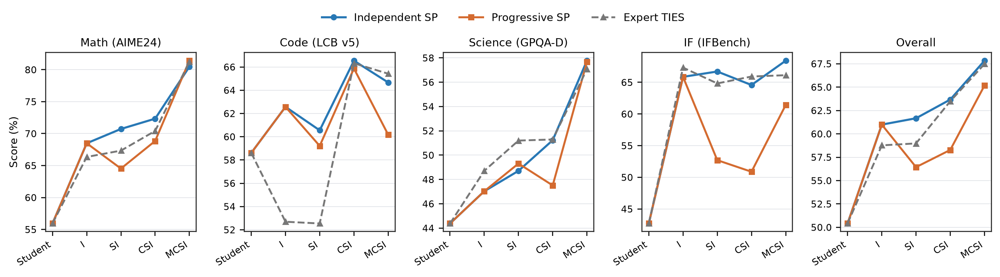
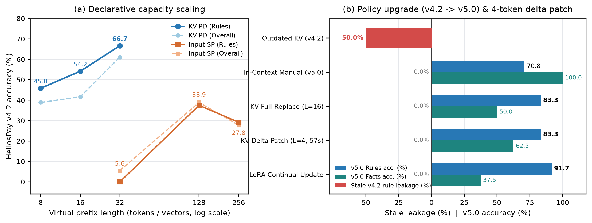
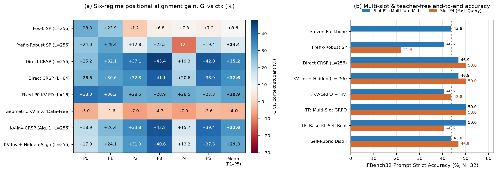
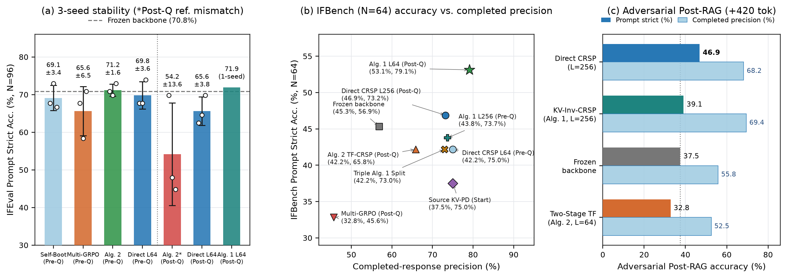

# 面向冻结大语言模型的模块化软提示蒸馏：从输入空间、键值缓存空间到语境鲁棒的任意槽位组合

## 摘要

强化学习（RL）后训练与垂域私有知识适配通常按单一领域分别开展，随后需要将多个专精专家整合为统一模型，并随着新领域与新版本规章的不断到达持续演进。现有的权重合并（Task Arithmetic、TIES）与多教师同策略蒸馏（MOPD）每次新增专家均需重新整合共享权重，不仅计算开销随领域数量增长，还易导致既有领域遗忘与域外通用能力退化。本文围绕严格冻结预训练或监督微调骨干模型参数这一前提，沿表示空间与部署语境两条主线，系统构建并验证了三层递进式模块化软提示蒸馏框架。

第一部分建立输入空间可组合软提示蒸馏（Composable Soft-Prompt Distillation, `CSPD`），将各领域强化学习专家独立蒸馏为少量前置连续词嵌入向量，通过前缀鲁棒训练支持推理期直接拼接而无需联合微调。实验覆盖 23 个跨架构数学、代码与智能体设置、四域多专家组合、六项域外泛化基准、多适配器高并发服务以及注意力路径归因，证实输入空间软提示可在冻结骨干下匹配权重级多教师蒸馏（四域均值 67.83 vs. 67.79），取得最优域外泛化（56.6 vs. 53.5）与高并发吞吐优势（32 并发下为 4 秩 LoRA 的 2.40 倍），并主要经由回复生成阶段的响应侧注意力发挥作用。同时，实验也揭示了输入空间蒸馏反向传播耗时高及零预训练泄露垂域文档直接拼接失效两项结构局限。

第二部分提出键值缓存空间的软提示蒸馏（KV-Space Prompt Distillation, `KV-PD`），直接在全部 Transformer 层注入经真实文本前向推理初始化的可训练逐层键值张量，并在私有文档持续学习场景中结合轻量自动路由、常量事实检索（`Micro-RAG`）与增量 Delta 版本补丁机制。在相同更新预算下，`KV-PD` 将分布蒸馏墙钟耗时缩短 2.71 倍、留出分布对齐增益提高 1.89 倍，并在零泄露五域持续学习与版本升级评测中实现零跨领域遗忘与零陈旧规则泄露。

第三部分针对 `KV-PD` 受旋转位置编码（RoPE）约束而固定绑定于序列起始索引、以及传统前缀软提示在非起始语境中显著退化的问题，提出语境鲁棒的任意槽位软提示（Context-Robust Soft Prompts, `CRSP`）。通过多槽语境随机化、跨语境输出一致性损失项 $`\mathcal{L}_{\text{inv}}`$ 与对称非目标任务输出保持损失项 $`\mathcal{L}_{\text{null}}`$，本文设计并验证了两类构造方法：不依赖原教师、由前置 `KV-PD` 经纯输出分布编译的键值功能逆向算法（算法 1），以及完全无强化学习教师、仅凭冻结基座与程序化验证器构造的两阶段自举与在线策略优化算法（算法 2）。规模化多随机种子与三专家分槽并发评测表明，算法 1 经 16-token 键值缓存与 64 向量输入软提示两级压缩后，在困难指令遵循基准上取得 53.12% 严格通过率（达到源键值模块通过率的 141.7%），在三专家并发组合中将跨专家 KL 干扰降低 2.95 倍，并实现相邻拼接 0.00 个百分点的精确置换不变性。最后，本文基于零泄露垂域文档的跨槽容量测试，总结了推理策略与私有文档记忆在输入空间与键值缓存空间中的分工边界与系统部署选型准则。

---

## 1. 引言

强化学习后训练通常针对单一垂直领域独立实施，因为数学推理、代码生成、智能体交互与复杂指令遵循各自具备独立的数据分布、交互环境与程序化验证器（Wang et al., 2026b; Ma et al., 2026a）。随着新领域专家、新业务规范与新版本策略持续产生，能力整合本质上是一个持续演进过程。理想的持续后训练与知识扩展系统应同时满足四项要求：（1）吸收新专家在目标领域的能力增量；（2）完整保留既有领域的专精能力与基座模型的通用域外能力；（3）新增或移除任一模块的开销仅取决于该模块自身，与既有模块库规模无关；（4）支持在包含系统人设、多轮对话历史或外部检索文档的异构推理上下文中按需动态挂载并并发组合多个专家。

既有技术路线主要分为两类。第一类将全部专家整合进单一共享参数集合，包括联合多任务强化学习、顺序强化学习（Wang et al., 2026a）、任务算术与符号裁剪权重合并（Ilharco et al., 2023; Yadav et al., 2023）以及多教师同策略蒸馏（MOPD；Wang et al., 2026b; Ma et al., 2026a）。此类方法每次新增领域均需重训或重新合并全模型，且覆写基座权重易引起既有任务遗忘与域外通用能力下降（Wang et al., 2026c）。第二类保持各专家权重独立并在推理期按请求路由或合并低秩适配器（LoRA；Hu et al., 2021; Huang et al., 2023; Prabhakar et al., 2024），但在并发多租户场景下，不同请求挂载不同低秩适配器会为每一网络层的每一个解码步引入额外矩阵乘加开销，且路由器随专家库扩展需反复重训。

与在权重空间整合不同，本文将专家能力迁移至冻结骨干模型的外部连续表示空间，沿「表示空间演进」与「任意上下文位置适配」两条轴线构建了三阶段模块化框架（图 1）：

1. **阶段一：输入空间可组合软提示蒸馏（`CSPD`）**。保持预训练或监督微调骨干权重严格冻结，将每个强化学习专家独立蒸馏为输入嵌入空间中的连续软提示矩阵（Lester et al., 2021），并通过前缀鲁棒训练使独立模块在推理期可直接拼接组合。该阶段验证了输入空间模块化的可行性、域外保真优势、高并发推理效率与响应侧注意力作用机理，同时定位了输入层跨全网反向传播耗时高及零预训练泄露垂域文档拼接失效两项主要限制。
2. **阶段二：键值缓存空间软提示蒸馏（`KV-PD`）与零遗忘持续学习架构**。基于软提示主要通过响应侧跨层注意力生效的机理结论，将外部可训练参数由第 0 层输入嵌入前移至全部 Transformer 层的键值缓存张量，并提出真实文本前向键值初始化。针对无预训练先验的私有垂域文档持续学习，进一步设计了自动路由隔离、`KV-PD` 与轻量常量检索（`Micro-RAG`）的规则-事实分工架构以及 4-Token 增量 Delta 版本补丁机制，同时阐明了逐层键值参数受旋转位置编码（RoPE；Su et al., 2024）约束而无法脱离序列起始索引动态插入的结构限制。
3. **阶段三：语境鲁棒的任意槽位软提示（`CRSP`）**。为兼顾输入空间的任意槽位可插拔自由度与跨语境稳定性，本文形式化定义了六类典型部署槽位，提出多槽语境随机化、跨语境输出一致性损失项与组合安全对称非目标任务输出保持损失项，并针对「持有前缀键值资产但无原教师」与「完全无强化学习教师」两类现实约束分别推导了键值功能逆向编译算法（算法 1）与两阶段无教师构造算法（算法 2）。


**图 1：三阶段模块化软提示蒸馏统一框架总览。** **(a)** 阶段一（输入空间 `CSPD`）：在严格冻结的预训练/微调骨干上，将各强化学习教师独立蒸馏为前置输入空间软提示，经前缀鲁棒训练后在推理期直接拼接组合。**(b)** 阶段二（逐层 `KV-PD` 与路由架构）：跳过输入层跨层传播，通过 `past_key_values` 在全部网络层直接注入经真实文本前向初始化的键值缓存，并结合自动路由、`Micro-RAG` 常量事实检索与增量 Delta 补丁实现多域持续学习与版本更新。**(c)** 阶段三（任意槽位 `CRSP`）：通过键值功能逆向编译（算法 1）或无教师两阶段自举与多槽策略优化（算法 2）构造语境鲁棒的输入软提示，配合跨语境输出一致性损失项 $`\mathcal{L}_{\text{inv}}`$ 与对称非目标任务输出保持损失项 $`\mathcal{L}_{\text{null}}`$，支持在系统、历史对话、检索文档与查询末尾等任意槽位分槽并发组合。

本文的主要贡献可概括为四点：
- 系统梳理并实证检验了输入空间可组合软提示在跨模型单专家蒸馏、多专家持续增量扩展、域外泛化、高并发推理服务及注意力路径归因中的完整特性，同时量化了其优化敏感性与零泄露垂域文档拼接边界。
- 提出真实文本前向初始化的逐层 `KV-PD` 方法及其面向私有垂域文档的自动路由、`KV-PD + Micro-RAG` 分工与增量 Delta 补丁体系，显著缩短训练时间并实现零遗忘持续学习与零陈旧泄露版本更新。
- 提出语境鲁棒的任意槽位软提示框架 `CRSP`，通过对比实验证明纯输出分布功能逆向优于逐层键值几何拟合与中间层隐藏态匹配，并构建了有资产逆向编译（算法 1）与零教师混合构造（算法 2）两套完整算法及组合安全分槽训练目标。
- 通过跨多随机种子、规模化困难基准、对抗检索干扰与三专家分槽并发的系统实验，总结了参数范数与直接拼接的关系、多专家共存训练的参考输入一致性要求、两级压缩对长思维链的精简效应以及输入空间与键值空间在推理策略与私有文档记忆上的分工边界，为模块化推理系统提供明确的架构选型依据。

---

## 2. 统一问题形式化与输入空间可组合软提示蒸馏（CSPD）

本节给出冻结骨干模型上三类外部连续参数化的统一数学记号，随后形式化阐述第一阶段输入空间可组合软提示蒸馏（`CSPD`）的优化目标、前缀鲁棒机制、矩阵正交化更新与推理组合方式。

### 2.1 统一问题形式化

设 $`f_{\theta_0}`$ 为具有 $`N_{\text{layer}}`$ 层、隐藏维度 $`d`$、分组查询注意力键值头数 $`H_{\text{kv}}`$ 与单头维度 $`d_h`$ 的自回归 Transformer 语言模型，其骨干参数 $`\theta_0`$ 在本文全部训练与推理阶段严格保持冻结。给定用户查询序列 $`x = (x_1, \dots, x_m)`$ 与回复序列 $`y = (y_1, \dots, y_T)`$，无外部模块时的条件语言模型分布记为 $`p_{\theta_0}(y_t \mid x, y_{<t})`$。

当存在由强化学习专精教师 $`f_{\theta_j}`$、私有规范文档或程序化验证器 $`R(x, y)`$ 诱导的目标行为分布时，模块化适配学习轻量级外部连续参数 $`\psi`$，并通过插入方式 $`\mathcal{I}(\cdot; \psi)`$ 在伴随外部部署语境 $`\mathcal{C}`$（系统人设、多轮对话历史或外部检索片段）下诱导受控分布 $`p_{\theta_0, \psi}(y_t \mid \mathcal{C}, x, y_{<t})`$。本文研究的三类参数化形式统一表示为：

**（1）起始位输入空间软提示（Prefix Input-SP）**：$`\psi = \mathbf{P} \in \mathbb{R}^{L \times d}`$，固定拼接于词嵌入序列起始处：$`\mathbf{E}_{\text{in}} = [\mathbf{P};\mkern 4mu \text{Emb}(x)]`$。

**（2）逐层键值缓存软提示（`KV-PD`）**：$`\psi = \mathbf{Z}_{\text{KV}} = \lbrace (\mathbf{K}^{(\ell)}, \mathbf{V}^{(\ell)})\rbrace _{\ell=1}^{N_{\text{layer}}}`$，其中 $`\mathbf{K}^{(\ell)}, \mathbf{V}^{(\ell)} \in \mathbb{R}^{L_{\text{kv}} \times H_{\text{kv}} \times d_h}`$，通过缓存接口直接前置注入各层注意力模块。

**（3）语境鲁棒的任意槽位软提示（`CRSP`）**：$`\psi = \mathbf{P} \in \mathbb{R}^{L \times d}`$ 位于输入嵌入空间，依据语境划分 $`\mathcal{C} = (\mathcal{C}_{\text{pre}}, \mathcal{C}_{\text{post}})`$ 动态插入任意指定槽位 $`s \in \mathcal{S}`$：

```math
\mathcal{I}_s(\mathcal{C}, x; \mathbf{P}) = \text{Concat}\big(\text{Emb}(\mathcal{C}_{\text{pre}}(s)),\mkern 4mu \mathbf{P},\mkern 4mu \text{Emb}(\mathcal{C}_{\text{post}}(s))\big) \tag{1}
```

### 2.2 单专家软提示蒸馏目标

对于第 $`j`$ 个领域的强化学习教师模型 $`p_{\theta_j}`$ 与域内问题集合 $`\mathcal{X}_j`$，单专家输入空间软提示 $`\mathbf{P}_j \in \mathbb{R}^{L \times d}`$ 置于系统消息模板 $`\mathcal{I}(\mathbf{P}_j, x)`$ 中位于用户问题 $`x`$ 之前。依据监督信息获取成本的不同，本文同时形式化两类单专家蒸馏目标：

#### 2.2.1 序列级轨迹蒸馏（Sequence-Level Distillation）

在大规模离线多模型蒸馏场景中，仅需从教师模型采样回复并经领域验证器筛选构成轨迹数据集 $`\mathcal{D}_j`$，在回复词元上最小化长度归一化负对数似然（Kim and Rush, 2016）：

```math
\mathbf{P}_j^\star = \arg\min_{\mathbf{P}_j} \mathbb{E}_{(x,y) \sim \mathcal{D}_j} \left[ -\frac{1}{\lvert y \rvert} \sum_{t=1}^{\lvert y \rvert} \log p_{\theta_0}\big(y_t \mid \mathcal{I}(\mathbf{P}_j, x), y_{<t}\big) \right] \tag{2}
```

其中前缀、软提示、系统消息与用户输入位置均不计入损失，仅对回复词元反传梯度。

#### 2.2.2 Rao-Blackwellized Top-K 前向散度蒸馏

当教师模型在轨迹上的逐词元预测分布可离线缓存时，单词元负对数似然仅利用了单个采样词元的硬标签，丢弃了教师在推理分叉点（如核查词、逻辑转折词与格式约束词）上的次优概率分配。为在有限训练步数内高密度对齐教师分布，同时避免大词表全分布存储开销，对每个时间步 $`t`$ 仅保留教师概率最高的 Top-$`K`$ 词元集合 $`\mathcal{V}_K(t)`$ 及其概率，将剩余词表质量归并为单点尾概率 $`r_j(t) = 1 - \sum_{v \in \mathcal{V}_K(t)} p_{\theta_j}(v \mid x, y_{<t})`$，构建 Rao-Blackwellized 前向交叉熵目标：

```math
\mathcal{L}_{\text{RB-CE}}(\mathbf{P}_j) = \mathbb{E}_{(x,y) \sim \mathcal{D}_j} \left[ \frac{1}{\lvert y \rvert} \sum_{t=1}^{\lvert y \rvert} \left( -\sum_{v \in \mathcal{V}_K(t)} p_{\theta_j}(v \mid x, y_{<t}) \log p_{\theta_0,\mathbf{P}_j}(v \mid x, y_{<t}) - r_j(t) \log \Big(1 - \sum_{v \in \mathcal{V}_K(t)} p_{\theta_0,\mathbf{P}_j}(v \mid x, y_{<t})\Big) \right) \right] \tag{3}
```

在固定教师轨迹分布上，最小化式 (3) 与最小化 Top-$`K`$ 支撑集及尾类合并空间上的精确前向 KL 散度等价（仅差与 $`\mathbf{P}_j`$ 无关的教师熵常数）。

### 2.3 前缀鲁棒训练、矩阵正交化更新与推理拼接组合

#### 2.3.1 零联合训练拼接与前缀鲁棒随机化

为将 $`k`$ 个独立蒸馏得到的领域专家 $`\mathbf{P}_1^\star, \dots, \mathbf{P}_k^\star`$ 组合应用于同一请求，推理期直接沿长度维无分隔符拼接其嵌入矩阵 $`\mathbf{P}_{1:k} = [\mathbf{P}_1^\star; \dots; \mathbf{P}_k^\star] \in \mathbb{R}^{kL \times d}`$ 并填入同一系统模板：

```math
p(y \mid x) = p_{\theta_0}\big(y \mid \mathcal{I}(\mathbf{P}_{1:k}, x)\big) \tag{4}
```

在持续后训练中，新专家到达时仅需独立蒸馏其自身软提示并拼接到现有提示序列中，既有模块与骨干参数均无需修改；移除专家则直接删除对应矩阵切片。

由于单个模块在训练时独立存在，而在推理拼接时可能位于其它模块之后，直接拼接会导致后置模块遭遇绝对位置偏移与陌生前导上下文。为此引入**前缀鲁棒训练（Prefix-Robust Training）**：在单域训练中对一半样本随机采样一段来自动态语料或词表的上下文前缀 $`\mathbf{F}`$ 置于 $`\mathbf{P}_j`$ 之前：

```math
\tilde{\mathbf{E}}_{\text{in}} = \begin{cases} [\mathbf{F};\mkern 4mu \mathbf{P}_j;\mkern 4mu \text{Emb}(x)], & \text{以概率 } p_{\text{pr}} \\ [\mathbf{P}_j;\mkern 4mu \text{Emb}(x)], & \text{以概率 } 1 - p_{\text{pr}} \end{cases} \tag{5}
```

前导前缀 $`\mathbf{F}`$ 保持冻结且不参与损失计算，在推理期移除。该机制迫使每个独立软提示在非零起始偏移下维持稳定的条件调制作用。

#### 2.3.2 矩阵正交化更新（Muon）与参数几何监控

对于二维矩阵参数 $`\mathbf{P}_j \in \mathbb{R}^{L \times d}`$，标准逐元素自适应优化器（AdamW）容易使参数更新集中在少数奇异方向上。作为对照与默认优化方案，矩阵正交化优化器 Muon（Liu et al., 2025）对 Nesterov 动量矩阵 $`\mathbf{M}_t = \mu \mathbf{M}_{t-1} + \mathbf{G}_t`$ 施加迭代 Newton-Schulz 近似极分解，提取正交因子 $`\text{Orth}(\mathbf{M}_t) = \mathbf{U}\mathbf{V}^\top`$ 并以各方向均衡的奇异值幅度更新参数：

```math
\mathbf{P}_{t+1} = \mathbf{P}_t - \eta \sqrt{\max\left(1, \frac{L}{d}\right)}\mkern 4mu  \text{Orth}(\mathbf{M}_t) \tag{6}
```

同时，为诊断不同优化器对模块几何结构及多专家拼接兼容性的影响，本文监测参数偏移量 $`\Delta\mathbf{P} = \mathbf{P}_{\text{final}} - \mathbf{P}_{\text{init}}`$ 的有效秩（Effective Rank，定义为归一化奇异值分布的指数香农熵 $`\exp(-\sum_i \tilde{\sigma}_i \log \tilde{\sigma}_i)`$）与单向量均方根范数（RMS Norm）。

---

## 3. 输入空间 CSPD 实验评估与内部机理分析

本节依次检验输入空间软提示的单专家蒸馏泛化能力（第 3.2 节）、四域多专家零联合训练组合（第 3.3 节）、持续增量添加与逐一移除特性（第 3.4 节）、域外泛化与高并发多适配器服务效率（第 3.5 节）、内部注意力与词元概率作用机理（第 3.6 节），并进一步通过受控三轴优化消融与零预训练泄露垂域文档测试量化输入空间在训练耗时与文档拼接上的限制（第 3.7 节）。

### 3.1 评测指标与实验设置

除各项基准的绝对得分外，本节采用三项标准化相对指标：

**（1）教师增益恢复率（Recovery, $`R`$）**：设冻结基座、强化学习教师与挂载软提示后的模型在目标基准上的得分分别为 $`A_S`$、$`A_T`$ 与 $`A_{S+P}`$（$`A_T > A_S`$），定义恢复率为：

```math
R = \frac{A_{S+P} - A_S}{A_T - A_S} \times 100\% \tag{7}
```

**（2）留出分布对齐增益（Distributional Alignment Gain, $`G`$）**：设在固定留出推理轨迹上冻结基座与候选模型 $`A`$ 相对目标教师 $`T`$ 的前向 KL 散度分别为 $`D_{\text{KL}}(T \Vert S)`$ 与 $`D_{\text{KL}}(T \Vert A)`$，定义相对散度缩减比例为：

```math
G(A) = \left(1 - \frac{D_{\text{KL}}(T \Vert A)}{D_{\text{KL}}(T \Vert S)}\right) \times 100\% \tag{8}
```

**（3）注意力路径增益保留率（Improvement Kept, $`K`$）**：在因果注意力掩码消融中，设全路径模型为 $`S+P`$、基准对照为 $`B`$（可取基座 $`S`$ 或全屏蔽模型），定义受限路径模型 $`A`$ 保留的散度改善比例为：

```math
K(A) = \frac{D_{\text{KL}}(T \Vert B) - D_{\text{KL}}(T \Vert A)}{D_{\text{KL}}(T \Vert B) - D_{\text{KL}}(T \Vert S+P)} \times 100\% \tag{9}
```

单专家跨模型实验覆盖 7B 至 35B 参数规模的稠密与混合专家（MoE）公开模型对，均采用 256 向量软提示；多专家组合实验遵循 `M2RL`（Wang et al., 2026b）设置，采用 `M2RL-SFT`（基于 Qwen3-4B-Base 微调的 36 层骨干）作为冻结基座，并以其数学（AIME24）、代码（LiveCodeBench v5）、科学（GPQA-Diamond）与指令遵循（IFBench）四个强化学习专家为教师（温度 0.6，最大生成 32k tokens，采样数 $`K=64/8/16/8`$；Muon 200 步更新，前缀鲁棒随机前置 128–256 词元）。为深入剖析短预算分布蒸馏动力学与零预训练泄露文档学习能力，本文在单张 NVIDIA A100-80GB 上对同一 `M2RL-SFT` 骨干额外开展了 Top-64 前向散度蒸馏（60 步与 45 步受控消融，截断长度 $`T_{\max}=768`$，端到端评测 `IFBench` $`N=40`$，最大生成 2048 tokens）以及三个完全合成、无预训练语料泄露的私有规范文档域评测（`HeliosPay v4.2` 跨境结算风控、`NVX-418` 临床试验给药规范、`Litho-X9` 极紫外光刻良率手册，各含多条件决策规则题、逐字常量事实题及 24 道域外拒答题）。

### 3.2 单专家软提示蒸馏的跨模型泛化

在组合多专家之前，首先检验单个 256 向量软提示能否跨模型族与任务形态充分恢复单个强化学习专家的能力。表 1 汇总了跨越数学推理、代码生成（LiveCodeBench）以及多步智能体交互（SWE-bench Verified 与 Terminal-Bench 2.1）共 23 组公开强化学习模型对的评测结果。

| 强化学习前基座模型 | 强化学习专家教师 | 文献来源 | 基座得分 | 教师得分 | 软提示得分 | 恢复率 $`R`$ (%) |
| :--- | :--- | :--- | :---: | :---: | :---: | :---: |
| *(a) 数学推理（AIME / MATH / AMC / HMMT）* | | | | | | |
| MiMo-7B-SFT | MiMo-7B-RL | Xiaomi LLM-Core et al., 2025 | 63.77 | 73.18 | 72.25 | 90.15 |
| GPT-OSS-Swallow-20B-SFT | GPT-OSS-Swallow-20B-RL | Swallow LLM, 2026a | 76.53 | 90.21 | 89.67 | 96.06 |
| Qwen3-Swallow-8B-SFT | Qwen3-Swallow-8B-RL | Swallow LLM, 2026b | 63.68 | 83.01 | 82.28 | 96.22 |
| OLMo-3-7B-Instruct-DPO | OLMo-3-7B-Instruct | Team OLMo et al., 2026 | 42.97 | 60.72 | 60.13 | 96.70 |
| Nemotron-Cascade-8B-SFT | Nemotron-Cascade-8B-MathRL | Wang et al., 2026a | 85.25 | 89.34 | 89.30 | 99.18 |
| Qwen3-Swallow-30B-A3B-SFT | Qwen3-Swallow-30B-A3B-RL | Swallow LLM, 2026b | 72.91 | 86.25 | 86.23 | 99.79 |
| Eurus-2-7B-SFT | Eurus-2-7B-PRIME | Cui et al., 2025 | 36.06 | 49.63 | 49.91 | 102.07 |
| INTELLECT-MATH-SFT | INTELLECT-MATH | Prime Intellect, 2025 | 45.47 | 54.11 | 54.62 | 105.89 |
| Poro-2-8B-Long-Math-SFT | Poro-2-8B-Long-Math-RL | Hakala et al., 2026 | 68.34 | 72.43 | 73.88 | 135.47 |
| Klear-Reasoner-8B-SFT | Klear-Reasoner-8B | Su et al., 2026 | 62.15 | 65.00 | 66.11 | 139.02 |
| *(b) 代码生成（LiveCodeBench）* | | | | | | |
| MiMo-7B-SFT | MiMo-7B-RL（代理数据） | Xiaomi LLM-Core et al., 2025 | 50.17 | 52.87 | 52.55 | 88.08 |
| Nemotron-Cascade-8B-SFT | Nemotron-Cascade-8B-CodeRL | Wang et al., 2026a | 55.73 | 69.39 | 69.56 | 101.21 |
| Klear-Reasoner-8B-SFT | Klear-Reasoner-8B | Su et al., 2026 | 53.44 | 57.27 | 57.34 | 101.83 |
| Qwen3-14B | AReaL-boba-2-14B-Open | Fu et al., 2026 | 64.86 | 68.06 | 68.14 | 102.38 |
| Mellum2-12B-A2.5B-SFT | Mellum2-12B-A2.5B-Instruct | Kojic et al., 2026 | 36.30 | 39.05 | 39.34 | 110.34 |
| Qwen3-8B | AReaL-boba-2-8B-Open | Fu et al., 2026 | 58.54 | 62.20 | 62.96 | 120.83 |
| OLMo-3-7B-Instruct-DPO | OLMo-3-7B-Instruct | Team OLMo et al., 2026 | 28.50 | 34.10 | 36.54 | 143.44 |
| *(c) 软件工程智能体（SWE-bench Verified，500 任务）* | | | | | | |
| Nemotron-Cascade-8B-SFT | Nemotron-Cascade-8B | Wang et al., 2026a | 23.60 | 34.60 | 33.75 | 92.27 |
| Qwen3-32B | DeepSWE-Preview | Luo et al., 2025 | 24.90 | 44.05 | 45.65 | 108.36 |
| Qwen3.5-35B-A3B | Lego-RL-35B-A3B | Du et al., 2026 | 64.00 | 70.40 | 72.25 | 128.91 |
| SWE-Gym-OpenHands-7B | SkyRL-Agent-7b-v0 | Cao et al., 2025 | 11.40 | 12.80 | 13.60 | 157.14 |
| *(d) 终端交互智能体（Terminal-Bench 2.1，89 任务）* | | | | | | |
| Qwen3.5-9B | TMax-9B | Ivison et al., 2026 | 20.22 | 28.09 | 29.96 | 123.81 |
| Qwen3.6-27B | TMax-27B | Ivison et al., 2026 | 43.45 | 46.07 | 48.69 | 200.00 |

**表 1：跨 23 组公开数学、代码与智能体强化学习专家的单专家软提示蒸馏结果（全部数值为百分比）。** 在 23 组跨架构（7B–35B 稠密与 MoE）设置中，单个 256 向量软提示在 22 组中恢复了至少 90% 的教师增益，并在 15 组中达到或超过教师模型；多步智能体任务中，6 组里有 5 组超过教师（如 `DeepSWE-Preview` 由 24.90% 提升至 45.65%，高于教师 44.05%）。最低恢复率 88.08% 出现在使用代理数据集的 `MiMo-7B` 代码任务上，说明即便缺乏原始强化学习语料仍具高迁移性。

进一步在 `GPT-OSS-Swallow-20B` 数学任务上的消融表明：（1）**软提示长度缩放**：向量数取 2、8、32、256、512 时，最优恢复率依次为 51.23%、74.11%、90.01%、93.10% 与 87.83%，32 个向量即已捕获绝大部分增益，过长（512）反而略微下降；（2）**监督纯度与同参数 LoRA 对照**：在 28,946 条训练轨迹上，仅用全对轨迹的软提示（737,280 参数）恢复率为 96.06%，与同参数量级 K/V 投影 5 秩 LoRA（814,080 参数，95.72%）相当；即便混入 31% 错误轨迹（仅 69% 正确），软提示仍取得 90.54% 恢复率，表明验证器过滤并非严格必要条件。

### 3.3 跨领域多专家组合与基线对照

在四域多专家组合设置（`M2RL-SFT` 骨干上的数学、代码、科学与指令遵循专家）中，表 2 对比了独立训练后直接拼接的 `CSPD` 与权重合并（Task Arithmetic、TIES）、多教师同策略蒸馏（MOPD）及同数据 LoRA 合并基线的域内性能。

| 适配方法 | 适配表示空间 | AIME24 | LiveCodeBench v5 | GPQA-Diamond | IFBench | 四域均值 | 相对专家恢复率 (%) |
| :--- | :--- | :---: | :---: | :---: | :---: | :---: | :---: |
| 冻结基座模型（无提示） | — | 55.94 | 58.61 | 44.38 | 42.71 | 50.41 | 0.0 |
| 独立领域专家（理想路由上界） | 全模型（4 份） | 81.77 | 66.92 | 50.44 | 67.33 | 66.61 | 100.0 |
| 专家权重合并（Task Arithmetic，$`\lambda=1.0`$） | 全模型权重 | 78.85 | 64.52 | 54.14 | **71.58** | 67.27 | 104.1 |
| 专家权重合并（TIES） | 全模型权重 | 81.25 | 65.42 | 57.07 | 66.12 | 67.47 | 105.2 |
| 多教师同策略蒸馏（MOPD） | 全模型权重 | **83.28** | **66.24** | 55.21 | 66.42 | 67.79 | 107.2 |
| LoRA 蒸馏 + Task Arithmetic（$`\lambda=0.5`$） | LoRA 权重 | 80.21 | 63.10 | 56.22 | 62.46 | 65.50 | 93.1 |
| LoRA 蒸馏 + TIES | LoRA 权重 | 81.41 | 64.00 | 56.66 | 62.67 | 66.19 | 97.3 |
| 单域软提示（理想单域挂载） | 输入软提示 | 80.89 | 64.67 | 49.24 | 66.71 | 65.38 | 92.4 |
| `CSPD` 无前缀鲁棒训练（AdamW，ISCM） | 输入软提示 | 76.98 | 64.15 | 51.89 | 65.00 | 64.50 | 87.0 |
| `CSPD`（AdamW，ISCM） | 输入软提示 | 79.74 | 65.94 | 55.78 | 64.96 | 66.60 | 99.9 |
| `CSPD`（Muon，ISCM） | 输入软提示 | 79.90 | 65.72 | **57.92** | 67.33 | 67.72 | 106.8 |
| **`CSPD`（Muon，MCSI）** | **输入软提示** | 80.47 | 64.67 | 57.77 | 68.42 | **67.83** | **107.5** |

**表 2：`M2RL-SFT` 四领域单专家与多专家组合对比（百分比）。** 独立蒸馏后直接拼接的四域软提示将基座均值由 50.41 提升至 **67.83**（恢复率 107.5%），与需全模型联合重训的 MOPD（67.79）持平，并优于全部权重合并与同数据 LoRA 合并基线（65.50–67.47）；反序拼接 ISCM 亦得 67.72，且组合后 GPQA-Diamond 相对单域软提示提升 +8.53 个百分点（49.24 → 57.77），体现跨领域正向迁移。去掉前缀鲁棒训练后，AdamW 组合均值由 66.60 降至 64.50（恢复率由 99.9% 降至 87.0%），证实前缀随机化对多专家拼接的必要性。

在受控短预算（60 步 Top-64 前向散度蒸馏）双域实验（指令遵循 + 数学，评测 `IFBench` $`N=40`$）中，单域指令遵循软提示即可将冻结基座严格通过率由 37.50% 提升至 45.00%（教师为 50.00%，差距恢复 60.0%；留出 $`\text{KL}_{\text{IF}}`$ 由 0.2508 降至 0.1580，$`G_{\text{IF}}=+37.01\%`$）。参数几何分析进一步揭示了优化器与范数对拼接的影响：无裁剪 Muon 产生接近满秩的增量（有效秩 242.37 / 256），但将向量 RMS 推高至 0.1380（初始值 0.0192 的 7.2 倍），在短预算双域直接拼接下出现负向分布干扰（$`G_{\text{IF}}=-6.35\%`$，$`G_{\text{Math}}=-2.69\%`$）；而保持较低范数的 AdamW（RMS = 0.0463，有效秩 215.48 / 256）在单域同样达 $`G_{\text{IF}}=+37.01\%`$、数学达 $`G_{\text{Math}}=+35.32\%`$，且在双域直接拼接下同时保持双域正增益（$`G_{\text{IF}}=+10.91\%`$，$`G_{\text{Math}}=+14.41\%`$），并在 `IFBench`（$`N=40`$）上达到 **47.50%** 严格通过率（80.0% 差距恢复）。同时，未施加域间隔离时单域数学软提示在指令遵循留出集上产生 $`G_{\text{IF}}=-32.33\%`$ 负迁移，提示多专家并发时需关注跨领域身份保持。

### 3.4 专家持续增量添加、逐一移除与渐进训练对比

为模拟专家随时间依次到达的持续后训练场景，图 2 展示了按指令遵循（I）、科学（S）、代码（C）、数学（M）顺序逐一前置添加独立软提示的演化轨迹，以及从完整组合 MCSI 中逐一移除单个模块的留一消融矩阵。


**图 2：能力持续扩展与模块间跨领域交互作用。** **(a)** 独立训练的软提示按到达顺序 I、S、C、M 依次前置拼接至冻结基座，形成 `Student → I → SI → CSI → MCSI`；虚线为四域独立专家均值（66.61%）。每新增一个专家，四域总体均值均严格单调上升（50.4 → 61.0 → 61.7 → 63.7 → 67.8%），无需重训任何既有模块。**(b)** 从完整 MCSI 组合中分别移除单个模块（保持其余模块相对顺序）后各基准得分相对完整组合的变化量（pp，负值表示被移除模块在组合中产生正向贡献）；每个模块均对本域与四域均值贡献为正（移除数学导致均值降 4.2 pp 且 GPQA-Diamond 降 6.5 pp，移除指令遵循导致 IFBench 降 12.9 pp），同时存在局部域间竞争（移除数学使 LiveCodeBench 升 1.9 pp）。

进一步将独立训练的软提示与两类持续整合对照方法——**渐进式提示训练（Progressive Prompts；Razdaibiedina et al., 2023，冻结前置既有提示并在其语境下训练新提示）**与**专家 TIES 权重合并**——在相同到达顺序下逐域对比，结果见图 3。



**图 3：独立软提示、渐进软提示与专家 TIES 合并在各领域及总体均值上的持续扩展曲线。** 五个子图依次对应数学（AIME24）、代码（LCB v5）、科学（GPQA-D）、指令遵循（IFBench）与总体均值。在每个到达阶段，独立训练软提示均高于渐进软提示（阶段 S/C/M 总体均值分别为 61.7 vs. 56.4、63.7 vs. 58.3、67.8 vs. 65.2）；渐进训练反而侵蚀了最早的指令遵循能力（IFBench 降至 52.7、50.9、61.4），表明为特定历史组合联合拟合新模块并不利于后续扩展。在权重空间对照中，TIES 合并在仅纳入指令遵循专家时即导致代码基准 LiveCodeBench 由基座 58.61 急剧跌至 52.69（纳入科学后仍停留在 52.54），呈现典型的权重级灾难性遗忘；而独立软提示因骨干冻结使代码基准维持在 62.57 与 60.55，且全阶段总体均值均高于 TIES。

### 3.5 域外泛化能力与多适配器并发推理服务效率

权重空间整合虽可逼近域内专家水平，但常伴随目标域之外通用能力的损失（Wang et al., 2026c）。表 3 在六个完全独立于训练领域的域外基准——拒绝校准（XSTest）、真实性（TruthfulQA）、工具调用（BFCL）、闭卷知识（TriviaQA）、复杂推理（BBEH）与金融数值推理（FinQA）——上对比了各整合方案。

| 方法 | XSTest | TruthfulQA | BFCL | TriviaQA | BBEH | FinQA | 六基准均值 |
| :--- | :---: | :---: | :---: | :---: | :---: | :---: | :---: |
| 冻结基座模型（无提示） | 80.4 | **64.6** | 47.6 | 31.5 | 11.1 | 66.3 | 50.3 |
| 专家权重合并（TIES） | 82.4 (+2.0) | 63.7 (-0.9) | 48.5 (+0.9) | **33.6** (+2.1) | 25.6 (+14.5) | 70.9 (+4.6) | 54.1 (+3.9) |
| 多教师同策略蒸馏（MOPD） | 84.2 (+3.8) | 61.0 (-3.6) | 49.4 (+1.8) | 31.9 (+0.4) | 23.9 (+12.8) | 70.8 (+4.5) | 53.5 (+3.3) |
| LoRA 蒸馏 + TA（$`\lambda=0.5`$） | 85.1 (+4.7) | 63.8 (-0.8) | 47.5 (-0.1) | 32.7 (+1.2) | 23.0 (+11.9) | 70.9 (+4.6) | 53.8 (+3.6) |
| **`CSPD`（MCSI 四域拼接）** | **88.2** (+7.8) | 64.2 (-0.4) | **55.6** (+8.0) | 33.5 (+2.0) | **25.8** (+14.7) | **72.5** (+6.2) | **56.6** (+6.4) |

**表 3：六个域外通用基准得分对比（百分比，括号内为相对冻结基座的变化量）。** 四域拼接的 `CSPD` 取得最高域外均值（56.6），领先 MOPD（53.5）达 3.1 个百分点并在 4 项基准上居首（BFCL 领先 MOPD 6.2 分，XSTest 领先 LoRA 3.1 分）；在 TruthfulQA 上仅变化 -0.4 分，而修改权重的 MOPD 损失 3.6 分，证明冻结骨干的输入空间适配有效保护了模型的通用能力。

在服务效率方面，输入空间软提示仅在预填充（Prefill）阶段增加少量前置上下文，解码阶段不向线性投影层引入额外矩阵计算，因此搭载不同软提示组合的异构请求可无缝共享同一推理批次。图 4 展示了在单张 NVIDIA B200 上使用 SGLang 部署 BF16 `GPT-OSS-20B`（每请求 20,480 输入词元、512 生成词元，每并发请求分配互不相同的独立适配器）的实测吞吐与 P95 首词元延迟（TTFT）。


**图 4：每请求独立适配器的多并发服务效率（单张 NVIDIA B200，SGLang）。** 上排对比无适配骨干（灰色空心圈）、256 向量软提示（蓝色）与 4 秩未合并 LoRA（橙色，CSGMV 后端）的输出吞吐（左，越高越好）与 P95 首词元延迟（右，越低越好）；下排为软提示相对无适配骨干的百分比变化。在并发度 1 至 32 全区间内，软提示吞吐始终维持在原骨干 1.5% 误差范围内（32 并发下 715.4 vs. 721.3 tokens/s，仅 -0.8%），输出吞吐达到 4 秩 LoRA（298.5 tokens/s）的 **2.40 倍**（单并发时达 4.12 倍），同时将 P95 首词元延迟由 LoRA 的 39.21 秒压低至 **17.26 秒（降低 2.27 倍，接近原骨干 16.89 秒）**。此外，软提示对基于原骨干训练的投机解码草稿模型保持良好兼容：挂载 256 向量软提示后，EAGLE-3（Li et al., 2025）平均接受长度仅由 2.34 微降至 2.28（-2.6%），DFlash（Chen et al., 2026）由 2.96 降至 2.82（-4.7%）。

### 3.6 软提示的内部作用机理

为揭示连续软提示究竟学习了何种表示及如何调制冻结骨干，本节综合 20B 数学软提示（`GPT-OSS-Swallow-20B`，100 道 AIME/MATH-500 留出题的 600 条轨迹）与 4B 指令遵循软提示（`M2RL-SFT`，20 条留出轨迹）两组独立分析，从词表几何、输出分布偏移与因果注意力路径三个层面给出定量证据（图 5）。


**图 5：输入空间软提示的内部作用机理。** **(a)** 软提示与显式自然语言校验指令（验证指令、核查指令、中性指令及高推理强度/未训练初始化）缩减教师–学生 KL 差距的比例 $`G`$（%），涵盖 20B 数学域（蓝色）与 4B 指令遵循域（橙色）。**(b)** 在 20B 数学推理轨迹中软提示上调（蓝色向右）与下调（红色向左）概率最频繁的前 4 类词元位置计数（`␣` 表示前导空格）。**(c)** 因果注意力掩码消融下的增益保留率 $`K`$（%），对比完整路径、仅允许回复词元关注软提示（Response only）、仅允许用户输入词元关注软提示（Input only）与完全屏蔽（Blocked）。

综合分析得出三项一致机理结论：

1. **最近邻词表项不反映学习内容**：跨 6 个不同模型族检查权重发现，84%–100% 的软提示向量仍以初始化词元作为最近邻词表项（在 4B `M2RL-SFT` 上 Muon 为 87.11%、AdamW 为 98.05%），尽管向量方向已大幅偏离初始嵌入（中位余弦相似度仅 0.16–0.34），说明软提示并非编码可读离散提示词。
2. **分布校准显著超越显式文本指令，核心表现为重构自我核查与推理转折词概率**：在 20B 数学域中，软提示缩减了 **86.8%** 的教师–学生 KL 差距（KL 由 0.225 降至 0.030），而语义等价的显式核查/验证指令至多仅缩减 2.1%（图 5(a)）；软提示最显著提升 `?`、`But`、`Check`、`Let's` 等中间结果检验词的概率，并压低段尾换行 `.\n\n`、`␣So`、`Thus` 等过早总结词的概率（图 5(b)）。在 4B 指令遵循域中观察到完全一致的规律：软提示取得 **+37.01%** 分布增益（全部人工文本指令均为 -4.5% 至 -16.9% 负增益），并将基座相对教师的话语控制词概率比显著拉回 1.0 附近（`Check` 由 0.332 升至 0.809，`So` 由 0.445 升至 0.980，`␣But` 由 0.632 升至 0.988，`Thus` 由 1.217 回调至 0.882）。
3. **主要经由回复生成阶段的响应侧直接注意力起作用**：屏蔽用户输入对软提示的注意力、仅保留回复词元直接关注软提示（Response only）时，20B 数学域保留了 **80%** 的分布改善（4B 指令遵循域相对全屏蔽基准保留 **70.0%**，相对基座保留 54.6%）；反之，仅允许输入词元关注而阻断回复侧注意力（Input only）时，改善保留率下降至 33%（4B 相对基座仅 0.84%）。这表明软提示在推理期充当各层解码步持续读取的行为控制状态，而非静态改写问题编码。

### 3.7 输入空间的优化敏感性与零泄露垂域拼接限制

尽管输入空间 `CSPD` 在多专家程序性推理上表现优良，受控的 45 步三轴优化消融与零预训练泄露文档持续学习测试揭示了其在训练效率与高密度陈述性知识存储上的两项主要限制：

1. **反向传播耗时高且对初始化、截断与优化器高度敏感**：在单卡 A100 上对 `M2RL-SFT` 执行 45 步输入空间 Top-64 前向散度蒸馏（基准基座 $`\text{KL}_{\text{IF}}=0.2344`$），由于梯度必须经由激活重计算反向穿越全部 36 层，单轮 45 步即耗时约 **196 秒**。初始化轴上，任务指令初始化达 $`G_{\text{IF}}=+34.59\%`$（196.7 秒），随机词表初始化达 +26.66%（195.8 秒），低范数高斯初始化仅达 +7.45%（195.7 秒）；损失与截断轴上，正反向混合 KL（+21.70%）与高熵分叉点 Top-30 KL（+18.97%）大幅优于纯序列 NLL（-0.08%），而将训练截断压缩至 256 词元会因丢失长思维链后段核查信号导致严重负向偏差（$`G_{\text{IF}}=-57.63\%`$）；优化器与长度轴上，低范数初始化下 AdamW（+30.48%）显著优于无裁剪 Muon（+7.45%）与范数裁剪 Muon（+11.83%），缩短长度至 $`L=64`$（+10.24%）或 $`L=16`$（+7.10%）则导致对齐收益明显下滑。
2. **零泄露垂域文档学习中单域容量受限且多域拼接完全失效**：在零预训练泄露的三域合成规范基准上（$`L=128`$，120 步训练耗时 266–276 秒），输入软提示单域总体准确率分别为 `HeliosPay` 38.89%（规则 37.50%、事实 41.67%、域外拒答 91.67%）、`NVX-418` 44.12%（规则 41.67%、事实 50.00%）与 `Litho-X9` 11.76%（规则 12.50%、事实 10.00%），且长度缩放呈非单调退化（$`L=32`$ 得 5.56%、$`L=128`$ 得 38.89%、$`L=256`$ 降至 27.78%）。更为关键的是，一旦将独立训练的输入空间文档模块直接拼接，双域拼接使 `HeliosPay` 降至 **0.0%**、`NVX-418` 降至 **5.88%**；三域正反拼接在全部三个领域上的准确率均降至 **0.0%**（同期顺序 LoRA 在完成第三域训练后亦出现严重灾难性遗忘：`HeliosPay` 由 47.22% 遗忘至 0.0%，`NVX-418` 由 73.53% 遗忘至 8.82%）。

上述两项限制的根源在于第 3.6 节发现的跨层路径矛盾：软提示的核心作用发生在全部网络层的响应注意力中，却被迫仅在第 0 层嵌入空间接受间接梯度。这直接引出了第 4 节的逐层键值缓存空间参数化方法。

---

## 4. 键值缓存空间的软提示蒸馏（KV-PD）与持续学习架构

针对输入空间软提示在第 3.7 节中暴露的跨层反向传播耗时高与零泄露垂域知识容量受限问题，本节提出键值缓存空间的软提示蒸馏（KV-Space Prompt Distillation, `KV-PD`），并面向多域企业规范持续学习与动态版本更新构建完整的模块化路由与增量补丁架构。

### 4.1 逐层键值缓存参数化与真实文本前向键值初始化

第 3.6 节的注意力路径消融证实，外部控制模块主要通过在全部 Transformer 层中被回复查询向量读取而生效。`KV-PD` 直接省去输入嵌入层向深层的隐式非线性映射，将长度为 $`L_{\text{kv}}`$ 的全部 $`N_{\text{layer}}`$ 层分组查询注意力（GQA）键值张量设为可训练外部参数：

```math
\mathbf{Z}_{\text{KV}} = \left\lbrace \big(\mathbf{K}^{(\ell)},\mkern 4mu  \mathbf{V}^{(\ell)}\big) \right\rbrace _{\ell=1}^{N_{\text{layer}}}, \qquad \mathbf{K}^{(\ell)}, \mathbf{V}^{(\ell)} \in \mathbb{R}^{L_{\text{kv}} \times H_{\text{kv}} \times d_h} \tag{10}
```

每个虚拟键值词元对应的总参数量为 $`2 N_{\text{layer}} H_{\text{kv}} d_h`$。在分组查询注意力架构中，由于键值头数 $`H_{\text{kv}}`$ 显著小于查询头数，极短的缓存长度 $`L_{\text{kv}}`$ 即可在近似或更低的参数规模下为每一网络层提供独立的键值控制自由度。

由于冻结骨干不同层内部键值张量的数值尺度与分布特征差异显著，随机初始化易导致初期注意力权重分布发散。为此，本文采用**真实文本前向键值初始化（Real-Text Forward KV Initialization）**：选取一段长度为 $`L_{\text{kv}}`$ 的真实任务指令或垂域规范前置文本 $`u = (u_1, \dots, u_{L_{\text{kv}}})`$，经冻结骨干 $`f_{\theta_0}`$ 执行一次无梯度前向推理，直接截取各层输出的缓存状态作为初始点：

```math
\mathbf{Z}_{\text{KV}}^{(0)} = \text{KV-Cache}\big(f_{\theta_0}(u)\big) \tag{11}
```

真实文本前向初始化使外部键值参数在优化开始时即与冻结骨干各层真实注意力键值的数值分布保持一致。

### 4.2 前置缓存注入与一阶梯度计算特性

在训练与推理阶段，$`\mathbf{Z}_{\text{KV}}`$ 经由标准 `past_key_values` 接口直接前置注入各层注意力计算。第 $`\ell`$ 层对真实输入与生成词元查询向量 $`\mathbf{Q}_x^{(\ell)}`$ 的注意力计算直接拼接外部键值张量：

```math
\text{Attn}^{(\ell)}(\mathbf{Q}_x^{(\ell)}) = \text{Softmax}\left(\frac{\mathbf{Q}_x^{(\ell)} \big[\mathbf{K}^{(\ell)};\mkern 4mu  \mathbf{K}_x^{(\ell)}\big]^\top}{\sqrt{d_h}}\right) \big[\mathbf{V}^{(\ell)};\mkern 4mu  \mathbf{V}_x^{(\ell)}\big] \tag{12}
```

该注入方式从计算图层面消除了两项计算开销：前向计算无需重复编码虚拟前缀词元；反向传播时每一层的 $`\big(\mathbf{K}^{(\ell)}, \mathbf{V}^{(\ell)}\big)`$ 直接接收本层注意力输出的一阶梯度，无需启用激活重计算（Gradient Checkpointing）将梯度串联回传至第 0 层，从而显著降低单步墙钟耗时并提升深层优化稳定性。蒸馏目标沿用式 (3) 的 Rao-Blackwellized Top-$`K`$ 前向散度损失，优化器采用 AdamW。对于独立蒸馏的多个程序性策略专家，推理期可直接沿键值序列维拼接缓存张量 $`[\mathbf{Z}_{\text{KV}}^{(1)}; \mathbf{Z}_{\text{KV}}^{(2)}]`$ 实现零重训组合。

### 4.3 多域自动路由、`KV-PD + Micro-RAG` 分工与增量 Delta 补丁

在无预训练先验的私有垂域文档持续学习中，企业规章同时包含两类异质知识：需要多条件数值计算与分支推理的隐式**程序性决策树规则**，以及需要字符级精确一致的**逐字常量事实**（如版本号、截止时间、代码常量）。单一参数化模块难以同时达到两类任务的高精度，且直接串联多个高幅值垂域文档模块易引起分布外注意力干扰。为此，本文在 `KV-PD` 之上建立三项模块化持续学习机制：

**（1）轻量自动路由与单域文件隔离**：为每个领域 $`d \in \lbrace 1, \dots, D\rbrace`$ 独立训练并持久化保存专属键值缓存文件 $`\mathbf{Z}_{\text{KV}}^{(d)}`$。推理时，轻量路由器度量用户查询与各领域原型向量的语义相似度；超过拒答阈值时仅挂载对应的单域缓存，域外查询则路由至空缓存以保持基座原有拒答行为。新增领域对既有领域严格保证零参数干扰，删除特定领域知识只需移除磁盘上的对应缓存文件即可实现精确遗忘（Exact Unlearning）。

**（2）`KV-PD` 与轻量事实检索（`Micro-RAG`）分工互补**：由路由加载的 `KV-PD` 缓存专责执行多分支程序性决策树逻辑，而对事实查询按需检索极简文本常量片段（`Micro-RAG`）注入用户上下文，以极小上下文开销实现规则推理与精确符号提取的分工互补。

**（3）增量 Delta 版本补丁（KV Delta Patch）**：当某垂域规范由旧版本 $`v_{\text{old}}`$ 升级为不兼容的新版本 $`v_{\text{new}}`$ 时，除整模块直接替换外，本文进一步提出轻量级增量补丁机制——严格冻结原有缓存 $`\mathbf{Z}_{\text{KV}}^{(v_{\text{old}})}`$，仅在其末尾追加极短长度 $`L_\Delta`$ 的可训练增量键值张量 $`\Delta\mathbf{Z}_{\text{KV}}`$：

```math
\mathbf{Z}_{\text{KV}}^{(v_{\text{new}})} = \big[\text{sg}\big(\mathbf{Z}_{\text{KV}}^{(v_{\text{old}})}\big);\mkern 4mu \Delta\mathbf{Z}_{\text{KV}}\big] \tag{13}
```

借助因果注意力对后置键值槽位的覆写作用，仅更新少量增量参数即可覆盖变更规则并消除旧版本泄露，卸载增量切片即可瞬时回滚至历史版本。

---

## 5. KV-PD 实验评估与零泄露持续学习分析

本节在单张 NVIDIA A100-80GB 上，沿用同一 36 层 `M2RL-SFT` 冻结骨干（每个键值词元对应 $`73{,}728`$ 参数；$`L_{\text{kv}}=8/16/32`$ 分别对应 $`589{,}824`$、$`1{,}179{,}648`$ 与 $`2{,}359{,}296`$ 参数，真实文本前向初始化后各层张量初始 RMS 稳定在 2.46–2.58 区间），系统检验 `KV-PD` 的训练效率、双专家组合稳定性、五域零泄露持续学习能力与动态版本升级表现。

### 5.1 训练效率与分布对齐加速

在与第 3.7 节完全一致的 45 步更新预算、768-token 截断长度及留出测试轨迹（基准基座 $`\text{KL}_{\text{IF}}=0.2344`$，$`\text{KL}_{\text{Math}}=0.0538`$）下，表 4 与图 6(a) 对比了 `KV-PD` 与各类输入空间软提示配置的墙钟收敛效率。

| 方法与配置（45 步更新） | 参数量 | 峰值显存 (GB) | 墙钟耗时 (s) | 第 2 步 $`G_{\text{IF}}`$ (%) | 第 10 步 $`G_{\text{IF}}`$ (%) | 最终 $`G_{\text{IF}}`$ (%) | 最终 $`G_{\text{Math}}`$ (%) |
| :--- | :---: | :---: | :---: | :---: | :---: | :---: | :---: |
| 输入空间软提示（低范数初始化，Muon） | 655,360 | 12.99 | 195.7 | — | -23.52 | +7.45 | — |
| 输入空间软提示（范数裁剪 Muon） | 655,360 | 12.99 | 196.4 | — | -21.59 | +11.83 | +1.11 |
| 输入空间软提示（随机词表初始化，Muon） | 655,360 | 12.99 | 195.8 | — | +2.30 | +26.66 | — |
| 输入空间软提示（低范数初始化，AdamW） | 655,360 | 13.00 | 197.3 | — | -4.91 | +30.48 | — |
| 输入空间软提示（任务指令初始化，Muon） | 655,360 | 12.99 | 196.7 | — | +8.67 | +34.59 | — |
| **`KV-PD`（$`L_{\text{kv}}=8`$，AdamW）** | **589,824** | 16.84 | **72.3** | **+26.08** (3.3 s) | **+46.06** | **+65.46** | — |
| **`KV-PD`（$`L_{\text{kv}}=16`$，AdamW）** | 1,179,648 | 16.89 | **72.5** | +24.33 (3.3 s) | +31.25 | +59.68 | **+28.01** (81.6 s) |

**表 4：统一 45 步更新预算下 `KV-PD` 与输入空间软提示的训练效率与留出分布对齐对比。** 在总参数量更小（589,824 vs. 655,360）的条件下，`KV-PD`（$`L_{\text{kv}}=8`$）仅需 **72.3 秒**即达到 **$`G_{\text{IF}}=+65.46\%`$**，相对输入空间最优配置（任务指令初始化，196.7 秒，+34.59%）实现 **2.71 倍墙钟加速**与 **1.89 倍分布对齐增益**；仅训练至第 2 步（3.3 秒），`KV-PD` 的对齐增益（+26.08%）已接近随机词表输入软提示训练 195.8 秒的最终水平（+26.66%）。在数学域上，`KV-PD`（$`L_{\text{kv}}=16`$）在 81.6 秒内达 $`G_{\text{Math}}=+28.01\%`$，大幅超越同期耗时 205.5 秒的范数裁剪输入软提示（+1.11%）。

### 5.2 双专家键值拼接与顺序不变性

将独立蒸馏的指令遵循与数学 `KV-PD`（$`L_{\text{kv}}=16`$）模块按正反两种顺序直接沿长度维拼接（图 6(b)）：与短预算范数裁剪输入软提示在两种顺序下均发生双域负向退化（均值 $`G_{\text{avg}}=-45.94\%`$ / $`-21.04\%`$）不同，`KV-PD` 拼接 $`[\mathbf{Z}_{\text{Math}}; \mathbf{Z}_{\text{IF}}]`$ 在双域同时维持高正向增益（$`G_{\text{IF}}=+25.24\%`$，$`G_{\text{Math}}=+14.43\%`$，均值 $`+19.84\%`$），逆序 $`[\mathbf{Z}_{\text{IF}}; \mathbf{Z}_{\text{Math}}]`$ 取得几乎完全一致的结果（$`G_{\text{IF}}=+25.18\%`$，$`G_{\text{Math}}=+14.74\%`$，均值 $`+19.96\%`$），正反顺序差异仅 **0.12 个百分点**。在 `IFBench`（$`N=32`$）端到端测试中，`KV-PD` 双专家拼接取得 **88.24%** 闭合推理精度（总严格通过率 46.88%，评测耗时 282.4 秒），明显优于冻结基座（65.38%）与输入空间拼接（61.90%，耗时 342.7 秒）。


**图 6：`KV-PD` 的训练加速效果与双专家拼接顺序不变性。** **(a)** 单张 A100-80GB 上留出指令遵循分布对齐增益 $`G_{\text{IF}}`$（%）随墙钟训练时间（秒）的收敛曲线（45 步更新）；双向箭头标示 `KV-PD`（$`L_{\text{kv}}=8`$）相对输入空间最优基线的 2.71 倍提速与 1.89 倍分布对齐增益优势。**(b)** 独立训练的指令遵循与数学模块在单域及正反两种直接拼接顺序下的分布对齐增益对比，`KV-PD` 保持双域正增益且顺序差异仅 0.12 个百分点。

### 5.3 零预训练泄露五域持续学习与防遗忘轨迹

为在大规模私有文档持续学习场景下检验第 4.3 节提出的自动路由与 `KV-PD + Micro-RAG` 分工架构，在第 3.7 节三个零泄露合成规范域基础上继续新增 `GridPulse-9`（电网调度故障处置规范）与 `Meridian-C3`（跨境海关税则判定手册），构成共 5 域 172 道域内评测题与 24 道域外拒答题的持续学习基准（单域 `KV-PD` 训练 80 步仅耗时 54.6–57.8 秒，较输入空间 128.8 秒提速 2.24 倍，单域缓存占磁盘 2.36 MB bf16）。表 5 与图 7 展示了全部五个领域随到达阶段演化的完整对比。

| 五域持续学习方法（零预训练泄露） | 域 A 规则/事实 | 域 B 规则/事实 | 域 C 规则/事实 | 域 D 规则/事实 | 域 E 规则/事实 | 五域均值 Rules | 五域均值 Facts | OOD 拒答 | 跨领域遗忘 |
| :--- | :---: | :---: | :---: | :---: | :---: | :---: | :---: | :---: | :---: |
| 冻结基座模型（域 D、E 零泄露校验） | — | — | — | 0.0 / 10.0 | 0.0 / 0.0 | 0.00 | 5.00 | — | — |
| 仅轻量事实检索（`Micro-RAG`，前三域） | 0.0 / 100.0 | 0.0 / 100.0 | 0.0 / 100.0 | — | — | 0.00 | 100.00 | — | — |
| 顺序 LoRA（完成第 5 阶段域 E 后） | 2.78 (总) | 0.00 (总) | 0.00 (总) | 2.94 (总) | 70.59 (总) | 19.17 | 5.67 | 91.67 | 严重遗忘 |
| 自动路由 `KV-PD`（$`L_{\text{kv}}=16`$） | 54.17 / 16.67 | 58.33 / 80.00 | 54.17 / 10.00 | 54.17 / 60.00 | 66.67 / 40.00 | **57.50** | 41.33 | **91.67** | **0.00%** |
| **自动路由 `KV-PD`（$`L_{\text{kv}}=16`$）+ `Micro-RAG`** | 54.17 / 100.0 | 58.33 / 90.00 | 54.17 / 100.0 | 54.17 / 90.00 | 66.67 / 100.0 | **57.50** | **96.00** | **91.67** | **0.00%** |

**表 5：五域零预训练泄露持续学习评测汇总（百分比）。** 轻量自动路由在五个领域上的规则题路由准确率均达 **100.0%**，事实题达 90.0%–100.0%，域外拒答路由率达 79.17%。单独使用 `Micro-RAG` 虽达 100.0% 事实准确率但在多分支规则上完全失效（0.0%）；与 `KV-PD` 结合后，系统同时达到 **57.50% 五域平均规则准确率、96.00% 平均常量事实准确率与 91.67% 域外拒答率**，规则与事实准确率分别为五域顺序 LoRA 的 **3.00 倍**与 **16.93 倍**。


**图 7：五域零泄露私有文档持续学习的逐域准确率演化曲线（基座至阶段五 `+E`）。** 六个并列子图分别展示五个独立私有域与五域总体加权均值随领域依次到达的走势。顺序 LoRA（橙色）每学习新领域即导致先前领域急剧遗忘，五域终态总体均值滞留于 15.3%；输入空间直接拼接（红色虚线）在合并至第 2–3 域时迅速归零；自动路由 `KV-PD + Micro-RAG`（蓝色）在全部五个域上维持严格零遗忘的水平保持线，五域总体均值单调攀升至 **69.2%**（为顺序 LoRA 的 4.53 倍）。

### 5.4 垂域容量缩放、策略版本在线更新与 KV 固定起始位置限制

图 8(a) 展示了 `HeliosPay v4.2` 零泄露基准上 `KV-PD` 与输入空间软提示的虚拟长度缩放规律。与输入空间软提示在 $`L=128 \to 256`$ 出现非单调退化（38.9% → 27.8%）不同，`KV-PD` 性能随键值槽位单调上升：$`L_{\text{kv}}=8`$ 达 38.89%（规则 45.83%），$`L_{\text{kv}}=16`$ 达 41.67%（规则 54.17%；推理期开启思维链模式可达规则 62.50%、总体 47.22%），**$`L_{\text{kv}}=32`$ 达到 61.11%（规则 66.67%、事实 50.00%）**，规则精度为最优输入软提示的 2 倍。

图 8(b) 进一步评测了 `HeliosPay v4.2 → v5.0` 全量不兼容版本修订中的新版本准确率与旧版本 `v4.2` 规则陈旧泄露率：过时模块 `v4.2` 在 `v5.0` 查询上产生 **50.0%** 旧规则泄露（新规则 0.0%）；整模块替换为 `v5.0` 达到 **83.3%** 新规则准确率与 **0.0%** 陈旧泄露；采用第 4.3 节提出的 **4-Token 增量补丁**（仅 $`L_\Delta=4`$、294,912 增量参数，训练耗时 **57.0 秒**）叠加于冻结的 `v4.2` 缓存末尾，同样达到 **83.3% 新规则准确率**（高于全文上下文对照的 70.8%）与 **62.5% 新事实准确率**，并将旧规则与旧事实陈旧泄露率均压降至 **0.0%**，同时保留瞬时卸载回滚能力。



**图 8：`KV-PD` 垂域容量缩放与策略版本增量补丁实证。** **(a)** `HeliosPay v4.2` 零泄露准确率随虚拟前缀长度（对数坐标）的变化：`KV-PD` 规则准确率随 $`L_{\text{kv}}`$ 单调扩展至 66.7%，而输入空间软提示在 $`L=256`$ 发生非单调退化。**(b)** `HeliosPay v4.2 → v5.0` 版本升级双向对照（向左红色条为陈旧 `v4.2` 规则泄露率，向右蓝/青条为 `v5.0` 新规则与新事实准确率）；4-Token 增量补丁在 57 秒内将陈旧泄露由 50.0% 降至 0.0% 且新规则准确率超越全文上下文基线。

综合第 3 节与第 5 节的参数几何统计，可得一项核心实验现象——**参数范数与直接拼接兼容性的关系**：程序性策略对齐仅需较低幅度的参数更新（输入空间 AdamW RMS 约 0.037–0.046，KV 空间偏移 RMS 约 0.13–0.14），故支持直接拼接；而零泄露陈述性文档学习需要较大幅度的参数更新（无界输入软提示 RMS 达 0.192 得 38.89%，强行裁剪至 0.055 立即降至 16.67%；`KV-PD` 垂域偏移 RMS 达 0.21–0.23），若绕过自动路由将高范数垂域 KV 模块直接拼接，双域拼接准确率降至 2.78%–5.88%、三域降至 0.00%–2.78%。

此外，`KV-PD` 存在一项由 Transformer 架构决定的结构限制：**固定起始位置限制**。$`\mathbf{Z}_{\text{KV}}`$ 存储的是已经施加绝对索引 $`[0, L_{\text{kv}}-1]`$ 旋转位置编码的逐层键张量，因此只能固定前置在序列最开头。一旦真实部署请求包含可变的系统人设前缀、多轮历史对话、动态插入的检索文档，或要求在用户问题末尾挂载行为专家，`KV-PD` 无法在不破坏旋转位置编码相对相位或重算前置上下文缓存的前提下插入任意中间槽位。这一局限直接催生了第 6 节的语境鲁棒任意槽位软提示框架。

---

## 6. 语境鲁棒的任意槽位软提示（CRSP）：理论框架与算法设计

与已绑定旋转位置编码相位的逐层键值缓存不同，输入空间软提示 $`\mathbf{P} \in \mathbb{R}^{L \times d}`$ 在输入第 0 层之前为位置无关的连续嵌入矩阵，天然支持插入任意文本片段之间并由冻结骨干自动分配准确的相对位置编码。本节针对传统起始位软提示离开位置 0 后的退化机理，构建语境鲁棒的任意槽位软提示（Context-Robust Soft Prompts, `CRSP`）理论框架，并系统推导有键值资产无原教师（算法 1）、完全无强化学习教师（算法 2）以及多专家异槽并发隔离（组合安全训练）三套完整算法。

### 6.1 六类部署槽位形式化与前缀退化机理

为覆盖对话系统、检索增强生成与多轮智能体推理中的典型上下文结构，本文将推理期软提示的挂载位置形式化为六类槽位集合 $`\mathcal{S} = \lbrace P_0, P_1, P_2, P_3, P_4, P_5\rbrace`$：

- **槽位 $`P_0`$（纯净起始）**：软提示置于序列索引 0 并紧接单轮用户查询：$`[\mathbf{P};\mkern 4mu  x]`$。
- **槽位 $`P_1`$（系统中段）**：软提示插入固定系统人设文本之后、用户查询之前：$`[\mathcal{C}_{\text{sys}};\mkern 4mu  \mathbf{P};\mkern 4mu  x]`$。
- **槽位 $`P_2`$（多轮中段）**：软提示插入多轮对话历史之后、当前用户查询之前：$`[\mathcal{C}_{\text{sys}};\mkern 4mu  \mathcal{C}_{\text{hist}};\mkern 4mu  \mathbf{P};\mkern 4mu  x]`$。
- **槽位 $`P_3`$（检索后置）**：软提示插入长篇外部检索增强文档片段之后、当前用户查询之前：$`[\mathcal{C}_{\text{sys}};\mkern 4mu  \mathcal{C}_{\text{rag}};\mkern 4mu  \mathbf{P};\mkern 4mu  x]`$。
- **槽位 $`P_4`$（查询后置）**：软提示挂载于多轮对话及当前用户查询文本全部结束之后、生成起始符之前：$`[\mathcal{C}_{\text{sys}};\mkern 4mu  \mathcal{C}_{\text{hist}};\mkern 4mu  x;\mkern 4mu  \mathbf{P}]`$。
- **槽位 $`P_5`$（长偏移）**：软提示置于超长前置语境之后，用以检验大跨度旋转位置编码偏移下的行为不变性。

仅在起始位训练（`Pos-0 SP`）或仅在前置随机干扰下训练（`PR-SP`）的传统软提示在非起始槽位退化的机理来自三方面：（1）真实语义前缀在自注意力归一化分母中争夺权重，稀释回复词元分配给 $`\mathbf{P}`$ 的注意力质量并扰动 $`\mathbf{P}`$ 经各层传播后的隐状态；（2）在槽位 $`P_4`$ 中，用户查询 $`x`$ 位于 $`\mathbf{P}`$ 之前，因果掩码阻断了查询词元对 $`\mathbf{P}`$ 的关注，同时使 $`\mathbf{P}`$ 的各层隐状态直接依赖于千变万化的查询内容，而前置随机化训练从未覆盖此类因果顺序；（3）单一位置训练缺乏显式的跨语境输出一致性约束。

### 6.2 CRSP 统一优化框架

针对上述位置偏移与因果顺序失配，`CRSP` 由三项核心组件构成：

**（1）多槽语境随机化**：构建涵盖系统人设、多轮对话历史、外部检索片段、查询前置与查询后置位置及长位移偏移的联合采样分布 $`q_{\text{slot}}`$。在每步优化中为训练样本独立采样槽位与语境 $`(s, \mathcal{C}) \sim q_{\text{slot}}`$，经由式 (1) 拼接方式 $`\mathcal{I}_s(\mathcal{C}, x; \mathbf{P})`$ 组装输入，迫使模块同时适应不同旋转位置偏移与前置/后置两种相对顺序。

**（2）跨语境输出一致性损失项（$`\mathcal{L}_{\text{inv}}`$）**：对同一训练样本 $`(x, y)`$，同步构建纯净起始参考输入 $`P_0`$ 与随机非起始槽位上下文输入 $`(s, \mathcal{C})`$，对回复轨迹上的条件概率分布施加单向停止梯度 KL 一致性约束：

```math
\mathcal{L}_{\text{inv}}(\mathbf{P}) = \mathbb{E}_{(x,y),\mkern 4mu (s,\mathcal{C}) \sim q_{\text{slot}}} \left[ \frac{1}{T} \sum_{t=1}^{T} D_{\text{KL}}\Big( \text{sg}\big[p_{\theta_0,\mathbf{P}}(\cdot \mid P_0, x, y_{<t})\big] \mkern 4mu \Big\Vert \mkern 4mu p_{\theta_0,\mathbf{P}}(\cdot \mid s, \mathcal{C}, x, y_{<t}) \Big) \right] \tag{14}
```

**（3）真实任务词元初始化与单向量范数裁剪**：以任务相关真实词元嵌入初始化 $`\mathbf{P}`$，每步更新后施加单向量均方根范数裁剪 $`\text{RMS}(\mathbf{p}_i) \le \rho_{\max}`$，防止多槽复杂梯度引发参数数值发散。

当原始强化学习教师分布可直接访问时，有教师直通 `CRSP`（Direct CRSP）的完整优化目标为：

```math
\mathcal{L}_{\text{Direct-CRSP}}(\mathbf{P}) = \mathbb{E}_{(s,\mathcal{C}) \sim q_{\text{slot}}} \Big[ \mathcal{L}_{\text{RB-CE}}\big(\mathbf{P};\mkern 4mu  s, \mathcal{C}\big) \Big] + \lambda_{\text{inv}}\mkern 4mu  \mathcal{L}_{\text{inv}}(\mathbf{P}) \tag{15}
```

### 6.3 路径一：基于纯输出分布的键值功能逆向编译（算法 1）

当组织已通过第 4 节的 `KV-PD` 管线训练并归档轻量级前置键值专家 $`\mathbf{Z}_{\text{KV}}`$、但原强化学习教师权重不再可用时，需解决如下逆向编译问题：仅依赖冻结骨干 $`f_{\theta_0}`$ 与前置键值缓存 $`\mathbf{Z}_{\text{KV}}`$，构造可在任意槽位挂载的输入空间模块 $`\mathbf{P}`$。

#### 6.3.1 逐层键值几何拟合及其可达性限制

设冻结骨干将输入矩阵 $`\mathbf{P}`$ 映射至全部 $`N_{\text{layer}}`$ 层键值张量的前向映射为 $`\Phi_{\text{KV}}(\mathbf{P})`$。无数据几何拟合（Geo-Inv）直接求解逐层张量相对 Frobenius 误差最小化问题（语境几何拟合 CR-Geo-Inv 额外在随机前置语境下匹配值张量）：

```math
\min_{\mathbf{P}} \frac{1}{N_{\text{layer}}} \sum_{\ell=1}^{N_{\text{layer}}} \left( \frac{\Vert \mathbf{K}^{(\ell)}(\mathbf{P}) - \mathbf{K}_{\text{tgt}}^{(\ell)}\Vert _F^2}{\Vert \mathbf{K}_{\text{tgt}}^{(\ell)}\Vert _F^2} + \frac{\Vert \mathbf{V}^{(\ell)}(\mathbf{P}) - \mathbf{V}_{\text{tgt}}^{(\ell)}\Vert _F^2}{\Vert \mathbf{V}_{\text{tgt}}^{(\ell)}\Vert _F^2} \right) \tag{16}
```

然而，`KV-PD` 在全部网络层上逐层独立优化，其收敛点 $`\mathbf{Z}_{\text{KV}}`$ 往往超出第 0 层低维输入嵌入经冻结网络前向计算所能精确生成的逐层键值范围，尤其在浅层无法找到精确对应的输入原像。

#### 6.3.2 纯输出分布功能逆向编译（KV-Inv-CRSP）与中间层过约束分析

鉴于逐层键值难以通过第 0 层输入精确生成，本文转向**输出分布等价**准则：仅要求 $`\mathbf{P}`$ 挂载于任意槽位 $`(s, \mathcal{C})`$ 时诱导的自回归输出分布与 $`P_0`$ 前置 $`\mathbf{Z}_{\text{KV}}`$ 诱导的输出分布一致。完全无需访问原强化学习教师，先由冻结骨干挂载 $`\mathbf{Z}_{\text{KV}}`$ 自生成（或重打分）无标注提示词轨迹并离线缓存源分布 Top-$`K`$ 概率 $`p_{\theta_0,\mathbf{Z}_{\text{KV}}}(\cdot \mid P_0, x, y_{<t})`$，随后最小化跨语境纯输出功能编译目标（算法 1）：

```math
\mathcal{L}_{\text{KV-Inv}}(\mathbf{P}) = \mathbb{E}_{(s,\mathcal{C}) \sim q_{\text{slot}}} \Big[ \mathcal{L}_{\text{RB-CE}}\big(p_{\theta_0,\mathbf{P}}(\cdot \mid s,\mathcal{C}) \mkern 4mu \Vert \mkern 4mu  p_{\theta_0,\mathbf{Z}_{\text{KV}}}(\cdot \mid P_0)\big) \Big] + \lambda_{\text{inv}}\mkern 4mu  \mathcal{L}_{\text{inv}}(\mathbf{P}) \tag{17}
```

为检验额外匹配中间层隐藏态是否有益，同时构造隐状态联合逆向消融变体（叠加特征匹配项 $`\lambda_{\text{feat}} \sum_{\ell \in \mathcal{L}_{\text{feat}}} d(\mathbf{h}^{(\ell)}(\mathbf{P}; s,\mathcal{C}),\mkern 4mu  \mathbf{h}^{(\ell)}(\mathbf{Z}_{\text{KV}}; P_0))`$）。理论上，在包含长篇外部检索文档或对话历史的非起始语境中，骨干中间层隐状态必须同时编码外部语义，强行将其拉向无外部语境的 $`P_0`$ 隐状态会产生表示过约束；因此算法 1 默认设置 $`\lambda_{\text{feat}} = 0`$。

```text
Algorithm 1: 基于纯输出分布的键值功能逆向编译（KV-Inv-CRSP）
输入: 冻结骨干 f_{θ0}, 源前置键值缓存 Z_KV, 无标注提示集 X, 槽位分布 q_slot,
      目标向量数 L, 单向量均方根范数上限 ρ_max, 权重 λ_inv, λ_null (若启用组合安全训练)
输出: 语境鲁棒任意槽位软提示 P* ∈ R^{L × d}

1:  [源分布自采样与缓存 — 无需访问原 RL 教师]
2:  以 Z_KV 挂载于槽位 P0 驱动冻结骨干 f_{θ0} 对 X 生成或重打分轨迹，
    离线缓存每时间步 Top-K 词元集合 V_K(t) 及其概率 p_{θ0, Z_KV}(· | P0)
3:  以任务相关真实词元嵌入初始化输入矩阵 P ∈ R^{L × d}
4:  for step = 1, ..., T_opt do
5:      采样小批量轨迹 (x, y) 及部署语境槽位 (s, C) ~ q_slot
6:      计算参考输入 P0 分布 p_ref = sg[p_{θ0, P}(· | P0, x, y_<t)]
7:      计算目标上下文输入 (s, C) 分布 p_ctx = p_{θ0, P}(· | s, C, x, y_<t)
8:      计算纯输出分布功能编译损失 L_RB-CE(p_ctx || p_{θ0, Z_KV}) 与 L_inv(p_ref || p_ctx)
9:      (可选) 叠加共存干扰与非目标域输出保持损失 λ_null · L_null(P)
10:     反向传播更新 P 并施加范数裁剪: 对每行 p_i ← p_i · min(1, ρ_max / RMS(p_i))
11: end for
12: return P*
```

### 6.4 路径二：无强化学习教师的两阶段构造算法（算法 2）

当系统中完全不存在外部强化学习教师或已蒸馏键值缓存、仅持有冻结监督微调基座 $`f_{\theta_0}`$ 与程序化规则验证器 $`R(x, y) \in [0, 1]`$ 时，传统单槽离策略筛选（如拒绝微调 RFT、迭代 RFT 或离线对比偏好优化 DPO）缺乏跨槽位鲁棒性。为此，本文先系统梳理四条原生支持多槽语境的无教师构造路径：

1. **键值强化逆向（KV-GRPO + 逆向编译）**：先用验证器在前置键值空间执行在线组相对策略优化（GRPO；Shao et al., 2024），再经由算法 1 逆向编译为输入空间 `CRSP`。
2. **冷启动多槽在线 GRPO（Multi-Slot GRPO）**：跳过中间键值缓存，直接对输入软提示 $`\mathbf{P}`$ 在随机槽位 $`(s, \mathcal{C}) \sim q_{\text{slot}}`$ 下执行在线组采样，利用组内标准化奖励优势 $`\hat{A}_i = (R_i - \bar{R}) / (\sigma_R + \epsilon)`$ 更新参数，但从零冷启动时在线采样方差较高。
3. **带基座 KL 约束的多槽自举（Base-KL Self-Bootstrap）**：利用冻结基座在训练集上多次采样并由验证器筛出全通过轨迹集 $`\mathcal{D}_{\text{win}}`$，在多槽随机化下联合最小化优质轨迹负对数似然、相对冻结基座分布的前向 KL 约束项（抑制过拟合）与跨语境一致性项 $`\mathcal{L}_{\text{inv}}`$；该路径方差极低，但受限于基座静态样本覆盖面。
4. **自生成准则蒸馏（Self-Rubric Distillation）**：前置结构化规则自检清单提示冻结基座生成高通过率轨迹，再将该上下文诱导分布多槽蒸馏进连续软提示。

综合「带基座 KL 约束的多槽自举」的低方差离策略热启动优势与「多槽在线 GRPO」的在线策略探索能力，本文提出统一的无强化学习教师两阶段构造算法（**Two-Stage TF-CRSP**，算法 2）：

**阶段一（带基座 KL 约束的多槽自举热启动）**：在离线筛选的验证通过轨迹集 $`\mathcal{D}_{\text{win}}`$ 上优化离策略联合目标，得到稳定初始化 $`\mathbf{P}_{\text{S1}}`$：

```math
\mathcal{L}_{\text{Stage1}}(\mathbf{P}) = \mathbb{E}_{(x,y)\sim\mathcal{D}_{\text{win}},\mkern 4mu (s,\mathcal{C})\sim q_{\text{slot}}}\Big[\mathcal{L}_{\text{NLL}}(\mathbf{P}; s,\mathcal{C}) + \beta_{\text{base}}\mkern 4mu D_{\text{KL}}\big(p_{\theta_0}(\cdot \mid s,\mathcal{C}) \mkern 4mu \Vert \mkern 4mu p_{\theta_0,\mathbf{P}}(\cdot \mid s,\mathcal{C})\big)\Big] + \lambda_{\text{inv}}\mkern 4mu \mathcal{L}_{\text{inv}}(\mathbf{P}) \tag{18}
```

**阶段二（多槽在线 GRPO 策略精调）**：以 $`\mathbf{P}_{\text{S1}}`$ 初始化并固定参考策略 $`\pi_{\text{ref}} = p_{\theta_0,\mathbf{P}_{\text{S1}}}`$，在多槽语境下最小化带重要性比率裁剪与信任域 KL 惩罚的组相对策略目标：

```math
\mathcal{L}_{\text{Stage2}}(\mathbf{P}) = -\mathbb{E}_{(s,\mathcal{C}),\mkern 4mu \lbrace y_i\rbrace _{i=1}^G} \left[ \frac{1}{G} \sum_{i=1}^{G} \frac{1}{\lvert y_i \rvert} \sum_{t=1}^{\lvert y_i \rvert} \min\Big( r_{i,t} \hat{A}_i,\mkern 4mu \text{clip}(r_{i,t}, 1-\epsilon, 1+\epsilon)\hat{A}_i \Big) - \beta_{\text{kl}}\mkern 4mu D_{\text{KL}}\big(p_{\theta_0,\mathbf{P}} \mkern 4mu \Vert \mkern 4mu \pi_{\text{ref}}\big) \right] \tag{19}
```

其中 $`r_{i,t} = p_{\theta_0,\mathbf{P}}(y_{i,t} \mid s,\mathcal{C}, x, y_{i,<t}) / p_{\theta_0,\mathbf{P}_{\text{old}}}(y_{i,t} \mid s,\mathcal{C}, x, y_{i,<t})`$ 为逐词元策略比率。

```text
Algorithm 2: 无强化学习教师的两阶段 CRSP 构造（Two-Stage TF-CRSP）
输入: 冻结基座 f_{θ0}, 训练集 X, 程序化验证器 R(x, y), 槽位分布 q_slot,
      组采样数 G, 裁剪阈值 ε, 损失权重系数 β_base, β_kl, λ_inv, 范数上限 ρ_max
输出: 语境鲁棒任意槽位软提示 P* ∈ R^{L × d}

1:  [阶段一: 离线筛选与带基座 KL 约束的多槽自举热启动]
2:  用冻结基座 f_{θ0} 对 X 采样多路轨迹，保留满足 R(x, y)=1 的轨迹集 D_win
3:  初始化 P 并最小化式 (18) 联合损失 (每步施加 RMS 裁剪 ρ_max)，得热启动参数 P_S1
4:  [阶段二: 多槽在线组相对策略优化精调]
5:  令 P ← P_S1，固定参考策略 π_ref ← p_{θ0, P_S1}
6:  for step = 1, ..., T_rl do
7:      采样训练提示 x 及槽位语境 (s, C) ~ q_slot
8:      以当前策略 p_{θ0, P} 在相同 (s, C) 下采样 G 条完整轨迹 {y_i}_{i=1}^G
9:      调用验证器计算奖励 R_i = R(x, y_i) 及组内归一化优势 Â_i = (R_i - R̄)/(σ_R + δ)
10:     在严格一致的语境输入下计算策略比率 r_{i,t} 与参考散度 D_KL(p_{θ0,P} || π_ref)
11:     按式 (19) 反向传播更新 P 并施加单向量均方根范数裁剪 ρ_max
12: end for
13: return P*
```

### 6.5 组合安全分槽训练与对称非目标任务输出保持损失

当多个独立训练的异构领域专家（如私有文档专家 $`\mathbf{P}_{\text{Doc}}`$、数学推理专家 $`\mathbf{P}_{\text{Math}}`$ 与指令遵循专家 $`\mathbf{P}_{\text{IF}}`$）在同一请求中被同时挂载于不同或相邻槽位时，若缺乏组合隔离约束，会出现两类跨专家退化：目标专家对并发出现在其它槽位的高幅值连续向量不鲁棒；非目标专家在面对无关领域查询时仍主动偏置输出词元分布。

为在保持**各专家完全独立训练**的前提下实现多专家零干扰并发，本文提出**组合安全语境鲁棒训练（Composition-Safe CRSP）**，在单专家优化中引入两项通用约束：

**（1）分槽共存干扰（Co-Presence Perturbation）**：在训练专家 $`\mathbf{P}^{(k)}`$ 时，以固定概率在当前序列的其它未占用槽位随机挂载长度可变的合成外部连续向量块（范数与真实软提示相近的随机词表或高斯扰动嵌入），使 $`\mathbf{P}^{(k)}`$ 提前对并发存在的其它连续软提示保持稳定输出。

**（2）对称非目标任务输出保持损失项（Symmetric Null-Task Identity Preservation, $`\mathcal{L}_{\text{null}}`$）**：为每个领域专家 $`\mathbf{P}^{(k)}`$ 配备来自非目标领域的无关查询集合 $`\mathcal{D}_{\neg k}`$，要求 $`\mathbf{P}^{(k)}`$ 在非目标任务任意槽位下诱导的输出分布严格逼近无外挂模块的冻结基座分布：

```math
\mathcal{L}_{\text{null}}\big(\mathbf{P}^{(k)}\big) = \mathbb{E}_{(x,y) \sim \mathcal{D}_{\neg k},\mkern 4mu (s,\mathcal{C}) \sim q_{\text{slot}}} \left[ \frac{1}{T} \sum_{t=1}^{T} D_{\text{KL}}\Big( \text{sg}\big[p_{\theta_0}(\cdot \mid \mathcal{C}, x, y_{<t})\big] \mkern 4mu \Big\Vert \mkern 4mu p_{\theta_0,\mathbf{P}^{(k)}}(\cdot \mid s, \mathcal{C}, x, y_{<t}) \Big) \right] \tag{20}
```

由此构成组合安全单专家完整离线目标：

```math
\mathcal{L}_{\text{CS-CR}}\big(\mathbf{P}^{(k)}\big) = \mathcal{L}_{\text{task}}\big(\mathbf{P}^{(k)};\mkern 4mu  \text{co-pres}\big) + \lambda_{\text{inv}}\mkern 4mu  \mathcal{L}_{\text{inv}}\big(\mathbf{P}^{(k)}\big) + \lambda_{\text{null}}\mkern 4mu  \mathcal{L}_{\text{null}}\big(\mathbf{P}^{(k)}\big) \tag{21}
```

在推理期物理布局上，本文进一步区分**不同位置分开插入**（如 `[Doc@P1 + Math@P2 + IF@P4]` 或 `[Math@P2 + IF@P4]`，由自然语言语义词元物理分隔不同领域专家以减少相邻连续向量之间的直接注意力干扰）与**同一位置相邻拼接**（`[IF; Math]@P2` 与 `[Math; IF]@P2`，用以检验严格置换不变性）。

---

## 7. CRSP 实验评估与多专家分槽并发组合分析

本节遵循与第 3 节、第 5 节一致的分点评测结构，围绕第 6 节提出的 `CRSP` 框架、算法 1（键值功能逆向编译）、算法 2（两阶段无教师构造）与组合安全训练，系统检验六槽位置鲁棒性、逆向与无教师路径消融、多随机种子收敛稳定性、规模化官方基准与对抗检索干扰、三专家分槽并发组合及零泄露垂域文档的跨槽容量边界。

### 7.1 实验设置与评测基准

全部实验在单张 NVIDIA A100-80GB 上基于冻结 36 层 `M2RL-SFT` 骨干执行，涵盖五个递增评测协议：

1. **六槽分布与跨位置漂移矩阵**：在留出指令遵循测试轨迹上于槽位 $`P_0`$–$`P_5`$ 同步度量相对同语境基座的分布增益 $`G_{\text{vs ctx}}`$、跨位置漂移 $`\text{Drift-KL}(P_k, P_0)`$ 与第 36 层隐藏态余弦相似度（冻结基座在 $`P_0`$–$`P_5`$ 上对清洁教师的前向 KL 分别为 0.2398、0.2877、0.3423、0.3970、0.3423 与 0.3958 nats，其中 $`P_3`$ 注入约 420 词元无关检索文档，$`P_5`$ 前置超过 1000 词元长语境）。
2. **多槽端到端消融基准（IFBench，$`N=32`$，最大生成 2048 tokens）**：验证 `CRSP` 核心组件、三类键值逆向编译方法及四条无教师多槽路径在 $`P_0/P_2/P_3/P_4`$ 槽位上的端到端行为准确率。
3. **三随机种子稳定性基准（留出 IFEval，$`N=96`$，最大生成 1536 tokens）**：固定三组独立随机种子（42、108、202），对比无教师与有教师路径在 $`P_2`$ 与 $`P_4`$ 槽位上的均值、标准差与闭合推理精度。
4. **规模化官方指令遵循与对抗检索基准（IFBench，$`N=64`$，最大生成 2048 tokens）**：在多轮对话语境与注入 420 词元无关文档的对抗 `P3` 检索后置语境下全面评估全部构造路径。
5. **三专家分槽并发与垂域容量基准**：采用 `[Doc@P1 + Math@P2 + IF@P4]` 分槽布局，在留出 IFEval（$`N=96`$）、IFBench（$`N=64`$）、MATH（$`N=48`$，1536 tokens）与零泄露私有规范基准 HeliosPay（$`N=36`$）上评测 Top-32 跨专家 KL 干扰矩阵与同步端到端准确率。

超参数配置：单向量均方根范数上限 $`\rho_{\max}`$ 对程序性 $`L=256`$ 取 0.038、紧凑程序性 $`L=64`$ 取 0.047、高容量零泄露文档 $`L=128`$ 放宽至 0.14（对照低范数 0.055）；非目标任务输出保持权重 $`\lambda_{\text{null}}`$ 对指令遵循、数学与文档专家分别取 0.20、0.35 与 0.85；共存外部连续向量块长度为 $`L_{\text{decoy}} \in [32, 128]`$。

### 7.2 六槽位置鲁棒性验证与前缀退化诊断

表 6 上半部与图 9(a) 汇总了传统前缀方法、有教师直通 `CRSP` 与前置 `KV-PD` 在六类部署槽位上的分布对齐与跨位置漂移矩阵。

| 方法配置 | $`G_{P_0}`$ (%) | $`G_{P_1}`$ (%) | $`G_{P_2}`$ (%) | $`G_{P_3}`$ (%) | $`G_{P_4}`$ (%) | $`G_{P_5}`$ (%) | $`P_1`$–$`P_5`$ 均值 (%) | 均值 Drift-KL (nats) | L36 隐态余弦 ($`P_2`$/$`P_3`$/$`P_4`$) |
| :--- | :---: | :---: | :---: | :---: | :---: | :---: | :---: | :---: | :---: |
| 起始位输入软提示（Pos-0 SP，$`L=256`$） | +28.28 | +23.89 | -1.25 | +6.80 | +7.81 | +7.15 | +8.88 | 0.1843 | 0.881 / 0.852 / 0.854 |
| 前缀鲁棒软提示（PR-SP，$`L=256`$） | +23.97 | +29.43 | +12.78 | +22.54 | -12.10 | +19.44 | +14.42 | 0.1602 | 0.877 / 0.834 / 0.862 |
| 多槽随机化软提示（无 $`\mathcal{L}_{\text{inv}}`$，$`L=256`$） | +26.91 | +33.78 | +36.31 | **+46.42** | +20.01 | **+42.39** | **+35.78** | 0.0786 | 0.921 / 0.926 / 0.919 |
| **直通 CRSP（含 $`\mathcal{L}_{\text{inv}}`$，$`L=256`$）** | +25.19 | +32.08 | **+37.06** | +45.40 | +19.32 | +41.99 | +35.17 | 0.0778 | **0.938 / 0.948 / 0.941** |
| 紧凑型直通 CRSP（含 $`\mathcal{L}_{\text{inv}}`$，$`L=64`$） | +26.58 | +30.61 | +32.83 | +41.08 | **+20.63** | +38.02 | +32.63 | 0.0900 | 0.907 / 0.919 / 0.900 |
| 前置键值缓存模块（KV-PD，$`L_{\text{kv}}=16`$，仅起始位） | **+37.99** | +36.25 | +28.47 | +28.88 | +28.47 | +27.34 | +29.88 | — | — |
| 无数据几何拟合（Geo-Inv） | -4.98 | +1.57 | -6.95 | -4.29 | -6.96 | -3.61 | -4.05 | 0.1803 | 0.782 / 0.723 / 0.738 |
| 语境几何拟合（CR-Geo-Inv） | -8.01 | +2.04 | -1.11 | +9.16 | -7.57 | +8.30 | +2.16 | 0.1418 | 0.911 / 0.927 / 0.916 |
| **键值功能逆向编译（算法 1，$`L=256`$，$`\lambda_{\text{feat}}=0`$）** | +18.86 | +26.35 | +33.80 | +42.75 | +15.70 | +39.42 | +31.60 | **0.0555** | 0.930 / 0.926 / 0.934 |
| 隐状态联合逆向（$`L=256`$，$`\lambda_{\text{feat}}>0`$） | +17.93 | +24.15 | +31.32 | +40.57 | +13.20 | +37.29 | +29.31 | 0.0652 | 0.901 / 0.917 / 0.910 |

**表 6：六类部署槽位（$`P_0`$–$`P_5`$）上的相对同语境分布对齐增益、跨位置漂移及深层隐态余弦相似度对比。**

1. **传统前缀方法在非起始槽位显著退化**：起始位软提示在 $`P_0`$ 达 +28.28%，但在非起始槽位（$`P_1`$–$`P_5`$）平均增益降至 **+8.88%**（功能留存仅 31.4%，$`P_2`$ 降至 -1.25%，均值漂移 0.1843 nats）。前缀鲁棒软提示在 $`P_4`$ 查询后置槽位因因果顺序逆转发生严重退化：$`G_{P_4}=-12.10\%`$，漂移高达 0.2732 nats，且在 IFBench（$`N=32`$）$`P_4`$ 槽位严格通过率降至 **21.88%**（仅为基座 43.75% 的一半，见图 9(b)）。
2. **`CRSP` 全面恢复并提升非起始槽位鲁棒性**：直通 `CRSP`（$`L=256`$）将 $`P_1`$–$`P_5`$ 均值提升至 **+35.17%**（$`P_3`$ 达 +45.40%，$`P_5`$ 达 +41.99%），均值漂移降低 **2.37 倍**至 **0.0778 nats**，第 36 层隐态跨语境余弦相似度保持在 **0.938–0.969**；紧凑版 $`L=64`$ 仍保持 +32.63% 均值增益。在 IFBench（$`N=32`$）端到端测试中，直通 `CRSP` 在全部测试位置一致领先：$`P_0=46.88\%`$（闭合精度 93.75%）、$`P_2=46.88\%`$（闭合精度 83.33%）、$`P_3=46.88\%`$（较同语境基座 34.38% 高 **+12.50 pp**）、$`P_4=50.00\%`$（较前缀鲁棒软提示 21.88% 高 **+28.12 pp**）。

### 7.3 键值逆向方法消融与无教师路径对比

#### 7.3.1 三类键值逆向编译方法消融

表 6 下半部与图 9(a) 对比了在丢弃原始强化学习教师后、仅凭前置 `KV-PD`（$`L_{\text{kv}}=16`$，耗时 92.3 秒）进行编译的三类方法：

- **逐层键值几何拟合失效**：无数据几何拟合（27.6 秒）与语境几何拟合（53.6 秒）尽管将第 35 层误差压至 0.075–0.094，但第 0 层值张量相对误差分别高达 **96.26%** 与 **95.21%**（全网 36 层平均 V 误差超 31%），直接印证第 6.3.1 节所述第 0 层输入无法精确生成逐层独立优化键值张量的限制，六槽均值仅 -4.05% 与 +2.16%（IFBench $`P_0`$ 降至 31.25%）。
- **纯输出分布功能逆向（算法 1，$`\lambda_{\text{feat}}=0`$）取得全场最低漂移**：在 163.7 秒内达到 **+31.60%** 非起始均值增益（$`P_3=+42.75\%`$，$`P_5=+39.42\%`$），并将跨位置漂移降至 **0.0555 nats**（比直通有教师 `CRSP` 的 0.0778 还低 28.7%）。
- **隐状态联合逆向（$`\lambda_{\text{feat}}>0`$）引发非起始语境过约束**：相同耗时（167.1 秒）下，加入中间层隐状态对齐使全部六个槽位的增益严格下降（$`P_1`$–$`P_5`$ 均值由 +31.60% 降至 +29.31%，漂移升至 0.0652 nats），且在 IFBench（$`N=32`$）的 $`P_3`$ 检索干扰下回落至 34.38%，证实算法 1 坚持 $`\lambda_{\text{feat}}=0`$ 的必要性。

#### 7.3.2 无强化学习教师构造路径对比

先期单槽无多槽随机化对比（64 条训练题采集 163 条通过轨迹与 28 对偏好样本并辅以二轮采样，IFBench $`N=32`$）显示，常规单轮拒绝微调（37.50%）、迭代拒绝微调（50.00%）、离线对比偏好优化（31.25%）、单槽在线 GRPO（46.88%）与单槽无教师键值转输入（50.00%）均未超越同切分基座（50.00%），且移至多轮语境时降至 40.62%–43.75%。

在原生多槽无教师对比中（IFBench $`N=32`$，同语境 $`P_2`$ 基座 43.75%，见图 9(b)）：**键值强化逆向**（上游键值 GRPO 717.4 秒 + 逆向编译 163.9 秒）在 $`P_0/P_2/P_4`$ 分别为 37.50% / 40.62% / 43.75%，受两阶段误差累积限制；**冷启动多槽在线 GRPO**（$`L=64`$，681.3 秒）在 $`P_2`$ 与 $`P_4`$ 均达 **50.00%**（较基座 +6.25 pp，闭合精度 72.73%）；**带基座 KL 约束的多槽自举**（82 条筛选轨迹，454.6 秒）在 $`P_2`$ 达 **50.00%**（$`P_4`$ 40.62%）并取得全部无教师路径中最高的未见教师分布对齐（$`P_1`$–$`P_5`$ 均值 **+12.39%**）；**自生成准则蒸馏**（151 词元准则前缀，166.3 秒）在 $`P_2/P_4`$ 分别达 43.75% 与 46.88%（闭合精度 71.43%）。



**图 9：`CRSP` 六槽位置分布对齐热力图与多槽/无教师端到端消融。** **(a)** 八类方法跨越六个部署槽位（$`P_0`$–$`P_5`$）及非起始均值（$`P_1`$–$`P_5`$）的相对同语境分布对齐增益热力图（红色负退化，蓝色正增益）；传统前缀软提示在 $`P_2`$（-1.2%）或 $`P_4`$（-12.1%）明显退化，几何拟合整体失效（均值 -4.0%），而直通 `CRSP` 与算法 1 纯输出分布逆向（均值 +31.6%，优于隐状态联合逆向 +29.3%）在全部槽位稳定为正。**(b)** IFBench（$`N=32`$）在 $`P_2`$（蓝色）与 $`P_4`$（橙色）槽位上的严格通过率对比，展示前缀鲁棒软提示在 $`P_4`$ 的显著退化（21.9%）与直通 `CRSP` 及无教师多槽路径（多槽 GRPO 50.0%/50.0%、带基座 KL 约束的多槽自举 50.0%）的跨槽恢复能力。

### 7.4 多随机种子收敛稳定性与共存训练参考输入一致性分析

在 96 条独立留出指令遵循样本（IFEval，$`N=96`$）上，表 7 与图 10(a) 汇总了三组独立随机种子（42、108、202）的稳定性评测结果。

| 构造方法与容量配置 | 部署槽位 | 种子数 | 严格提示均值 ± 标准差 (%) | 逐种子得分 `[42, 108, 202]` (%) | 闭合推理精度均值 (%) |
| :--- | :---: | :---: | :---: | :---: | :---: |
| 冻结基座模型（无提示） | — | — | 70.83 | — | 80.95 |
| 带基座 KL 约束的多槽自举（无教师，$`L=64`$） | $`P_2`$ | 3 | 69.10 ± 3.35 | `[67.71, 72.92, 66.67]` | 76.60 |
| 冷启动多槽在线 GRPO（无教师，$`L=64`$） | $`P_2`$ | 3 | 65.62 ± 6.51 | `[67.71, 58.33, 70.83]` | 77.66 |
| **两阶段无教师 CRSP（算法 2，$`L=64`$）** | **$`P_2`$** | **3** | **71.18 ± 1.59** | `[70.83, 69.79, 72.92]` | 76.83 |
| 直通 CRSP（有教师，$`L=64`$） | $`P_2`$ | 3 | 69.79 ± 3.61 | `[67.71, 67.71, 73.96]` | **87.77** |
| 带基座 KL 约束的多槽自举（无教师，$`L=64`$） | $`P_4`$ | 3 | 70.83 ± 4.54 | `[73.96, 72.92, 65.62]` | 79.95 |
| 冷启动多槽在线 GRPO（无教师，$`L=64`$） | $`P_4`$ | 3 | 67.71 ± 4.78 | `[66.67, 63.54, 72.92]` | 76.80 |
| 两阶段无教师 CRSP（算法 2，在线参考失配*，$`L=64`$） | $`P_4`$ | 3 | 54.17 ± 13.62 | `[69.79, 47.92, 44.79]` | 74.08 |
| 直通 CRSP（有教师，$`L=64`$） | $`P_4`$ | 3 | 65.62 ± 3.76 | `[62.50, 64.58, 69.79]` | 86.28 |
| **键值功能逆向编译（算法 1，$`L=64`$）** | **$`P_4`$** | 1 | **71.88** | `[71.88]` | 88.46 |
| **直通 CRSP（有教师，$`L=256`$）** | **$`P_4`$** | 1 | **72.92** | `[72.92]` | **92.11** |
| 键值功能逆向编译（算法 1，$`L=256`$） | $`P_2`$ / $`P_4`$ | 1 | 67.71 / 68.75 | — | 89.04 / 86.84 |

**表 7：留出 IFEval（$`N=96`$）三随机种子稳定性与闭合精度评测汇总。**

结果揭示三项明确统计结论：（1）在 $`P_2`$ 槽位，算法 2 通过阶段一带基座 KL 约束的多槽自举热启动将均值由冷启动多槽 GRPO 的 65.62% 提升至 **71.18%**，并将跨种子标准差压缩 **4.1 倍**（6.51% → **1.59%**）；（2）在 $`P_4`$ 槽位，当在线强化学习阶段向策略前向插入共存外部占位向量但参考策略 $`\pi_{\text{ref}}`$ 剥离了该占位向量时，信任域 KL 产生显著失配峰值（种子 42 第 5 步参考策略 KL 散度由 0.080 升至 **0.897 nats**），使算法 2 在 $`P_4`$ 的标准差放大至 13.62%；而在离线直通蒸馏中施加同等共存干扰时，$`P_4`$ 标准差稳定在 **3.76%**（低 3.6 倍），说明共存干扰应优先施加于离线蒸馏阶段，若用于在线强化学习则策略与参考模型必须接收完全一致的输入序列；（3）全部有教师衍生模块（算法 1 与直通 `CRSP`）的闭合推理精度稳定在 **86.28%–92.11%**，系统性领先冻结基座（80.95%）与无教师路径（74.08%–79.95%）。

### 7.5 规模化 IFBench、两级压缩精简效应与对抗检索干扰

表 8 与图 10(b)、(c) 给出了在规模翻倍的官方 IFBench（$`N=64`$，最大生成 2048 tokens）以及对抗 `P3` 检索干扰（注入 420 词元无关文档）上的全路径评测结果。

| 构造方法（IFBench，$`N=64`$） | 部署槽位 | 向量/槽位数 | Prompt Strict (%) | Inst Strict (%) | 闭合数 (/64) | 闭合精度 (%) | 相对源 KV 比值 |
| :--- | :---: | :---: | :---: | :---: | :---: | :---: | :---: |
| 冻结基座模型（多轮语境） | — | 0 | 45.31 | 43.24 | 51 | 56.86 | — |
| 源前置键值缓存（KV-PD，94.4 s） | $`P_0`$ | 16 (KV) | 37.50 | 33.78 | 32 | 75.00 | 100.0% |
| 冷启动多槽在线 GRPO（无教师） | $`P_4`$ | 64 | 32.81 | 29.73 | 46 | 45.65 | — |
| 带基座 KL 约束的多槽自举（无教师） | $`P_4`$ | 64 | 43.75 | 40.54 | 47 | 59.57 | — |
| 两阶段无教师 CRSP（算法 2） | $`P_2`$ / $`P_4`$ | 64 | 37.50 / 42.19 | 35.14 / 39.19 | 47 / 41 | 51.06 / 65.85 | — |
| 直通 CRSP（有教师） | $`P_2`$ / $`P_4`$ | 64 | 42.19 / 40.62 | 39.19 / 39.19 | 36 / 41 | 75.00 / 63.41 | 112.5% / 108.3% |
| 直通 CRSP（有教师） | $`P_4`$ | 256 | 46.88 | 47.30 | 41 | 73.17 | 125.0% |
| 键值功能逆向编译（算法 1） | $`P_2`$ / $`P_4`$ | 256 | 43.75 / 40.62 | 40.54 / 37.84 | 38 / 37 | 73.68 / 70.27 | 116.7% / 108.3% |
| **键值功能逆向编译（算法 1，两级压缩）** | **$`P_4`$** | **64** | **53.12** | **51.35** | **43** | **79.07** | **141.7%** |

**表 8：官方 IFBench（$`N=64`$）全路径严格准确率与闭合推理精度对比。**

1. **两级压缩带来的推理长度缩减效应**：紧凑版算法 1（$`L=64`$，挂载于 $`P_4`$）同时取得全场最高的提示严格通过率（**53.12%**，34/64）、指令严格通过率（**51.35%**）与闭合推理精度（**79.07%**），在图 10(b) 中位于同时兼顾总体通过率与闭合精度的最高位置，较冻结基座高 **+7.81 pp**，较 4 倍容量有教师直通模块（46.88%）高 **+6.24 pp**，且达到其自身源前置键值缓存通过率（37.50%）的 **141.7%**。拆解闭合指标可见，源前置键值缓存虽具备 75.00% 高闭合精度，但继承了强化学习教师过度拉长思维链的倾向，导致 2048-token 预算内仅有 32/64 完成闭合；先后经由 16-token 键值缓存与 64 向量输入空间纯输出分布两级压缩后，冗余推理词元模式减少，有效闭合数回升 34.4%（32 → 43）且闭合精度进一步升至 79.07%，共同推动整体严格通过率大幅提升。
2. **对抗检索干扰（`P3` 槽位，+420 词元无关文档）单调四级排序**：如图 10(c) 所示，四类代表方法呈现严格单调递增排序——无教师算法 2（$`L=64`$，**32.81%**，闭合精度 52.50%）< 冻结基座（**37.50%**，闭合精度 55.81%）< 算法 1（$`L=256`$，**39.06%**，闭合精度 69.44%，达到源键值通过率的 104.2%）< **高容量直通 CRSP（$`L=256`$，46.88%，指令严格率 45.95%，闭合精度 68.18%）**。高容量直通 `CRSP` 在强检索噪声下相对冻结基座高出 **+9.38 pp**，且相对无检索干扰的 $`P_4`$ 槽位（46.88%）实现 **0.00 pp 零抗干扰漂移**。



**图 10：多随机种子收敛稳定性、规模化官方 IFBench（$`N=64`$）及对抗检索干扰评估。** **(a)** 留出 IFEval（$`N=96`$）三随机种子均值、标准差误差棒与单次种子散点；算法 2 在 $`P_2`$ 将标准差压低 4.1 倍至 1.6%，而在 $`P_4`$ 因在线参考失配（*标记）放大至 13.6%，同期离线直通 $`L=64`$ 稳定在 3.8%。**(b)** IFBench（$`N=64`$）闭合推理精度与总体严格通过率分布，紧凑版算法 1（$`L=64`$，$`P_4`$）同时取得最高严格通过率（53.1%）与最高闭合精度（79.1%）。**(c)** 注入 420 词元无关检索文档的对抗 `P3` 槽位四级单调排序，高容量直通 `CRSP`（$`L=256`$）达到 46.9%（相对 $`P_4`$ 零漂移）。

### 7.6 三专家分槽并发组合、跨专家干扰矩阵与置换不变性

在三专家分槽并发布局 **`[Doc@P1 + Math@P2 + IF@P4]`** 上，系统比较四组完整套装：（1）独立无隔离组合（Basic CRSP，三专家各 64 向量，共 192 向量）；（2）无教师组合安全套装（TF CS-CR，共 192 向量）；（3）有教师直通组合安全套装（Direct CS-CR，文档采用 Muon 128 向量且 $`\rho_{\max}=0.14`$，数学与指令遵循各 64 向量，共 256 向量）；（4）算法 1 组合安全套装（Alg. 1 CS-CR，共 256 向量）。表 9 与图 11(a) 汇报留出 Top-32 跨专家 KL 干扰矩阵，表 10 汇报三基准同步并发准确率。

| 三专家并发套装（`[Doc@P1 + Math@P2 + IF@P4]`） | 并发总向量数 | 指令域三专家干扰 KL ↓ | 文档→指令域泄露 KL ↓ | 数学域三专家干扰 KL ↓ | 指令域有效信号 KL ↑ | 信号干扰比 ↑ |
| :--- | :---: | :---: | :---: | :---: | :---: | :---: |
| 独立无隔离组合（Basic CRSP） | 192 | 0.1570 | 0.1272 | 0.0300 | 0.0773 | 0.49× |
| 无教师组合安全套装（TF CS-CR） | 192 | 0.0663 (-57.8%) | 0.0782 (-38.5%) | **0.0286** | 0.1263 | 1.90× |
| 有教师直通组合安全套装（Direct CS-CR） | 256 | 0.0591 (-62.4%) | **0.0700 (-45.0%)** | 0.0446 | 0.2207 | 3.73× |
| **算法 1 组合安全套装（Alg. 1 CS-CR）** | **256** | **0.0533 (-66.0%，降 2.95×)** | **0.0700 (-45.0%)** | 0.0295 | **0.2348 (增 3.04×)** | **4.41×** |

**表 9：四套三专家并发系统在留出轨迹上的 Top-32 Logit KL 跨专家干扰矩阵（nats）。** 即使在 $`P_1`$ 挂载了容量翻倍且范数放大至 0.14 的文档专家，组合安全训练仍将跨领域泄露压低 45.0%（0.1272 → 0.0700）；算法 1 组合安全套装同时取得最低三专家并发干扰（0.0533，较无隔离组合降 **2.95 倍**）与最高本域有效信号（0.2348，增 **3.04 倍**），将信号干扰比提高 **9.0 倍**至 **4.41×**。

| 三专家并发套装（`[Doc@P1 + Math@P2 + IF@P4]`） | 留出 IFEval 严格率 (%) | IFEval 闭合精度 (%) | IFBench 严格率 (%) | IFBench 闭合精度 (%) | MATH 准确率 (%) |
| :--- | :---: | :---: | :---: | :---: | :---: |
| 独立无隔离组合（192 向量） | 65.62 | 75.00 | 37.50 | 50.00 | 64.58 |
| 无教师组合安全套装（192 向量） | **68.75**（单挂载的 98.5%） | 79.52 | 35.94 | 56.10 | 54.17 |
| 有教师直通组合安全套装（256 向量） | 56.25 | 83.08 | 34.38 | 64.71 | 43.75 |
| **算法 1 组合安全套装（256 向量）** | 64.58（+8.33 vs 直通） | **86.11** | **42.19**（+7.81 vs 直通） | **72.97**（+22.97 vs 无隔离） | **45.83**（> 直通） |

**表 10：三专家同步激活条件下在 IFEval（$`N=96`$）、IFBench（$`N=64`$）与 MATH（$`N=48`$）上的端到端并发准确率。** 算法 1 套装在全部三项任务上一致优于有教师直通套装（IFEval +8.33 pp，IFBench +7.81 pp 且闭合精度较无隔离组合高 +22.97 pp）。在 MATH 上，强化学习数学教师生成的长思维链在 1536-token 上限内使闭合数由基座的 41/48 降至 35/48（单模块算法 1 与直通均为 54.17%，100.0% 等价且闭合精度维持 74.29%），故总准确率低于冻结基座（64.58%），而算法 1 并发表现仍高于直通套装。

图 11(b) 进一步对比了双专家（数学 + 指令遵循）的**不同位置分开插入**与**同一位置相邻拼接**：
1. **不同位置分开插入带来显著正向增益**：在无教师组合安全组中，MATH 冻结基座为 64.58%，单挂载数学专家（$`P_2`$ 或 $`P_4`$）均为 62.50%，同槽相邻拼接 `[IF; Math]@P2` 与 `[Math; IF]@P2` 因相邻向量直接互相注意降至 54.17% 与 52.08%；仅将相同两专家拆分为不同位置分开插入 **`[Math@P2 + IF@P4]`**（由用户查询文本物理隔开），MATH 准确率即提升至 **70.83%**（34/48，闭合精度 80.95%），较相邻拼接高 **+16.66 pp**、较冻结基座高 **+6.25 pp**。
2. **双向 $`\mathcal{L}_{\text{null}}`$ 实现精确 `0.00 pp` 置换不变性**：无教师组在 IFEval 上正反相邻拼接均精确为 **71.88%**（顺序差 $`\lvert \Delta \rvert=0.00\text{ pp}`$）；在有教师组补齐双向对称非目标任务输出保持项（$`\lambda_{\text{null}}=0.20`$）后，MATH 相邻拼接相对单挂载的退化幅度压缩 **2.5 倍**（由 -10.42 pp 缩至 -4.17 pp），且正反两种相邻顺序 `[IF; Math]@P2` 与 `[Math; IF]@P2` 均精确取得 **50.00%**（顺序差 **$`\lvert \Delta \rvert=0.00\text{ pp}`$**），同期 IFEval 顺序差为 1.05 pp（66.67% vs. 65.62%）。

### 7.7 零泄露垂域文档在 CRSP 中的容量边界与插入位置衰减现象

图 11(c) 在零预训练泄露文档基准 HeliosPay（$`N=36`$）上测定了输入空间 `CRSP` 承载全新陈述性知识的能力极限：
- 采用与程序性专家一致的低范数紧凑配置（$`L=64`$，$`\rho_{\max}=0.055`$）时，训练 NLL 滞留于 0.915，在 $`P_1`$、$`P_2`$、$`P_4`$ 三个槽位上的规则与事实准确率均为 **0.00%**。
- 放宽至高容量配置（Muon $`L=128`$，$`\rho_{\max}=0.14`$ 与严格 EOS 监督，耗时 442.7 秒，NLL 降至 0.199）后，单挂载下的逐字常量事实提取率随挂载位置临近用户查询与生成起点呈现 **5.0 倍单调上升**：远距系统槽位 $`P_1`$ 为 **8.33%**（总体 2.78%）< 查询末尾槽位 $`P_4`$ 为 **25.00%**（总体 8.33%）< 紧邻查询前槽位 $`P_2`$ 达 **41.67%**（总体 13.89%）。
- 尽管如此，输入空间跨槽 `CRSP` 在全部三个槽位上的零泄露多条件决策规则准确率仍为 **0.00%**，且在三专家并发下置于远距 $`P_1`$ 时事实召回率同样归零（0.00%）。对照第 5.3–5.4 节 `KV-PD`（$`L_{\text{kv}}=32`$ 达 66.7% 规则 / 50.0% 事实；$`L_{\text{kv}}=16`$ + `Micro-RAG` 达 54.2% 规则 / 100.0% 事实），实验清晰确立了程序性策略与零泄露陈述性记忆之间的参数化分工边界。


**图 11：多专家分槽并发干扰抑制、分槽摆放效果与陈述性容量边界。** **(a)** 四套三专家并发套装在指令遵循与文档域上的 Top-32 KL 干扰与信号对比；算法 1 组合安全套装将三专家干扰较无隔离组合降低 2.95 倍（0.157 → 0.053 nats）并将本域有效信号提升 3.04 倍（0.077 → 0.235 nats）。**(b)** 双专家分槽插入与相邻拼接对比（MATH 蓝色/绿色，IFEval 青色）；不同位置分开插入 `[Math@P2 + IF@P4]` 将 MATH 提升至 70.8%，且在 IFEval（无教师组 71.9% vs. 71.9%）与 MATH（有教师双向 $`\mathcal{L}_{\text{null}}`$ 组 50.0% vs. 50.0%）上均实现 0.00 pp 精确置换不变性。**(c)** 零预训练泄露文档 HeliosPay（$`N=36`$）上 `KV-PD` 与 `CRSP` 的容量边界对比；高容量 `CRSP` 常量事实召回随距离查询变近呈 5.0 倍递增（$`P_1`$ 8.3% < $`P_4`$ 25.0% < $`P_2`$ 41.7%），但决策规则均为 0.0%，确立推理策略与私有文档记忆的功能分工。

---

## 8. 讨论：核心实验结论、系统选型与局限性

### 8.1 四项核心实验结论

综合第 3、5、7 节跨越三种参数化与多类评测基准的实验证据，冻结骨干上的模块化软提示设计可归结为四项结论：

1. **参数范数与直接拼接兼容性的关系**：目标任务所需的信息改写强度决定了外部模块参数偏离冻结骨干常规嵌入幅度的程度，进而决定了其无路由直接拼接的可行性。程序性策略对齐仅需低幅度的参数更新，支持低干扰甚至零顺序差的多专家组合；零预训练泄露的陈述性文档记忆必须施加高幅度参数更新，多模块无路由直接拼接必然引发分布外注意力干扰，必须采用自动路由隔离挂载。
2. **多专家共存训练中参考模型输入一致性的要求**：多专家分槽并发训练中的外部占位干扰应优先施加于确定性离线蒸馏或自举阶段；若在包含在线采样的强化学习阶段启用共存干扰，策略模型与参考模型 $`\pi_{\text{ref}}`$ 必须严格接收完全一致的外部上下文序列，以防止参考分布错位诱发 KL 峰值与高位置敏感槽位（如 $`P_4`$）的方差放大。
3. **两级压缩对长思维链冗余词元的精简效应**：经由「强化学习教师 $`\to`$ 前置 `KV-PD`（16 tokens）$`\to`$ 紧凑纯输出分布 `CRSP`（64 向量，算法 1，$`\lambda_{\text{feat}}=0`$）」两级压缩编译得到的输入模块，能够减少强化学习教师低频冗长的推理词元模式，在提升闭合样本条件精度的同时大幅增加有限长度预算内的有效推理闭合数，在困难基准上取得高于单级高容量直通蒸馏与源键值模块的综合表现。
4. **输入空间与键值缓存空间在推理策略与私有文档记忆上的分工边界**：在冻结骨干上，输入空间 `CRSP` 与逐层 `KV-PD` 承担不同的任务类型。程序性推理与行为策略适合由低范数 `CRSP` 在任意槽位动态挂载并低干扰并发组合；而零预训练泄露的陈述性长文档在输入空间 `CRSP` 中受限于浅层容量上限与远离查询时的召回衰减，必须由自动路由 `KV-PD` 承载多分支决策逻辑、配合 `Micro-RAG` 承载逐字常量事实。

### 8.2 系统部署架构选型矩阵

基于上述理论与实验边界，表 11 给出面向六类实际工程场景的参数化与算法选型准则。

| 部署场景与核心诉求 | 推荐参数化与算法路径 | 关键配置与约束 | 代表性实证指标与效率 |
| :--- | :--- | :--- | :--- |
| 固定起始位 $`P_0`$ 高速策略蒸馏与双专家组合 | `KV-PD`（真实文本前向初始化 + Top-64 前向散度） | $`L_{\text{kv}}=8/16`$，AdamW，无需激活重计算 | 72.3 秒完成（2.71× 提速），$`G_{\text{IF}}=+65.5\%`$，顺序差 0.12 pp |
| 多域零泄露私有文档持续学习、精确遗忘与版本在线更新 | 自动路由 `KV-PD` + `Micro-RAG` + 增量 Delta 补丁 | 每域独立 $`L_{\text{kv}}=16/32`$，Top-1 路由，升级追加 $`L_\Delta=4`$ | 五域均值规则 57.5%、事实 96.0%、OOD 91.7%、零遗忘；4-Token 补丁 57 秒实现 83.3% 新规则与 0.0% 泄露 |
| 已有 `KV-PD` 资产或强化学习教师，需任意槽位与多专家并发 | **算法 1（KV-Inv-CRSP）** + 组合安全训练 | $`\lambda_{\text{feat}}=0`$，$`L=64`$，$`\mathcal{L}_{\text{inv}}`$ + 双向 $`\mathcal{L}_{\text{null}}`$ + 离线共存 | IFBench（$`N=64`$）$`P_4`$ 达 53.1% 严格率 / 79.1% 闭合精度（源 KV 的 141.7%）；三专家干扰降 2.95×，置换差 0.00 pp |
| 强检索文档干扰语境（`P3` 槽位，400+ 词元噪声） | 高容量直通 `CRSP`（有教师） | $`L=256`$，$`\lambda_{\text{inv}} > 0`$，Top-64 稠密监督 | IFBench（$`N=64`$）$`P_3`$ 达 46.9%（相对 $`P_4`$ 零漂移，较基座 +9.4 pp） |
| 无强化学习教师权重，仅持有冻结基座与程序化验证器 | **算法 2（Two-Stage TF-CRSP）** | $`L=64`$，$`P_2`$ 优先；在线阶段保持策略与参考共存输入一致 | 留出 IFEval 三随机种子 $`P_2`$ 达 $`71.18 \pm 1.59\%`$（方差降 4.1×）；IFBench（$`N=32`$）$`P_2/P_4`$ 达 50.0% |
| 多领域程序性专家并发推理物理布局 | 不同位置分开插入（如 `[Math@P2 + IF@P4]`） | 以自然语言用户查询词元物理分隔不同领域专家 | 避免相邻连续向量直接互相注意，较相邻拼接带来 +16.7 pp 增益（MATH 达 70.8%） |

由此，面向真实生产环境的完整冻结骨干模块化推理系统应采用**混合分层架构**：在序列起始位置 $`P_0`$ 通过轻量自动路由器按需加载单域 `KV-PD` 私有知识缓存与按需 `Micro-RAG` 常量片段，在系统中段 $`P_1`$、多轮中段 $`P_2`$ 或查询后置 $`P_4`$ 动态挂载经算法 1 与组合安全训练编译的紧凑 `CRSP` 程序性行为专家，从而在同一冻结骨干上同时满足零遗忘陈述性知识管理、整模块替换或增量补丁更新、长语境任意槽位鲁棒性与多专家低干扰并发组合四项系统需求。

### 8.3 局限性与未来研究方向

本文工作存在四项明确局限：（1）`KV-PD` 与 `CRSP` 的全部消融与多专家组合实验均在 4B 参数量级的 36 层 Qwen3 架构上开展，单向量均方根范数阈值 $`\rho_{\max}`$、两级压缩最优向量数与零泄露文档容量在 14B–72B 更大规模骨干上的标度规律尚待系统实测；（2）数学强化学习教师诱导的长思维链在 1536-token 上限下使闭合推理数下降，未来需在蒸馏与功能逆向目标中显式引入长度感知惩罚或自适应终止校准；（3）在线共存强化学习中对齐策略与参考模型外部占位输入的修正版本，以及无教师路径在更大向量容量（$`L=128/256`$）下的抗检索干扰上限有待后续多随机种子闭环复验；（4）将起始位自动路由 `KV-PD + Micro-RAG` 与多槽并发 `CRSP` 同步集成于同一高并发推理服务框架（如 SGLang）下的端到端跨层级交互效应与首词元延迟基准测试，将作为下一阶段工程验证重点。

---

## 9. 相关工作

**后训练能力压缩与低维适配。** 近期研究表明，强化学习后训练引起的有效参数更新往往分布在低维子空间或稀疏子网络中：低秩适配（LoRA；Hu et al., 2021）在多种后训练设定下可逼近全参数微调（Schulman and Thinking Machines Lab, 2025），单层微调、稀疏子网络及极低维适配器亦能恢复大部分强化学习增益（Zhang et al., 2026; Mukherjee et al., 2025; Morris et al., 2026; Mukherjee et al., 2026）。这为在冻结骨干的外部连续空间中封装强化学习专家提供了结构依据。

**后训练策略蒸馏与多教师整合。** 序列级知识蒸馏通过教师生成轨迹迁移推理行为（Kim and Rush, 2016; DeepSeek-AI et al., 2025），而同策略蒸馏进一步在学生自生成轨迹上对齐教师分布（Agarwal et al., 2024; Gu et al., 2024; Lu and Thinking Machines Lab, 2025）。多教师同策略蒸馏（MOPD；Wang et al., 2026b; Ma et al., 2026a）与参数算术/符号裁剪权重合并（Wortsman et al., 2022; Ilharco et al., 2023; Yadav et al., 2023; Yu et al., 2024）将多个强化学习专家写入同一套模型权重，但在新增专家时需重新整合且易损害域外泛化能力（Wang et al., 2026c; Wu et al., 2026）。本文通过冻结骨干的输入空间与键值缓存空间模块化设计将专家获取与专家组合分开进行。

**连续提示微调与键值缓存适配。** 连续适配可施加于输入词嵌入（Prompt Tuning；Lester et al., 2021）、逐层前缀键值（Prefix-Tuning；Li and Liang, 2021）或中间隐状态干预（ReFT；Wu et al., 2024）。PromptKD（Kim et al., 2024）、特权上下文软提示蒸馏（Ma et al., 2026b）、动态演示提示（Teng et al., 2026）与安全行为软提示蒸馏（Alfarra et al., 2026）探索了软提示在蒸馏与推理中的应用。在键值缓存压缩方向，Cartridges 通过自学习将长上下文压缩进键值前缀（Eyuboglu et al., 2025），Hypertune 直接通过强化学习或监督微调训练支持共存加载的键值前缀（Hyperstition, 2026）。本文进一步系统建立了从输入空间 `CSPD` 到真实文本前向初始化 `KV-PD` 再到纯输出分布逆向编译 `CRSP` 的完整转换链条，并定量刻画了二者在程序性推理与零泄露陈述性记忆之间的分工边界。

**模块化组合、持续学习与高效并发服务。** 适配器组合研究多采用权重合并（Huang et al., 2023; Prabhakar et al., 2024）或路由门控混合（Pfeiffer et al., 2021; Buehler and Buehler, 2024; Zadouri et al., 2024; Morrison et al., 2026）；在输入空间中，APT（Bowman et al., 2023）、ATTEMPT（Asai et al., 2022）、渐进提示（Razdaibiedina et al., 2023）与技能新词嵌入（Berthon et al., 2026）探索了任务级提示组合。系统部署层面，Punica（Chen et al., 2023）与 S-LoRA（Sheng et al., 2024）优化了多租户 LoRA 批处理，PreFT 探索了仅预填充适配（Lanpouthakoun et al., 2026），EAGLE-3（Li et al., 2025）与 DFlash（Chen et al., 2026）推进了投机解码加速。本文的 `CRSP` 将模块化组合由固定起始前缀进一步推进至异构长上下文的任意槽位低干扰并发组装。

---

## 10. 结论

本文围绕冻结大语言模型骨干上的模块化能力扩展问题，系统构建并实证验证了从输入空间可组合软提示蒸馏（`CSPD`）、逐层键值缓存软提示蒸馏（`KV-PD`）到语境鲁棒任意槽位软提示（`CRSP`）的三阶段统一框架。首先，在输入空间层面验证了跨模型单专家蒸馏、四域零联合训练持续增量组合、域外通用能力保持、高并发多适配器推理效率与响应侧注意力作用机理，并量化了输入层在反向传播耗时与零泄露垂域文档拼接上的结构限制。其次，通过真实文本前向初始化的逐层 `KV-PD`、自动路由 `KV-PD + Micro-RAG` 分工架构与 4-Token 增量 Delta 补丁，显著加速了分布蒸馏并实现了零遗忘五域持续学习与零陈旧泄露版本在线更新。最后，针对键值缓存的固定起始位置限制与传统前缀软提示在非起始语境下的退化，提出了基于多槽随机化、跨语境输出一致性损失项与对称非目标任务输出保持损失项的 `CRSP` 框架，通过纯输出分布键值功能逆向编译（算法 1）与无强化学习教师两阶段自举+多槽策略优化（算法 2）全面打通了有资产迁移与零教师构造两条路径，在规模化困难评测中通过两级压缩精简取得超过源键值模块的综合性能，并在三专家分槽并发中实现低干扰、分槽协同增益与精确置换不变性。全文总结的四项实验结论与混合分层部署架构为构建冻结骨干、无遗忘且可按需动态组装的持续后训练推理系统提供了系统的理论与实验基础。

---

## 参考文献

- Agarwal, R., Vieillard, N., Zhou, Y., Stanczyk, P., Ramos, S., Geist, M., & Bachem, O. (2024). On-Policy Distillation of Language Models: Learning from Self-Generated Mistakes. *International Conference on Learning Representations (ICLR)*.
- Alfarra, M., Pinneri, C., Kianfar, D., Almousa, M., & Louizos, C. (2026). Distilling Safe LLM Systems via Soft Prompts for On-Device Settings. *arXiv preprint arXiv:2606.09388*.
- Asai, A., Salehi, M., Peters, M. E., & Hajishirzi, H. (2022). ATTEMPT: Parameter-Efficient Multi-Task Tuning via Attentional Mixtures of Soft Prompts. *Proceedings of EMNLP*.
- Berthon, A., Astorga, N., & van der Schaar, M. (2026). Skill Neologisms: Towards Skill-Based Continual Learning. *Proceedings of the 43rd International Conference on Machine Learning (ICML)*, PMLR 306: 7815–7836.
- Bowman, B., Achille, A., Zancato, L., Trager, M., Perera, P., Paolini, G., & Soatto, S. (2023). A-la-carte Prompt Tuning (APT): Combining Distinct Data via Composable Prompting. *Proceedings of CVPR*.
- Buehler, E. L., & Buehler, M. J. (2024). X-LoRA: Mixture of Low-Rank Adapter Experts, a Flexible Framework for Large Language Models. *APL Machine Learning*.
- Cao, S., Hegde, S., Li, D., et al. (2025). SkyRL-v0: Train Real-World Long-Horizon Agents via Reinforcement Learning.
- Chen, J., Liang, Y., & Liu, Z. (2026). DFlash: Block Diffusion for Flash Speculative Decoding. *Proceedings of ICML*.
- Chen, L., Ye, Z., Wu, Y., Zhuo, D., Ceze, L., & Krishnamurthy, A. (2023). Punica: Multi-Tenant LoRA Serving. *arXiv preprint arXiv:2310.18547*.
- Chen, Z., Chen, W., Smiley, C., Shah, S., Borova, I., Langdon, D., Moussa, R., Beane, M., Huang, T.-H., Routledge, B., & Wang, W. Y. (2021). FinQA: A Dataset of Numerical Reasoning over Financial Data. *Proceedings of EMNLP*, 3697–3711.
- Cui, G., Yuan, L., Wang, Z., et al. (2025). Process Reinforcement through Implicit Rewards. *arXiv preprint arXiv:2502.01456*.
- DeepSeek-AI, et al. (2025). DeepSeek-R1: Incentivizing Reasoning Capability in LLMs via Reinforcement Learning. *arXiv preprint arXiv:2501.12948*.
- Du, Y., Jiang, Y., Yuan, T., et al. (2026). LEGO-RL: Harness-Native Reinforcement Learning for Coding Agents. *arXiv preprint arXiv:2608.17393*.
- Eyuboglu, S., et al. (2025). Cartridges: Lightweight and General-Purpose Long Context Representations via Self-Study. *arXiv preprint arXiv:2506.06266*.
- Fu, W., Gao, J., Shen, X., et al. (2026). AReaL: A Large-Scale Asynchronous Reinforcement Learning System for Language Reasoning. *arXiv preprint arXiv:2505.24298*.
- Gu, Y., Dong, L., Wei, F., & Huang, M. (2024). MiniLLM: Knowledge Distillation of Large Language Models. *International Conference on Learning Representations (ICLR)*.
- Hakala, K., Luoma, J., Zautner, D., et al. (2026). Enabling Language-Specific Reasoning in Multilingual Models with Reinforcement Learning. *ROCm Technical Blog*.
- Hendrycks, D., Burns, C., Kadavath, S., et al. (2021). Measuring Mathematical Problem Solving with the MATH Dataset. *NeurIPS Datasets and Benchmarks*.
- Hu, E. J., Shen, Y., Wallis, P., Allen-Zhu, Z., Li, Y., Wang, S., Wang, L., & Chen, W. (2021). LoRA: Low-Rank Adaptation of Large Language Models. *arXiv preprint arXiv:2106.09685*.
- Huang, C., Liu, Q., Lin, B. Y., Pang, T., Du, C., & Lin, M. (2023). LoraHub: Efficient Cross-Task Generalization via Dynamic LoRA Composition. *arXiv preprint arXiv:2307.13269*.
- Hyperstition. (2026). Hypertune: Serving and Composing Individually Fine-Tuned Models with Soft Prefills.
- Ilharco, G., Ribeiro, M. T., Wortsman, M., Gururangan, S., Schmidt, L., Hajishirzi, H., & Farhadi, A. (2023). Editing Models with Task Arithmetic. *International Conference on Learning Representations (ICLR)*.
- Ivison, H., Yin, J. O., Shao, R., Xiao, T., Lambert, N., & Hajishirzi, H. (2026). TMax: A Simple Recipe for Terminal Agents. *arXiv preprint arXiv:2606.23321*.
- Jain, N., Han, K., Gu, A., Li, W.-D., Yan, F., Zhang, T., Wang, S., Solar-Lezama, A., Sen, K., & Stoica, I. (2025). LiveCodeBench: Holistic and Contamination Free Evaluation of Large Language Models for Code. *International Conference on Learning Representations (ICLR)*.
- Joshi, M., Choi, E., Weld, D., & Zettlemoyer, L. (2017). TriviaQA: A Large Scale Distantly Supervised Challenge Dataset for Reading Comprehension. *Proceedings of ACL*, 1601–1611.
- Kazemi, M., Fatemi, B., Bansal, H., et al. (2025). BIG-Bench Extra Hard. *Proceedings of ACL*, 26473–26501.
- Kim, G., Jang, D., & Yang, E. (2024). PromptKD: Distilling Student-Friendly Knowledge for Generative Language Models via Prompt Tuning. *Findings of EMNLP*.
- Kim, Y., & Rush, A. M. (2016). Sequence-Level Knowledge Distillation. *Proceedings of EMNLP*.
- Kojic, M., Bondyrev, I., de Moor, A., et al. (2026). Mellum2 Technical Report. *arXiv preprint arXiv:2605.31268*.
- Lanpouthakoun, A., Arora, A., Wu, Z., Pai, D., Keigwin, B., Jurafsky, D., & Potts, C. (2026). PreFT: Prefill-Only Finetuning for Efficient Inference. *arXiv preprint arXiv:2605.14217*.
- Lester, B., Al-Rfou, R., & Constant, N. (2021). The Power of Scale for Parameter-Efficient Prompt Tuning. *Proceedings of EMNLP*.
- Li, X. L., & Liang, P. (2021). Prefix-Tuning: Optimizing Continuous Prompts for Generation. *Proceedings of ACL-IJCNLP*.
- Li, Y., Wei, F., Zhang, C., & Zhang, H. (2025). EAGLE-3: Scaling up Inference Acceleration of Large Language Models via Training-Time Test. *arXiv preprint arXiv:2503.01840*.
- Lin, S., Hilton, J., & Evans, O. (2022). TruthfulQA: Measuring How Models Mimic Human Falsehoods. *Proceedings of ACL*.
- Liu, J., Su, J., Yao, X., et al. (2025). Muon is Scalable for LLM Training. *arXiv preprint arXiv:2502.16982*.
- Lu, K., & Thinking Machines Lab. (2025). On-Policy Distillation. *Thinking Machines Lab: Connectionism*.
- Luo, M., Jain, N., Singh, J., et al. (2025). DeepSWE: Training a Fully Open-Sourced, State-of-the-Art Coding Agent by Scaling RL.
- Ma, W., Wei, J., Zhao, L., et al. (2026a). MOPD: Multi-Teacher On-Policy Distillation for Capability Integration in LLM Post-Training. *arXiv preprint arXiv:2606.30406*.
- Ma, Y., Zhu, Z., Jiang, M., & Xiao, C. (2026b). One Student, Many Teachers: Multi-Task On-Policy Distillation via Soft-Prompt Privileged Context. *arXiv preprint arXiv:2607.18293*.
- Morris, J. X., Mireshghallah, N., Ibrahim, M., & Mahloujifar, S. (2026). Learning to Reason in 13 Parameters. *arXiv preprint arXiv:2602.04118*.
- Morrison, J., Adhikesaven, S., Bhagia, A., Zaharia, M., Smith, N. A., & Min, S. (2026). Train Separately, Merge Together: Modular Post-Training with Mixture-of-Experts. *arXiv preprint arXiv:2604.18473*.
- Mukherjee, S., Yuan, L., Hakkani-Tur, D., & Peng, H. (2025). Reinforcement Learning Finetunes Small Subnetworks in Large Language Models. *Advances in Neural Information Processing Systems (NeurIPS)*.
- Mukherjee, S., Yuan, L., Jayasinha, P., Hakkani-Tur, D., & Peng, H. (2026). Do We Need Adam? Surprisingly Strong and Sparse Reinforcement Learning with SGD in LLMs. *arXiv preprint arXiv:2602.07729*.
- Patil, S. G., Mao, H., Yan, F., Ji, C. C.-J., Suresh, V., Stoica, I., & Gonzalez, J. E. (2025). The Berkeley Function Calling Leaderboard (BFCL): From Tool Use to Agentic Evaluation of Large Language Models. *Proceedings of ICML*.
- Pfeiffer, J., Kamath, A., Rücklé, A., Cho, K., & Gurevych, I. (2021). AdapterFusion: Non-Destructive Task Composition for Transfer Learning. *Proceedings of EACL*.
- Prabhakar, A., Li, Y., Narasimhan, K., Kakade, S., Malach, E., & Jelassi, S. (2024). LoRA Soups: Merging LoRAs for Practical Skill Composition Tasks. *arXiv preprint arXiv:2410.13025*.
- Prime Intellect. (2025). Distributed Training in the Inference-Time-Compute Paradigm.
- Pyatkin, V., Malik, S., Graf, V., Ivison, H., Huang, S., Dasigi, P., Lambert, N., & Hajishirzi, H. (2025). Generalizing Verifiable Instruction Following. *arXiv preprint arXiv:2507.02833*.
- Razdaibiedina, A., Mao, Y., Hou, R., Khabsa, M., Lewis, M., & Almahairi, A. (2023). Progressive Prompts: Continual Learning for Language Models. *International Conference on Learning Representations (ICLR)*.
- Rein, D., Hou, B. L., Stickland, A. C., et al. (2024). GPQA: A Graduate-Level Google-Proof Q&A Benchmark. *Conference on Language Modeling (COLM)*.
- Röttger, P., Kirk, H. R., Vidgen, B., Attanasio, G., Bianchi, F., & Hovy, D. (2024). XSTest: A Test Suite for Identifying Exaggerated Safety Behaviours in Large Language Models. *Proceedings of NAACL*.
- Schulman, J., & Thinking Machines Lab. (2025). LoRA Without Regret. *Thinking Machines Lab: Connectionism*.
- Shao, Z., Wang, P., Zhu, Q., et al. (2024). DeepSeekMath: Pushing the Limits of Mathematical Reasoning in Open Language Models. *arXiv preprint arXiv:2402.03300*.
- Sheng, Y., Cao, S., Li, D., Hooper, C., Lee, N., Yang, S., Chou, C., Zhu, B., Zheng, L., Keutzer, K., Gonzalez, J. E., & Stoica, I. (2024). S-LoRA: Serving Thousands of Concurrent LoRA Adapters. *Proceedings of MLSys*.
- Su, J., Ahmed, M., Lu, Y., Pan, S., Bo, W., & Liu, Y. (2024). RoFormer: Enhanced Transformer with Rotary Position Embedding. *Neurocomputing*, 568: 127063.
- Su, Z., Pan, L., Bai, X., et al. (2026). Klear-Reasoner: Advancing Reasoning Capability via Gradient-Preserving Clipping Policy Optimization. *arXiv preprint arXiv:2508.07629*.
- Swallow LLM. (2026a). GPT-OSS Swallow.
- Swallow LLM. (2026b). Qwen3 Swallow.
- Team OLMo, Ettinger, A., Bertsch, A., et al. (2026). OLMo 3. *arXiv preprint arXiv:2512.13961*.
- Teng, G., Shen, C., Wang, W., et al. (2026). DDPT: Enhancing Complex Reasoning in Large Language Models via Distillation and Dynamic Prompt Tuning. *Neurocomputing*.
- Wang, B., Lee, C., Lee, N., et al. (2026a). Nemotron-Cascade: Scaling Cascaded Reinforcement Learning for General-Purpose Reasoning Models. *arXiv preprint arXiv:2512.13607*.
- Wang, H., Long, X., Li, Z., Xu, Y., Li, T., & Tang, Y. (2026b). To Mix or to Merge: Toward Multi-Domain Reinforcement Learning for Large Language Models. *Conference on Language Modeling (COLM)*.
- Wang, Y., Zhou, Y., Zhu, S., et al. (2026c). On the Generalization Limitation of On-Policy Distillation for Post-RL Consolidation. *arXiv preprint arXiv:2611.05609*.
- Wortsman, M., Ilharco, G., Gadre, S. Y., et al. (2022). Model Soups: Averaging Weights of Multiple Fine-Tuned Models Improves Accuracy without Increasing Inference Time. *Proceedings of ICML*.
- Wu, C., Li, Z., Bu, J., Liu, J., & Wang, H. (2026). Sparsity Curse: Understanding RLVR Model Parameter Space from Model Merging. *arXiv preprint arXiv:2606.18521*.
- Wu, Z., Arora, A., Wang, Z., Geiger, A., Jurafsky, D., Manning, C. D., & Potts, C. (2024). ReFT: Representation Finetuning for Language Models. *Advances in Neural Information Processing Systems (NeurIPS)*.
- Xiaomi LLM-Core, Xia, B., Shen, B., et al. (2025). MiMo: Unlocking the Reasoning Potential of Language Model – From Pretraining to Posttraining. *arXiv preprint arXiv:2505.07608*.
- Yadav, P., Tam, D., Choshen, L., Raffel, C., & Bansal, M. (2023). TIES-Merging: Resolving Interference When Merging Models. *Advances in Neural Information Processing Systems (NeurIPS)*.
- Yang, A., et al. (2025). Qwen3 Technical Report. *arXiv preprint arXiv:2505.09388*.
- Yu, L., Yu, B., Yu, H., Huang, F., & Li, Y. (2024). Language Models are Super Mario: Absorbing Abilities from Homologous Models as a Free Lunch. *Proceedings of ICML*.
- Zadouri, T., Üstün, A., Ahmadian, A., Ermiş, B., Locatelli, A., & Hooker, S. (2024). Pushing Mixture of Experts to the Limit: Extremely Parameter Efficient MoE for Instruction Tuning. *International Conference on Learning Representations (ICLR)*.
- Zhang, Z., Hu, R., Glentis, A., Li, D., Yau, C.-Y., Lin, H., & Hong, M. (2026). Is One Layer Enough? Training A Single Transformer Layer Can Match Full-Parameter RL Training. *arXiv preprint arXiv:2607.01232*.
