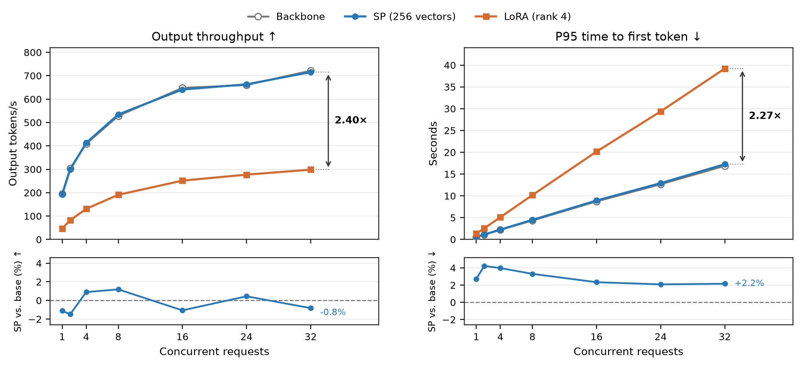
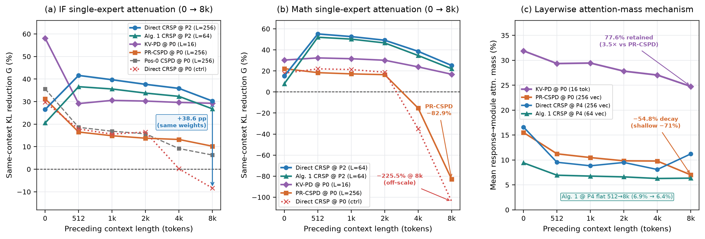
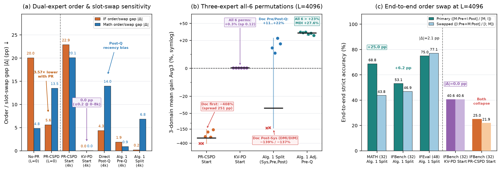
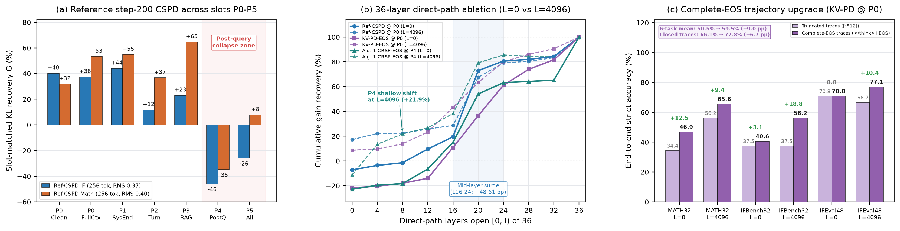

# 面向冻结大语言模型的模块化软提示蒸馏：从输入空间、键值缓存空间到语境鲁棒的任意槽位组合

## 摘要

本文围绕一个核心问题展开：**在不修改大语言模型主干参数的前提下，如何将多个独立训练的领域能力与私有知识模块化地装入外部连续空间，同时满足自由增删、低干扰并发组合以及复杂长上下文下的稳定生效。** 跨模型、跨语境与跨长度的系统实证揭示了一项根本结论：不存在一种通吃全部场景的外部软提示形态——外部模块应置于哪一层（第 0 层输入嵌入还是逐层键值缓存）、插在序列的什么位置（固定起始位还是随查询滑动）、以及组合时能否直接拼接（还是必须路由隔离），完全由**任务类型（程序性行为策略 vs. 零预训练泄露陈述性知识）**与**上下文长度**共同决定。

沿这一主线，本文建立了由上一阶段局限直接推动的三阶段模块化蒸馏框架。第一阶段评估输入空间可组合软提示蒸馏（`CSPD`），证实冻结主干下的少量输入软提示即可跨 7B–35B 模型恢复强化学习专家能力，并在域外通用能力保持与高并发吞吐上优于权重合并与 LoRA；但也定位了三项明确限制：跨全网反向传播耗时高、难以承载无预训练先验的私有文档规则，以及固定于序列起始位 $`P_0`$ 时在非起始槽位（即便全量 200 步参考检查点在 $`P_4/P_5`$）和数千词元长上下文中因浅层注意力流失而显著衰减甚至双专家崩溃。基于「软提示主要经由回复生成阶段的响应侧注意力生效」的机理分析，第二阶段将可训练参数前移至全部层的键值缓存（`KV-PD`），结合真实文本前向初始化、完整思考闭环与结束符门控、轻量自动路由、`Micro-RAG` 常量事实检索与 4-Token 增量 Delta 补丁，显著加速蒸馏并实现五域零泄露私有文档的零遗忘持续学习与零陈旧泄露版本更新，同时使程序性 `KV-PD` 在 8192 词元长上下文与全排列拼接下保持正向增益与严格顺序不变性；但其键张量受旋转位置编码绑定于 $`P_0`$，无法动态插入异构上下文中段，且短上下文训练的陈述性文档 `KV-PD` 被千词元以上无关历史隔开后规则触发失效。由此，第三阶段回归位置无关的输入空间并提出语境鲁棒的任意槽位软提示（`CRSP`），通过多槽语境随机化、跨语境输出一致性损失 $`\mathcal{L}_{\text{inv}}`$ 与对称非目标任务输出保持损失 $`\mathcal{L}_{\text{null}}`$，打通了由前置 `KV-PD` 经纯输出分布逆向编译（算法 1）与无强化学习教师两阶段构造（算法 2）两条路径，使模块随当前用户查询动态滑动挂载（$`P_2/P_4`$），将模块与生成起点的相对距离锁定为常数。

贯穿全部实验与 36 层逐层因果通路、多专家注入顺序及推理服务化验证，本文总结出四条统一规律：（1）**表示空间分工**——低幅值改写的程序性行为策略适合由输入空间 `CRSP` 滑动挂载与分槽并发（推理置 $`P_2`$、格式约束置 $`P_4`$），高信息量的零泄露陈述性知识则须由自动路由 `KV-PD`（承载多条件规则）与紧邻查询的 `Micro-RAG`（承载精确常量事实）分工处理；（2）**长上下文抗衰减仅有两条有效路径**——依赖逐层 `KV-PD` 在深层维持高注意力占比，或通过滑动 `CRSP` 与 `Micro-RAG` 紧邻当前查询消除距离退化；（3）**多专家直接拼接兼容性与注入顺序由参数幅值与物理位置共同决定**——低幅值模块配合双向非目标保持与物理分槽可压低跨专家干扰并消除顺序敏感，高幅值模块既不可无路由直接拼接，亦禁置于长历史上游（$`P_0/P_1`$）；（4）**纯输出分布两级压缩与完整闭环轨协同校准思维链终止**——仅对齐最终输出分布优于中间层几何或隐状态拟合，且能精简教师冗长推理链以提升有限预算内的闭合率与端到端准确率。结合仅响应位置输出投影的显存压缩、任意槽位虚拟词元导出配合绑定词嵌入 $`-10^9`$ 硬掩码以及滑动槽位在多租户 RadixAttention 下的 100% 共享前置长上下文 KV 缓存优势，本文最终确立了「起始位自动路由 `KV-PD` + 紧邻查询 `Micro-RAG` + 滑动分槽 `CRSP`」的冻结骨干混合分层部署架构。

---

## 1. 引言

大语言模型的强化学习后训练与企业私有规范适配往往按单一领域独立开展：数学推理、代码生成、智能体交互与复杂指令遵循各自依赖独立的数据分布与程序化验证器（Wang et al., 2026b; Ma et al., 2026a），而垂域业务规章更需随合规修订持续增删。理想的能力整合系统应同时满足四项要求：（1）充分吸收各领域专精能力增量；（2）保护既有领域性能与基座通用域外能力；（3）新增或移除任一模块的开销仅取决于该模块自身；（4）支持在系统人设、多轮对话、长篇检索文档等异构长上下文中按需动态挂载并低干扰并发组合。

现有整合路线主要分为两类。权重空间整合（如任务算术、TIES 权重合并与多教师同策略蒸馏 MOPD；Ilharco et al., 2023; Yadav et al., 2023; Wang et al., 2026b）将多专家写入同一套模型权重，每次新增能力均须重新整合，且覆写基座参数易导致既有能力遗忘与域外退化（Wang et al., 2026c）。低秩适配器（LoRA；Hu et al., 2021）虽保持各专家参数独立，但在多租户并发请求挂载不同适配器时，需在每一网络层的每一解码步引入额外矩阵计算，显著拖累吞吐并拉长首词元延迟。

本文探索一条在**严格冻结骨干权重**下将专精能力封装于外部连续表示空间的递进路线，围绕「表示深度」「参数幅值边界」与「物理挂载槽位」三个耦合设计维度构建三阶段统一框架（图 1）：

1. **阶段一（输入空间 `CSPD`）**：将强化学习专家独立蒸馏为前置输入词嵌入软提示，通过前缀鲁棒训练支持零联合微调拼接。系统实证在确立其跨模型泛化、域外保护与高并发推理优势的同时，定位了三项直接驱动后续演进的结构局限——跨全网反向传播耗时高、零预训练泄露私有文档直接拼接失效，以及离开序列起始位置后的槽位退化。
2. **阶段二（逐层键值空间 `KV-PD`）**：顺应输入软提示主要经由各层响应侧注意力生效的机理，将可训练参数直接前移至全部 Transformer 层的分组查询注意力键值缓存，采用真实文本前向键值初始化消除跨层反传开销，并构建面向零泄露私有文档的自动路由、`KV-PD + Micro-RAG` 分工与增量 Delta 版本补丁架构。与此同时，逐层键张量受旋转位置编码（RoPE；Su et al., 2024）约束而绑定于序列起点索引，难以插入异构长上下文的任意中间槽位。
3. **阶段三（语境鲁棒的任意槽位软提示 `CRSP`）**：回归位置无关的输入嵌入空间，针对六类真实部署槽位提出多槽语境随机化、跨语境输出一致性损失与对称非目标任务输出保持损失，分别解决「持有前置键值资产但无原教师」（算法 1）与「无强化学习教师、仅凭验证器」（算法 2）两类构造问题，进而与前两阶段一同接受长上下文、多专家注入顺序及虚拟词元服务化的统一压力测试。


**图 1：三阶段模块化软提示蒸馏统一架构。** **(a)** 阶段一（输入空间 `CSPD`）通过前缀鲁棒蒸馏将强化学习专家封装为独立输入嵌入向量并直接拼接；**(b)** 阶段二（逐层 `KV-PD`）通过真实文本前向初始化键值缓存直接注入各层，并结合自动路由、`Micro-RAG` 与增量补丁实现零遗忘文档持续学习；**(c)** 阶段三（任意槽位 `CRSP`）通过纯输出功能逆向（算法 1）或无教师两阶段构造（算法 2）结合跨语境一致与非目标输出保持约束，支持异构上下文任意槽位低干扰并发组装。

本文的主要贡献可概括为四点：
- **三阶段统一方法体系**：在冻结骨干上系统建立从输入空间 `CSPD`、逐层键值空间 `KV-PD` 到任意槽位 `CRSP` 的完整表示演进链，统一形式化完整思考闭环轨门控、仅响应位置输出投影、纯输出分布键值功能逆向（算法 1）、无教师两阶段自举与策略优化（算法 2）以及任意槽位虚拟词元导出。
- **程序性策略与零泄露陈述性记忆的分工边界**：通过受控优化消融、五域零预训练泄露持续学习与跨槽容量测定，定量刻画了参数均方根幅值、训练数据规模与任务性质对直接拼接兼容性的影响，确立了低范数 `CRSP` 承载程序性策略、自动路由 `KV-PD + Micro-RAG` 承载零泄露私有文档的互补分工。
- **长上下文衰减机理与多专家注入顺序规律**：在非重复真实长上下文中，通过同权重对照、逐层注意力占比追踪、全部 36 层因果通路遮蔽消融及双/三专家全排列互换，分离了位置距离退化、注意力分母稀释与高范数上游破坏三类机理，完整界定了不同架构与槽位的顺序敏感性层级。
- **端到端系统工程与部署选型准则**：实证验证仅响应投影的显存压缩、标准词元 ID 引擎虚拟词元导出的位级等价性、绑定词嵌入高范数采样风险的硬掩码防护以及滑动槽位在多租户前缀缓存共享上的结构优势，形成面向生产环境的混合分层架构选型矩阵。

---

## 2. 统一问题形式化与三阶段方法框架

### 2.1 统一问题形式化与三类外部参数化

设 $`f_{\theta_0}`$ 为具有 $`N_{\text{layer}}`$ 层、隐藏维度 $`d`$、分组查询注意力（GQA）键值头数 $`H_{\text{kv}}`$ 与单头维度 $`d_h`$ 的自回归 Transformer 语言模型，其骨干参数 $`\theta_0`$ 在全部训练与推理阶段严格保持冻结。给定用户查询序列 $`x = (x_1, \dots, x_m)`$、伴随外部部署语境 $`\mathcal{C}`$（系统人设、多轮对话历史或外部检索片段）及回复序列 $`y = (y_1, \dots, y_T)`$，无外部模块时的条件分布记为 $`p_{\theta_0}(y_t \mid \mathcal{C}, x, y_{\lt t})`$。

针对由强化学习教师 $`f_{\theta_j}`$、私有规范文档或程序化验证器 $`R(x, y)`$ 定义的目标能力，本文统一考察三类轻量外部连续参数 $`\psi`$ 及其插入方式 $`\mathcal{I}(\cdot; \psi)`$：
1. **起始位输入空间软提示（`CSPD`）**：$`\psi = \mathbf{P} \in \mathbb{R}^{L \times d}`$，固定拼接于序列索引 0 处：$`\mathbf{E}_{\text{in}} = [\mathbf{P};\, \text{Emb}(x)]`$。
2. **逐层键值缓存软提示（`KV-PD`）**：$`\psi = \mathbf{Z}_{\text{KV}} = \lbrace (\mathbf{K}^{(\ell)}, \mathbf{V}^{(\ell)})\rbrace_{\ell=1}^{N_{\text{layer}}}`$，其中 $`\mathbf{K}^{(\ell)}, \mathbf{V}^{(\ell)} \in \mathbb{R}^{L_{\text{kv}} \times H_{\text{kv}} \times d_h}`$，经由 `past_key_values` 前置注入全部注意力层。
3. **语境鲁棒的任意槽位软提示（`CRSP`）**：$`\psi = \mathbf{P} \in \mathbb{R}^{L \times d}`$ 位于第 0 层词嵌入空间，依据语境划分 $`\mathcal{C} = (\mathcal{C}_{\text{pre}}, \mathcal{C}_{\text{post}})`$ 动态插入任意指定槽位 $`s \in \mathcal{S}`$：

```math
\mathcal{I}_s(\mathcal{C}, x; \mathbf{P}) = \text{Concat}\big(\text{Emb}(\mathcal{C}_{\text{pre}}(s)),\, \mathbf{P},\, \text{Emb}(\mathcal{C}_{\text{post}}(s))\big) \qquad \text{(1)}
```

### 2.2 阶段一：输入空间可组合软提示蒸馏（CSPD）

#### 蒸馏目标与完整闭环轨门控

给定领域 $`j`$ 的强化学习教师 $`p_{\theta_j}`$ 与轨迹数据集 $`\mathcal{D}_j`$，单专家输入软提示 $`\mathbf{P}_j`$ 依据监督信息可获取性采用两类目标。在大规模离线场景中，仅对教师生成的验证通过回复词元最小化长度归一化负对数似然（Kim and Rush, 2016）：

```math
\mathbf{P}_j^\star = \arg\min_{\mathbf{P}_j} \mathbb{E}_{(x,y) \sim \mathcal{D}_j} \left[ -\frac{1}{\lvert y \rvert} \sum_{t=1}^{\lvert y \rvert} \log p_{\theta_0}\big(y_t \mid \mathcal{I}(\mathbf{P}_j, x), y_{\lt t}\big) \right] \qquad \text{(2)}
```

当教师逐词元概率可离线缓存时，为避免单样本硬标签丢弃推理分叉点的次优概率分配并控制存储开销，每步仅保留教师概率最高的 Top-$`K`$ 词元集合 $`\mathcal{V}_K(t)`$ 及合并尾概率 $`r_j(t) = 1 - \sum_{v \in \mathcal{V}_K(t)} p_{\theta_j}(v \mid x, y_{\lt t})`$，构建 Rao-Blackwellized Top-$`K`$ 前向交叉熵目标：

```math
\mathcal{L}_{\text{RB-CE}}(\mathbf{P}_j) = \mathbb{E}_{(x,y) \sim \mathcal{D}_j} \left[ \frac{1}{\lvert y \rvert} \sum_{t=1}^{\lvert y \rvert} \left( -\sum_{v \in \mathcal{V}_K(t)} p_{\theta_j}(v \mid x, y_{\lt t}) \log p_{\theta_0,\mathbf{P}_j}(v \mid x, y_{\lt t}) - r_j(t) \log \Big(1 - \sum_{v \in \mathcal{V}_K(t)} p_{\theta_0,\mathbf{P}_j}(v \mid x, y_{\lt t})\Big) \right) \right] \qquad \text{(3)}
```

在固定轨迹分布上，式 (3) 与 Top-$`K`$ 及尾类合并空间上的精确前向 KL 散度等价。同时，针对包含显式推理链 `<think>...</think>` 的模型，本文进一步引入**完整思考闭环与结束符门控**：要求每条蒸馏轨迹仅含一对格式完好的思考闭合标签、后续最终回答非空且序列末尾以终止符 `<|im_end|>` 结束，避免定长截断抹除思维链闭合与终止校准信号。

#### 前缀鲁棒训练、矩阵正交化更新与仅响应位置投影

推理期组合 $`k`$ 个独立蒸馏专家时，直接沿长度维无分隔符拼接嵌入矩阵 $`\mathbf{P}_{1:k} = [\mathbf{P}_1^\star; \dots; \mathbf{P}_k^\star]`$：

```math
p(y \mid x) = p_{\theta_0}\big(y \mid \mathcal{I}(\mathbf{P}_{1:k}, x)\big) \qquad \text{(4)}
```

为缓解多专家拼接引入的前置偏移与上下文干扰，训练中引入**前缀鲁棒随机化**（前缀 $`\mathbf{F}`$ 保持冻结且不计入损失，可基于样本内容哈希确定性切分以保证一致）：

```math
\tilde{\mathbf{E}}_{\text{in}} = \begin{cases} [\mathbf{F};\, \mathbf{P}_j;\, \text{Emb}(x)], & \text{以概率 } p_{\text{pr}} \\ [\mathbf{P}_j;\, \text{Emb}(x)], & \text{以概率 } 1 - p_{\text{pr}} \end{cases} \qquad \text{(5)}
```

优化器除 AdamW 外，同时考察矩阵正交化优化器 Muon（Liu et al., 2025），对动量矩阵 $`\mathbf{M}_t`$ 施加迭代 Newton-Schulz 近似极分解 $`\text{Orth}(\mathbf{M}_t) = \mathbf{U}\mathbf{V}^\top`$ 并监测参数偏移的有效秩（$`\exp(-\sum_i \tilde{\sigma}_i \log \tilde{\sigma}_i)`$）与单向量均方根范数（RMS）：

```math
\mathbf{P}_{t+1} = \mathbf{P}_t - \eta \sqrt{\max\left(1, \frac{L}{d}\right)}\, \text{Orth}(\mathbf{M}_t) \qquad \text{(6)}
```

在训练工程层面，面对数千词元的完整轨迹或长上下文，先经解码器骨干提取末层隐状态并**仅在有监督回复词元位置施加词表输出头（`lm_head`）投影**，在不改变任何前向与反向数值的前提下避免为大段前置上下文实例化 $`[B, T_{\text{ctx}}, V]`$ 词表 logits，显著压缩训练峰值显存。

### 2.3 阶段二：逐层键值空间软提示蒸馏（KV-PD）与持续学习架构

针对输入空间软提示仅在第 0 层接受跨全网反向传播梯度的结构低效问题，`KV-PD` 直接将全部 $`N_{\text{layer}}`$ 层的 GQA 键值张量设为可训练参数：

```math
\mathbf{Z}_{\text{KV}} = \left\lbrace \big(\mathbf{K}^{(\ell)},\, \mathbf{V}^{(\ell)}\big) \right\rbrace_{\ell=1}^{N_{\text{layer}}}, \qquad \mathbf{K}^{(\ell)}, \mathbf{V}^{(\ell)} \in \mathbb{R}^{L_{\text{kv}} \times H_{\text{kv}} \times d_h} \qquad \text{(7)}
```

为匹配冻结骨干各层固有的键值分布尺度，采用**真实文本前向键值初始化**：选取长度为 $`L_{\text{kv}}`$ 的真实任务指令或规范文本 $`u`$ 经冻结骨干无梯度前向推理，直接截取各层缓存作为初始点：

```math
\mathbf{Z}_{\text{KV}}^{(0)} = \text{KV-Cache}\big(f_{\theta_0}(u)\big) \qquad \text{(8)}
```

训练与推理时，$`\mathbf{Z}_{\text{KV}}`$ 直接拼接于每层注意力键值序列前端：

```math
\text{Attn}^{(\ell)}(\mathbf{Q}_x^{(\ell)}) = \text{Softmax}\left(\frac{\mathbf{Q}_x^{(\ell)} \big[\mathbf{K}^{(\ell)};\, \mathbf{K}_x^{(\ell)}\big]^\top}{\sqrt{d_h}}\right) \big[\mathbf{V}^{(\ell)};\, \mathbf{V}_x^{(\ell)}\big] \qquad \text{(9)}
```

每一层参数直接接收本层注意力输出的一阶梯度，免除经激活重计算串联回传至第 0 层的开销；独立蒸馏的程序性键值专家在推理期可直接沿长度维拼接 $`[\mathbf{Z}_{\text{KV}}^{(1)}; \mathbf{Z}_{\text{KV}}^{(2)}]`$。

面向零预训练泄露的私有规范文档持续学习（兼含多条件决策树规则与逐字常量事实），在 `KV-PD` 之上构建三项模块化机制：（1）**轻量自动路由与单域文件隔离**：按查询与领域原型相似度仅挂载单一目标缓存，域外查询退回空缓存，新增零干扰、删除文件即实现精确遗忘；（2）**`KV-PD + Micro-RAG` 分工互补**：`KV-PD` 专责执行多分支规则逻辑，`Micro-RAG` 紧邻用户查询按需注入极短文本常量片段；（3）**增量 Delta 版本补丁**：面对不兼容规章修订，冻结旧版缓存 $`\mathbf{Z}_{\text{KV}}^{(v_{\text{old}})}`$ 并仅在末尾追加极短增量张量 $`\Delta\mathbf{Z}_{\text{KV}}`$：

```math
\mathbf{Z}_{\text{KV}}^{(v_{\text{new}})} = \big[\text{sg}\big(\mathbf{Z}_{\text{KV}}^{(v_{\text{old}})}\big);\, \Delta\mathbf{Z}_{\text{KV}}\big] \qquad \text{(10)}
```

卸载增量切片即可瞬时回滚。然而，`KV-PD` 存在由架构决定的**固定起始位置限制**：$`\mathbf{Z}_{\text{KV}}`$ 缓存了绑定绝对索引 $`[0, L_{\text{kv}}-1]`$ 的旋转位置编码键张量，无法在不破坏相对相位或重算前置缓存的情况下动态插入异构上下文中间。

### 2.4 阶段三：语境鲁棒的任意槽位软提示（CRSP）与虚拟词元导出

#### 六类部署槽位与统一优化目标

为兼顾输入嵌入的位置无关自由度与复杂上下文稳定性，将真实推理中的挂载位置形式化为六类槽位 $`\mathcal{S} = \lbrace P_0, P_1, P_2, P_3, P_4, P_5\rbrace`$：纯净起始 $`P_0`$（$`[\mathbf{P}; x]`$）、系统中段 $`P_1`$（$`[\mathcal{C}_{\text{sys}}; \mathbf{P}; x]`$）、多轮中段 $`P_2`$（$`[\mathcal{C}_{\text{sys}}; \mathcal{C}_{\text{hist}}; \mathbf{P}; x]`$）、检索后置 $`P_3`$（$`[\mathcal{C}_{\text{sys}}; \mathcal{C}_{\text{rag}}; \mathbf{P}; x]`$）、查询后置 $`P_4`$（$`[\mathcal{C}_{\text{sys}}; \mathcal{C}_{\text{hist}}; x; \mathbf{P}]`$）及长偏移 $`P_5`$。传统前缀软提示离开 $`P_0`$ 退化的根源在于真实语义前缀稀释注意力权重、$`P_4`$ 中查询位于 $`\mathbf{P}`$ 之前导致因果顺序逆转，以及缺乏显式跨语境输出一致性约束。

`CRSP` 在每步训练中从覆盖全部槽位的语境分布 $`q_{\text{slot}}`$ 采样 $`(s, \mathcal{C})`$，对真实任务词元初始化的 $`\mathbf{P}`$ 施加单向量均方根范数裁剪 $`\text{RMS}(\mathbf{p}_i) \le \rho_{\max}`$，并联合优化两项核心约束：（1）**跨语境输出一致性损失 $`\mathcal{L}_{\text{inv}}`$**，以停止梯度的纯净起始位 $`P_0`$ 分布对齐非起始槽位分布；（2）面向多专家独立训练并发的**组合安全训练**，在其它未占用槽位注入随机外部占位向量（共存干扰）并引入**对称非目标任务输出保持损失 $`\mathcal{L}_{\text{null}}`$**，要求专家 $`\mathbf{P}^{(k)}`$ 在非目标领域集合 $`\mathcal{D}_{\neg k}`$ 上逼近冻结基座分布：

```math
\mathcal{L}_{\text{inv}}(\mathbf{P}) = \mathbb{E}_{(x,y),\, (s,\mathcal{C}) \sim q_{\text{slot}}} \left[ \frac{1}{T} \sum_{t=1}^{T} D_{\text{KL}}\Big( \text{sg}\big[p_{\theta_0,\mathbf{P}}(\cdot \mid P_0, x, y_{\lt t})\big] \, \Big\Vert \, p_{\theta_0,\mathbf{P}}(\cdot \mid s, \mathcal{C}, x, y_{\lt t}) \Big) \right] \qquad \text{(11)}
```

```math
\mathcal{L}_{\text{null}}\big(\mathbf{P}^{(k)}\big) = \mathbb{E}_{(x,y) \sim \mathcal{D}_{\neg k},\, (s,\mathcal{C}) \sim q_{\text{slot}}} \left[ \frac{1}{T} \sum_{t=1}^{T} D_{\text{KL}}\Big( \text{sg}\big[p_{\theta_0}(\cdot \mid \mathcal{C}, x, y_{\lt t})\big] \, \Big\Vert \, p_{\theta_0,\mathbf{P}^{(k)}}(\cdot \mid s, \mathcal{C}, x, y_{\lt t}) \Big) \right] \qquad \text{(12)}
```

由此构成统一离线组合安全目标（有原教师直通蒸馏时 $`\mathcal{L}_{\text{task}} = \mathcal{L}_{\text{RB-CE}}`$）：

```math
\mathcal{L}_{\text{CS-CR}}\big(\mathbf{P}^{(k)}\big) = \mathcal{L}_{\text{task}}\big(\mathbf{P}^{(k)};\, \text{co-pres}\big) + \lambda_{\text{inv}}\, \mathcal{L}_{\text{inv}}\big(\mathbf{P}^{(k)}\big) + \lambda_{\text{null}}\, \mathcal{L}_{\text{null}}\big(\mathbf{P}^{(k)}\big) \qquad \text{(13)}
```

#### 两条无原教师构造路径（算法 1 与算法 2）

1. **路径一：基于纯输出分布的键值功能逆向编译（算法 1，`KV-Inv-CRSP`）**。当系统仅存有归档的前置 `KV-PD` 模块 $`\mathbf{Z}_{\text{KV}}`$ 而无原强化学习教师权重时，直接对逐层键值张量执行最小二乘几何拟合（式 (14)）受限于逐层独立优化的 $`\mathbf{Z}_{\text{KV}}`$ 超出第 0 层输入前向可达范围：

```math
\min_{\mathbf{P}} \frac{1}{N_{\text{layer}}} \sum_{\ell=1}^{N_{\text{layer}}} \left( \frac{\Vert \mathbf{K}^{(\ell)}(\mathbf{P}) - \mathbf{K}_{\text{tgt}}^{(\ell)}\Vert_F^2}{\Vert \mathbf{K}_{\text{tgt}}^{(\ell)}\Vert_F^2} + \frac{\Vert \mathbf{V}^{(\ell)}(\mathbf{P}) - \mathbf{V}_{\text{tgt}}^{(\ell)}\Vert_F^2}{\Vert \mathbf{V}_{\text{tgt}}^{(\ell)}\Vert_F^2} \right) \qquad \text{(14)}
```

算法 1 转而采用**纯输出分布等价准则**：利用 $`\mathbf{Z}_{\text{KV}}`$ 驱动冻结骨干在无标注提示上自生成完整轨迹并缓存 Top-$`K`$ 输出分布 $`p_{\theta_0,\mathbf{Z}_{\text{KV}}}(\cdot \mid P_0)`$，随后跨多槽最小化纯输出功能编译目标（且默认不附加中间层隐状态对齐项 $`\lambda_{\text{feat}}=0`$，防止强行抹除外部语境语义表示）：

```math
\mathcal{L}_{\text{KV-Inv}}(\mathbf{P}) = \mathbb{E}_{(s,\mathcal{C}) \sim q_{\text{slot}}} \Big[ \mathcal{L}_{\text{RB-CE}}\big(p_{\theta_0,\mathbf{P}}(\cdot \mid s,\mathcal{C}) \, \Vert \, p_{\theta_0,\mathbf{Z}_{\text{KV}}}(\cdot \mid P_0)\big) \Big] + \lambda_{\text{inv}}\, \mathcal{L}_{\text{inv}}(\mathbf{P}) \qquad \text{(15)}
```

```text
Algorithm 1: 基于纯输出分布的键值功能逆向编译（KV-Inv-CRSP）
输入: 冻结骨干 f_{θ0}, 源前置键值缓存 Z_KV, 无标注提示集 X, 槽位分布 q_slot,
      目标向量数 L, 均方根范数上限 ρ_max, 权重 λ_inv, λ_null
输出: 语境鲁棒任意槽位软提示 P* ∈ R^{L × d}

1:  挂载 Z_KV 于 P0 驱动 f_{θ0} 对 X 自生成或重打分轨迹，缓存每步 Top-K 分布 p_{θ0, Z_KV}(· | P0)
2:  以任务相关真实词元嵌入初始化 P ∈ R^{L × d}
3:  for step = 1, ..., T_opt do
4:      采样小批量轨迹 (x, y) 及语境槽位 (s, C) ~ q_slot
5:      计算纯净参考 p_ref = sg[p_{θ0,P}(· | P0)] 与目标语境分布 p_ctx = p_{θ0,P}(· | s, C)
6:      计算纯输出功能编译损失 (15)，按需叠加共存干扰与非目标保持损失 λ_null · L_null(P)
7:      反向传播更新 P 并裁剪每行: p_i ← p_i · min(1, ρ_max / RMS(p_i))
8:  end for
9:  return P*
```

2. **路径二：无强化学习教师两阶段构造（算法 2，`Two-Stage TF-CRSP`）**。当仅持有冻结基座 $`f_{\theta_0}`$ 与程序化验证器 $`R(x, y) \in [0, 1]`$ 时，先由冻结基座多次采样筛选通过轨迹集 $`\mathcal{D}_{\text{win}}`$ 执行低方差的带基座 KL 约束多槽自举热启动（式 (16)），再以热启动参数 $`\mathbf{P}_{\text{S1}}`$ 为初始点与参考策略 $`\pi_{\text{ref}}`$ 执行多槽在线组相对策略优化 GRPO（Shao et al., 2024，式 (17)）：

```math
\mathcal{L}_{\text{Stage1}}(\mathbf{P}) = \mathbb{E}_{(x,y)\sim\mathcal{D}_{\text{win}},\, (s,\mathcal{C})\sim q_{\text{slot}}}\Big[\mathcal{L}_{\text{NLL}}(\mathbf{P}; s,\mathcal{C}) + \beta_{\text{base}}\, D_{\text{KL}}\big(p_{\theta_0}(\cdot \mid s,\mathcal{C}) \, \Vert \, p_{\theta_0,\mathbf{P}}(\cdot \mid s,\mathcal{C})\big)\Big] + \lambda_{\text{inv}}\, \mathcal{L}_{\text{inv}}(\mathbf{P}) \qquad \text{(16)}
```

```math
\mathcal{L}_{\text{Stage2}}(\mathbf{P}) = -\mathbb{E}_{(s,\mathcal{C}),\, \lbrace y_i\rbrace_{i=1}^G} \left[ \frac{1}{G} \sum_{i=1}^{G} \frac{1}{\lvert y_i \rvert} \sum_{t=1}^{\lvert y_i \rvert} \min\Big( r_{i,t} \hat{A}_i,\, \text{clip}(r_{i,t}, 1-\epsilon, 1+\epsilon)\hat{A}_i \Big) - \beta_{\text{kl}}\, D_{\text{KL}}\big(p_{\theta_0,\mathbf{P}} \, \Vert \, \pi_{\text{ref}}\big) \right] \qquad \text{(17)}
```

其中 $`\hat{A}_i = (R_i - \bar{R})/(\sigma_R + \delta)`$，$`r_{i,t} = p_{\theta_0,\mathbf{P}}(y_{i,t} \mid s,\mathcal{C}, x, y_{i,\lt t}) / p_{\theta_0,\mathbf{P}_{\text{old}}}(y_{i,t} \mid s,\mathcal{C}, x, y_{i,\lt t})`$。在线阶段策略模型与参考策略 $`\pi_{\text{ref}}`$ 必须接收完全一致的语境与占位序列，防止参考分布错位。

```text
Algorithm 2: 无强化学习教师的两阶段 CRSP 构造（Two-Stage TF-CRSP）
输入: 冻结基座 f_{θ0}, 训练集 X, 验证器 R(x, y), 槽位分布 q_slot,
      组采样数 G, 裁剪阈值 ε, 权重 β_base, β_kl, λ_inv, 范数上限 ρ_max
输出: 语境鲁棒任意槽位软提示 P* ∈ R^{L × d}

1:  用 f_{θ0} 对 X 采样多路轨迹，筛出 R(x, y)=1 的轨迹集 D_win
2:  最小化式 (16)（每步施加 RMS 裁剪 ρ_max），得低方差热启动参数 P_S1
3:  令 P ← P_S1，固定参考策略 π_ref ← p_{θ0, P_S1}
4:  for step = 1, ..., T_rl do
5:      采样训练提示 x 及语境槽位 (s, C) ~ q_slot，在相同 (s, C) 下采样 G 条轨迹 {y_i}
6:      调用验证器计算奖励 R_i 与组内优势 Â_i，在一致输入下按式 (17) 更新 P 并裁剪 ρ_max
7:  end for
8:  return P*
```

#### 任意槽位虚拟词元导出与绑定词嵌入防护

为使输入空间 `CSPD` 与任意槽位 `CRSP` 直接运行于无需改动内核的标准词元 ID 推理引擎（如 SGLang、vLLM），本文将软提示向量追加至派生 `safetensors` 权重的 `model.embed_tokens.weight` 末尾（其余分片符号链接复用，逐字节 SHA-256 校验），并在推理期将模块以连续虚拟词元 ID 插入任意槽位（$`P_0`$–$`P_4`$）。针对输入/输出词嵌入权重绑定的骨干架构（如 Qwen3），追加的高范数虚拟词元行会直接充当输出投影矩阵行向量，存在解码阶段意外采样出虚拟词元的高风险，因此必须在解码采样器中对全部虚拟词元及词表填充区施加 $`-10^9`$ 硬 `logit_bias` 掩码或严格词表白名单。此外，在推理期多专家物理布局上区分**分槽插入**（如 `[Math@P2 + IF@P4]`）与**同槽相邻拼接**（如 `[Math; IF]@P2`），且滑动槽位 $`P_2/P_4`$ 位于共享系统提示、历史对话与 RAG 文本之后，使搭载不同专家组合的并发请求可在 RadixAttention 前缀树中完整共享前置长上下文的 KV 缓存。

---

## 3. 实验设计与统一评测协议

### 3.1 统一相对评估指标

除各基准的绝对准确率外，本文统一使用三项标准化指标定量衡量能力恢复与作用机理：
1. **教师增益恢复率（Recovery, $`R`$）**：设基座、教师与挂载模块模型的得分分别为 $`A_S`$、$`A_T`$ 与 $`A_{S+P}`$（$`A_T \gt A_S`$）：

```math
R = \frac{A_{S+P} - A_S}{A_T - A_S} \times 100\% \qquad \text{(18)}
```

2. **留出分布对齐增益（Distributional Alignment Gain, $`G`$）**：设在固定留出轨迹与同一测试语境下，基座与候选模型 $`A`$ 相对目标教师 $`T`$ 的前向 KL 散度分别为 $`D_{\text{KL}}(T \Vert S)`$ 与 $`D_{\text{KL}}(T \Vert A)`$：

```math
G(A) = \left(1 - \frac{D_{\text{KL}}(T \Vert A)}{D_{\text{KL}}(T \Vert S)}\right) \times 100\% \qquad \text{(19)}
```

3. **注意力路径增益保留率（Improvement Kept, $`K`$）**：在因果注意力掩码消融中，设全路径模型为 $`S+P`$、对照基准为 $`B`$（基座或全屏蔽状态），受限路径 $`A`$ 的相对保留比例为：

```math
K(A) = \frac{D_{\text{KL}}(T \Vert B) - D_{\text{KL}}(T \Vert A)}{D_{\text{KL}}(T \Vert B) - D_{\text{KL}}(T \Vert S+P)} \times 100\% \qquad \text{(20)}
```

### 3.2 骨干模型与四层递进实验基准

1. **跨架构单专家与四域组合基准**：跨模型单专家实验覆盖 7B 至 35B 参数规模的 23 组稠密与混合专家（MoE）公开模型对（256 向量软提示）。统一受控对比均在 36 层 Qwen3-4B 骨干 `M2RL-SFT`（Wang et al., 2026b，原生窗口 32k）上开展：四域全量组合涵盖数学（AIME24）、代码（LiveCodeBench v5）、科学（GPQA-Diamond）与指令遵循（IFBench）四个强化学习教师（200 步 Muon，128–256 随机前缀）及六项域外基准（XSTest、TruthfulQA、BFCL、TriviaQA、BBEH、FinQA）；受控消融在单卡 A100-80GB / RTX PRO 6000 Blackwell 上采用 Top-64 前向散度（45/60 步，短截断对比完整 `</think>` + EOS 闭环轨），评测留出 `IFEval`（$`N=48/96`$）、`IFBench`（$`N=32/40/64`$）与 `MATH`（$`N=32/48`$），同步记录严格通过率与预算内闭合思考链的条件准确率（闭合精度）。
2. **五域零预训练泄露私有规范持续学习基准**：构建五个完全合成、无预训练语料泄露的企业规范域——`HeliosPay v4.2`（含不兼容升级版 `v5.0`）、`NVX-418`、`Litho-X9`、`GridPulse-9` 与 `Meridian-C3`（共 172 道域内多条件规则与逐字常量事实题及 24 道域外拒答题）。
3. **六槽位鲁棒性与多专家分槽并发基准**：在 $`P_0`$–$`P_5`$ 六槽（含 420 词元对抗检索文档 `P3` 与超千词元偏移 `P5`）上度量同语境增益 $`G_{\text{vs ctx}}`$、跨位置漂移 $`\text{Drift-KL}(P_k, P_0)`$、三随机种子（42/108/202）收敛方差，以及三专家 `[Doc@P1 + Math@P2 + IF@P4]` 并发的 Top-32 跨专家 KL 干扰矩阵与端到端准确率。
4. **长上下文（0 → 8192）衰减、注入顺序与服务化基准**：从 `Salesforce/wikitext` 提取 126 段互不重复文本结合多轮对话历史，精确构造 $`L_{\text{ctx}} \in \lbrace 0, 512, 1024, 2048, 4096, 8192\rbrace`$ 语境包，系统测定单/双/四专家衰减、9 层注意力占比与全部 36 层直接响应通路因果遮蔽消融、双专家分槽/同槽互换、三专家全部 $`3!=6`$ 种排列，以及仅响应投影显存与虚拟词元导出等价性。

---

## 4. 阶段一实证：输入空间 CSPD 的能力边界与失效诊断

### 4.1 单专家泛化、四域持续组合、域外保持与并发服务效率

表 1 首先验证单个 256 向量输入空间软提示在 23 组跨模型与任务形态（数学推理、代码生成、软件工程与终端智能体）上的恢复能力。在 23 组设置中，22 组恢复了至少 90% 的强化学习教师增益，15 组达到或超过教师模型（多步智能体中 6 组有 5 组超教师）。在 `GPT-OSS-Swallow-20B` 上的受控消融进一步表明：（1）向量数取 2/8/32/256/512 时恢复率依次为 51.23%、74.11%、90.01%、93.10% 与 87.83%，32 向量即捕获绝大部分增益；（2）同等参数规模下软提示（737k 参数，96.06%）与 5 秩 K/V LoRA（814k 参数，95.72%）相当，且混入 31% 错误轨迹时仍保持 90.54% 恢复率。

| 强化学习前基座模型 | 强化学习专家教师 | 文献来源 | 基座得分 | 教师得分 | 软提示得分 | 恢复率 $`R`$ (%) |
| :--- | :--- | :--- | :---: | :---: | :---: | :---: |
| *(a) 数学推理（AIME / MATH / AMC / HMMT）* | | | | | | |
| MiMo-7B-SFT | MiMo-7B-RL | Xiaomi LLM-Core et al., 2025 | 63.77 | 73.18 | 72.25 | 90.15 |
| GPT-OSS-Swallow-20B-SFT | GPT-OSS-Swallow-20B-RL | Swallow LLM, 2026a | 76.53 | 90.21 | 89.67 | 96.06 |
| Qwen3-Swallow-8B-SFT | Qwen3-Swallow-8B-RL | Swallow LLM, 2026b | 63.68 | 83.01 | 82.28 | 96.22 |
| OLMo-3-7B-Instruct-DPO | OLMo-3-7B-Instruct | Team OLMo et al., 2026 | 42.97 | 60.72 | 60.13 | 96.70 |
| Nemotron-Cascade-8B-SFT | Nemotron-Cascade-8B-MathRL | Wang et al., 2026a | 85.25 | 89.34 | 89.30 | 99.18 |
| Qwen3-Swallow-30B-A3B-SFT | Qwen3-Swallow-30B-A3B-RL | Swallow LLM, 2026b | 72.91 | 86.25 | 86.23 | 99.79 |
| Eurus-2-7B-SFT | Eurus-2-7B-PRIME | Cui et al., 2025 | 36.06 | 49.63 | 49.91 | 102.07 |
| INTELLECT-MATH-SFT | INTELLECT-MATH | Prime Intellect, 2025 | 45.47 | 54.11 | 54.62 | 105.89 |
| Poro-2-8B-Long-Math-SFT | Poro-2-8B-Long-Math-RL | Hakala et al., 2026 | 68.34 | 72.43 | 73.88 | 135.47 |
| Klear-Reasoner-8B-SFT | Klear-Reasoner-8B | Su et al., 2026 | 62.15 | 65.00 | 66.11 | 139.02 |
| *(b) 代码生成（LiveCodeBench）* | | | | | | |
| MiMo-7B-SFT | MiMo-7B-RL（代理数据） | Xiaomi LLM-Core et al., 2025 | 50.17 | 52.87 | 52.55 | 88.08 |
| Nemotron-Cascade-8B-SFT | Nemotron-Cascade-8B-CodeRL | Wang et al., 2026a | 55.73 | 69.39 | 69.56 | 101.21 |
| Klear-Reasoner-8B-SFT | Klear-Reasoner-8B | Su et al., 2026 | 53.44 | 57.27 | 57.34 | 101.83 |
| Qwen3-14B | AReaL-boba-2-14B-Open | Fu et al., 2026 | 64.86 | 68.06 | 68.14 | 102.38 |
| Mellum2-12B-A2.5B-SFT | Mellum2-12B-A2.5B-Instruct | Kojic et al., 2026 | 36.30 | 39.05 | 39.34 | 110.34 |
| Qwen3-8B | AReaL-boba-2-8B-Open | Fu et al., 2026 | 58.54 | 62.20 | 62.96 | 120.83 |
| OLMo-3-7B-Instruct-DPO | OLMo-3-7B-Instruct | Team OLMo et al., 2026 | 28.50 | 34.10 | 36.54 | 143.44 |
| *(c) 软件工程智能体（SWE-bench Verified，500 任务）* | | | | | | |
| Nemotron-Cascade-8B-SFT | Nemotron-Cascade-8B | Wang et al., 2026a | 23.60 | 34.60 | 33.75 | 92.27 |
| Qwen3-32B | DeepSWE-Preview | Luo et al., 2025 | 24.90 | 44.05 | 45.65 | 108.36 |
| Qwen3.5-35B-A3B | Lego-RL-35B-A3B | Du et al., 2026 | 64.00 | 70.40 | 72.25 | 128.91 |
| SWE-Gym-OpenHands-7B | SkyRL-Agent-7b-v0 | Cao et al., 2025 | 11.40 | 12.80 | 13.60 | 157.14 |
| *(d) 终端交互智能体（Terminal-Bench 2.1，89 任务）* | | | | | | |
| Qwen3.5-9B | TMax-9B | Ivison et al., 2026 | 20.22 | 28.09 | 29.96 | 123.81 |
| Qwen3.6-27B | TMax-27B | Ivison et al., 2026 | 43.45 | 46.07 | 48.69 | 200.00 |

**表 1：跨 23 组公开数学、代码与智能体强化学习专家的单专家输入空间软提示蒸馏结果（百分比）。**

在 `M2RL-SFT` 四域多专家组合中（表 2），独立蒸馏后直接拼接的四域软提示（`MCSI`）将基座均值由 50.41 提升至 **67.83**（恢复率 107.5%），与全模型联合重训的 MOPD（67.79）持平并优于全部权重合并与 LoRA 合并基线（65.50–67.47）；完全反转拼接顺序（`ISCM`）仍达 **67.72**（顺序差仅 **0.11 pp**），且在 GPQA-Diamond 上产生 +8.53 pp 跨领域正向迁移。去掉前缀鲁棒训练后，AdamW 组合均值由 66.60 降至 64.50。

| 适配方法 | 表示空间 | AIME24 | LiveCodeBench v5 | GPQA-Diamond | IFBench | 四域均值 | 恢复率 (%) |
| :--- | :--- | :---: | :---: | :---: | :---: | :---: | :---: |
| 冻结基座模型（无提示） | — | 55.94 | 58.61 | 44.38 | 42.71 | 50.41 | 0.0 |
| 独立领域专家（理想路由上界） | 全模型（4 份） | 81.77 | 66.92 | 50.44 | 67.33 | 66.61 | 100.0 |
| Task Arithmetic（$`\lambda=1.0`$） / TIES | 全模型权重 | 78.85 / 81.25 | 64.52 / 65.42 | 54.14 / 57.07 | **71.58** / 66.12 | 67.27 / 67.47 | 104.1 / 105.2 |
| 多教师同策略蒸馏（MOPD） | 全模型权重 | **83.28** | **66.24** | 55.21 | 66.42 | 67.79 | 107.2 |
| LoRA 蒸馏 + TA / TIES | LoRA 权重 | 80.21 / 81.41 | 63.10 / 64.00 | 56.22 / 56.66 | 62.46 / 62.67 | 65.50 / 66.19 | 93.1 / 97.3 |
| 单域软提示（理想单域挂载） | 输入软提示 | 80.89 | 64.67 | 49.24 | 66.71 | 65.38 | 92.4 |
| `CSPD` 无前缀鲁棒（AdamW，ISCM） | 输入软提示 | 76.98 | 64.15 | 51.89 | 65.00 | 64.50 | 87.0 |
| `CSPD`（AdamW，ISCM） | 输入软提示 | 79.74 | 65.94 | 55.78 | 64.96 | 66.60 | 99.9 |
| `CSPD`（Muon，ISCM） | 输入软提示 | 79.90 | 65.72 | **57.92** | 67.33 | 67.72 | 106.8 |
| **`CSPD`（Muon，MCSI）** | **输入软提示** | 80.47 | 64.67 | 57.77 | 68.42 | **67.83** | **107.5** |

**表 2：`M2RL-SFT` 四领域多专家组合与权重/LoRA 整合基线对比（百分比）。**

持续扩展实验进一步验证了模块独立性的优势（图 2 与图 3）。按到达顺序逐一前置添加（`Student → I → SI → CSI → MCSI`）使总体均值严格单调上升（50.4 → 61.0 → 61.7 → 63.7 → 67.8%）；改用后置追加（`Student → I → IS → ISC → ISCM`）同样单调上升（50.41 → 60.99 → 62.29 → 63.58 → 67.72%；各域终态分别为 79.90%、65.72%、57.92%、67.33%），且在 `MCSI` 与 `ISCM` 上逐一移除任一模块均导致总体均值下降（`ISCM` 留一移除 M/C/S/I 分别变化 -4.14/-0.25/-0.47/-3.30 pp）。相比之下，渐进软提示训练反而侵蚀了最早的指令遵循能力（IFBench 跌至 50.9%–61.4%），而 TIES 权重合并在仅引入指令遵循专家时即导致代码基准由 58.61% 跌至 52.69%。


**图 2：能力持续扩展与留一跨领域贡献。** **(a)** 独立软提示按 `I → S → C → M` 依次前置拼接使四域均值单调上升至 67.8%，无需重训既有模块；**(b)** 从完整 MCSI 留一移除各模块后得分变化（pp），全部模块均产生正向边际贡献。


**图 3：独立软提示、渐进软提示与专家 TIES 权重合并的持续扩展曲线。** 独立软提示在全部到达阶段总体均值均高于渐进提示与 TIES，并彻底避免 TIES 合并在代码基准上引发的权重级遗忘。

由于骨干参数严格冻结，四域拼接 `CSPD` 在六个域外通用基准上取得最高均值 **56.6**（表 3，领先 MOPD 3.1 分），并在 TruthfulQA 上几乎无损（-0.4 vs. MOPD -3.6）。同时，因为软提示仅增加少量预填充上下文且不改动解码线性投影，在单卡 B200（SGLang，BF16 `GPT-OSS-20B`，每并发请求挂载互异适配器）上，32 并发吞吐维持在原骨干 0.8% 以内（715.4 vs. 721.3 tokens/s），达到 4 秩 LoRA（298.5 tokens/s）的 **2.40 倍**，P95 首词元延迟降低 **2.27 倍**（17.26 vs. 39.21 s），且对投机解码草稿模型几乎无损（EAGLE-3 接受长度 -2.6%，DFlash -4.7%，见图 4）。

| 方法 | XSTest | TruthfulQA | BFCL | TriviaQA | BBEH | FinQA | 六基准均值 |
| :--- | :---: | :---: | :---: | :---: | :---: | :---: | :---: |
| 冻结基座模型（无提示） | 80.4 | **64.6** | 47.6 | 31.5 | 11.1 | 66.3 | 50.3 |
| TIES / MOPD | 82.4 / 84.2 | 63.7 / 61.0 | 48.5 / 49.4 | **33.6** / 31.9 | 25.6 / 23.9 | 70.9 / 70.8 | 54.1 / 53.5 |
| LoRA 蒸馏 + TA（$`\lambda=0.5`$） | 85.1 | 63.8 | 47.5 | 32.7 | 23.0 | 70.9 | 53.8 |
| **`CSPD`（MCSI 四域拼接）** | **88.2** (+7.8) | 64.2 (-0.4) | **55.6** (+8.0) | 33.5 (+2.0) | **25.8** (+14.7) | **72.5** (+6.2) | **56.6** (+6.4) |

**表 3：六个独立域外通用基准得分对比（百分比，括号内为相对冻结基座的变化量）。**



**图 4：单卡 B200（SGLang）每请求独立适配器的多并发服务效率。** 1 至 32 并发全区间内，256 向量软提示吞吐始终处于原骨干 $`\pm 1.5\%`$ 范围内，在 32 并发下输出吞吐为 4 秩 LoRA 的 2.40 倍、P95 首词元延迟降低 2.27 倍。

### 4.2 作用机理与三大结构局限（驱动阶段二与阶段三演进）

跨 20B 数学与 4B 指令遵循的机理分析（图 5）表明：软提示并非编码可读词表词元（84%–100% 向量仍以初始化词元为最近邻，但中位余弦相似度已降至 0.16–0.34）；其分布校准能力远超语义等价的自然语言校验指令（20B 缩减 86.8% KL vs. 显式指令 $`\le 2.1\%`$；4B 取得 +37.01% vs. 显式指令负增益），核心表现为提升 `?`、`But`、`Check` 等核查转折词概率并抑制 `.\n\n`、`Thus` 等过早总结词；最关键的是，因果注意力掩码消融证实**软提示主要经由回复生成阶段的响应侧直接注意力起作用**——仅允许回复关注软提示（Response only）即可在 20B 与 4B 上分别保留 **80%** 与 **70.0%** 的改善，而阻断回复侧注意力（Input only）分别跌至 33% 与 0.84%。


**图 5：输入空间软提示的内部作用机理。** **(a)** 软提示与显式自然语言指令的教师–学生 KL 缩减比例 $`G`$；**(b)** 20B 数学轨迹中概率最常被上调与下调的前 4 类词元；**(c)** 因果注意力掩码消融下的增益保留率 $`K`$，表明效果主要由响应侧直接注意力承载。

然而，受控消融与拓展审计暴露了输入空间 `CSPD` 的**三项核心结构局限**，直接驱动了后续两阶段的方法演进：
1. **跨层反向传播耗时高且对短预算优化与范数敏感（引出第 5 节 `KV-PD`）**：软提示虽在全部 36 层响应注意力中生效，却被迫经激活重计算从顶层反向传回第 0 层，单卡 A100 上 45 步即耗时约 196 秒，且高度依赖初始化（任务指令 +34.59%、随机词表 +26.66%、高斯 +7.45%）与截断长度（256 词元截断骤降至 -57.63%）。在 60 步受控双域实验中，前缀鲁棒训练虽将顺序差压缩 **3.57 倍**（20.05 → 5.61 pp），但短预算无裁剪 Muon（RMS 0.1380，有效秩 242.4）在双域直接拼接下产生负干扰，需低范数 AdamW（RMS 0.0463）方能维持双域正增益（`IFBench` $`N=40`$ 达 47.50%）。需要指出的是，对表 2 中全量数据（8k–14k 条验证轨）200 步参考 Muon 软提示的直接几何审计显示，其全局 RMS 达 0.3693–0.4134（M 0.4044、C 0.4134、S 0.3750、I 0.3693，有效秩 246.2–251.1），说明大规模前缀鲁棒训练可在短上下文 $`P_0`$ 支撑高范数程序性拼接，而短预算高范数与下文零泄露文档高范数均会诱发拼接失效。
2. **零预训练泄露私有文档容量受限且直接拼接归零（引出第 5.2 节自动路由 `KV-PD + Micro-RAG`）**：在三域零泄露合成规范基准上（$`L=128`$，120 步约 270 秒），输入软提示单域准确率仅 11.76%–44.12% 且在 $`L=256`$ 非单调退化（38.89% → 27.78%）；直接拼接时双域降至 0.0%–5.88%，三域全数归零（同期顺序 LoRA 亦发生严重灾难性遗忘：`HeliosPay` 47.22% → 0.0%）。
3. **非起始部署槽位严重退化（引出第 6 节 `CRSP`）**：即便上述经过全量 200 步与 128–256 随机前缀训练的参考 `CSPD` 检查点，一旦移至查询后槽位 $`P_4/P_5`$ 仍发生崩溃（第 6.1 节表 6 与图 15(a) 显示参考 `I` 跌至 -46.03%/-26.00%，参考 `M` 在 $`P_4`$ 跌至 -34.84%）。

---

## 5. 阶段二实证：逐层 KV-PD 的训练加速与零遗忘持续学习

针对第 4.2 节的前两项局限，本节在冻结 36 层 `M2RL-SFT` 骨干上评估真实文本前向初始化的逐层 `KV-PD`（每虚拟键值词元 $`73{,}728`$ 参数，$`L_{\text{kv}}=8/16/32`$ 对应 590k / 1.18M / 2.36M 参数，真实文本初始化后各层初始 RMS 稳定于 2.46–2.58）。

### 5.1 训练加速、完整 EOS 闭环轨升级与双专家顺序不变性

在统一 45 步更新预算下（表 4 与图 6(a)），参数量更小的 `KV-PD`（$`L_{\text{kv}}=8`$，590k 参数）仅用 **72.3 秒**即取得 **$`G_{\text{IF}}=+65.46\%`$**，相对输入空间最优基线（196.7 秒，+34.59%）实现 **2.71 倍墙钟加速**与 **1.89 倍分布对齐增益**；仅第 2 步（3.3 秒）即达 +26.08%，接近随机词表输入软提示全轮 195.8 秒的终值。数学域同样在 81.6 秒达 $`G_{\text{Math}}=+28.01\%`$（对比输入软提示 205.5 秒仅 +1.11%）。

| 方法与配置（45 步更新，单卡 A100） | 参数量 | 峰值显存 (GB) | 墙钟耗时 (s) | 第 2 步 $`G_{\text{IF}}`$ (%) | 第 10 步 $`G_{\text{IF}}`$ (%) | 最终 $`G_{\text{IF}}`$ (%) | 最终 $`G_{\text{Math}}`$ (%) |
| :--- | :---: | :---: | :---: | :---: | :---: | :---: | :---: |
| 输入空间软提示（低范数 / 范数裁剪 Muon） | 655,360 | 12.99 | 195.7 / 196.4 | — | -23.52 / -21.59 | +7.45 / +11.83 | — / +1.11 |
| 输入空间软提示（随机词表 Muon / 低范数 AdamW） | 655,360 | 12.99 | 195.8 / 197.3 | — | +2.30 / -4.91 | +26.66 / +30.48 | — |
| 输入空间软提示（任务指令初始化 Muon） | 655,360 | 12.99 | 196.7 | — | +8.67 | +34.59 | — |
| **`KV-PD`（$`L_{\text{kv}}=8`$，AdamW）** | **589,824** | 16.84 | **72.3** | **+26.08** (3.3 s) | **+46.06** | **+65.46** | — |
| **`KV-PD`（$`L_{\text{kv}}=16`$，AdamW）** | 1,179,648 | 16.89 | **72.5** | +24.33 (3.3 s) | +31.25 | +59.68 | **+28.01** (81.6 s) |

**表 4：统一 45 步更新预算下 `KV-PD` 与输入空间软提示的训练效率与留出分布对齐对比。**

直接拼接独立蒸馏的数学与指令遵循 `KV-PD`（$`L_{\text{kv}}=16`$）时（图 6(b)），正序 $`[\mathbf{Z}_{\text{Math}}; \mathbf{Z}_{\text{IF}}]`$ 与逆序 $`[\mathbf{Z}_{\text{IF}}; \mathbf{Z}_{\text{Math}}]`$ 同步保持双域正增益（均值 +19.84% vs. +19.96%，顺序差仅 **0.12 pp**），且在 `IFBench`（$`N=32`$）端到端测试中取得 88.24% 闭合精度（高于输入拼接 61.90%）。进一步启用第 2.2 节提出的**完整 `</think>` + `<|im_end|>` 闭环轨门控**（教师完整轨均值达 902.8 与 634.0 词元，消除此前 512 词元截断对终止信号的破坏）后，第 7.2 节表 14 与图 15(c) 证实 `KV-PD-EOS` 在 `MATH32`、`IFBench32`、`IFEval48` 的长短上下文全部 6 项端到端评测中零退化，六项均值由 50.52% 一致跃升至 **59.55%（+9.03 pp）**，总闭环率由 66.1% 升至 **72.8%**。


**图 6：`KV-PD` 的训练加速与双专家拼接顺序不变性。** **(a)** 45 步更新内 `KV-PD` 相对最优输入软提示实现 2.71× 墙钟提速与 1.89× 分布对齐增益；**(b)** 双专家直接拼接保持双域正增益且正反顺序差仅 0.12 pp。

### 5.2 五域零遗忘持续学习、容量缩放与增量版本补丁

在扩展至五域的零预训练泄露规范持续学习基准（单域 80 步仅耗时 55–58 秒，缓存文件 2.36 MB bf16）上，表 5 与图 7 显示：轻量自动路由在五域规则题上均达 100.0% 路由精度；`KV-PD + Micro-RAG` 分工架构同步达到 **57.50% 规则准确率、96.00% 常量事实准确率与 91.67% 域外拒答率**，跨领域遗忘为 **0.00%**，终态总体均值（69.2%）达到顺序 LoRA（15.3%）的 **4.53 倍**（顺序 LoRA 与输入拼接在多域到达后迅速溃败）。

| 五域零泄露持续学习方法 | 域 A 规则/事实 | 域 B 规则/事实 | 域 C 规则/事实 | 域 D 规则/事实 | 域 E 规则/事实 | 五域均值 Rules / Facts | OOD 拒答 | 跨领域遗忘 |
| :--- | :---: | :---: | :---: | :---: | :---: | :---: | :---: | :---: |
| 冻结基座（D、E 零泄露校验） | — | — | — | 0.0 / 10.0 | 0.0 / 0.0 | 0.00 / 5.00 | — | — |
| 仅 `Micro-RAG`（前三域） | 0.0 / 100.0 | 0.0 / 100.0 | 0.0 / 100.0 | — | — | 0.00 / 100.00 | — | — |
| 顺序 LoRA（完成第 5 域后） | 2.78 (总) | 0.00 (总) | 0.00 (总) | 2.94 (总) | 70.59 (总) | 19.17 / 5.67 | 91.67 | 严重遗忘 |
| 自动路由 `KV-PD`（$`L_{\text{kv}}=16`$） | 54.17 / 16.67 | 58.33 / 80.00 | 54.17 / 10.00 | 54.17 / 60.00 | 66.67 / 40.00 | **57.50** / 41.33 | **91.67** | **0.00%** |
| **自动路由 `KV-PD` + `Micro-RAG`** | 54.17 / 100.0 | 58.33 / 90.00 | 54.17 / 100.0 | 54.17 / 90.00 | 66.67 / 100.0 | **57.50** / **96.00** | **91.67** | **0.00%** |

**表 5：五域零预训练泄露持续学习评测汇总（百分比）。**


**图 7：五域零泄露私有文档持续学习逐域演化轨迹。** 自动路由 `KV-PD + Micro-RAG` 在全部五个域上维持严格零遗忘的水平保持线，五域总体均值单调升至 69.2%，显著优于遗忘严重的顺序 LoRA 与归零的输入拼接。

图 8 进一步揭示了 `KV-PD` 在垂域容量缩放与在线版本更新上的优势：（a）在 `HeliosPay v4.2` 上，`KV-PD` 规则准确率随槽位长度单调提升（$`L_{\text{kv}}=8/16/32`$ 分别为 45.83% / 54.17% / **66.67%**，总体达 **61.11%**），克服了输入软提示在 $`L=256`$ 的非单调退化；（b）在 `v4.2 → v5.0` 不兼容规章修订中，仅追加 $`L_\Delta=4`$（295k 增量参数，训练 57.0 秒）的 **4-Token Delta 补丁**即达到 **83.3%** 新规则准确率（超过全文上下文基线 70.8%），并将旧版规则陈旧泄露由 50.0% 彻底压降至 **0.0%**。几何统计同时印证了第 4.2 节的范数规律：零泄露陈述性文档 `KV-PD` 偏移 RMS 高达 0.21–0.23（显著高于程序性策略的 0.13–0.14），若绕过路由将其无隔离拼接，多域准确率同样骤降至 0.0%–5.9%。


**图 8：`KV-PD` 垂域容量缩放与策略版本增量更新实证。** **(a)** `KV-PD` 在 `HeliosPay v4.2` 上随长度单调扩展至 66.7% 规则准确率；**(b)** 4-Token 增量补丁在 57 秒内将陈旧 `v4.2` 泄露由 50.0% 压降至 0.0% 并达到 83.3% 新规则准确率。

**阶段二向阶段三的过渡**：尽管 `KV-PD` 彻底解决了训练耗时与零泄露文档持续学习难题，但其键张量绑定于绝对起始位置 $`[0, L_{\text{kv}}-1]`$，既无法在系统人设、多轮对话或检索文档之后动态挂载，也无法在不同租户间共享前置长上下文 KV 缓存。这一限制直接催生了第 6 节的语境鲁棒任意槽位软提示（`CRSP`）。

---

## 6. 阶段三实证：语境鲁棒的任意槽位软提示（CRSP）

围绕第 4.2 节发现的非起始槽位退化与第 5.2 节末尾指出的 `KV-PD` 固定起始位置限制，本节在 `M2RL-SFT` 冻结骨干上系统检验 `CRSP` 框架、算法 1（键值功能逆向编译）、算法 2（无教师两阶段构造）以及组合安全多专家并发训练（$`\rho_{\max}`$ 对 $`L=256/64/128`$ 文档分别取 0.038 / 0.047 / 0.14；$`\lambda_{\text{null}}`$ 对 IF / Math / Doc 分别取 0.20 / 0.35 / 0.85）。

### 6.1 六槽位鲁棒性、键值功能逆向（算法 1）与无教师路径（算法 2）

表 6 将短预算传统前缀、**全量 200 步参考 `CSPD` 检查点（`I` RMS=0.37、`M` RMS=0.40）**、有教师直通 `CRSP` 与三类无原教师键值逆向方法置于同一六槽基准（$`P_0`$–$`P_5`$）直接对照，配合图 9 呈现清晰分化：

| 方法配置（$`P_0`$–$`P_5`$ 六槽位对齐增益 $`G_{\text{vs ctx}}`$） | $`P_0`$ (%) | $`P_1`$ (%) | $`P_2`$ (%) | $`P_3`$ (%) | $`P_4`$ (%) | $`P_5`$ (%) | $`P_1`$–$`P_5`$ 均值 (%) | 漂移 KL ↓ | L36 余弦 ($`P_2`$/$`P_3`$/$`P_4`$) |
| :--- | :---: | :---: | :---: | :---: | :---: | :---: | :---: | :---: | :---: |
| **全量 200 步参考 `CSPD I`（IF，RMS 0.37）** | **+40.29** | **+44.07** | +11.71 | +23.06 | **-46.03** | **-26.00** | +1.36 | 0.2143 | — |
| **全量 200 步参考 `CSPD M`（Math，RMS 0.40）** | +31.94 | **+54.87** | +36.83 | +64.59 | **-34.84** | +7.88 | +25.87 | 0.0811 | — |
| 起始位输入软提示（Pos-0 SP，$`L=256`$） | +28.28 | +23.89 | -1.25 | +6.80 | +7.81 | +7.15 | +8.88 | 0.1843 | 0.881 / 0.852 / 0.854 |
| 前缀鲁棒软提示（PR-SP，$`L=256`$） | +23.97 | +29.43 | +12.78 | +22.54 | **-12.10** | +19.44 | +14.42 | 0.1602 | 0.877 / 0.834 / 0.862 |
| 多槽随机化软提示（无 $`\mathcal{L}_{\text{inv}}`$，$`L=256`$） | +26.91 | +33.78 | +36.31 | **+46.42** | +20.01 | **+42.39** | **+35.78** | 0.0786 | 0.921 / 0.926 / 0.919 |
| **直通 `CRSP`（含 $`\mathcal{L}_{\text{inv}}`$，$`L=256`$ / $`64`$）** | +25.19 / +26.58 | +32.08 / +30.61 | **+37.06** / +32.83 | +45.40 / +41.08 | +19.32 / **+20.63** | +41.99 / +38.02 | +35.17 / +32.63 | 0.0778 / 0.0900 | **0.938 / 0.948 / 0.941** |
| 前置 `KV-PD`（$`L_{\text{kv}}=16`$，仅绑定 $`P_0`$） | +37.99 | +36.25 | +28.47 | +28.88 | +28.47 | +27.34 | +29.88 | — | — |
| 无数据 / 语境几何拟合（Geo-Inv / CR-Geo-Inv） | -4.98 / -8.01 | +1.57 / +2.04 | -6.95 / -1.11 | -4.29 / +9.16 | -6.96 / -7.57 | -3.61 / +8.30 | -4.05 / +2.16 | 0.1803 / 0.1418 | 0.782 / 0.723 / 0.738 |
| **算法 1 键值功能逆向（$`L=256`$，$`\lambda_{\text{feat}}=0`$）** | +18.86 | +26.35 | +33.80 | +42.75 | +15.70 | +39.42 | +31.60 | **0.0555** | 0.930 / 0.926 / 0.934 |
| 隐状态联合逆向（$`L=256`$，$`\lambda_{\text{feat}}\gt 0`$） | +17.93 | +24.15 | +31.32 | +40.57 | +13.20 | +37.29 | +29.31 | 0.0652 | 0.901 / 0.917 / 0.910 |

**表 6：六类部署槽位（$`P_0`$–$`P_5`$）的同语境分布对齐增益、跨位置漂移与深层隐态余弦相似度对比。** 参考 200 步 `CSPD` 虽在 $`P_1`$（64 词元人设后，落入其 128–256 前缀训练窗口）保持强劲，移至 $`P_4/P_5`$ 仍严重崩溃（漂移 KL 达 0.3612/0.3633）。

1. **前缀退化在全量 200 步参考基线上同样显著，而 `CRSP` 实现全槽位恢复**：全量 200 步参考 `CSPD` 检查点移至查询后槽位 $`P_4`$ 时同样崩溃（`I` 跌至 **-46.03%**、`M` 跌至 **-34.84%**，图 15(a)），证实多槽退化源于因果顺序逆转而非训练步数不足；短预算 `PR-SP` 在 `IFBench`（$`N=32`$）$`P_4`$ 严格率跌至 21.88%（仅为基座一半）。直通 `CRSP` 将 $`P_1`$–$`P_5`$ 均值拉升至 **+35.17%**、跨位置漂移压低 2.37 倍（0.0778 nats），端到端 `IFBench`（$`N=32`$）在 $`P_0/P_2/P_3/P_4`$ 全槽位保持 46.88%–50.00%（$`P_4`$ 较 `PR-SP` 高 **+28.12 pp**）。
2. **纯输出分布功能逆向（算法 1）显著优于逐层几何拟合与隐状态联合逆向**：几何拟合在第 0 层值张量相对误差高达 95.2%–96.3%，六槽均值仅 -4.05% 与 +2.16%；算法 1（$`\lambda_{\text{feat}}=0`$，无需访问原教师）在 163.7 秒内达到 **+31.60%** 非起始均值与全场最低漂移 **0.0555 nats**；若叠加中间层隐状态对齐（$`\lambda_{\text{feat}}\gt 0`$），全部六槽增益反而一致下滑（均值降至 +29.31%），证实强制对齐中间层会压制非起始语境的正常语义编码。
3. **无强化学习教师多槽路径对比**：常规单槽无教师基线（RFT 37.5%、iRFT 50.0%、DPO 31.3%、单槽 GRPO 46.9%）在多轮语境下均回落至 40.6%–43.8%；在原生多槽对比（IFBench $`N=32`$，同语境基座 43.75%，图 9(b)）中，冷启动多槽 GRPO（$`P_2/P_4`$ 均 **50.00%**）与带基座 KL 约束的多槽自举（$`P_2`$ **50.00%**，最高未见教师对齐 +12.39%）表现最优，直接促成了二者的两阶段融合（算法 2）。


**图 9：`CRSP` 六槽位分布对齐热力图与多槽/无教师端到端对比。** **(a)** 直通 `CRSP` 与算法 1 在 $`P_0`$–$`P_5`$ 全槽保持正向对齐，显著优于退化的传统前缀与失效的几何拟合；**(b)** `IFBench`（$`N=32`$）上 `CRSP` 与无教师多槽路径有效修复了 `PR-SP` 在 $`P_4`$ 的崩溃。

### 6.2 多随机种子稳定性、规模化 `IFBench` 两级精简与对抗检索干扰

表 7（留出 `IFEval` $`N=96`$，三随机种子 42/108/202）与表 8（规模翻倍 `IFBench` $`N=64`$ 及注入 420 词元无关文档的对抗 `P3`）配合图 10 揭示三项核心实证规律：

| 构造方法（留出 IFEval，$`N=96`$） | 槽位 | 种子数 | 严格率均值 ± 标准差 (%) | 逐种子得分 `[42, 108, 202]` (%) | 闭合精度 (%) |
| :--- | :---: | :---: | :---: | :---: | :---: |
| 冻结基座模型（无提示） | — | — | 70.83 | — | 80.95 |
| 带基座 KL 多槽自举 / 冷启动多槽 GRPO（无教师，$`L=64`$） | $`P_2`$ | 3 | 69.10 ± 3.35 / 65.62 ± 6.51 | `[67.7, 72.9, 66.7]` / `[67.7, 58.3, 70.8]` | 76.60 / 77.66 |
| **算法 2 两阶段无教师 `CRSP`（$`L=64`$）** | **$`P_2`$** | **3** | **71.18 ± 1.59** | `[70.83, 69.79, 72.92]` | 76.83 |
| 直通 `CRSP`（有教师，$`L=64`$） | $`P_2`$ / $`P_4`$ | 3 | 69.79 ± 3.61 / 65.62 ± 3.76 | `[67.7, 67.7, 74.0]` / `[62.5, 64.6, 69.8]` | **87.77** / 86.28 |
| 带基座 KL 多槽自举 / 冷启动多槽 GRPO（无教师，$`L=64`$） | $`P_4`$ | 3 | 70.83 ± 4.54 / 67.71 ± 4.78 | `[74.0, 72.9, 65.6]` / `[66.7, 63.5, 72.9]` | 79.95 / 76.80 |
| 算法 2（在线参考输入失配对照*，$`L=64`$） | $`P_4`$ | 3 | 54.17 ± 13.62 | `[69.79, 47.92, 44.79]` | 74.08 |
| **算法 1（$`L=64`$） / 直通 `CRSP`（$`L=256`$）** | **$`P_4`$** | 1 | **71.88** / **72.92** | — | 88.46 / **92.11** |

**表 7：留出 `IFEval`（$`N=96`$）三随机种子收敛稳定性与闭合推理精度。**

| 构造方法（`IFBench`，$`N=64`$，最大生成 2048 tokens） | 槽位 | 向量数 | Prompt Strict (%) | Inst Strict (%) | 闭合数 (/64) | 闭合精度 (%) | 对抗 `P3` (+420 词元噪声, %) |
| :--- | :---: | :---: | :---: | :---: | :---: | :---: | :---: |
| 冻结基座模型（多轮语境） | — | 0 | 45.31 | 43.24 | 51 | 56.86 | 37.50 |
| 源前置 `KV-PD`（94.4 s） | $`P_0`$ | 16 (KV) | 37.50 | 33.78 | 32 | 75.00 | — |
| 冷启动 GRPO / 带基座 KL 自举 / 算法 2（无教师） | $`P_4`$ | 64 | 32.81 / 43.75 / 42.19 | 29.73 / 40.54 / 39.19 | 46 / 47 / 41 | 45.65 / 59.57 / 65.85 | 32.81（算法 2） |
| 直通 `CRSP`（有教师） | $`P_4`$ | 64 / 256 | 40.62 / 46.88 | 39.19 / 47.30 | 41 / 41 | 63.41 / 73.17 | **46.88**（$`L=256`$，零漂移） |
| 算法 1 键值功能逆向 | $`P_2`$ / $`P_4`$ | 256 | 43.75 / 40.62 | 40.54 / 37.84 | 38 / 37 | 73.68 / 70.27 | 39.06（$`L=256`$） |
| **算法 1 键值功能逆向（两级紧凑压缩）** | **$`P_4`$** | **64** | **53.12** | **51.35** | **43** | **79.07** | — |

**表 8：规模化 `IFBench`（$`N=64`$）全路径严格准确率、闭合推理精度及对抗 `P3` 检索干扰结果。**

1. **两阶段热启动显著压缩方差，而在线共存干扰必须保持策略与参考输入一致**：在 $`P_2`$ 上，算法 2 将跨种子标准差较冷启动 GRPO 压缩 **4.1 倍**（6.51% → **1.59%**，均值 71.18%）；反之，若在在线强化学习中仅对策略前向注入共存占位向量而剥离参考策略 $`\pi_{\text{ref}}`$ 的占位向量，信任域 KL 飙升至 0.897 nats，使 $`P_4`$ 标准差放大至 13.62%，而离线蒸馏施加同等干扰时稳定于 3.76%。
2. **两级压缩的思维链精简效应**：在 `IFBench`（$`N=64`$）上，经由「教师 → 16-Token `KV-PD` → 64 向量纯输出 `CRSP`」两级压缩的紧凑算法 1（$`P_4`$）同时取得全场最高严格率（**53.12%**，达到源键值 37.50% 的 **141.7%**）与最高闭合精度（**79.07%**）——相比易过度拉长推理链的源键值模块（仅 32/64 闭合），两级压缩将预算内闭合数提升 34.4%（32 → 43）并进一步提高条件精度。
3. **强检索干扰下的容量四级排序**：在注入 420 词元无关文档的对抗 `P3` 上呈现严格递增序：无教师算法 2（32.81%）< 冻结基座（37.50%）< 算法 1（39.06%）< 高容量直通 `CRSP`（$`L=256`$，**46.88%**，相对无噪 $`P_4`$ 零漂移）。


**图 10：多随机种子稳定性、规模化 `IFBench`（$`N=64`$）与对抗检索评估。** **(a)** 算法 2 在 $`P_2`$ 将跨种子标准差压缩 4.1×，同时标注了 $`P_4`$ 在线参考失配风险（*）；**(b)** 紧凑版算法 1（$`L=64`$）居于总体通过率与闭合精度双高位置；**(c)** 对抗 `P3` 检索噪声下的四级单调排序。

### 6.3 三专家分槽并发组合与程序性/陈述性能力分工

在三专家并发物理布局 `[Doc@P1 + Math@P2 + IF@P4]` 上，表 9 合并汇报了四套并发套装的留出 Top-32 跨专家 KL 干扰矩阵与三项基准的同步端到端准确率。组合安全训练即使在 $`P_1`$ 挂载高范数文档模块（$`\rho_{\max}=0.14`$）时仍将文档向指令域泄露压低 45.0%（0.1272 → 0.0700）；算法 1 组合安全套装同时取得最低三专家干扰（**0.0533**，较无隔离组合降 **2.95 倍**）与最高本域有效信号（0.2348，信号干扰比提升 **9.0 倍**至 **4.41×**），并在三项同步端到端基准上一致高于有教师直通套装（`IFEval` +8.33 pp，`IFBench` +7.81 pp 且闭合精度达 **72.97%**）。

| 三专家并发套装（`[Doc@P1 + Math@P2 + IF@P4]`） | 总向量数 | 指令域干扰 KL ↓ | 文档→指令泄露 ↓ | 信号干扰比 ↑ | `IFEval` 严格 / 闭合精度 (%) | `IFBench` 严格 / 闭合精度 (%) | `MATH` 准确率 (%) |
| :--- | :---: | :---: | :---: | :---: | :---: | :---: | :---: |
| 独立无隔离组合（Basic CRSP） | 192 | 0.1570 | 0.1272 | 0.49× | 65.62 / 75.00 | 37.50 / 50.00 | 64.58 |
| 无教师组合安全套装（TF CS-CR） | 192 | 0.0663 | 0.0782 | 1.90× | **68.75** / 79.52 | 35.94 / 56.10 | 54.17 |
| 有教师直通组合安全套装（Direct CS-CR） | 256 | 0.0591 | **0.0700** | 3.73× | 56.25 / 83.08 | 34.38 / 64.71 | 43.75 |
| **算法 1 组合安全套装（Alg. 1 CS-CR）** | **256** | **0.0533 (-66.0%)** | **0.0700 (-45.0%)** | **4.41×** | 64.58 / **86.11** | **42.19** / **72.97** | **45.83**（> 直通） |

**表 9：四套三专家并发套装的跨专家 KL 干扰矩阵（nats）与三项同步端到端准确率综合对比。**

图 11(b)、(c) 进一步揭示了两项机制发现：（1）**物理分槽协同与置换不变性**——将相同双专家由同槽相邻拼接（`MATH` 52.08%–54.17%）拆分为分槽 `[Math@P2 + IF@P4]` 后，准确率跃升至 **70.83%**（+16.66 pp）；补齐双向对称 $`\mathcal{L}_{\text{null}}`$ 后，同槽正反相邻拼接在无教师 `IFEval`（71.88% vs. 71.88%）与有教师 `MATH`（50.00% vs. 50.00%）上均实现精确 **0.00 pp** 置换不变性；（2）**零泄露私有文档在输入空间 `CRSP` 中的容量边界**——在 `HeliosPay v4.2`（$`N=36`$）上，低范数 `CRSP` 规则与事实均归零；放宽至 $`L=128, \rho_{\max}=0.14`$ 后，常量事实召回虽随临近查询单调递增 5.0 倍（$`P_1`$ 8.3% < $`P_4`$ 25.0% < $`P_2`$ 41.7%），但全部槽位的多条件规则准确率仍为 **0.0%**，与第 5.2 节 `KV-PD`（66.7% 规则 / 100% `Micro-RAG` 事实）共同划定了程序性策略与陈述性文档记忆的参数化分工边界。


**图 11：多专家分槽并发干扰抑制、分槽摆放效应与零泄露文档容量边界。** **(a)** 算法 1 组合安全套装将三专家干扰压低 2.95×、信号提升 3.04×；**(b)** 分槽摆放 `[Math@P2 + IF@P4]` 较相邻拼接提升 MATH 达 +16.7 pp 且双向 $`\mathcal{L}_{\text{null}}`$ 实现 0.00 pp 置换不变性；**(c)** 输入空间 `CRSP` 在零泄露规则上为 0.0%，确立与 `KV-PD` 的功能分工。

---

## 7. 长上下文扩展、多专家注入顺序与服务化压力测试

完成三阶段框架的短/中上下文验证后，面向真实生产环境尚须回答四个决定系统上限的关键问题：（1）前置无关上下文扩展至 8192 词元时，三类参数化的单专家能力衰减程度及全部 36 层的因果作用路径如何演化？（2）长上下文中并发挂载双/三/四专家时，同槽顺序与跨槽分配遵循何种定量规律？（3）零泄露陈述性 `KV-PD` 在长对话下是否与程序性 `KV-PD` 同样稳健？（4）仅响应投影、任意槽位虚拟词元导出与跨租户共享前缀缓存的实际工程收益与风险为何？本节对此开展统一压力测试。

### 7.1 单专家长上下文衰减（0 → 8192）与 36 层因果通路归因

表 10 汇总了从 0 到 8192 词元非重复长上下文的单专家衰减扫描（含全量 200 步参考 `CSPD I/M`、短预算 `CSPD`、逐层 `KV-PD`、固定于 $`P_0`$ 的同权重 `CRSP` 对照以及滑动于 $`P_2`$ 的 `CRSP`），图 12 展示对应曲线与 9 层精确注意力质量：

| 单专家配置与挂载位置 | 领域 | $`L_{\text{ctx}}=0`$ (%) | $`512`$ (%) | $`1024`$ (%) | $`2048`$ (%) | $`4096`$ (%) | $`8192`$ (%) | 8192 漂移 KL ↓ |
| :--- | :---: | :---: | :---: | :---: | :---: | :---: | :---: | :---: |
| 冻结基座模型（无模块） | IF / Math | 0.0 / 0.0 | 0.0 / 0.0 | 0.0 / 0.0 | 0.0 / 0.0 | 0.0 / 0.0 | 0.0 / 0.0 | 0.2217 / 0.0518 |
| 全量 200 步参考 `CSPD`（$`L=256`$，$`P_0`$） | IF / Math | +40.3 / +31.9 | +43.4 / +54.9 | +42.8 / +55.7 | +38.8 / +50.1 | +36.5 / +43.9 | +29.5 / +33.0 | 0.2108 / 0.0599 |
| 位置 0 输入软提示（$`L=256`$，$`P_0`$） | IF | +35.6 | +18.6 | +16.9 | +15.7 | +9.2 | **+6.3** | 0.2427 |
| 前缀鲁棒 `CSPD`（$`L=256`$，$`P_0`$） | IF / Math | +31.2 / +22.2 | +16.5 / +18.4 | +14.8 / +17.2 | +13.8 / +16.4 | +13.2 / **-15.4** | +10.2 / **-82.9** | 0.2057 / 0.1417 |
| 逐层 `KV-PD`（$`L_{\text{kv}}=16`$，$`P_0`$） | IF / Math | **+58.1** / **+30.3** | +29.1 / +32.4 | +30.5 / +31.6 | +30.2 / +30.1 | +29.6 / +23.8 | **+29.2** / +16.8 | 0.1852 / 0.0455 |
| 直通 `CRSP` 同权重固定对照（$`P_0`$） | IF / Math | +29.8 / +17.8 | +17.9 / +22.0 | +15.6 / +21.3 | +16.5 / +18.8 | +0.2 / **-35.0** | **-8.4** / **-225.5** | 0.2706 / 0.2810 |
| **直通 `CRSP` 同权重滑动挂载（$`P_2`$）** | **IF / Math** | +26.5 / +15.1 | **+41.6** / **+55.1** | **+39.7** / **+52.6** | **+37.6** / **+49.2** | **+35.9** / **+38.6** | **+30.2** / **+25.2** | 0.1084 / 0.0294 |
| **算法 1 键值逆向 `CRSP`（$`L=64`$，$`P_2`$）** | **IF / Math** | +20.5 / +7.9 | +36.6 / +52.0 | +35.6 / +50.2 | +33.8 / +46.6 | +32.3 / +34.6 | +26.8 / +22.1 | **0.0906** / **0.0227** |

**表 10：单专家在 $`L_{\text{ctx}} \in [0, 8192]`$ 真实非重复长上下文下的同语境分布对齐增益与 8192 词元分布漂移。**

表 10 与图 12 确立了三类截然不同的长程衰减机理：
1. **固定 $`P_0`$ 的输入空间 `CSPD` 因浅层注意力大幅流失而衰减**：短预算 `PR-CSPD @ P0` 九层平均注意力流失 54.8%（15.51% → 7.01%，浅层流失 **71.2%**），在 8192 词元指令域仅剩 +10.2%、数学域崩至 -82.9%；即便全量 200 步高范数参考 `CSPD I @ P0`，其九层注意力质量亦由 7.44% 暴跌 **-78.6%** 至 1.59%（浅层由 10.51% 跌至 0.99%，流失 **-90.6%**），使指令与数学增益分别较峰值衰减 -32.0% 与 -40.8%。
2. **固定 $`P_0`$ 的 16-Token 逐层 `KV-PD` 借深层高注意力维持长程稳定**：尽管同处位置 0，`KV-PD` 凭借真实文本前向初始化与全层直接写入，在 8192 词元仍保留 **24.75%** 九层平均注意力（保留率 77.6%，深层第 29–35 层保持 **36.0%**），在双域稳定维持 +29.2% 与 +16.8%。
3. **同权重对照实验分离了位置距离退化与注意力分母稀释**：将完全相同的 `CRSP` 参数固定于 $`P_0`$ 在 8192 词元跌至 -8.4%（IF）与 -225.5%（Math），仅改为随查询滑动至 $`P_2`$ 即跃升至 **+30.2%**（同权重差 **+38.6 pp**）与 **+25.2%**（同权重差 **+250.7 pp**），且滑动算法 1（$`P_4`$）在 512–8192 词元间模块注意力近乎平直（6.94% → 6.36%，保留率 **91.6%**），取得全场最低 8k 漂移（0.0906 / 0.0227 nats）。



**图 12：单专家长上下文衰减（0 → 8192 词元）与九层注意力质量归因。** **(a)–(b)** 同权重对照证实滑动槽位彻底消除了距离退化；**(c)** 16-Token `KV-PD @ P0` 保持 24.75% 高注意力，滑动 `CRSP @ P4` 在 512–8192 词元保持 91.6% 留存，而 `PR-CSPD @ P0` 浅层流失 71.2%。

进一步在全部 36 层上实施逐层累计直接响应通路（$`R \to \text{Module}`$）精确因果遮蔽消融（表 11 与图 15(b)，未遮蔽校验误差 `0.000000`），揭示了长短上下文下的层级分工迁移：在 $`L=0`$ 时，三类参数化均在浅层 `[0, 12)` 贡献极微（-14.0% 至 +9.6%），中层 `[16, 24)` 产生 +48.2 至 +61.1 pp 的急剧跃升，且仅开放中深层 `[16, 36)` 即可单独承载 **94.3%–115.0%** 的全部增益；进入 $`L=4096`$ 后，紧邻回复的 `Alg. 1 CRSP @ P4` 将浅层 `[0, 8)` 直接贡献由 -18.3% 拉升至 **+21.9%**，`KV-PD @ P0` 将 `[0, 16)` 由 +10.8% 提升至 **+43.2%**，而远距 `CSPD @ P0` 在 `[0, 16)` 扣除间接基线 +17.2% 后的净直接增量仅 +11.5%。

| 36 层累计直接通路消融（`sanity_diff = 0.000000`） | 语境长度 | 仅开浅层 `[0, 0)` / `[0, 8)` / `[0, 12)` / `[0, 16)` / `[0, 24)` (%) | 仅开中深层 `[12, 36)` / `[16, 36)` / `[20, 36)` / `[24, 36)` (%) |
| :--- | :---: | :---: | :---: |
| 参考 200 步 `CSPD I @ P0` | $`L=0`$ / $`4096`$ | -7.2 / -1.4 / +9.6 / +19.5 / **+80.6** ‖ +17.2 / +22.5 / +25.7 / +28.7 / **+79.1** | +108.4 / **+106.9** / +70.3 / +43.8 ‖ +95.8 / **+93.2** / +57.8 / +42.3 |
| 逐层 `KV-PD-EOS @ P0` | $`L=0`$ / $`4096`$ | -21.7 / -18.0 / -14.0 / +10.8 / **+61.1** ‖ +8.7 / +13.9 / +23.4 / **+43.2** / **+80.0** | +101.6 / **+94.3** / +66.2 / +37.7 ‖ +91.4 / +77.7 / +55.6 / +36.7 |
| 算法 1 `CRSP-EOS @ P4` | $`L=0`$ / $`4096`$ | -22.9 / -18.3 / -6.5 / +15.0 / **+63.2** ‖ -11.2 / **+21.9** / +26.7 / **+38.4** / **+85.5** | +103.4 / **+115.0** / +80.0 / **+54.8** ‖ +77.9 / +78.7 / +43.2 / +26.6 |

**表 11：36 层 Qwen3-4B 骨干上的逐层累计直接响应通路因果遮蔽消融（相对完整 36 层增益的恢复百分比，左侧 $`L=0`$、右侧 $`L=4096`$）。**

### 7.2 长上下文多专家组合与注入顺序规律

进一步在双专家（数学 + 指令遵循）、四专家（参考 `MCSI/ISCM`）及三专家（`{Doc, Math, IF}` 全部 $`3!=6`$ 种排列）上同时测定长上下文组合稳定性与注入顺序敏感性（表 12、表 13、表 14 及图 13、图 14）：

| 多专家架构、布局与注入顺序 | IF 增益（0 / 1k / 4k / 8k, %） | Math 增益（0 / 1k / 4k / 8k, %） | 4k/8k 顺序或互换差（IF / Math, pp） | 跨专家干扰 KL（4k / 8k） |
| :--- | :---: | :---: | :---: | :---: |
| 参考 200 步双专家 `[M; I]` / `[I; M]` @ $`P_0`$ | +8.7/+30.5/+24.3/+16.7 ‖ +7.1/+32.2/+29.6/**+23.3** | +22.6/+55.3/+42.5/**+33.9** ‖ +21.5/+52.6/+39.0/+28.9 | 8k：**6.6 / 5.0**（前导位胜） | 0.0519/0.0507 ‖ **0.0373/0.0336** |
| 参考 200 步四专家 `MCSI` / `ISCM` @ $`P_0`$ | +6.3/+21.2/+15.7/**+7.1** ‖ +2.2/+24.9/+24.2/**+19.4** | +6.6/+43.7/+31.5/**+16.1** ‖ +15.0/+40.4/+30.7/+18.9 | 8k：**12.3 / 2.8**（前导位胜） | 0.0837/0.0783 ‖ 0.0581/0.0510 |
| 短预算 `PR-CSPD` `[M; I]` / `[I; M]` @ $`P_0`$ | +1.7/+4.0/**-68.5**/-30.8 ‖ +5.2/+0.2/-45.6/-22.5 | +4.1/+17.2/**-37.7**/**-79.0** ‖ +13.3/+17.1/-17.6/-91.6 | 4k：**22.9 / 20.1**（双崩） | **0.3864** / 0.1842 |
| **逐层 `KV-PD` `[M; I]` / `[I; M]` @ $`P_0`$** | +20.4/+25.1/**+27.1**/**+25.1** ‖ +20.6/+25.3/+27.1/+25.2 | -2.2/+19.2/**+11.6**/**+8.9** ‖ -2.1/+19.4/+11.5/+8.9 | 全区间 **$`\le 0.2`$ / $`\le 0.2`$** | 0.1086 / 0.0970 |
| 直通 `CRSP` 同槽 `[M; I]` / `[I; M]` @ $`P_4`$ | +6.7/+19.5/+16.2/+11.0 ‖ +3.1/+15.7/+11.8/+7.0 | -17.5/+25.1/**+5.2**/-3.6 ‖ -8.4/+37.6/**+19.2**/+10.5 | 4k：4.3 / **14.0**（靠后位胜） | 0.0263/0.0258 ‖ 0.0468/0.0416 |
| **算法 1 `CRSP` 同槽 `[M; I]` / `[I; M]` @ $`P_2`$** | +11.1/**+33.3**/**+31.0**/**+25.8** ‖ +17.3/+31.7/+29.1/+23.7 | -8.9/+41.1/+25.4/+15.3 ‖ -8.0/+41.9/+24.5/+14.9 | 4k：**1.9 / 0.9**（近似对称） | **0.0198/0.0195** ‖ 0.0339/0.0306 |
| **算法 1 `CRSP` 分槽 `[M@P2+I@P4]` / 反槽** | +9.7/+29.7/+27.1/+22.2 ‖ +12.6/+29.1/+26.9/+20.5 | -15.9/**+40.9**/**+25.0**/**+13.5** ‖ -30.5/+35.5/+18.2/+6.4 | 4k：**0.2 / 6.8**（分槽正序胜） | 0.0389/0.0330 ‖ 0.0424/0.0408 |

**表 12：长上下文（$`0 \to 8192`$）多专家组合增益、顺序/互换敏感性与跨专家干扰 KL 主对照表。**

| 三专家全 6 排列（`{Doc, Math, IF}`） | 语境长度 | IF 均值 ± 标准差（跨度） | Math 均值 ± 标准差（跨度） | Doc 均值 ± 标准差（跨度） | 三域均值最差 / 最佳排列 (%) |
| :--- | :---: | :---: | :---: | :---: | :---: |
| `PR-CSPD @ P0`（6 排列） | $`L=0`$ / $`4096`$ | -76.3 (26.7) ‖ -357.1 (**318.1**) | -61.7 (37.8) ‖ -422.2 (**350.3**) | +47.2 (20.8) ‖ -55.6 (92.9) | -35.4/-25.4 ‖ **-407.6 (`DIM`)** / -156.4 |
| **`KV-PD @ P0`（6 排列）** | $`L=0`$ / $`4096`$ | -44.3 (**0.2**) ‖ -12.7 (**0.1**) | -89.2 (**0.4**) ‖ -27.5 (**0.4**) | +64.1 (**0.2**) ‖ +41.2 (**0.2**) | -23.2/-23.0 (跨 0.17) ‖ +0.27/+0.39 (**跨 0.12**) |
| **算法 1 同槽 $`P_2`$（6 排列）** | $`L=0`$ / $`4096`$ | -36.2 (20.8) ‖ **$`+5.9 \pm 5.8`$** | -51.6 (9.8) ‖ **$`+8.8 \pm 1.1`$ (3.2)** | +66.9 (3.4) ‖ **$`+62.6 \pm 1.1`$ (3.2)** | -10.4/-4.6 ‖ **$`+23.5`$ (`IMD`) 至 $`+27.6`$ (`MDI`)** |
| 算法 1 分槽 `(P1,P2,P4)` — `Doc@P1`（2 排列） | $`L=4096`$ | -186.8 / -183.5 | -221.6 / -215.0 | -9.3 / -11.3 | **-139.2 (`DMI`) / -136.6 (`DIM`)** |
| 算法 1 分槽 `(P1,P2,P4)` — `Doc@P2/P4`（4 排列） | $`L=4096`$ | -18.9 至 -10.3 | -2.6 至 +10.7 | +54.4 至 **+64.1** | +10.9 (`MID`) 至 **+21.5 (`IDM`)** |

**表 13：三专家 `{Doc, Math, IF}` 全部 6 种排列在 $`L_{\text{ctx}}=0`$ 与 $`L_{\text{ctx}}=4096`$ 下的三域对齐增益统计（%）。**

| 端到端基准与配置（相同生成预算与语境包） | `MATH32` `0 → 4k` (%) | `IFBench32` `0 → 4k` (%) | `IFEval48` `0 → 4k` (%) | 4k 闭合精度（M/IFB/IFE, %） |
| :--- | :---: | :---: | :---: | :---: |
| 冻结基座模型（无模块） | 62.50 → 68.75 | 46.88 → 56.25 | 79.17 → 70.83 | 78.6 / 64.3 / 73.9 |
| 参考 200 步单专家 `CSPD @ P0`（`M` / `I`） | 31.25 → 62.50 | 21.88 → 50.00 | 31.25 → 56.25 | 80.0 / 80.0 / 73.0 |
| 参考 200 步双专家 `[M; I]` / 四专家 `MCSI` @ $`P_0`$ | 21.88→59.38 ‖ 37.50→**68.75** | 21.88→43.75 ‖ 25.00→46.88 | 33.33→41.67 ‖ 52.08→62.50 | 79.2/73.7/66.7 ‖ 81.5/**62.5**/79.0 |
| 短预算双专家 `PR-CSPD @ P0`（正 / 4k 反序） | 53.12 → 53.12 | 62.50 → **28.12**（25.0 / 21.9） | 77.08 → **37.50** | 70.8 / **36.0** / **56.2** |
| 截断轨单/双专家 `KV-PD @ P0`（`[:512]`） | 34.38→56.25 ‖ 34.38→50.00 | 37.50→37.50 ‖ 43.75→50.00（反序 **0.0 pp**） | 70.83→66.67 ‖ 68.75→66.67 | 78.3/66.7/91.4 ‖ 80.0/76.2/**94.1** |
| **完整 EOS 轨 `KV-PD-EOS @ P0`（升级后）** | **46.88 → 65.62** | **40.62 → 56.25** | **70.83 → 77.08** | **80.8 / 85.7 / 86.0** |
| **截断轨算法 1 分槽 `[M@P2+I@P4]`** | 56.25 → 56.25 | 46.88 → **56.25** | 75.00 → **81.25** | 78.3 / **85.7** / **90.7** |
| **分槽互换对照：`[M@P2+I@P4]` vs. `[I@P2+M@P4]`** | **68.75** vs. 43.75 (**+25.0 pp**) | **53.12** vs. 46.88 (**+6.2 pp**) | 75.00 vs. 77.08 (-2.1 pp) | **84.6** / 70.8 / 83.7 |
| **完整 EOS 轨算法 1 分槽 `[M@P2+I@P4]`** | 43.75 → **62.50** | **53.12 → 53.12 (0.0 pp)** | 70.83 → 66.67 | 76.9 / 77.3 / 82.0 |

**表 14：三项端到端自回归基准在 $`L_{\text{ctx}}=0`$ 与 $`L_{\text{ctx}}=4096`$ 下的统一对照总表（涵盖参考 200 步 `CSPD`、截断轨与完整 EOS 轨升级及顺序/分槽互换）。**

综合表 12–14 与图 13–14，长上下文多专家组合与注入顺序遵循五项清晰规律：
1. **起始位 `P0` 拼接在长上下文中面临双重风险——短预算崩溃与全量参考四专家衰减及前导位优势**：短预算双专家 `PR-CSPD @ P0` 在 4096 词元跨专家干扰激增 6.4 倍（0.3864 nats），`IFEval` 与 `IFBench` 分别暴跌 -39.58 pp 与 -34.38 pp（反序同崩：25.0% / 21.9%），三专家 6 排列跨度失控达 350.3 pp。即便全量 200 步参考 `MCSI`（1024 向量），在 8192 词元下 IF 增益亦跌至 +7.1%（`IFBench32` 4k 闭合精度由单专家 80.0% 降至 **62.5%**），且 `P0` 拼接显现出与 `P4` 相反的**前导位优势**——置于位置 0 附近的专家占据更多起始注意力汇聚配额，使 8k 下 `[I; M]` 领先 `[M; I]` +6.6 pp、`ISCM` 领先 `MCSI` **+12.3 pp**。此外，参考 200 步检查点在 $`L=0`$ 因强驱动超长思维链导致预算内仅 9–14 样本闭合，而在 $`L=4096`$ 因注意力稀释缓和过度思考使闭合数翻倍至 20–27。
2. **逐层 `KV-PD` 保持严格顺序不变性，且完整 EOS 闭环轨带来全场一致跃升**：`KV-PD @ P0` 在双/三专家全排列中分布跨度始终 $`\le 0.4\text{ pp}`$，4096 词元 `IFBench32` 端到端正反顺序差精确为 **0.00 pp**；升级为完整 EOS 闭环轨后，六场景无一退化且均值由 50.52% 升至 **59.55%（+9.03 pp）**，4k 下 `IFEval48` 达 **77.08%**、`IFBench32` 达 **56.25%**、`MATH32` 达 **65.62%**（但三专家中无路由串联高范数文档仍会拉低程序性增益，印证路由隔离必要性）。
3. **`CRSP` 遵循「推理置 $`P_2`$、格式约束置 $`P_4`$」的分槽分工与同槽位置规律**：紧邻回复的同槽 $`P_4`$ 呈现明显靠后位置偏好（数学顺序差达 **14.0 pp**），而问题前 $`P_2`$ 近似顺序对称（算法 1 顺序差仅 0.9–1.9 pp，8k 干扰低至 0.0195 nats）。跨槽互换端到端验证证实 `[Math@P2 + IF@P4]` 在 4096 词元三基准均值领先反槽 **+9.72 pp**（`MATH32` 68.75% vs. 43.75%，**+25.0 pp**；`IFBench32` 53.12% vs. 46.88%，**+6.2 pp**）；算法 1 完整 EOS 升级版在固定 45 步下虽因 974 词元超长自生成轨使 `IFEval48` 4k 非目标收敛略逊于截断版（66.67% vs. 81.25%），仍在 `IFBench32` 实现 53.12% 零衰减、`MATH32` 4k 升至 62.50%，全面优于参考 200 步 `CSPD` 配置。
4. **高范数模块禁置长历史上游规则**：在 4096 词元三专家异质分槽 `(P1, P2, P4)` 中（表 13），一旦将高范数文档模块（RMS=0.14）置于长历史上游的 $`P_1`$（`DMI`/`DIM`），其强幅值偏置经 36 层传播破坏全部 4096 词元历史隐状态，导致三域全面崩溃（均值 **-139.2% / -136.6%**）；仅将其移至长历史后的 $`P_2/P_4`$ 即恢复至 +10.9%–+21.5%（反差 **160.7 pp**），而三专家全置长历史后的 $`P_2`$ 成为唯一在全部 6 排列上均取正均值的方案（+23.5% 至 **+27.6%**）。


**图 13：长上下文双专家组合稳定性、4096 词元端到端对比与零泄露私有文档 `KV-PD` 衰减。** **(a)–(b)** `PR-CSPD @ P0` 双专家在 4096 词元崩溃，而 `KV-PD` 与分槽滑动 `CRSP` 保持高稳健性；**(c)** 短上下文训练的陈述性文档 `KV-PD` 规则在 $`\ge 1024`$ 词元归零，而 `Micro-RAG` 事实召回保持稳定。



**图 14：多专家注入顺序与槽位互换消融。** **(a)** 各架构顺序/互换差对比；**(b)** 4096 词元三专家 6 排列分布凸显 `KV-PD` 精确收束、`Doc@P1` 崩溃与全置 $`P_2`$ 全正优势；**(c)** 4096 词元端到端顺序互换验证 `[Math@P2 + IF@P4]` 优势与 `KV-PD` 0.0 pp 顺序差。



**图 15：参考 200 步 `CSPD` 六槽退化、36 层因果通路与完整 EOS 轨升级汇总。** **(a)** 全量 200 步参考 `CSPD` 在 $`P_4/P_5`$ 查询后区域仍发生严重崩溃；**(b)** 36 层直接通路 `[0, l)` 恢复曲线显示中层 `[16, 24)` 集中跃升及 $`L=4096`$ 下 `CRSP @ P4` 的浅层前移；**(c)** 完整 EOS 闭环轨使 `KV-PD @ P0` 在全部六项端到端基准均值一致跃升 +9.0 pp。

### 7.3 零泄露私有文档 `KV-PD` 在长上下文下的表现分化

对照程序性 `KV-PD` 在 8192 词元下的稳健表现，表 15 与图 13(c) 检验了按第 5.2 节短上下文配方训练的零泄露私有文档 `KV-PD`（`HeliosPay v4.2`，$`N=36`$）在 $`L_{\text{ctx}} \in \lbrace 0, 1024, 2048, 4096\rbrace`$ 下的行为。在 $`L_{\text{ctx}}=0`$ 下，`KV-PD (L=32) + Micro-RAG` 总体达 **69.44%**（规则 66.7%，高于完整手册文本置于 $`P_0`$ 的 52.78%）；但一旦插入 $`\ge 1024`$ 词元无关历史，短上下文训练的陈述性 `KV-PD` 规则准确率骤降至 **0.0%**（完整手册文本亦跌至 4.2%），原因是陈述性规则依赖模块与查询紧邻时的条件分支匹配，长距离无关历史阻断了该触发路径。与之形成鲜明对比，紧邻查询注入（等效槽位 $`P_2`$）的 `Micro-RAG` 在 4096 词元下仍保持 **83.3%–91.7%** 事实准确率。因此，长对话私有文档系统必须采用长上下文前缀随机化训练，或通过无无关历史干扰的独立子调用加载路由 `KV-PD`。

| 私有文档挂载配置（`HeliosPay v4.2`，$`N=36`$） | $`L_{\text{ctx}}=0`$ 规则 / 事实 / 总 (%) | $`1024`$ 规则 / 事实 / 总 (%) | $`2048`$ 规则 / 事实 / 总 (%) | $`4096`$ 规则 / 事实 / 总 (%) |
| :--- | :---: | :---: | :---: | :---: |
| 冻结基座模型（零泄露校验） | 0.0 / 0.0 / 0.00 | — | — | 0.0 / 0.0 / 0.00 |
| `KV-PD`（$`L_{\text{kv}}=16/32`$，仅 $`P_0`$） | 50.0/8.3/36.1 ‖ **66.7**/16.7/50.0 | **0.0**/0.0/0.0 ‖ **0.0**/8.3/2.8 | **0.0**/0.0/0.0 ‖ **0.0**/8.3/2.8 | **0.0**/0.0/0.0 ‖ **0.0**/0.0/0.0 |
| `KV-PD`（$`L_{\text{kv}}=16/32`$）+ `Micro-RAG` | 50.0/83.3/61.1 ‖ **66.7**/75.0/**69.4** | **0.0**/**83.3**/27.8 ‖ **0.0**/75.0/25.0 | **0.0**/66.7/22.2 ‖ **0.0**/66.7/22.2 | **0.0**/**83.3**/27.8 ‖ **0.0**/**91.7**/30.6 |
| 完整手册文本置于 $`P_0`$（上界参考） | 29.2 / 100.0 / 52.78 | — | — | **4.2** / 100.0 / 36.11 |

**表 15：零预训练泄露私有文档 `KV-PD`（`HeliosPay v4.2`）在 $`0 \to 4096`$ 长上下文下的规则与事实准确率演化。**

### 7.4 训练显存优化、虚拟词元服务化与跨租户前缀缓存验证

最后，表 16 汇总了第 2.2 节与第 2.4 节所述训练及推理服务化工程机制的实测结果：（1）仅响应位置 `lm_head` 投影在 $`L_{\text{ctx}}=4096`$ 下单样本即可节省 **2949.4 MB** 峰值显存（12669.2 → 9719.8 MB，批量 8–16 可省数十 GB）并保持 `0.000000` 数值等价；（2）虚拟词元 `safetensors` 导出在 $`P_0`$ 与任意槽位 $`P_4`$ 均与嵌入前向严格位级等价（最大 logit 差 `0.000000`）；（3）在 Qwen3 绑定词嵌入上实证暴露了高范数虚拟词元输出溢出风险——参考高范数 `I` 虚拟行最大输出 logit 高达 **408.0**（$`P_4`$ 达 **524.0**），远超真实词表峰值 31.88，`-100` 惩罚完全失效，直接证明必须施加 **$`-10^9`$ 硬掩码**；而范数受控的 `CRSP` 虚拟行最高 logit 仅 **19.0 / 20.88**（低于真实词表峰值）；（4）在多租户 RadixAttention 前缀树缓存结构下，固定于 $`P_0`$ 的 `CSPD`/`KV-PD` 使搭载不同专家组合的请求在序列第 0 位即完全分叉（共享率 **0%**），而滑动 `CRSP @ P2/P4` 位于共享系统提示、历史对话与 RAG 文本之后，使不同专家组合的并发请求可 **100%** 共享全部前置长上下文 KV 缓存。

| 训练与服务化工程验证项目 | 实测指标 | 验证结论 |
| :--- | :--- | :--- |
| 仅响应输出投影（$`L_{\text{ctx}}=512`$ / $`2048`$ / $`4096`$） | 峰值显存 8833→8677 / 10498→9001 / 12669→**9720 MB**（单样本省 **2949.4 MB**）；提速 2.57× / 1.06× / 1.05× | 全长度 `max_abs_logit_diff = 0.000000` |
| 虚拟词元 `safetensors` 导出（词表 151936 → 152256） | $`P_0`$（参考 `I`）与 $`P_4`$（算法 1 `CRSP`）相对嵌入前向最大 logit 差均为 **0.000000** | 标准词元 ID 引擎零改造部署 |
| 绑定词嵌入输出 logit 采样风险实测（Qwen3） | $`P_0/P_4`$ 真实词表最高 **31.88 / 35.50** vs. 高范数参考 `I` **408.0 / 524.0** vs. 低范数 `CRSP` **19.0 / 20.88** | `-100` 惩罚失效，**必须施加 $`-10^9`$ 硬掩码** |
| 跨租户前缀 KV 缓存共享（RadixAttention）与单元测试 | 固定 $`P_0`$ `CSPD`/`KV-PD` 跨专家组合共享率 **0%** vs. 滑动 `CRSP @ P2/P4` 共享率 **100%** | 6/6 纯 CPU 契约单元测试全部通过 |

**表 16：仅响应输出投影、任意槽位虚拟词元导出、绑定词嵌入风险防护与跨租户缓存共享实测汇总。**

---

## 8. 讨论：系统部署选型与局限性

### 8.1 生产部署架构选型矩阵

综合第 4 至第 7 节沿「表示深度」「参数幅值边界」与「物理挂载槽位」三条轴线的全部实证边界，表 17 给出面向八类实际生产场景的统一架构选型准则。面向真实多租户生产系统的冻结骨干模块化推理架构应采用**混合分层方案**：在序列起点 $`P_0`$ 由轻量路由器按需加载单域私有文档 `KV-PD`（长对话下采用独立子调用隔离或长上下文增强训练）并紧邻用户查询按需注入 `Micro-RAG` 常量片段，在随查询滑动的 $`P_2/P_4`$ 槽位通过虚拟词元导出与 $`-10^9`$ 硬输出掩码动态组装经算法 1 或算法 2 编译的紧凑 `CRSP` 程序性行为专家，从而在同一冻结骨干上同时满足零遗忘知识管理、增量版本补丁、8192 词元长上下文稳健性、跨租户 100% 共享前缀缓存与低干扰多专家并发组合。

| 部署场景与核心诉求 | 推荐方案 | 关键配置与约束 | 代表性实证指标 |
| :--- | :--- | :--- | :--- |
| 固定 $`P_0`$ 高速策略蒸馏与长短语境双专家组合 | `KV-PD-EOS`（真实文本初始化 + 完整 EOS 闭环轨 + 仅响应投影） | $`L_{\text{kv}}=8/16`$，AdamW，门控 `</think>` + EOS | 72.3 s 完成（2.71× 提速）；完整 EOS 轨六基准均值 +9.03 pp（59.55%，4k `IFEval` 77.1%）；全排列顺序差 $`\le 0.4\text{ pp}`$ |
| 多域零泄露私有文档持续学习、精确遗忘与版本更新 | 自动路由 `KV-PD` + `Micro-RAG` + 4-Token Delta 补丁 | 每域独立 $`L_{\text{kv}}=16/32`$，Top-1 路由，长对话须隔离历史或长上下文训练 | 五域均值规则 57.5%、事实 96.0%、OOD 91.7%、零遗忘；4-Token 补丁 57 s 零陈旧泄露 |
| 已有 `KV-PD` 资产，需任意槽位与长语境多专家并发 | **算法 1（KV-Inv-CRSP）** + 组合安全训练 | $`\lambda_{\text{feat}}=0`$，$`L=64`$，$`\mathcal{L}_{\text{inv}}`$ + 双向 $`\mathcal{L}_{\text{null}}`$ + 离线共存 | `IFBench`（$`N=64`$）$`P_4`$ 达 53.1%（源 KV 的 141.7%）；4k 双专家 `IFEval` 81.25% / `IFBench` 56.25% / EOS 版零衰减 |
| 强检索文档干扰语境（`P3`，400+ 词元噪声） | 高容量直通 `CRSP`（有教师） | $`L=256`$，$`\lambda_{\text{inv}}\gt 0`$，Top-64 稠密监督 | `IFBench`（$`N=64`$）$`P_3`$ 达 46.9%（相对 $`P_4`$ 零漂移）；8192 词元单专家保持 +30.2% |
| 无强化学习教师权重，仅持有冻结基座与验证器 | **算法 2（Two-Stage TF-CRSP）** | $`L=64`$，$`P_2`$ 优先；在线阶段保持策略与参考输入一致 | 三随机种子 `IFEval` $`P_2`$ 达 $`71.18 \pm 1.59\%`$（方差降 4.1×）；`IFBench32` $`P_2/P_4`$ 达 50.0% |
| 多领域程序性专家并发物理布局与注入顺序 | 滑动分槽 `[推理@P2 + 约束@P4]` 或全置长历史后 $`P_2`$ | 避免 $`P_4`$ 同槽堆叠与高范数模块置长历史上游 $`P_0/P_1`$ | 4k `[Math@P2+IF@P4]` 三基准均高反槽 +9.72 pp（`MATH` +25.0 pp）；三专家全置 $`P_2`$ 全 6 排列为正 |
| 长对话（$`\ge 1024`$ 词元）兼顾私有规则与通用推理 | 分层隔离调用：短语境子调用路由 `KV-PD` + 主会话滑动 `CRSP` / `Micro-RAG` | 将私有规则判定隔离于无无关历史干扰的子调用 | 规避陈述性 `KV-PD` 在 $`\ge 1024`$ 词元归零与高范数上游破坏，同时保留长对话推理与事实召回 |
| 标准词元 ID 引擎高并发多租户共享前缀服务 | 虚拟词元 `safetensors` 导出 + 滑动 `CRSP @ P2/P4` + 硬输出掩码 | 对虚拟词元与填充区施加 $`-10^9`$ `logit_bias` 或白名单 | $`P_0/P_4`$ 误差 0.000000；规避绑定词嵌入 408–524 溢出；跨租户 100% 共享前置 KV 缓存；4k 单样本省 2949 MB 显存 |

**表 17：面向八类实际生产部署场景的模块化参数化与算法选型矩阵。**

### 8.2 局限性与未来研究方向

本文工作存在五项明确局限：（1）`KV-PD`、`CRSP`、36 层因果通路及长上下文衰减实验主要在 4B 参数量级的 36 层 Qwen3 架构上开展，单向量均方根范数阈值 $`\rho_{\max}`$、长上下文崩溃临界长度与零泄露文档容量在 14B–72B 更大规模骨干上的标度规律尚待实测；（2）完整 EOS 闭环轨虽使 `KV-PD` 六基准均值一致提升 +9.03 pp，但平均长达 974 词元的自生成完整轨在固定 45 步下对两级逆向算法 1 的非目标保持项提出了更高步数需求，未来需按轨迹长度等比例扩展步数并结合自适应终止校准；（3）在线共存强化学习中对齐策略与参考模型输入的修正版，以及无教师路径在更大向量容量（$`L=128/256`$）下的抗检索干扰上限有待多随机种子复验；（4）零泄露私有文档 `KV-PD` 在插入 1024 词元以上无关历史后规则准确率归零，在训练期混合随机长度无关对话前缀以打通长上下文私有规则执行是重要改进方向；（5）将自动路由 `KV-PD + Micro-RAG` 与滑动虚拟词元 `CRSP` 同步集成于高并发 SGLang/vLLM 集群并实测跨租户 RadixAttention 前缀命中率与端到端吞吐收益，将作为下一阶段工程验证重点。

---

## 9. 相关工作

**后训练能力压缩与低维适配。** 近期研究表明，强化学习后训练的有效参数更新往往集中于低维子空间或稀疏子网络：低秩适配（LoRA；Hu et al., 2021）在多种后训练设定下可逼近全参数微调（Schulman and Thinking Machines Lab, 2025），单层微调、稀疏子网络及极低维适配器亦能恢复大部分强化学习增益（Zhang et al., 2026; Mukherjee et al., 2025; Morris et al., 2026; Mukherjee et al., 2026），为冻结骨干外部连续封装提供了结构依据。

**后训练策略蒸馏与多教师整合。** 序列级知识蒸馏通过教师生成轨迹迁移推理行为（Kim and Rush, 2016; DeepSeek-AI et al., 2025），同策略蒸馏进一步在学生自生成轨迹上对齐教师分布（Agarwal et al., 2024; Gu et al., 2024; Lu and Thinking Machines Lab, 2025）。多教师同策略蒸馏（MOPD；Wang et al., 2026b; Ma et al., 2026a）与参数算术/符号裁剪权重合并（Wortsman et al., 2022; Ilharco et al., 2023; Yadav et al., 2023; Yu et al., 2024）将多个专家写入同一套权重，新增专家时需重新整合且易损害域外泛化（Wang et al., 2026c; Wu et al., 2026）。本文通过冻结骨干的外部连续模块化设计使专家获取与组合彼此独立。

**连续提示微调与键值缓存适配。** 连续适配可施加于输入词嵌入（Prompt Tuning；Lester et al., 2021）、逐层前缀键值（Prefix-Tuning；Li and Liang, 2021）或中间隐状态干预（ReFT；Wu et al., 2024）。PromptKD（Kim et al., 2024）、特权上下文软提示蒸馏（Ma et al., 2026b）、动态演示提示（Teng et al., 2026）与安全行为软提示蒸馏（Alfarra et al., 2026）拓展了软提示在蒸馏与推理中的应用；键值缓存压缩方向上，Cartridges 通过自学习压缩长上下文（Eyuboglu et al., 2025），Hypertune 训练支持共存加载的键值前缀（Hyperstition, 2026）。本文建立了从输入空间 `CSPD` 到逐层 `KV-PD` 再到纯输出分布逆向编译 `CRSP` 的完整链条，并定量刻画了程序性推理与零泄露陈述性记忆的边界。

**模块化组合、持续学习与高并发服务。** 适配器组合多采用权重合并（Huang et al., 2023; Prabhakar et al., 2024）或路由门控混合（Pfeiffer et al., 2021; Buehler and Buehler, 2024; Zadouri et al., 2024; Morrison et al., 2026）；输入空间中，APT（Bowman et al., 2023）、ATTEMPT（Asai et al., 2022）、渐进提示（Razdaibiedina et al., 2023）与技能新词嵌入（Berthon et al., 2026）探索了任务级提示组合。推理服务方面，Punica（Chen et al., 2023）与 S-LoRA（Sheng et al., 2024）优化多租户 LoRA 批处理，PreFT 探索仅预填充适配（Lanpouthakoun et al., 2026），EAGLE-3（Li et al., 2025）与 DFlash（Chen et al., 2026）推进投机解码加速。本文的 `CRSP` 进一步将模块化组合拓展至数千词元异构长上下文的任意槽位低干扰并发组装与跨租户前缀缓存共享。

---

## 10. 结论

本文回答了一个贯穿冻结大语言模型模块化适配的核心问题：外部连续模块应当置于何种表示深度、采用何种参数幅值约束、以及挂载于序列何种物理槽位，才能兼顾独立增删、低干扰组合与复杂长上下文下的稳健生效。从输入空间 `CSPD`、逐层键值空间 `KV-PD` 到任意槽位 `CRSP` 的三阶段演进与长上下文、注入顺序及服务化压力测试共同表明，不存在单一通吃的外部提示形态——程序性策略与零泄露陈述性记忆在表示空间、抗衰减路径与组合隔离方式上存在本质分工。以「起始位自动路由 `KV-PD`（短语境子调用或长上下文增强）+ 紧邻查询 `Micro-RAG` + 随查询滑动分槽 `CRSP`（配合仅响应输出投影、虚拟词元导出与 $`-10^9`$ 硬输出掩码）」为核心的混合分层架构，为在单一冻结骨干上构建零遗忘、支持跨租户前缀缓存共享且可按需动态组装的持续后训练推理系统提供了清晰的设计依据与实证基础。

---

## 参考文献

- Agarwal, R., Vieillard, N., Zhou, Y., Stanczyk, P., Ramos, S., Geist, M., & Bachem, O. (2024). On-Policy Distillation of Language Models: Learning from Self-Generated Mistakes. *International Conference on Learning Representations (ICLR)*.
- Alfarra, M., Pinneri, C., Kianfar, D., Almousa, M., & Louizos, C. (2026). Distilling Safe LLM Systems via Soft Prompts for On-Device Settings. *arXiv preprint arXiv:2606.09388*.
- Asai, A., Salehi, M., Peters, M. E., & Hajishirzi, H. (2022). ATTEMPT: Parameter-Efficient Multi-Task Tuning via Attentional Mixtures of Soft Prompts. *Proceedings of EMNLP*.
- Berthon, A., Astorga, N., & van der Schaar, M. (2026). Skill Neologisms: Towards Skill-Based Continual Learning. *Proceedings of the 43rd International Conference on Machine Learning (ICML)*, PMLR 306: 7815–7836.
- Bowman, B., Achille, A., Zancato, L., Trager, M., Perera, P., Paolini, G., & Soatto, S. (2023). A-la-carte Prompt Tuning (APT): Combining Distinct Data via Composable Prompting. *Proceedings of CVPR*.
- Buehler, E. L., & Buehler, M. J. (2024). X-LoRA: Mixture of Low-Rank Adapter Experts, a Flexible Framework for Large Language Models. *APL Machine Learning*.
- Cao, S., Hegde, S., Li, D., et al. (2025). SkyRL-v0: Train Real-World Long-Horizon Agents via Reinforcement Learning.
- Chen, J., Liang, Y., & Liu, Z. (2026). DFlash: Block Diffusion for Flash Speculative Decoding. *Proceedings of ICML*.
- Chen, L., Ye, Z., Wu, Y., Zhuo, D., Ceze, L., & Krishnamurthy, A. (2023). Punica: Multi-Tenant LoRA Serving. *arXiv preprint arXiv:2310.18547*.
- Chen, Z., Chen, W., Smiley, C., Shah, S., Borova, I., Langdon, D., Moussa, R., Beane, M., Huang, T.-H., Routledge, B., & Wang, W. Y. (2021). FinQA: A Dataset of Numerical Reasoning over Financial Data. *Proceedings of EMNLP*, 3697–3711.
- Cui, G., Yuan, L., Wang, Z., et al. (2025). Process Reinforcement through Implicit Rewards. *arXiv preprint arXiv:2502.01456*.
- DeepSeek-AI, et al. (2025). DeepSeek-R1: Incentivizing Reasoning Capability in LLMs via Reinforcement Learning. *arXiv preprint arXiv:2501.12948*.
- Du, Y., Jiang, Y., Yuan, T., et al. (2026). LEGO-RL: Harness-Native Reinforcement Learning for Coding Agents. *arXiv preprint arXiv:2608.17393*.
- Eyuboglu, S., et al. (2025). Cartridges: Lightweight and General-Purpose Long Context Representations via Self-Study. *arXiv preprint arXiv:2506.06266*.
- Fu, W., Gao, J., Shen, X., et al. (2026). AReaL: A Large-Scale Asynchronous Reinforcement Learning System for Language Reasoning. *arXiv preprint arXiv:2505.24298*.
- Gu, Y., Dong, L., Wei, F., & Huang, M. (2024). MiniLLM: Knowledge Distillation of Large Language Models. *International Conference on Learning Representations (ICLR)*.
- Hakala, K., Luoma, J., Zautner, D., et al. (2026). Enabling Language-Specific Reasoning in Multilingual Models with Reinforcement Learning. *ROCm Technical Blog*.
- Hendrycks, D., Burns, C., Kadavath, S., et al. (2021). Measuring Mathematical Problem Solving with the MATH Dataset. *NeurIPS Datasets and Benchmarks*.
- Hu, E. J., Shen, Y., Wallis, P., Allen-Zhu, Z., Li, Y., Wang, S., Wang, L., & Chen, W. (2021). LoRA: Low-Rank Adaptation of Large Language Models. *arXiv preprint arXiv:2106.09685*.
- Huang, C., Liu, Q., Lin, B. Y., Pang, T., Du, C., & Lin, M. (2023). LoraHub: Efficient Cross-Task Generalization via Dynamic LoRA Composition. *arXiv preprint arXiv:2307.13269*.
- Hyperstition. (2026). Hypertune: Serving and Composing Individually Fine-Tuned Models with Soft Prefills.
- Ilharco, G., Ribeiro, M. T., Wortsman, M., Gururangan, S., Schmidt, L., Hajishirzi, H., & Farhadi, A. (2023). Editing Models with Task Arithmetic. *International Conference on Learning Representations (ICLR)*.
- Ivison, H., Yin, J. O., Shao, R., Xiao, T., Lambert, N., & Hajishirzi, H. (2026). TMax: A Simple Recipe for Terminal Agents. *arXiv preprint arXiv:2606.23321*.
- Jain, N., Han, K., Gu, A., Li, W.-D., Yan, F., Zhang, T., Wang, S., Solar-Lezama, A., Sen, K., & Stoica, I. (2025). LiveCodeBench: Holistic and Contamination Free Evaluation of Large Language Models for Code. *International Conference on Learning Representations (ICLR)*.
- Joshi, M., Choi, E., Weld, D., & Zettlemoyer, L. (2017). TriviaQA: A Large Scale Distantly Supervised Challenge Dataset for Reading Comprehension. *Proceedings of ACL*, 1601–1611.
- Kazemi, M., Fatemi, B., Bansal, H., et al. (2025). BIG-Bench Extra Hard. *Proceedings of ACL*, 26473–26501.
- Kim, G., Jang, D., & Yang, E. (2024). PromptKD: Distilling Student-Friendly Knowledge for Generative Language Models via Prompt Tuning. *Findings of EMNLP*.
- Kim, Y., & Rush, A. M. (2016). Sequence-Level Knowledge Distillation. *Proceedings of EMNLP*.
- Kojic, M., Bondyrev, I., de Moor, A., et al. (2026). Mellum2 Technical Report. *arXiv preprint arXiv:2605.31268*.
- Lanpouthakoun, A., Arora, A., Wu, Z., Pai, D., Keigwin, B., Jurafsky, D., & Potts, C. (2026). PreFT: Prefill-Only Finetuning for Efficient Inference. *arXiv preprint arXiv:2605.14217*.
- Lester, B., Al-Rfou, R., & Constant, N. (2021). The Power of Scale for Parameter-Efficient Prompt Tuning. *Proceedings of EMNLP*.
- Li, X. L., & Liang, P. (2021). Prefix-Tuning: Optimizing Continuous Prompts for Generation. *Proceedings of ACL-IJCNLP*.
- Li, Y., Wei, F., Zhang, C., & Zhang, H. (2025). EAGLE-3: Scaling up Inference Acceleration of Large Language Models via Training-Time Test. *arXiv preprint arXiv:2503.01840*.
- Lin, S., Hilton, J., & Evans, O. (2022). TruthfulQA: Measuring How Models Mimic Human Falsehoods. *Proceedings of ACL*.
- Liu, J., Su, J., Yao, X., et al. (2025). Muon is Scalable for LLM Training. *arXiv preprint arXiv:2502.16982*.
- Lu, K., & Thinking Machines Lab. (2025). On-Policy Distillation. *Thinking Machines Lab: Connectionism*.
- Luo, M., Jain, N., Singh, J., et al. (2025). DeepSWE: Training a Fully Open-Sourced, State-of-the-Art Coding Agent by Scaling RL.
- Ma, W., Wei, J., Zhao, L., et al. (2026a). MOPD: Multi-Teacher On-Policy Distillation for Capability Integration in LLM Post-Training. *arXiv preprint arXiv:2606.30406*.
- Ma, Y., Zhu, Z., Jiang, M., & Xiao, C. (2026b). One Student, Many Teachers: Multi-Task On-Policy Distillation via Soft-Prompt Privileged Context. *arXiv preprint arXiv:2607.18293*.
- Morris, J. X., Mireshghallah, N., Ibrahim, M., & Mahloujifar, S. (2026). Learning to Reason in 13 Parameters. *arXiv preprint arXiv:2602.04118*.
- Morrison, J., Adhikesaven, S., Bhagia, A., Zaharia, M., Smith, N. A., & Min, S. (2026). Train Separately, Merge Together: Modular Post-Training with Mixture-of-Experts. *arXiv preprint arXiv:2604.18473*.
- Mukherjee, S., Yuan, L., Hakkani-Tur, D., & Peng, H. (2025). Reinforcement Learning Finetunes Small Subnetworks in Large Language Models. *Advances in Neural Information Processing Systems (NeurIPS)*.
- Mukherjee, S., Yuan, L., Jayasinha, P., Hakkani-Tur, D., & Peng, H. (2026). Do We Need Adam? Surprisingly Strong and Sparse Reinforcement Learning with SGD in LLMs. *arXiv preprint arXiv:2602.07729*.
- Patil, S. G., Mao, H., Yan, F., Ji, C. C.-J., Suresh, V., Stoica, I., & Gonzalez, J. E. (2025). The Berkeley Function Calling Leaderboard (BFCL): From Tool Use to Agentic Evaluation of Large Language Models. *Proceedings of ICML*.
- Pfeiffer, J., Kamath, A., Rücklé, A., Cho, K., & Gurevych, I. (2021). AdapterFusion: Non-Destructive Task Composition for Transfer Learning. *Proceedings of EACL*.
- Prabhakar, A., Li, Y., Narasimhan, K., Kakade, S., Malach, E., & Jelassi, S. (2024). LoRA Soups: Merging LoRAs for Practical Skill Composition Tasks. *arXiv preprint arXiv:2410.13025*.
- Prime Intellect. (2025). Distributed Training in the Inference-Time-Compute Paradigm.
- Pyatkin, V., Malik, S., Graf, V., Ivison, H., Huang, S., Dasigi, P., Lambert, N., & Hajishirzi, H. (2025). Generalizing Verifiable Instruction Following. *arXiv preprint arXiv:2507.02833*.
- Razdaibiedina, A., Mao, Y., Hou, R., Khabsa, M., Lewis, M., & Almahairi, A. (2023). Progressive Prompts: Continual Learning for Language Models. *International Conference on Learning Representations (ICLR)*.
- Rein, D., Hou, B. L., Stickland, A. C., et al. (2024). GPQA: A Graduate-Level Google-Proof Q&A Benchmark. *Conference on Language Modeling (COLM)*.
- Röttger, P., Kirk, H. R., Vidgen, B., Attanasio, G., Bianchi, F., & Hovy, D. (2024). XSTest: A Test Suite for Identifying Exaggerated Safety Behaviours in Large Language Models. *Proceedings of NAACL*.
- Schulman, J., & Thinking Machines Lab. (2025). LoRA Without Regret. *Thinking Machines Lab: Connectionism*.
- Shao, Z., Wang, P., Zhu, Q., et al. (2024). DeepSeekMath: Pushing the Limits of Mathematical Reasoning in Open Language Models. *arXiv preprint arXiv:2402.03300*.
- Sheng, Y., Cao, S., Li, D., Hooper, C., Lee, N., Yang, S., Chou, C., Zhu, B., Zheng, L., Keutzer, K., Gonzalez, J. E., & Stoica, I. (2024). S-LoRA: Serving Thousands of Concurrent LoRA Adapters. *Proceedings of MLSys*.
- Su, J., Ahmed, M., Lu, Y., Pan, S., Bo, W., & Liu, Y. (2024). RoFormer: Enhanced Transformer with Rotary Position Embedding. *Neurocomputing*, 568: 127063.
- Su, Z., Pan, L., Bai, X., et al. (2026). Klear-Reasoner: Advancing Reasoning Capability via Gradient-Preserving Clipping Policy Optimization. *arXiv preprint arXiv:2508.07629*.
- Swallow LLM. (2026a). GPT-OSS Swallow.
- Swallow LLM. (2026b). Qwen3 Swallow.
- Team OLMo, Ettinger, A., Bertsch, A., et al. (2026). OLMo 3. *arXiv preprint arXiv:2512.13961*.
- Teng, G., Shen, C., Wang, W., et al. (2026). DDPT: Enhancing Complex Reasoning in Large Language Models via Distillation and Dynamic Prompt Tuning. *Neurocomputing*.
- Wang, B., Lee, C., Lee, N., et al. (2026a). Nemotron-Cascade: Scaling Cascaded Reinforcement Learning for General-Purpose Reasoning Models. *arXiv preprint arXiv:2512.13607*.
- Wang, H., Long, X., Li, Z., Xu, Y., Li, T., & Tang, Y. (2026b). To Mix or to Merge: Toward Multi-Domain Reinforcement Learning for Large Language Models. *Conference on Language Modeling (COLM)*.
- Wang, Y., Zhou, Y., Zhu, S., et al. (2026c). On the Generalization Limitation of On-Policy Distillation for Post-RL Consolidation. *arXiv preprint arXiv:2611.05609*.
- Wortsman, M., Ilharco, G., Gadre, S. Y., et al. (2022). Model Soups: Averaging Weights of Multiple Fine-Tuned Models Improves Accuracy without Increasing Inference Time. *Proceedings of ICML*.
- Wu, C., Li, Z., Bu, J., Liu, J., & Wang, H. (2026). Sparsity Curse: Understanding RLVR Model Parameter Space from Model Merging. *arXiv preprint arXiv:2606.18521*.
- Wu, Z., Arora, A., Wang, Z., Geiger, A., Jurafsky, D., Manning, C. D., & Potts, C. (2024). ReFT: Representation Finetuning for Language Models. *Advances in Neural Information Processing Systems (NeurIPS)*.
- Xiaomi LLM-Core, Xia, B., Shen, B., et al. (2025). MiMo: Unlocking the Reasoning Potential of Language Model – From Pretraining to Posttraining. *arXiv preprint arXiv:2505.07608*.
- Yadav, P., Tam, D., Choshen, L., Raffel, C., & Bansal, M. (2023). TIES-Merging: Resolving Interference When Merging Models. *Advances in Neural Information Processing Systems (NeurIPS)*.
- Yang, A., et al. (2025). Qwen3 Technical Report. *arXiv preprint arXiv:2505.09388*.
- Yu, L., Yu, B., Yu, H., Huang, F., & Li, Y. (2024). Language Models are Super Mario: Absorbing Abilities from Homologous Models as a Free Lunch. *Proceedings of ICML*.
- Zadouri, T., Üstün, A., Ahmadian, A., Ermiş, B., Locatelli, A., & Hooker, S. (2024). Pushing Mixture of Experts to the Limit: Extremely Parameter Efficient MoE for Instruction Tuning. *International Conference on Learning Representations (ICLR)*.
- Zhang, Z., Hu, R., Glentis, A., Li, D., Yau, C.-Y., Lin, H., & Hong, M. (2026). Is One Layer Enough? Training A Single Transformer Layer Can Match Full-Parameter RL Training. *arXiv preprint arXiv:2607.01232*.
